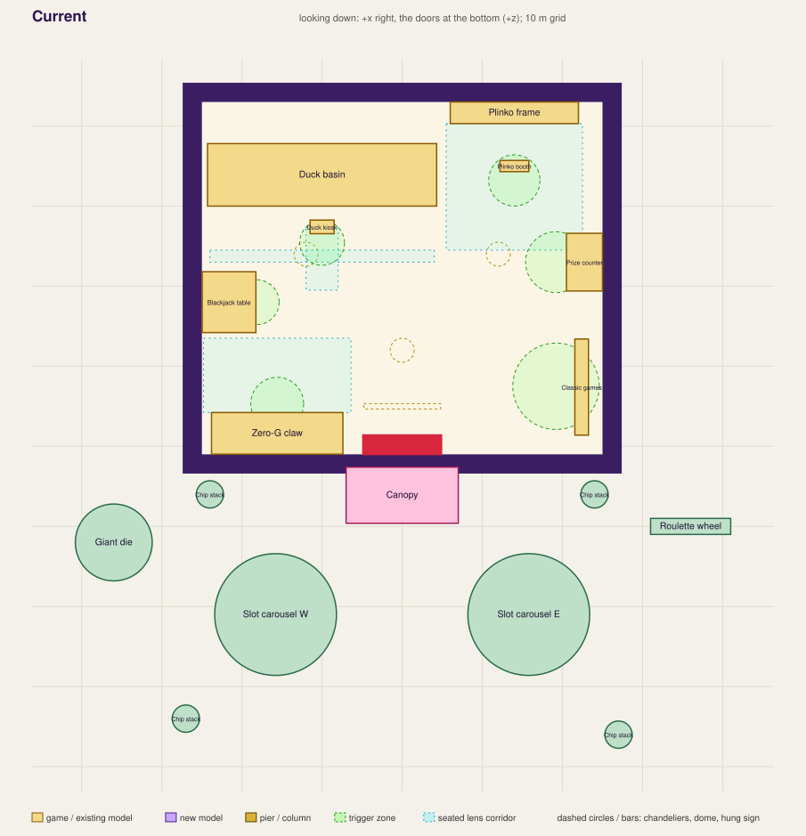
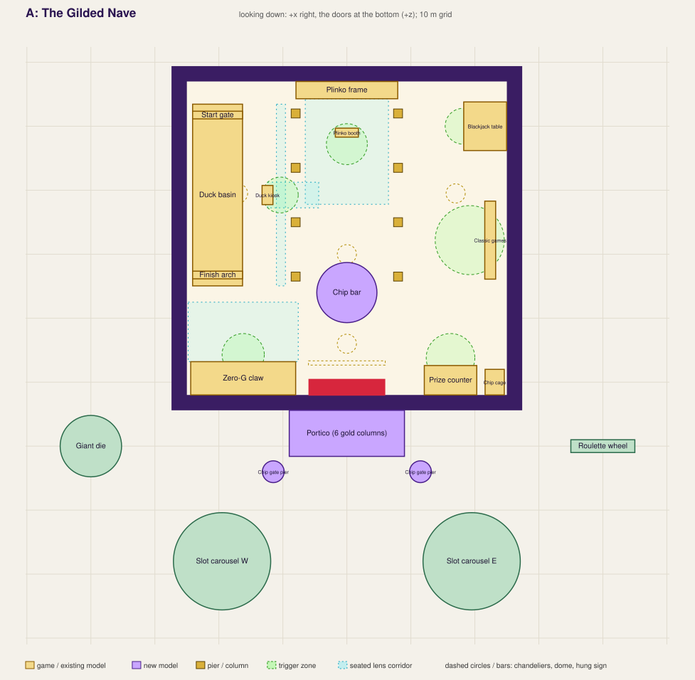
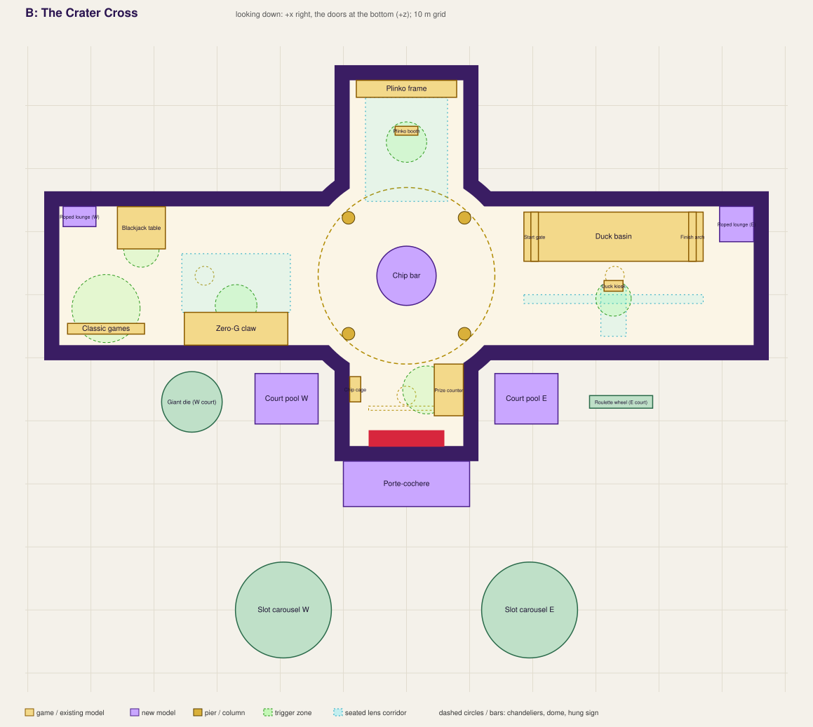

# Lucky Crater Casino: two revisions

Two proposals for rebuilding the casino's structure (the hall, its exterior and where everything stands) in the look the
interior models now have. **Layout B (the Crater Cross) is built**: `src/casinoPlan.js` holds its numbers, `src/casinoWorld.js`
builds it, `tools/blender/build_hall.py` makes its kit (`src/assets/hall.glb`). **Layout A stays a proposal.** The sections
on B below describe the plan as drawn; where the build differs the note says so (the crossing's rounded corners are r 16.5,
not 15; the wings run from x 10 to 55; the cage is 4 m by 1.75 m). What exists is the data and the checks:

- `tools/casino-layouts.mjs`: every footprint, trigger zone and seated-camera corridor of the current hall and of both
  proposals, with the checks below. Layout B's numbers are read from `src/casinoPlan.js`, the same ones the game builds from,
  so the check fails if the game drifts from the plan (and it checks that the wall colliders tile the outline and leave the
  floor and the doors free). `node tools/casino-layouts.mjs` checks them, `node tools/casino-layouts.mjs docs`
  redraws the plans, `node tools/casino-layouts.mjs dump` lists the placements.
- `docs/casino-layout-current.svg`, `-a.svg`, `-b.svg`: the plans (looking down, +x to the right, the doors at the bottom).
- `tools/casino-zfight.mjs`: a Z-fighting audit that runs against the live scene (section "Z-fighting"), and
  `tools/casino-shots.mjs`: screenshots from fixed vantage points. Dev-only, like `tools/winch-ride.mjs`.

All positions are in the casino's own frame, metres: +x right, +z toward the doors, y up (what `casinoWorld.js` calls
local). The proposals share one kit of Blender pieces; they differ in plan.

## What the hall has to live with

These come from code and models outside the shell and hold for both proposals.

| Constraint | Where it comes from | What it means |
|---|---|---|
| The seated cameras fly through the hall | `casinoGames.js` `view()` | Each game needs air in front of it, with nothing taller than the lens in the way: **claw** 14.5 m from its wall (the lens hangs 6.6 m off the glass at 16:9, 9.2 m at 4:3, 3.95 m up, 16.4 m wide); **Plinko** 17 m (6.4 m up); **Duck Derby** two lenses, the kiosk's (9 m up, 7.5 m out) and the race's (6.2 m up, 7.5 m off lane 0, following the lead along the whole track); **blackjack** 3 m. A mezzanine, a beam or a pier under those paths is a bug. |
| Each game model has a size and a facing | `build_claw.py`, `build_plinko.py`, `build_duck.py`, `build_blackjack.py`, `slots.glb` | Claw 16.4 x 5.2 x 8.4 m, glass away from its wall. Plinko frame 15.9 wide x 14.4 tall, its back on a wall, board 2.0 m out, the booth 6.0 m out. Duck basin 28.4 x 7.8 m with rails, odds board 17.2 x 6.8 m on the wall behind it (y 5 to 11.8), kiosk 5.4 m off lane 0 (was 4.1; see below). Blackjack table 7.6 wide, its dealer's counter on a wall, stool 4.7 m out. Classic games: four cabinets 3.2 m apart. Prize counter 8.2 long x 4.6 deep from its wall. |
| Trigger zones | `casinoGames.js` `STATIONS` | Circles of 2.8 to 5.4 m round a station. Two must not overlap (the prompt is ambiguous) and none may reach another game. |
| Orientations the code can already take | `bjPt` (`BJ.yaw`), `clawPt`, `CLAW.yaw`, `slots` take a yaw; the prize counter and the Plinko hang off `PRIZE.x/z` and `PLK.x/z` | Moving and turning blackjack, claw, classic games and the prize counter is a constants change. The **Duck Derby is written along x** with its viewers on +z (kiosk, both lenses, the odds board): turning it needs a `duckPt` like `bjPt`. Plinko faces +z. |
| The forecourt | `settlements.js` `dressCasinoLot` | The boulevard's funnel starts at the doors (`DOOR_Z` 13) and runs to the plaza at z 98; lamp posts at z 50, 61, 72; car parks at x +-30..74, z 53..87; the pylon sign at (26, 118). The slot carousels, die, roulette wheel and chip stacks are in `buildCasino`. Anything the proposals move out front stays clear of these. |
| "Am I inside the casino?" | `main.js` `where` (HALL.W, FRONT, BACK, H) | A rectangle test. Proposal B is not a rectangle: it needs a point-in-hall function. |
| Walls are code boxes | `casinoWorld.js` `wall()` and `col()` | A Blender shell supplies `col.*` empties (the GLB contract); the rectangular hall needs six, the cross about twenty. |
| Patrons and the crowd | `yardSpots`, `crowd` in `buildCasino` | Both lists are positions in the old hall and are rewritten for any layout (they are data). |
| One merged draw | `staticBake.js`, the world's merge of frozen pieces | New pieces come as frozen statics (`stat`) so they merge; only what turns or is painted stays dynamic. |

## The look the shell is being brought up to

The reworked interior is one vocabulary. The shell takes it, so the hall reads as the room those models were made for.

| Element | Where it is now | What the shell takes from it |
|---|---|---|
| Plum lacquer with a gold girdle | blackjack table, Duck basin, prize counter, Plinko cabinet | Wainscot and plinths; every wall starts with a 1.7 m lacquered band and a gold girdle |
| Cream suit panels in brass frames, between gold pilasters | blackjack (eight), prize counter (five), Plinko booth | The suit panels move from floating 4 m billboards onto the walls as framed panels with real relief |
| Gold fluted pilasters, ball finials | Duck gate, finish arch | Piers, pilasters and the parapet's finials |
| Brass posts and velvet rope | Duck rails | Every rope line (the door queue, the bar, the lounge) uses the Duck's post and rope pieces |
| Padded leather rail on gold studs | blackjack | The bar's rail, the lounge sofas |
| Cornice, coffered frames, pennant-jewel trim | Duck board and kiosk, blackjack counter | Cornice, coffered ceiling, frieze |
| Thin neon in a channel (cyan under the rail, pink on the top) | blackjack, prize counter | Cove lighting: glow strips sit in a recess, never on a face |
| Hung gold-and-neon signs on chains | `welcome_sign`, `wall_sign` | Kept; the new bays are drawn round them |

What the shell is today, for contrast: four flat `0x2a1450` boxes, a flat paper plane laid 2 cm off each wall, four glowing
strips, a flat ceiling plane 2 cm under the roof box, 22 suit icons as 4 m planes round the outside, a gold slab, a plum box and a sphere for a
roof, a pink box on poles for a canopy. The prize counter and the slots' neighbours are built from primitives in
`casinoWorld.js`, not in Blender.

## The hall today

50 x 44 m inside (2,200 m2), 16 m high. The games hug the walls: claw and blackjack on the left, Duck basin and Plinko on
the back wall, classic games and the prize counter on the right. The middle (x -17..17, z -17..0) holds three chandeliers.
Someone walking in from the doors faces nothing, and nothing in the room is bigger than the person.

What the checker finds in it: the kiosk stands **1.75 m** from the Duck basin's near rail, under the 2.4 m of a walkable
gap (both proposals move it out to 3.1 m; it is one constant, `DUCK.kiosk`). Everything else holds.

## Layout A: The Gilded Nave

**The idea.** One axis, one great room. You come in through the doors (12 m wide, 10 m tall), cross a foyer, and look down a
nave to the Plinko cabinet, 14 m tall and gold, which closes the far end like an altarpiece. Gold piers carry arcades along
the nave; behind them the left wing is the Duck Derby and the right wing is the card room and the arcade. The claw and the
prize pavilion stand either side of the doors, so the entrance is flanked by the two things you play and the thing you spend
at. The old hall's central void becomes the **Chip Bar**, a round island bar under a gilded halo.

Footprint: **50 x 49 m inside** (2,450 m2: 5 m deeper than today), 16 m high at the wings and about 20 m over the nave. Piers
at x = +-8 (the Plinko frame is 16 m wide: the nave and the cabinet are the same width), z = -6.5, -15, -23.5, -32.

| Piece | Position (x, z) | Size / facing | Note |
|---|---|---|---|
| Zero-G claw | x -24.4..-8.0, z 6.8..12.0 | against the front wall, left of the doors | its lens corridor (x -24.8..-7.6, z -2.5..6.8) is the foyer's floor: nothing stands in it |
| Prize counter | x 12.1..20.3, z 7.4..12.0 | against the front wall, right of the doors, facing -z | `PRIZE` gets a facing; the clerk's side is the wall |
| Chip cage (new) | x 21.6..24.6, z 8.0..12.0 | beside the counter | the cashier's grille: chips to credits, a sibling of the counter |
| Chip Bar (new) | centre (0, -4), r 4.7 with its stools | island bar, stools included | stands on the axis, 16 m from the doors; 3.3 m of floor to the pier line each side, 2.8 m at the nearest pier |
| Plinko | frame x -8.0..8.0, z -37.0..-34.3; booth (0, -29) | back wall, centred on the axis | `PLK` to (0, -35); lens corridor x +-6.5, z -34.3..-17.8 |
| Duck Derby | basin x -24.1..-16.3, z -33.5..-5.1 | along the left wall, **turned** a quarter: viewers walk the left wing | needs `duckPt`; the odds board hangs on the left wall; kiosk (-12.4, -19.3) with its station at (-10.4, -19.3) |
| Blackjack | table x 18.3..25.0, z -33.8..-26.2 | right wall, back corner, facing -x | `BJ.yaw` -pi/2 |
| Classic games | cabinets x 21.6..23.3, z -18.3..-6.1 | right wall, facing -x (as now) | station (19.2, -12.2) |
| Piers (new) | (+-8, -6.5 / -15 / -23.5 / -32) | 1.4 m square, gold, 16 m | the Duck race lens passes 0.9 m from them (the lane is 7.5 m off lane 0) |

Gaps the checker measures: Plinko frame to the nearest pier 1.6 m, Chip Bar to the nearest pier 2.8 m, kiosk to the Duck rail
3.1 m, every pair of different games at least 7.9 m apart. The foyer (z -2..12) has no pier in it: the claw's lens flies there.

**Built in Blender** (new `build_hall.py` -> `hall.glb`, `build_facade.py` -> `facade.glb`, and the prize counter moved out
of code into `prize.glb`; the shared kit is the same in B):

| Model | What it is |
|---|---|
| `hall_bay` | one 8 m wall bay: lacquer wainscot with three cream suit panels in brass frames, a gold girdle, a damask field that is the wall's own face, pilasters, a cornice over a cove channel |
| `hall_pier` / `hall_arch` | the nave's gold fluted pier on a plum plinth, and the 9 m arch between two piers with a suit medallion on its keystone |
| `hall_coffer` | an 8 x 8 m ceiling bay: gold ribs, plum coffers, a glow rosette sunk in each. It replaces the flat ceiling plane and the four strip lights |
| `hall_floor` | the whole floor as one mesh with the carpet's border and the runner inlaid (no overlay planes) |
| `hall_door` | the grand doors: gilded frame, a pediment with the four suits, lamp brackets |
| `hall_bar` | the Chip Bar: plum island, eight suit panels, a leather rail on studs, a brass back-bar ring, a gilded halo with six pendant lamps, a spinning `chip` pivot above |
| `prize_counter` | today's primitives, rebuilt in Blender with the same parts and a proper cabinet; the 15 prize models stay code-made or move as a pivot list |
| `facade_bay`, `facade_portico`, `facade_parapet`, `facade_clerestory`, `facade_dome` | see below |

**Outside.** The box becomes a palace front: plum lacquer ashlar with a gold pilaster every 8 m and a cream suit relief in a
recessed brass frame in each bay (the 22 floating suit planes round the building go); a six-column gold portico projecting 7 m over the doors
(replacing the pink box on poles); a gold balustrade parapet whose finials carry the chase bulbs (replacing the strings of
bulbs); the nave raised as a clerestory of five arched glow windows under a ribbed gilded dome and lantern (replacing the
sphere), with the rotating sign on a gilded mast behind it. The slot carousels move out to (+-19.5, 38) so they clear the
portico, with the same gilded kiosk pieces; the die and the roulette wheel go on gilded plinths either side; the four chip
stacks become two chip-stack gate piers by the portico steps. The pink canopy goes.

**Code touched.** `HALL` (the box and the door), `BJ`, `CLAW`, `PLK`, `PRIZE`, `CLASSIC` (positions, facings), `DUCK`
(a frame and `duckPt`, the lenses in `view()`), the odds board's mount, `yardSpots` and `crowd`, the door's mouth in
`dressCasinoLot` (`DOOR_Z`, the funnel).

**Risks.** Turning the Duck Derby touches the most code of anything here (the race lens in particular). The nave's long view
only works if the Plinko is the brightest thing in it. The wings' ceilings have to stay clear of the board's top (y 11.8).

## Layout B: The Crater Cross

**The idea.** A cruciform building round a domed rotunda, so every game has a room of its own and the casino reads from
outside as a landmark rather than a box. The doors open into a grand foyer (the prize counter on one side, [the chip cage, dropped since: chips are exchanged at the counter] on the
other); beyond it is the rotunda under the dome and the Chip Bar; the north arm ends in the Plinko cabinet; the east wing is
the Duck Derby; the west wing is the claw, the card room and the arcade. Rooms have different heights, so the rotunda is
the tallest and the wings are the most intimate.

Footprint (as built): a crossing with four rounded corners (r 16.5) under a drum and a dome, the foyer and Plinko arms 18 wide,
wings **22 wide x 45 long** (x 10 to 55 either side), 16 m high throughout (the wings' lower ceilings are not built).
**3,089 m2** inside (40% more than today) and 110 m of frontage.

| Piece | Position (x, z) | Size / facing | Note |
|---|---|---|---|
| Prize counter | x 4.4..9.0, z 1.0..9.2 | foyer's east wall, facing -x (as now) | station (3.2, 5.1) |
| ~~Chip cage (new)~~ | | dropped after the build: chips are exchanged at the prize counter | |
| Chip Bar (new) | centre (0, -13), r 4.7 | the rotunda's middle | under the dome; four piers at r 13.6 on the diagonals |
| Plinko | frame x -8.0..8.0, z -44.0..-41.3; booth (0, -36) | the north arm's end wall | lens corridor z -41.3..-24.8: the lens itself hangs at the rotunda's north edge, 17 m from the board |
| Duck Derby | basin x 18.6..47.0, z -23.1..-15.3 | east wing, along x on its north wall: **the orientation the code already has** | kiosk (32.8, -11.4); the odds board is 17.2 m of the wing's 42 m north wall; the lenses' z margin is the reason the wing is 22 m wide (at 20 m the kiosk's lens went through the south wall) |
| Zero-G claw | x -35.2..-18.8, z -7.2..-2.0 | west wing, south wall, facing -z (as now) | lens corridor x -35.6..-18.4, z -16.5..-7.2 |
| Classic games | x -53.7..-41.5, z -5.5..-3.8 | west wing, south wall, west of the claw, facing -z | station (-47.6, -7.8), its zone clearing blackjack's by 2.7 m |
| Blackjack | table x -45.8..-38.2, z -24.0..-17.3 | west wing, north wall, facing +z | `BJ.yaw` 0 |
| Roped lounges (new) | W x -54.4..-49.2, z -24..-21.5; E x 49.6..55, z -24..-19 | wing ends, sofas and a brass rope | decoration, no trigger |

Gaps the checker measures: Duck basin to the east lounge 2.6 m, kiosk to the basin 3.1 m, blackjack to the west lounge 3.4 m,
prize counter to the nearest rotunda pier 3.4 m; every pair of different games is at least 6 m apart.

**Built in Blender** (`build_hall.py`, 17 models): `hall_bay0..3` (a bay with half a gold pilaster each side, a lacquered wainscot with
a framed suit panel, a tall arched panel with a cyan line), `hall_filler`, `hall_coffer`, `hall_medallion` (a compass star with the
four suits), `hall_bar`, `hall_sofa`, `hall_table`, `hall_gate`, `facade_panel0..3` and `facade_crown` (the drum, the
ribbed dome and the lantern). What differs from the study: the long horizontal pieces (skirting, girdle, cornice, the damask
field, the outside's plinth, belt and cornice) are rings made in the game from the outline, not parts of a bay, so they meet at the
corners with a mitre and never share a plane; the prize counter stays as it was (code-built, it is the look the rest follows).

**Outside** (as built). A plum drum (r 16) with 24 gold pilasters and lit windows carries a plum dome (r 13) with 24 gold ribs and a
lantern, with the rotating sign on its mast; the walls are plum lacquer on a gold plinth with a belt, a cornice and the pink neon
in its channel, and a framed suit relief every 6.5 m; the doors have a gold frame with a pediment, and a pink marquee canopy stands
clear of it. The two re-entrant corners between foyer and wings are pocket courts: the die stands in the west court and the
roulette wheel in the east. (Not built: hipped wing roofs, mirror pools, gilded plinths for the die and the wheel.) The slot
carousels stand at (+-19.5, 40). The ring road and the lot are untouched; the boulevard starts at the new doors.

**Code touched.** Everything in A except turning the Duck Derby, plus: the hall's shape (`wall()` boxes become `col.*`
empties from the shell), the "inside the casino" test in `main.js`, the foyer door at z 14 (`DOOR_Z` moves 1 m), the
corners of the cross for the patrons' paths (their `path` is a list of points: with rooms they need doorway waypoints), and
the pocket courts in `dressCasinoLot`.

**Risks.** The biggest footprint (110 m wide) and the most new geometry. Patrons need waypoints. The wings feel remote from the
doors; the foyer's prize counter and the rotunda's bar are what pulls people along.

## Side by side

| | A: The Gilded Nave | B: The Crater Cross |
|---|---|---|
| Idea | one great room with an axis | rooms round a domed rotunda |
| Inside | 50 x 49 m, 2,450 m2 | 3,050 m2, rotunda r 15, wings 22 x 42 |
| Exterior | a palace front with a dome behind the portico | a landmark: drum, dome and four arms |
| Games turned or moved | all six move; the Duck Derby turns a quarter | all six move; nothing turns except blackjack, the classic cabinets and the prize counter (constants only) |
| New Blender pieces | about 10 | about 14, of which 7 are the same as A's |
| New code | `duckPt`, positions, the door | all of A's less `duckPt`, plus the polygon hall and patrons' waypoints |
| What it gives up | the nave is a single volume, so the games compete for attention | a long walk; wings can feel empty |
| Fit with the existing models | the Plinko's 16 m frame sets the nave's width | the Duck basin keeps its orientation |

**Recommendation.** Build the shared kit first (`hall_bay`, `hall_pier`, `hall_arch`, `hall_coffer`, `hall_floor`, `hall_bar`,
`hall_cage`, `hall_door`, `prize_counter`): it is what both plans are made of, it is the same work whichever is chosen,
and it can be looked at in the Asset Row before the plan is. Then pick A for the lower risk and the stronger single view,
or B if the casino should be a landmark seen from the ring road. If the choice cannot wait, A.

## Rules the checker holds every layout to

`node tools/casino-layouts.mjs` fails (for the proposals; the current hall is a study) when any of these breaks:

1. Every footprint lies on the floor; a free-standing one (the Chip Bar, the kiosk) keeps 2.4 m from the walls.
2. Two footprints that are not one build (a counter and its cage, a basin and its gates, a slot row) are 2.4 m apart or
   more; a pier is 1.2 m from anything.
3. A trigger zone reaches no other footprint and no other trigger zone, and stays on the floor.
4. Each seated camera's corridor (above) lies on the floor and holds nothing taller than 0.7 m under the lens, other than the
   game it belongs to.

The 2.4 m is the narrowest gap left to walk through. The corridors and zones are the numbers in the code, written at the
top of the script next to where each comes from. The tool does not know about heights above head height (the halo, the
dome), sight lines to signs, or crowds; those are looked at in the engine (Asset Row and screenshots).

## Z-fighting

Two surfaces fight when they sit on one plane (to within what the depth buffer can tell apart), face the same way and
overlap. The game's depth buffer is 24 bits with near 0.5 and far 9000, which separates surfaces 0.1 mm apart at 30 m and about
1 mm at 100 m. So the rule is **2 mm**, and the working rule is more careful: 2 cm.

**Result** (see the CHANGELOG): the hall as it was had 812 overlapping pairs; the Crater Cross, with the kit, has a handful, none over
1 m2 in the new work. `audit_coplanar()` in `kit.py` is the build-time half, and `build_hall.py` passes it.

`tools/casino-zfight.mjs` runs against the game (`npx vite --port 5199 --host 127.0.0.1`, then `node tools/casino-zfight.mjs`).
It walks every mesh near the casino, brings every triangle into the casino's frame, files them by plane and lists each pair
from different meshes on one plane (normals within 1 degree, offsets within 2 mm) that overlaps by more than 1 cm2. It
skips the black outline shells (they draw back faces only) and the undersides of things on the floor. It can be run again after any change; `EPS=0.01` widens the plane tolerance
to 1 cm.

**The hall today** (263,671 triangles in 747 meshes): **812 overlapping pairs**. The largest is 5.8 m2 and the picture is
consistent: the Duck model has gold and plum faces on one plane at its finish arch's top (5.8 m2) and its basin's base
(1.1 m2 each end); the shell has neon trims that lie exactly on each other (the cyan corner posts and the pink roofline, 0.12 m2 at
each corner), gold and plum faces of the hung welcome sign's frame and the blackjack wall sign's frame on one plane (0.8 and 0.6 m2), and
the door frame's gold pieces (x +-5, z 13) coincide in pairs (0.18 m2 each). Most are small and few are visible from one place, which is why
the hall looks fine, but they are the faces a lens finds when it moves.

The policy for the new work, in the order the pieces are made:

1. **Stand-offs, by kind.** A trim piece or a panel stands 5 cm proud of the face it is on; a brass frame 3 cm proud of its
   panel; a relief or an inlay 3 cm; a decal plane (neon text, the odds board, the screens) 2 cm with `polygonOffset` as now; glass
   2 cm clear of what is behind it (the display case's lesson).
2. **No overlay planes on a floor.** The floor is one mesh per room with its border, runner and star inlaid in the same mesh,
   or raised 3 cm as geometry.
3. **Walls are walls.** The shell's wall has its recesses and openings cut into it. Panels are not laid over a face; the
   wallpaper plane (2 cm off the wall) and its neon bands (on the paper) go.
4. **The ceiling is the roof's underside.** Coffers are modelled; no second plane sits 2 cm under the roof box.
5. **Neon in a channel.** A strip sits in a recess in the cornice, never on a face; two glow trims never cross at one edge
   (the 16 corners above).
6. **Drop what is never seen.** A piece standing on the floor has no bottom face; a column has no cap on a cap.
7. **The builder checks itself.** `kit.py` gets `audit_coplanar()` (face pairs of different objects with the same normal, an
   offset under 5 mm and overlapping area) and every new builder calls it the way `build_blackjack.py` calls `audit()`: a build with
   a pair fails. After a model is in the game, `tools/casino-zfight.mjs` is the second check. The target is no pair at or over
   1 cm2.

What the audit cannot see: a fight between two textures on one mesh, a fight that depends on `polygonOffset`, and anything
beyond the volume it covers (x +-70, z -50..60 round the casino). Screenshots from a fixed set of vantage points (the doors,
each wall, the ceiling, the exterior) cover those; headless Chromium with swiftshader draws them in a few seconds a frame.

## How it gets built

1. **The kit**, one model at a time in the Blender skill's order (`build_hall.py`, then the facade, then the prize counter):
   `MOONRUNNER_REPO=. python3 tools/blender/build_hall.py`, `npm run optimize:glb`, the viewer
   (`tools/viewer.html?m=casino&part=hall`) and the **Asset Row** (each piece an item; the Row's headless check that every
   item builds).
2. **The shell in the game**, behind a flag so the old hall stays until the new one is right. Both plans use the same
   `HALL`-driven builder; the plan is the data (a list like the script's).
3. **The games move** one at a time, running `tools/casino-layouts.mjs` as the gate (it takes the same constants as the
   game: the plan's numbers go into `casinoWorld.js` and the script's data together).
4. **Review**: screenshots from the vantage points (and the seated lenses), `tools/casino-zfight.mjs`, and the
   Asset Row.
5. **The forecourt** last (`dressCasinoLot`), once the doors are where they stay.

## What is open

- **Which plan.** Everything above is the same for both until step 2.
- **Is a taller nave in A wanted?** The roof over the nave is 4 m higher than the wings, which gives the clerestory but costs
  the game a second roof volume.
- **Turning the Duck Derby (A).** It is the largest single code change. The alternative, keeping it along x on the back
  wall, puts the basin across the nave and takes the Plinko off the axis.
- **Should B's wings be 42 m?** It is what the Duck basin, the prize counter and the lounge need together; making them 36 m
  drops the east lounge and shortens the frontage to 98 m.
- **The 15 prize models** (`PRIZES_3D`) are primitives in the code; they could move into `prize.glb` as pivots or stay as
  they are. Their look is not in question.
