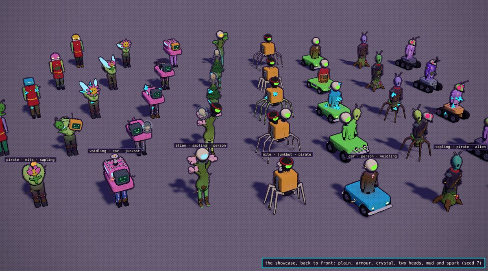
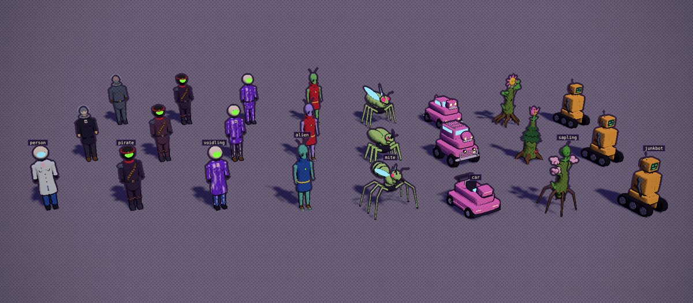
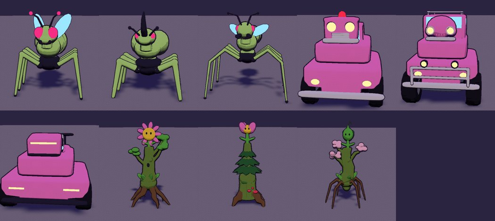
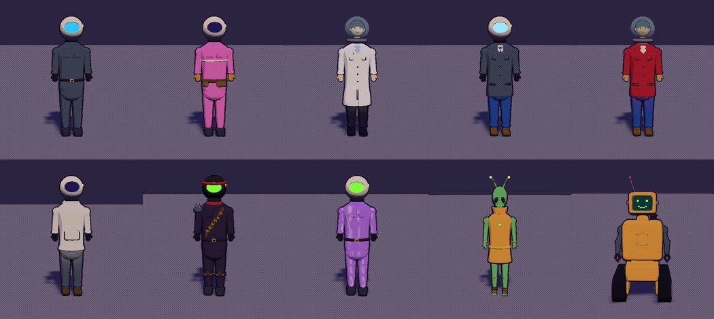
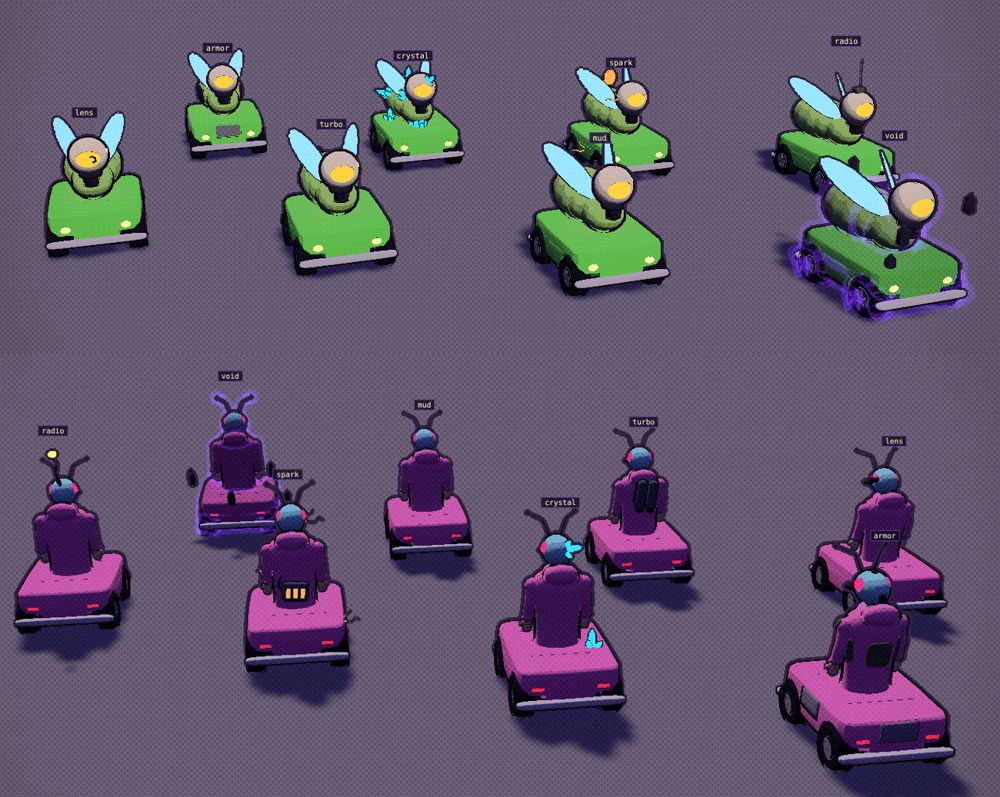

# The chimera builder

Every chimera in the game is put together by `src/chimerabuild.js` from its gene sheet: the races, the pen, followers, the cards' portraits,
the wild mites and the Mega Mite. Its parts are the chimera kit, built in Blender (`tools/blender/build_chimera.py` ->
`src/assets/chimera.glb`). Look at it in the lab: `npm run dev`, then `/tools/chimera-lab.html`.

## The kinds and their looks

| Kind | Legs | Body | Head |
|---|---|---|---|
| Mite (3 looks) | a thorax on six long legs; a beetle's stout spiny legs; a strider's six long legs, two knees each | a segmented abdomen with glassy wing cases; a beetle's domed shell; a wasp's banded gaster and small wings | great compound eyes; a rhinoceros beetle's horn; an ant's mandibles |
| Car (3 looks) | a coupe's lower half; an off-roader's (lifted, knobbly tyres, bull bar); a racer's (low, slim tyres, skirts) | a coupe's glass cabin; a van's tall cab with a roof rack; a roadster's open cockpit and wing | a box face; a bug face with round lamps; a wedge with a lamp bar |
| Sapling (3 looks) | a mossy bulb on gnarled roots; a stump with toadstools; a mandrake's tuber on spidery roots | a knotted trunk with leafy branches; a conifer in tiers of needles; a blossom tree | a daisy; a tulip; a leafy bud |
| Settler | the suit's legs and boots (coveralls, engineer); trousers and shoes (lab coat, jacket, hoodie) | coveralls (an engineer adds a tool belt, pouches and a band); a lab coat; a jacket (a trader adds a tie); a hoodie | a sealed helmet and visor; a bare head in a fishbowl |
| Void-touched | a settler's parts, in purple with violet veins and a green visor | | |
| Pirate | patched knees, tall studded boots | a bandolier of brass shells, a red scarf, a spiked pauldron | a black helmet, a green visor, a red bandana, claw marks |
| Vrill | bare slender legs, feet bound in strips | a tunic with a high collar and a gem clasp; long arms, three fingers | a tall skull, great dark eyes, antennae with glowing tips |
| Junkbot | two tank treads under a chassis | a scrap torso: rust patches, a hatch, a vent, an exhaust stack, claw arms | an old CRT with a pixel face, a whip aerial |

**A settler wears the outfit of the NPC you scooped up**: `makeFigure` reports it (archetype, colours, headgear), the jar item keeps it
(`alchemy.js add`), and `spliceGenes` hands it on (`genes.looks`). A chimera without one (a rival, a cheat) has one drawn from its seed.
The player's orange is never drawn.

## How a part is made

- **One surface per part.** Each colour region is built from overlapping shapes, voxel-remeshed into one watertight surface, smoothed and
  reduced to its triangle budget: limbs grow out of bodies with no seam and one outline goes round the whole part.
- **Details cut in, not laid on.** Sockets, recesses, grooves, the zip, panel lines, tread and the bolt and rivet holes are Boolean cuts;
  lamps, eyes and glass sit inside them. A cut can colour its own faces (a vent or a rivet hole dark, a dent bare steel) so it reads. The outline is drawn from the surface before the cuts (an `inkonly` copy), and it is the
  game's camera-scaled outline (`inkMatNear`): no thicker on screen up close than at the follow camera's distance.
- **Joints built in.** A body's base is a skirt that wraps down over the legs and a head ends in a stub that goes into the body; the hides
  shade into each other's colours across the joint.
- **Two heads**: each body has a second, forked form with a neck for each head (the trunk splits, the necks grow from the shoulders, the
  car's nose grows two pods).
- **Machines are built as machines**: the junkbot's boxes skip the organic remesh, so their panels stay flat and their edges and cuts crisp.
- **Far away** each part swaps to its lighter copy (`_far`, about a third of the triangles; a `THREE.LOD` at 22 m times the chimera's size).
- **Budget:** a plain chimera is 6.9k to 13.1k triangles near (median 9.4k), 2.1k to 4.0k far; the mutations add up to a few thousand.

## Mutations

- **Fitted to every part in Blender** (shown on a chimera that has them): **armour** (plates shrinkwrapped onto the part, rivets cut in:
  bare metal on a car or junkbot, dark plated chitin on a mite, stone-grey bark slabs on a sapling, olive vest panels and pads on a person;
  a junkbot's rust patches go under them), **crystal** (clusters rooted in the surface, found by ray casting), **mud** (a crust caked on
  the legs and the underside, drips running down).
- **Devices on sockets fitted to the surface**, in the family's form: **spark** (a battery pack; a bioelectric sac; a tesla coil; glowing
  seed pods), with arcs crackling on the flanks; **turbo** (a jet pack; three jet vents; an engine with its stacks; a smouldering hollow
  log); **radio** on the head (a field radio; a third feeler; an aerial and a dish; a leaf dish); **lens** on the eye (a jeweller's
  eyepiece; a big lensed headlamp; a glass eye bud). With two heads, the lens goes on the first and the radio on the second.
- **Void** darkens the whole creature and wraps it in one violet aura (two shells round every piece, a bright one and a dim outer one,
  blended by MAX so they merge, and drawn only outside the silhouette, down to the ground).
- **The Triple Crown**: gold laurels on the head.

## The files

- `src/chimerabuild.js`: the builder (`makeChimera(genes)`, `preloadChimeras()` at boot, `chimeraBuilder()` for the lab)
- `src/chimera.js`: `makeChimera`, `makeMite` and the splicing and stats re-exports (the old procedural models are gone)
- `tools/blender/build_chimera.py` (the contract is in its header), with `chimera_common.py` (the pipeline, the fitting, the far LOD),
  `chimera_people.py`, `chimera_mite.py`, `chimera_car.py`, `chimera_sapling.py`, `chimera_junkbot.py` and `chimera_devices.py`
- `tools/chimera-lab.html`: the lab (parts, a settler's outfit and headgear, mutations, seed, size, the crown, the far LOD; a random
  chimera, a grid of twelve, each mutation, every kind, the showcase). Query parameters for screenshots are in the file.
