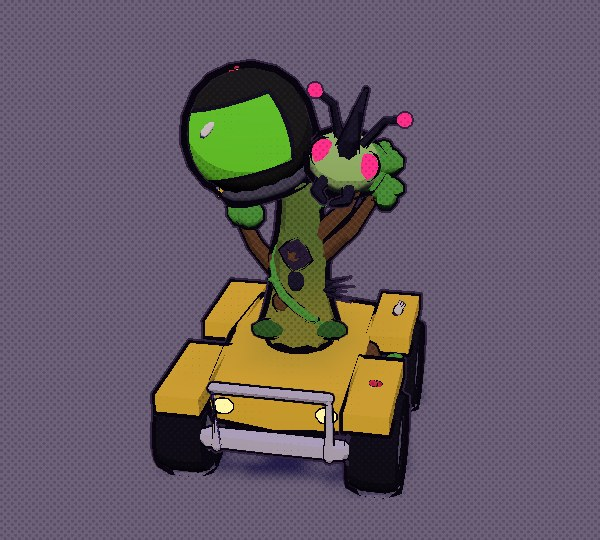
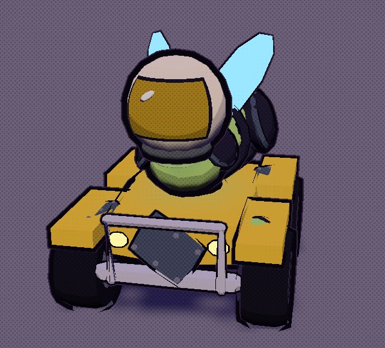
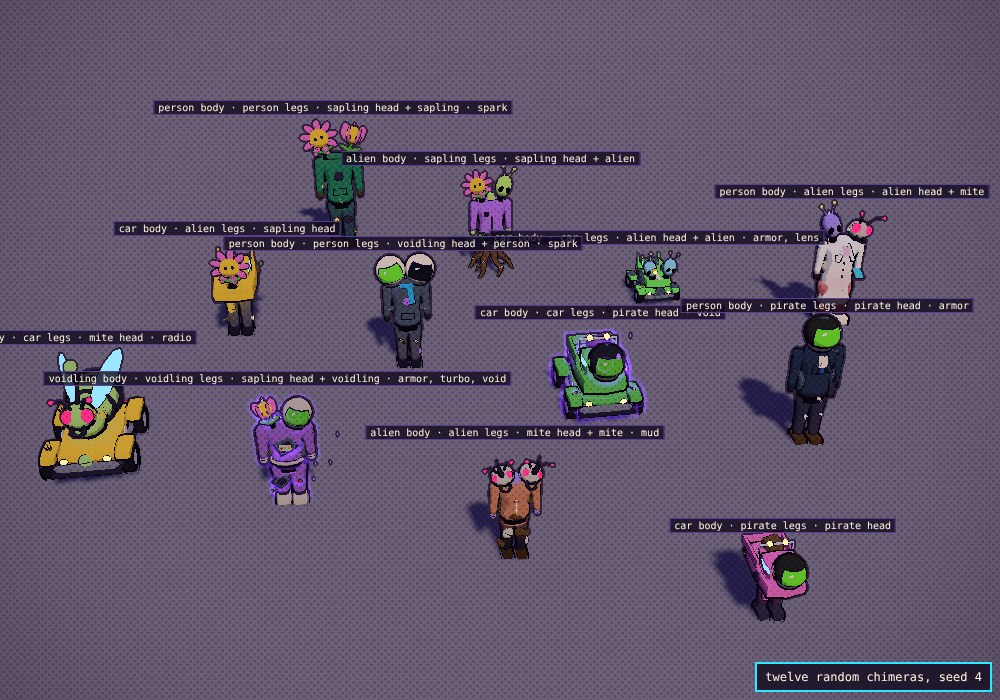
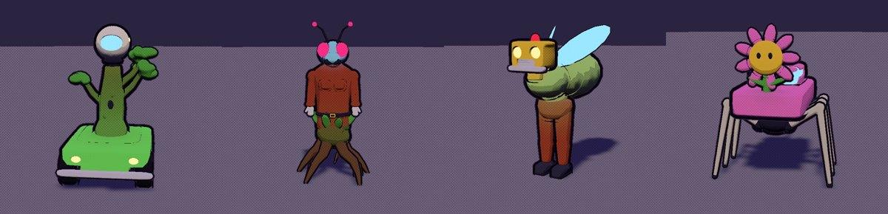
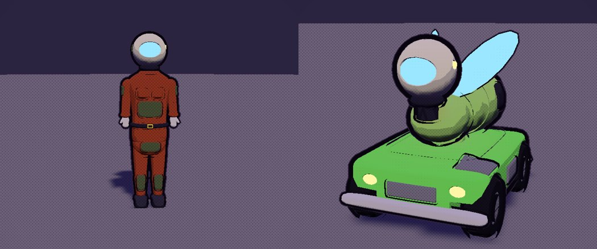
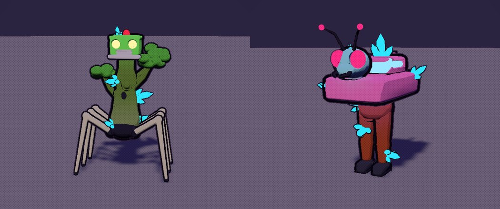
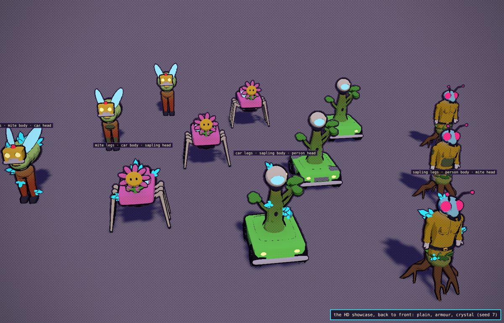

# The chimera builder (round three)

A chimera is no longer three creatures stacked up: `src/chimerabuild.js` puts it together from its gene sheet, fusing the parts where
they meet. (Grafts, the other parents' traits growing on each part, were tried and taken out: too noisy.) **Not in the game yet**: the game still draws chimeras with `src/chimera.js`
until this look is signed off. Look at it in the lab: `npm run dev`, then `/tools/chimera-lab.html`.

| A blend | Armour on a mite-car-settler |
|---|---|
|  |  |

## The HD showcase (up for sign-off)

The parts rebuilt at full resolution in Blender (`tools/blender/build_chimera_hd.py` -> `src/assets/chimera_hd.glb`, 611 KB compressed):
person, mite, car and sapling, one look each, with armour and crystal fitted to every part. In the lab: **HD SHOWCASE**, or tick **HD
parts** (`?showcase=1`, `&hd=1`); in the Asset Row: `creatures.builderhd`, beside the builder's line-up.

| Armour, fitted | Crystal, grown in |
|---|---|
|  |  |

How the parts are made (the Blender tools that answer the last round's notes):

- **One surface per part, not stacked primitives.** Each colour region is built from overlapping shapes, then voxel-remeshed into one
  watertight surface (Remesh), smoothed (Smooth) and reduced to its triangle budget (Decimate). Limbs grow out of bodies with no seam
  and one outline goes round the whole part.
- **Details cut in, not laid on.** Lamp and eye sockets, window recesses, wheel arches, the zip and pocket flaps, the grille, bark furrows,
  the tree's hollow, seed pits, tyre tread, and the bolt and rivet holes are Boolean differences in the surface; lamps, eyes and glass
  sit inside their sockets. The outline is drawn from the surface before the cuts, so a groove reads as a dent in the shading, not a
  black line.
- **The joints are built in.** A body's base is a skirt that wraps down over the legs and a head ends in a stub that goes into the body,
  so the builder adds no bridge between HD parts; only the colours bleed across.
- **Mutations fitted to the part.** Armour plates are shrinkwrapped onto each part's own surface and given thickness, with rivets cut in:
  bare metal on a car, dark plated chitin with a ridge on a mite, stone-grey bark slabs on a sapling, olive vest panels and pads on a
  settler. Crystal clusters are rooted 4 cm inside the surface (found by ray casting) and grow out along it. They come with the part and
  show only on a chimera with that mutation. The other mutations still use the kit's pieces for now.
- **Budget:** a part is 1.9k to 4.4k triangles, a chimera about 7k to 10k (armour adds 0.3k to 2.7k a part, crystal 0.1k to 0.3k).

Still to come once the look is signed off: the other looks and kinds (pirate, void-touched, Vrill, junkbot), the other mutations
fitted the same way, a far LOD, and wiring it into the game.

## How a chimera is put together

1. **Parts.** Legs, body and head (and a second head) are drawn from the parents as before (`spliceGenes`). Mites, cars and saplings come
   from the kit (`tools/blender/build_chimera_kit.py` -> `src/assets/chimera.glb`), each part in three looks, picked by the seed. The
   **human kinds are the game's own NPCs**, cut out of `models.js figureSpec`: a person is a settler in one of the NPCs' outfits (coveralls,
   lab coat, engineer, trader, elder, casual; never the player's orange), a pirate is the pirate you scooped (dark purple, black helmet,
   green visor), a void-touched is purple, a Vrill has its bare antennaed head. Their legs, torso and arms, and head come off the figure at
   0.7 (the head at 0.55) and keep its colours.
2. **Fused joints, no seams.** Each joint gives its size (the legs' hip, the body's base and neck, the head's base). The builder fills the
   gap with a bridge of hide that shades from the lower parent's colour into the upper's, and every part's hide shades toward its
   neighbour's colour near the joint (half way at the joint itself).
3. **Mutations, in the form of what they grow on:**
   - **armour**: plating on the flanks and tops of every part: riveted steel on car parts, steel-rimmed plated chitin on mite parts,
     cracked stone-grey bark on sapling parts, padded body armour on human parts
   - **crystal**: five to eight crystal clusters sprouting from anywhere on the body
   - **spark**: on the back, the body's kind of power (a tesla coil on a car, a glowing bioelectric sac on a mite, glowing seed pods on a
     sapling, a battery pack on a person), and sparks on a couple of flanks
   - **turbo**: on the back, an engine (a car), jet vents (a mite), a smouldering hollow log (a sapling), a jet pack (a person)
   - **radio**: on the head, a whip aerial and dish (a car), a third feeler with a receiver (a mite), a leaf dish (a sapling), a headset
   - **lens**: on the eye, a big lensed headlight (a car), a glass eye bud (a sapling), a jeweller's eyepiece (a mite or a person)
   - **mud**: caked on the legs and the underside
   - **void**: the whole creature darkens toward violet, wrapped in a shadowy purple aura, with void shards drifting round it
4. **The Triple Crown** sits on the head (the laurel halo).

## Still to do (after sign-off)

- Junkbot parts (it draws as a car for now) and the eight kinds' third looks where they are thin.
- Wiring it into the game: the race, the pen, the followers and the card portraits (`makeChimera` would call the builder), and remembering
  which NPC you scooped (so the chimera wears that settler's actual outfit, not one drawn from the seed).
- Retiring the old procedural models in `chimera.js`.

## The files

- `src/chimerabuild.js`: the builder (`chimeraBuilder()` loads the kit and returns `build(genes)` -> `{ root, anim(t, speed), height }`)
- `src/models.js`: `figureSpec` (an NPC's look and its labelled parts, which `makeFigure` bakes), `figurePiece` (a piece of one), `loadChimeraKit`
- `tools/blender/build_chimera_kit.py` -> `src/assets/chimera.glb`: the parts, mutation pieces and the crown (the contract is in its header)
- `tools/blender/build_chimera_hd.py` -> `src/assets/chimera_hd.glb`: the HD showcase's parts (`hd_<slot>_<kind>`) with their fitted armour
  and crystal (empties with role `mut`); the pipeline is in its header
- `tools/chimera-lab.html`: the lab (pick the parts, mutations, seed and size; HD parts; HD SHOWCASE; NEW SEED for other looks; RANDOM
  CHIMERA; a grid of twelve random ones; THIS ONE, EACH MUTATION). Query parameters for screenshots are in the file.
