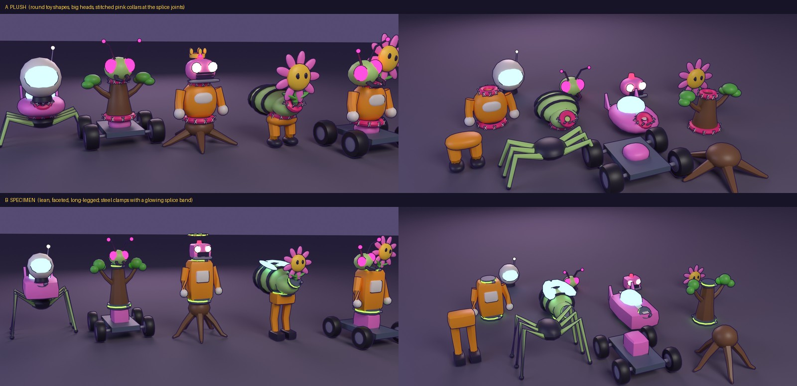

# Chimera parts kit: two proposals

The chimeras are still drawn by `makeChimera` in `src/chimera.js` (code-built parts, now at 0.72 of their old size so a field of six fits
the gate). These are two proposals for rebuilding them in Blender as a **kit of parts that fit together through sockets**, so the random
part draw (`spliceGenes` in `src/chimeragenes.js`: any body on any legs under any head) always gives a creature that holds together.
Neither is in the game yet: pick one (or a mix) and the other four kinds get built in that look, then the game swaps over.



- `chimera_proposals.jpg`: the review sheet (each proposal's blends, and every part on its own)
- `a_blends.jpg`, `b_blends.jpg`: five chimeras each, put together the way the game would. The first four are a Latin square of the four
  kinds (car body on mite legs with a person's head; sapling on car with a mite's head; person on sapling with a car's head, wearing the
  Triple Crown; mite on person with a sapling's head). The fifth has two heads on one neck (a mite's and a sapling's).
- `a_closeup.jpg`, `b_closeup.jpg`: the splice joints up close
- `a_parts.jpg`, `b_parts.jpg`: every part on its own (legs in front, then bodies, then heads)
- `chimera_kit_a.glb`, `chimera_kit_b.glb`: the kits (compressed)

## A, "Plush"

Round toy shapes: pillowy bodies, chunky stubby limbs and **big heads** (1.3x). Every splice joint wears a **stitched pink collar** with
cream cross-stitches, so you can see where one creature was sewn to the next. Reads as cute and friendly. About **4k to 7k triangles
for an assembled chimera** (heavier: rounder shapes, and the stitches; worth trimming before it ships).

## B, "Specimen"

Lean and long-legged (1.35x legs, smaller 0.85x heads), **faceted** shapes, a backward knee on the person legs, wing cases on the mite.
Every splice joint is a **steel clamp with a glowing green splice band** and two bolts: a lab experiment that works. Reads as weird
science. About **1.5k to 4k triangles for an assembled chimera** (lighter).

## The Triple Crown

Each kit carries the piece a Triple Crown winner wears (it sits on a head's `top` socket): A has a soft gold crown with five round points
and a pink gem; B has a glowing laurel halo with gold leaves. In the blends it is on the third chimera.

## What both share: the socket contract

Three.js axes, metres, a chimera faces +z.

| Part | Origin | Sockets (empties, role `socket`) | Moving pivots |
|---|---|---|---|
| `ck_legs_<kind>` | on the ground | `hip`: where the body sits | `leg` (biped legs, mite legs, sapling roots; swung about x), `wheel` (spun about x, extra `r`) |
| `ck_body_<kind>` | its hip socket | `neck`: where the head sits (a second head shares it, 0.3 m apart, leaning out); `back`: where mutations go | `arm` on biped bodies |
| `ck_head_<kind>` | the neck socket | `top`: where a crown sits | (none) |
| `ck_crown` | a head's top socket | (none) | (none) |

The **splice joint is drawn on the body**: a collar round its hip and its neck. Any legs and any head then meet it cleanly, whatever they
are. The hide slot is named after the kind (`person`, `mite`, `car`, `sapling`) and the game colours it from that kind's palette, part by
part, so a mite's legs under a car's body stay mite-coloured.

The draft covers four of the eight kinds, the four most unlike each other (person, mite, car, sapling). Junkbot, alien, pirate and
voidling follow in whichever look is picked, and so do the mutation clusters (crystal, armour, engine, antenna, void aura), which go on
the `back` socket.

## Rebuilding and re-rendering

```bash
MOONRUNNER_REPO=. MOONRUNNER_CHIMERA=a python3 tools/blender/build_chimera_kit.py      # -> docs/chimera-proposals/chimera_kit_a.glb
MOONRUNNER_REPO=. MOONRUNNER_CHIMERA=b python3 tools/blender/build_chimera_kit.py
MOONRUNNER_REPO=. python3 tools/blender/preview_chimera_kit.py a b                    # the renders and the sheet (Cycles on the CPU, about 4 min)
node tools/optimize-glb.mjs docs/chimera-proposals/chimera_kit_a.glb docs/chimera-proposals/chimera_kit_b.glb
```
