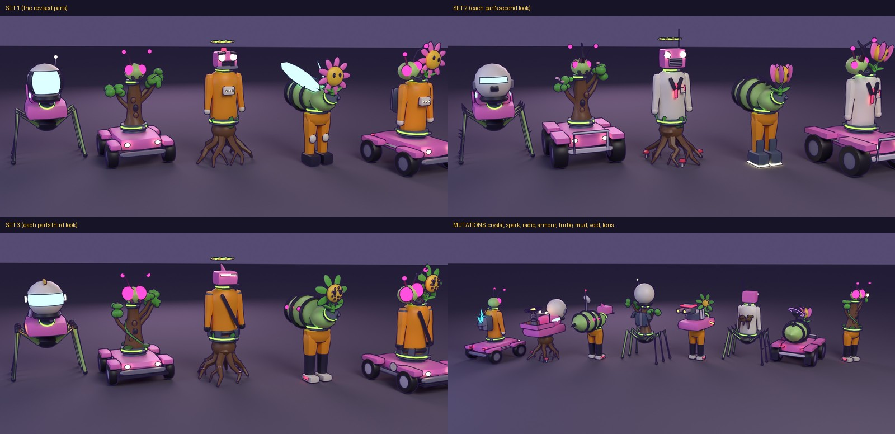

# Chimera parts kit: Specimen, second round

The chimeras are still drawn by `makeChimera` in `src/chimera.js` (code-built parts, at 0.72 of their old size so a field of six fits
the gate). This is the Blender kit that will replace them: **Specimen** (picked over Plush, which is dropped), revised, with three looks
for every part and the mutation pieces. Not in the game yet; once the look is settled, the other four kinds get built in it and the game
swaps over.



- `chimera_sheet.jpg`: the review sheet
- `set0.jpg`, `set1.jpg`, `set2.jpg`: five chimeras in each look of the parts (the same blends each time: car body on mite legs with a
  person's head; sapling on car with a mite's head; person on sapling with a car's head, wearing the Triple Crown; mite on person with a
  sapling's head; and two heads on one neck)
- `mods.jpg`: eight chimeras from behind, each wearing one mutation
- `revisions.jpg`: the reworked parts, close
- `chimera_kit.glb`: the kit (every part in every look, the mutations, the crown; compressed, 689 KB)

## What changed from the first round

- **Car legs:** the purple mount block and the bare platform are gone. The legs are a real lower car now: a hull over the axles, a fender
  over each wheel, headlights and tail lights, bumpers, a side stripe, and a steel turntable on top where the body sits.
- **Person:** built from the game's own people (`makeFigure`'s lathe profiles for the torso, legs and arms, at 0.72), so a person chimera
  looks like the NPCs: round shoulders, arms hung either side with gloves, EVA boots, the game's helmet with its framed visor. Both arms
  are one mirrored build (the right one was the odd one out before).
- **Mite wing cases:** they rise in a V from the shoulders and clear the abdomen all along (they used to cut into it).
- **Sapling legs:** six gnarled roots, no two alike (crooked, knotted, each with a rootlet), round a lumpy, mossy bulb that sprouts leaves.
  The trunk above leans a little, has knots and a hollow, and its branches sit at uneven heights with ragged leaf clusters.
- Small details throughout: the car head's brows, the chest box's status lights, the trunk's knots.

## The three looks

Every part comes in three looks (`alt` 0, 1, 2). They race the same (the stats come from the kind, not the look): two chimeras of the same
parts can look unalike. The game would draw a look for each part from the chimera's seed.

| Part | Look 1 (set 1) | Look 2 (set 2) | Look 3 (set 3) |
|---|---|---|---|
| Person legs | EVA boots, knee pads | mag boots with glowing soles, shin guards | shorts over leggings, trainers |
| Person body | chest box, life pack, two tanks | lab coat, lapels, tie, pocket and pen | tool belt with pouches, chest strap, steel shoulders |
| Person head | framed visor, antenna | rebreather: slit visor, grille, canisters | gold crest, wide visor, ear lamps |
| Mite legs | plain | spurs on knees and shins, bristles | armoured, thicker, ringed knees |
| Mite body | wing cases raised in a V | a ridge of spines | glowing spots and a stinger |
| Mite head | compound eyes, jaws, feelers | a rhinoceros horn | big eyes, feathery feelers |
| Car legs | road car | off-roader: big tyres, square arches, bull bar, mud flaps | low racer: splitter, side pipes, roundels |
| Car body | coupe: cabin, glass, fins | pickup: cab, open bed with a crate, roll bar and spotlights | hot rod: bare engine, chrome stacks, flames |
| Car head | headlight eyes under brows, siren | truck: chrome grille, round lamps, aerial | racer: a slit of light, splitter, fin |
| Sapling legs | gnarled roots, moss, sprouts | toadstools at the root ends | blossoms along the roots |
| Sapling body | leaning trunk, knots, a hollow | blossom on the branches | a vine winding up, moss at its foot |
| Sapling head | daisy | tulip bud | a crown of leaves round a seed head |

## The mutations

The mutations were not in the first round (the game still draws them in `chimera.js`). Now each has a piece in the kit, on the body's
`back` socket (the lens on the head's `top`), so it sits right on any body: **crystal** (a cluster of glowing shards in a steel seat),
**spark** (a tesla coil with glowing rings), **radio** (a mast with a dish and a beacon), **armour** (a riveted back plate with fins),
**turbo** (an engine with a red band and glowing exhausts), **mud** (clumps and drips), **void** (a dark orb in a violet halo with
orbiting shards), **lens** (a jeweller's eyepiece on an arm, over the right eye). The game's void aura (the faint sphere round the whole
chimera) could stay as well.

## The socket contract

Three.js axes, metres, a chimera faces +z.

| Part | Origin | Sockets (empties, role `socket`) | Moving pivots |
|---|---|---|---|
| `ck_legs_<kind>_<alt>` | on the ground | `hip`: where the body sits | `leg` (biped legs, mite legs, sapling roots; swung about x), `wheel` (spun about x, extra `r`) |
| `ck_body_<kind>_<alt>` | its hip socket | `neck`: where the head sits (a second head shares it, 0.3 m apart, leaning out); `back`: where a mutation goes | `arm` on biped bodies |
| `ck_head_<kind>_<alt>` | the neck socket | `top`: where the crown and the lens sit | (none) |
| `ck_mod_<name>` | the back socket (the lens: the top socket) | (none) | (none) |
| `ck_crown` | a head's top socket | (none) | (none) |

The splice joint (a steel clamp with a glowing band) is drawn on the body, round its hip and its neck, so any legs and any head meet it
cleanly. The hide slot is named after the kind (`person`, `mite`, `car`, `sapling`): the game colours it from that kind's palette, part by
part, so a mite's legs under a car's body stay mite-coloured.

Triangles: an assembled chimera is about 2k to 5k (the sapling's roots are the heaviest part, 2.6k to 3.8k).

## Rebuilding and re-rendering

```bash
MOONRUNNER_REPO=. python3 tools/blender/build_chimera_kit.py           # -> docs/chimera-proposals/chimera_kit.glb
MOONRUNNER_REPO=. python3 tools/blender/preview_chimera_kit.py          # the renders and the sheet (Cycles on the CPU, a few minutes)
node tools/optimize-glb.mjs docs/chimera-proposals/chimera_kit.glb
```
