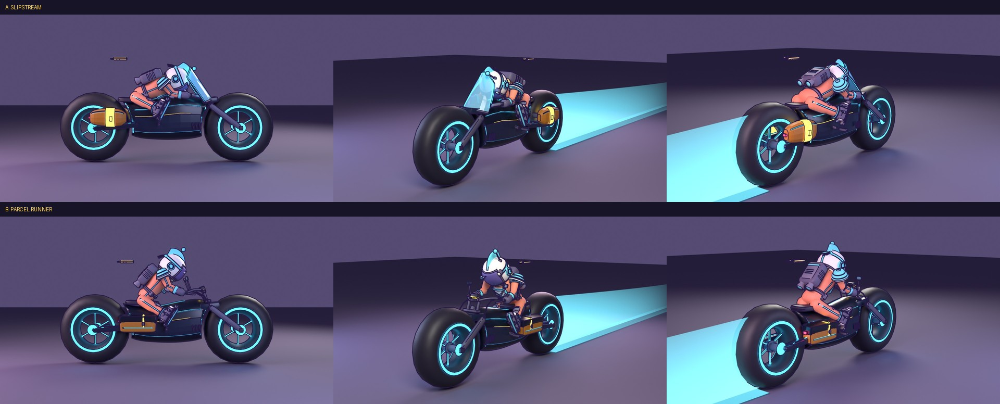

# Courier Light-Bike: two redesign proposals

Both are built from code in Blender by `tools/blender/build_courier.py` (`VARIANT = "a"` or `"b"`) and exported here as
`courier_a.glb` / `courier_b.glb` (plain, for any viewer). **Both are in the game now:** the builder also writes the
compressed `src/assets/lightbike_a.glb` / `lightbike_b.glb`, `makeLightBike` in `src/models.js` builds whichever is selected
(**B by default**), and the original primitive-built bike is still there as `classic`. Switch with the dev menu (F8) item
**9 · COURIER MODEL** (B, A, CLASSIC; remembered across launches; it applies to the next bike you call with V). The Asset Row
shows all three side by side. `tools/blender/preview_courier.py` rebuilds both and re-renders this sheet
(Cycles on the CPU, `pip install bpy pillow`; the runner is the game's own `runner.glb`, posed as a stand-in).

## What changed from the current bike (both)

- **No upper wheel wells.** The shell no longer arches over the wheels. It stops short of each tyre and is scooped to
  it (a 0.08 m gap), so the nose and tail cup the wheel without covering it. A glow arc runs round each scoop, in place of
  the old glowing well arcs.
- **Chunky wheels at the front and back.** 0.78 m outside radius, tyres 0.46 m (A) / 0.54 m (B) wide, still hubless with a
  glowing ring on each face and six glowing spokes. Slim forks and a swingarm carry them, beside the tyre.
- **A sleek, smooth body.** One lofted shell, smooth from nose to tail (the old bike's separate hump and raised side plates are gone),
  with thin lines laid on its skin: a cyan shoulder line, a gold pin-stripe and a cyan belly line, over a flush dark side
  panel. A spine light on top.
- **Saddle bags,** a pair, one each side, in their own `bag` slot (the trim colour as a flat toon, not a glow) so they read
  as luggage against the dark shell. `bag` is the one slot the game has no entry for yet.
- **Spokes run into a hub:** six glowing spokes root inside a hub disc on the axle (they used to start 4 cm short of it).
- **A tidy cockpit:** A has a tall windscreen on the nose cowl in front of the bars (the old canopy sat over them and looked wonky); B has no windscreen and a detailed handlebar set (below).
- **9.0k triangles (A) / 10.0k (B)**, plus 6.0k / 7.0k drawn again for the outline: inside the house budget of about 11k for a
  vehicle (`style.md`). About 325 / 356 KB as exported (the files here are plain so any viewer opens them; `npm run optimize:glb`
  compresses them to roughly 40%). Both pass `audit_coplanar` (no surfaces that would z-fight). Ink-0 details (the glow lines, rim rings,
  spokes) stand at most 6 mm off the surface they lie on, as the outline rules ask; the straps stand 12 mm off and have ink of
  their own.

## A: Slipstream

Long, low and pointed. A tall, raked sport windscreen on the nose with a glowing edge; tall teardrop bags that tuck in
beside the rear wheel, with a gold strap and clasp and a tail lamp; a racing crouch. The clip-on bars are pulled back to
z 0.42 so the runner's 0.6 m arms reach them. The tall tank needs the legs spread 0.5 rad to clear it (thigh swing -1.1),
which is a sprawl: scooping the tank like B's would bring that down to 0.3.

## B: Parcel Runner

Rounder and friendlier, more of a delivery bike: a round headlamp in the nose, wider tyres, and square flapped panniers
slung low with a gold strap and buckle, **centred on the shell's skin so they sit half sunk into its flank** (`bag_x` 0.36;
it was 0.50). **No windscreen.** The cockpit is open, with a **detailed handlebar set**: a triple clamp on the fork tops,
two risers with a cross-piece and a gauge pod (lit display, gold bezel), a pulled-back swept bar over the tank with rubber
grips and gold end caps, brake levers with reservoirs and brake lines down to the forks, and mirrors on stalks. The pegs stand
out from the shell on brackets.

The tank is slimmer and scooped (half width 0.27, top 1.30 m at the seat) so the rider's thighs clear it.

**The rider's pose is solved against the geometry**, not eyeballed (`SPEC["pose"]` in `build_courier.py`, written to the GLB's
root as `pose_*` extras): torso lean 0.752, thigh swing -1.0, **leg spread 0.35 rad** (about 20 degrees: the smallest that
clears), arm swing -1.179 with 0.128 out, elbow -0.704. `preview_courier.py` checks it every run: both fists land within
3 mm of the grips and no leg vertex is more than 4 mm inside the shell or bags. The game's `player.js` sets only torso, thigh
swing and arm swing, so using this needs leg spread and elbow added there. Suggested `seat: 1.40, seatZ: -0.66`.

## How the game uses them

`makeLightBike({ style })` picks `'a'`, `'b'` or `'classic'` (default: the dev-menu setting, else B). `makeBlenderBike` in
`src/models.js` dresses the baked GLB with the game's toon and glow materials and returns the same `{ root, chassis, wheels, gun,
trailFrom, trailColor }` as the classic bike, plus `wheelR`, `seat` (the rider's hip, scaled) and `pose`. The Garage seats the
rider from `model.seat` and `player.js` poses them from `model.pose` (torso lean, thigh swing, leg spread, arm swing and out,
elbow), so each bike's rider fits it; the classic bike has neither and keeps the old numbers and seat. After a rebuild, run
`npm run optimize:glb` (the builder writes plain files). To retire a proposal, remove its entries from the `GLB` map and
`loadShipParts` in `src/models.js`, and from `BIKE_STYLES`. The GLB carries what the game reads:

- **Pivots** (empties with a `role`): `chassis`; two `wheel`, spun about x; `trail`, the empty the light trail streams from
  (it replaces `trailFrom`). The rider's hip is in the root's `seat` extra, in the bike's own frame.
- **One material a mesh, named for its slot.** Fixed toon: `navy panel dark metal seat tire`. Glow: `glass lamp tail`, and the
  two livery glows `stripe` (the bike's colour) and `trim` (the gold), which are the old bike's `glowA` and `glowB`. New:
  `bag` (the saddle bags, the trim colour as a flat toon) needs an entry in the factory's slot map, or it draws magenta.
- **`ink`** on every mesh, by part size as `style.md` lists.

## The light trail (changed in the game now, whichever bike is picked)

`LightTrail` in `src/models.js`, used by the Courier and the Asset Row:

| | before | now |
|---|---|---|
| life | 1 s | **4 s** |
| wall height | 1.0 m | **1.5 m** (shrinks to 45% as it ages) |
| thickness | a single ribbon, invisible edge-on | the wall **plus a 0.6 m glowing strip on the ground** under it (narrowing as it ages), so it has body from any angle |
| fade | `k^2`: dark in about half the life | `k (2 - k)`: holds bright, eases away at the end |
| points | 64 at 0.3 m (19 m of trail at top speed) | **256 at 0.45 m (115 m), so a full 4 s at 34 m/s** |

Checked in Node against three.js 0.186 over a 6 s weaving ride at 34 m/s and a stop: all 4 s of it kept (at most 241 of
256 points), no NaNs, the strip 0.58 m wide and the wall 1.44 m tall, and it empties and hides 4 s after the bike stops.
The renders above draw the new trail as a mock-up (a wall and a strip fading over 10 m); they are not the game's shader.
