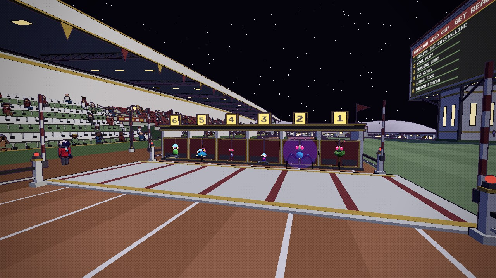
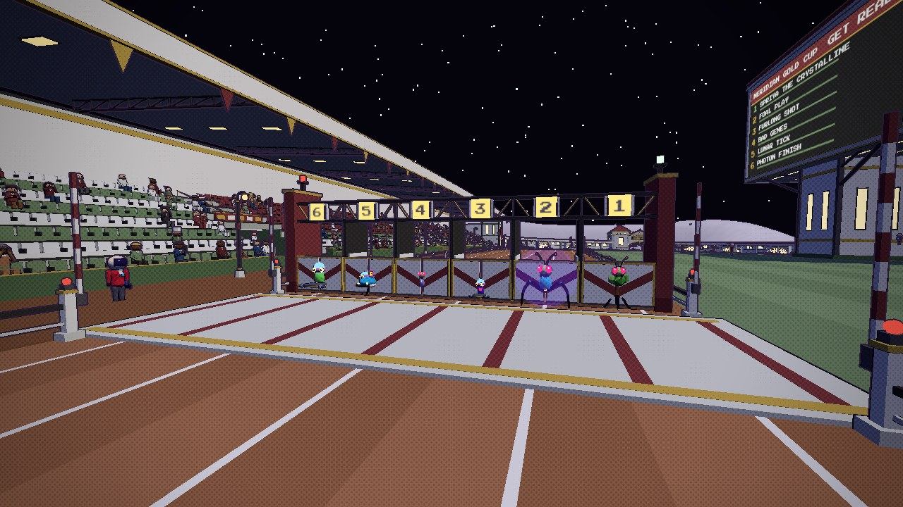

# Chimera Downs' six-stall starting gate: two designs

A field of six needed a six-stall gate. Six 3 m stalls fit between the rails (45 and 64.4 m from the oval's centre) where four 4 m
ones stood, so nothing else on the course moved. Both designs are in `src/assets/downs-course.glb` (built by
`tools/blender/build_downs_course.py`); `GATE` at the top of `src/race.js` picks the one the course uses: **B, The Gantry** (chosen), and the Asset Row's
course kit shows both, doors hung. The screenshots are from the running game, at the start of a race.

| A, "Classic Six" | B, "The Gantry" |
|---|---|
|  |  |

**A, "Classic Six":** today's gate in six stalls. Mint dividers with green padding, a Black roof with two gold lips, a gold number frame on
the roof over each stall, Barn Red doors with gold edging, and a pennant at each end. 18.5 m across, 3 m deep. 700 triangles plus 60 per
door.

**B, "The Gantry":** open-topped. Two Barn Red end towers with gold cornices and starter's lamps (red on one, mint on the other), slim Black
stall posts with Mint pads, and a Black lattice beam with gold diagonals across the top, whose Mint frames carry the numbers. Mint doors
with a Barn Red diagonal band. 19.1 m across. 988 triangles plus 72 per door.

To switch back, set `GATE = 'a'` in `src/race.js`.

**During a race** (`towGate` in `src/race.js`): once the whole field is 30 m clear of the stalls, the doors close, the gate swings round to
lie along the track and is towed to the outer edge, where it stands just inside the outer rail (5 s in all; a lap takes about 20, so it is
clear before anyone comes round again). The race model keeps runners inside that strip (`X_MAX` in `src/chimerastats.js`: 15 m out from the
inner rail, about the fifth lane).
