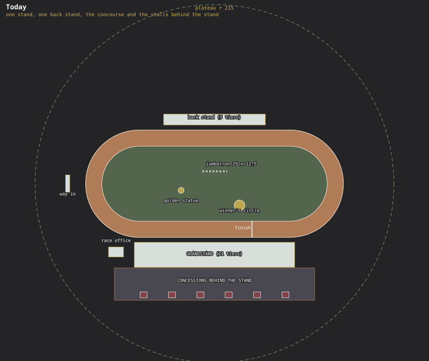
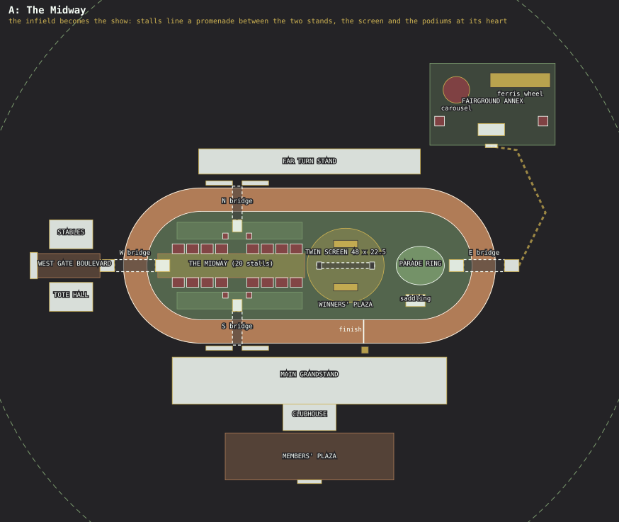
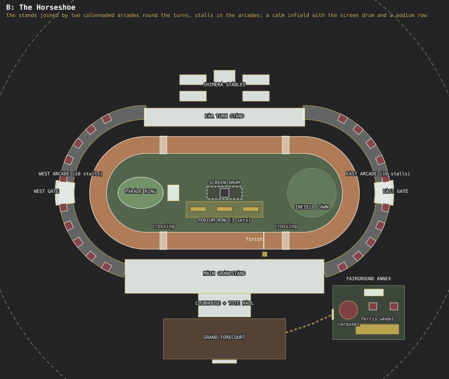

# Chimera Downs: overhaul, two layouts

Two layouts for the big Chimera Downs overhaul (`src/race.js` `build()` before it). **Layout B, The Horseshoe, is built** (`src/downsWorld.js` lays it out from `src/downsPlan.js`
and the Blender kits `tools/blender/build_downs_*.py`; see "As built" below); Layout A stays a proposal. The plans are
`docs/downs-layout-current.svg` (the course before the overhaul), `-a.svg` and `-b.svg`, drawn and clearance-checked by `tools/downs-layouts.mjs` (the footprints are the
data in that script; `node tools/downs-layouts.mjs` checks them, `node tools/downs-layouts.mjs docs` redraws the plans).

All positions are in the Downs' own frame, metres, +x to the right of the plan and +z **down** it (the main grandstand is at the bottom,
as the player sees it from the apron). The racing oval is the same in both layouts and is not moved: lane widths, the 706 m lap, the
finish line at x = 45 and every race distance stay exactly as `race.js` has them.

## What was asked, and how each layout answers

| Ask | Layout A: The Midway | Layout B: The Horseshoe |
|---|---|---|
| Rework nearly every model in Blender, more detail, grander | the shared kit below | the same kit |
| Bigger footprint | plateau r 215 → 280, stands bigger, a whole new infield | plateau r 215 → 280, stands bigger, two arcades round the turns |
| Larger jumbotron, fixed, visible from **both** stands | **twin-faced screen** on two pylons across the infield's centre, 48 × 22.5 m a face (today 25 × 12.5, one face) | **screen drum** on one core at the infield's centre, 40 × 20 m on the two long faces and 14 × 20 m on the ends (the ends face the arcades and gates) |
| More central winners' podiums, 1st / 2nd / 3rd; golden Chimera Champion statue removed | two podium sets back to back at the foot of the screen, one facing each stand | a row of three podium sets, one per race on the card, in front of the drum |
| Concessions along the area between the two stands, not behind the main stand | 20 stalls on both sides of a promenade down the infield (the Midway), reached by bridges from both stands | 20 stalls in two colonnaded arcades that join the two stands round the west and east turns |
| A slightly offset area for the carousel and ferris wheel from the old funpark | annex in the north-east, behind the far stand's east end | annex in the south-east, behind the main stand's east end |

"Between the two stands" can be read two ways: the infield that lies between them (A), or the ground at the two ends that joins them (B).
I could not tell which you meant, so one layout takes each. They can also be mixed (see the end).

## Palette

The swatch, sampled from the picture: Gold Gleam `#cfb352`, Saddle Brown `#b07c57`, Black `#3b393a`, Money `#7b9a6e`, Barn Red `#8b4044`,
Touch of Mint `#f8fff8`. It replaces the racing green, cream and brass the Downs wears now. Roles, the same in both layouts:

| Colour | Where it goes |
|---|---|
| Touch of Mint | walls, stand fascias, rails, columns: the main body colour |
| Barn Red | roof canopies, awnings, stable doors, seat blocks in the clubs, the carousel's canopy |
| Money | turf, seat blocks, banding on the stands, the infield, planters |
| Gold Gleam | trim, finials, the clock, the finish gantry, **1st place** |
| Saddle Brown | the dirt track, timber decks, counters, benches, **3rd place** |
| Black | steel (trusses, masts, pylons), screens, glazing frames |
| 2nd place | Touch of Mint (it stands in for silver) |

## What the site has to live with

| Constraint | Where it comes from | What it means |
|---|---|---|
| The oval: straights 180, curves r 55, lanes 48.5 to 60.5, rails at 45 and 64.4, finish at x = 45 | `race.js` `STRAIGHT`, `R0`, `LANES`, `RAIL_*`, `FINISH_U` | Fixed. Race lengths, lanes and the AI depend on it. |
| `loc.r` 215, `late: true` | `locations.js` | Both layouts need **r 280** (the farthest solid is r 256 in A, 257 in B; the plateau needs about 8 m of blend ring). `late` keeps the craters and outposts where they are, so only the ground round the Downs changes: a save with the player standing beyond the old r 215 will find the plateau has grown under them. |
| The ring road sits at `loc.r` + 32 | `traffic.js` `RING_GAP` | It moves out with r, to about 312. Roads re-link by themselves. |
| Traffic lays its own pads and stops in clear ground | `traffic.js` `keepouts` | Nothing to place by hand; the layouts leave the ring's edge open. |
| One bookie window and the race card board | `race.js` `OFFICE`, `WINDOW`, `booth` (also used by `trailer.js`) | They move with the tote hall: A at the west gate, B inside the clubhouse. |
| Up to three races on the card at once | `race.js` `MAX_CARD` | B's podium row has one set for each. |
| Cameras: chase, rail, leader, stands, blimp | `race.js` `updateCam` | The new stands and the screen must keep clear of them (the stands camera looks from the apron; the rail camera runs along the inner rail). |
| The crowd is built from the stand's own rows | `race.js` `buildCrowd`, `updateCrowd` | It grows with the stands: about 50 % more seats in the main stand (14 tiers × 228 m against 11 × 190), and the far stand goes from 5 tiers × 120 m to 8 × 184 m. |
| The Asset Row builds the Downs on a private stub world | `places.js` `P('downs', ..., { race: true })` | Whatever `build()` does has to keep working there. |

## Today

One grandstand with a smaller stand across the course, the race office off to the west, a screen standing low in the infield, a winner's
circle and a golden chimera on a plinth. The six food stalls and the picnic tables sit on a concourse **behind** the grandstand, where nobody
looks at them. It reads as a stand with a field in front of it.

## The kit both layouts share

Every item is modelled from code in Blender (`tools/blender/build_downs_*.py`, exported to `src/assets/downs-*.glb`, compressed by
`npm run optimize:glb`), baked per the existing conventions, with the palette above as the slot colours. Each gets an Asset Row item beside
the Downs place.

| Element | Today | Overhaul | Builder |
|---|---|---|---|
| Main grandstand | 11 tiers, 190 m, flat cream roof | 14 tiers, 228 m, front moved back 5.5 m (an 11.6 m apron); a suite row with Black glazing; Barn Red ribbed canopy roof on Black trusses with a Mint fascia and Gold finials; stair towers with banners at each end; aisle stairs with Gold rails | `build_downs_stand.py` |
| Clubhouse | none (a back wall) | a tower behind the stand's centre with a big Gold clock, the stand's three entrance tunnels leading into it | `build_downs_club.py` |
| Far Turn Stand | 5 tiers, 120 m, open | 8 tiers, 184 m, roofed to match | `build_downs_stand.py` |
| Rails and posts | white posts, a thin rail | Mint posts, a Black top rail, Gold caps, lamps on every fourth post, furlong boards | `build_downs_course.py` |
| Starting gate | a plain frame | a six-stall gate with Barn Red padded doors, number plates, Black frame | `build_downs_gate.py` |
| Finish gantry and photo-finish tower | a green beam, a small booth | a Gold arch over the track with a camera bar, a tower with a glazed box on the apron | `build_downs_course.py` |
| Concession stalls | six kiosks | twelve designs (the six, plus Space Slush, Lunar Coffee, Derby Donuts, Jockey's Grill, a foam-finger shop and a tote kiosk) on one kit, the Alcove, built into an arcade bay: on a Mint2 plinth, a one-piece Mint shell with the arch cut out and a gold cornice raked 0.6 m under the arcade's ceiling, a Black name plate and a lit roundel on each spandrel, a Saddle Brown counter trimmed in the stall's colour, two swags of pennants across the arch, props at the counter's ends so the vendor shows | `build_downs_stalls.py` |
| Race office | a box with an awning | the **tote hall**: a hall with a clerestory, six betting windows, the race card board on its front | `build_downs_tote.py` |
| Gates and arches | one arch, west | a grand gate with two pylons and a clock; lesser gates in the same style | `build_downs_gate.py` |
| Stables, parade ring, saddling pavilion | none | a Barn Red stable yard (twelve boxes), an oval parade ring with a rail and viewing step, a small pavilion | `build_downs_stable.py` |
| Lamps, floodmasts, bunting | stock lamps, four masts | the casino pass's lamp, pennants in the palette (the flood masts were removed in the general pass) | `build_downs_course.py` |
| Ferris wheel and carousel (from the old funpark) | built from boxes in `settlements.js`, funfair colours | rebuilt in Blender, recoloured to the palette; the wheel's gondolas and the carousel's rotor stay animated pivots, and both stay rideable (`rides.js`) | `build_downs_fair.py` |
| **Removed** | the golden chimera statue, its plinth ("THE FIRST CHIMERA") and the winner's circle dais, the concourse stalls, the picnic tables, the festoon lights | | |

The track itself (`ovalStrip`) stays code-built: raked dirt stripes in Saddle Brown, lane numbers painted on, the infield mown in a
Money diamond pattern.

## Layout A: The Midway

The infield becomes the show. An axis runs from the **West Gate Boulevard** (tote hall on one side, stables on the other) up a bridge over
the west turn, down the **Midway** (a promenade with eight stalls a side, picnic lawns behind them) to the **Winners' Plaza** under the screen,
and on to the **parade ring**. A cross-street at x = -60 joins the two stands: a bridge from each stand's apron over the track, landing in
the middle of the Midway. Every stall is between the two stands, with a stand in view from each.

| Element | Footprint | Notes |
|---|---|---|
| Twin screen | two pylons 4 × 6 at x = 6 and 50, the faces 48 × 22.5 m, underside at 14 m | Faces look at each stand. The promenade runs under it. From the main stand's far ends (about 145 m away, 40° off axis) a face still fills about 14° of view, against about 17° for today's screen seen from the middle of the stand. The 14 m underside clears the sight line from the top tier to the far straight by about 7 m. |
| Podiums | two sets 20 × 6 at the plaza, steps 1.4 / 1.0 / 0.7 m | Gold / Mint / Saddle Brown, numbered, a garland arch behind each. |
| Midway | 16 stalls 10 × 8 on a 12 m pitch, and four kiosks at the cross-street | Promenade 20 m wide; the stalls open onto it. |
| Bridges | four: west and east over the turns, south and north over the straights | 6.5 m deck, 8 m wide (10 m on the west and east ones, which are 34 m long), steps and a canopy. |
| Tote hall, stables | 36 × 24 each, at the west gate | The first thing you see arriving is the race card. |
| Annex | 104 × 68 plaza at (152, -134), a fence and a gate arch on its south side | The wheel (50 × 12) and the carousel (22 across) with a ticket pavilion and two kiosks; reached by the east bridge and a path round the far stand's end. |
| Members' plaza | 140 × 39 behind the clubhouse | Quiet: a forecourt and a south gate. The old concourse is gone. |

**For:** the strongest set piece; the stalls and the screen are where people are; nobody walks behind a stand any more.
**Against:** the infield is walked into, so the rail camera and the infield's old openness go; four bridges are four more models and colliders;
the footbridge steps need a decent landing for the apron camera crews.

## Layout B: The Horseshoe

The two stands are joined at both ends by **colonnaded arcades** that follow the track round the west and east turns, so the stands and the
arcades make one horseshoe round the oval. The stalls line the arcades. A gate hall stands at the middle of each (the west and east gates).
The main entrance is a **grand forecourt** behind the clubhouse. The infield is calm: the screen drum, a podium row, the parade ring and an
infield lawn.

| Element | Footprint | Notes |
|---|---|---|
| Arcades | two bands 16 m wide, r 84 to 100 round each turn's centre, 165° each | A walk under a roof on the inside (8 m), stalls on the outside; they run into the stand ends. |
| Concessions | 20 stalls, 9 m wide on a 21 m pitch (a bench or planter in each gap) | Ten a side, five either side of the gate hall. |
| Screen drum | core 10 × 10, drum 40 × 14 on top, faces 40 × 20 (long) and 14 × 20 (ends), underside at 18 m | The long faces look at the stands, the short ones down the arcades and out of the gates. |
| Podium row | three sets 19.2 × 5.15 at x = -30, 0, 30 | One for each race on the card; the set for a race lights when it finishes. |
| Tote hall | 60 × 27 with the clubhouse, behind the main stand | The window and the card board face the forecourt. |
| Forecourt | 140 × 46, a gate arch on its south side | Flag court with the palette's flags, valet bays, the main arrival. |
| Stables | 140 × 26 behind the far stand | A walk to the parade ring; the whole back is quiet. |
| Crossings | four at-grade, at x = ±70 on both straights | A barrier arm drops while a race is on. No bridges. |
| Annex | 82 × 62 plaza at (165, 137), a gate arch on its west side | The wheel and the carousel; reached by a path from the forecourt. |

**For:** one unbroken ring that looks like a stadium from outside; the arcades give the stalls a roof and a facade; the infield stays open
(the rail camera and the old walk-about survive); no bridges.
**Against:** the stalls are at the edge of the site, not at its heart; the far side of the arcade is hidden from the stands; the tote hall is a
walk from the west gate.

## Side by side

| | A: The Midway | B: The Horseshoe |
|---|---|---|
| Idea | the infield is a fairway between the stands | the stands are joined into a ring |
| Concessions | 20, on a promenade between the stands | 20, in two arcades joining the stands |
| Screen | twin face, 48 × 22.5 | four-face drum, 40 × 20 |
| Podiums | two sets, back to back | three sets, one per card race |
| Entrance | west gate, then over a bridge | forecourt behind the clubhouse, plus west and east gates |
| Annex | north-east | south-east |
| New big models | stand, clubhouse, 4 bridges, stalls, screen, tote hall | stand, clubhouse, 2 arcades with gate halls, stalls, screen, tote hall |
| Infield | busy, the show | open, calm |
| Farthest solid | r 256 | r 257 |
| Tightest gap checked | 3.0 m (the stand and the photo tower), 3.7 m (bridge steps and kiosks) | 3.0 m (the stand and the photo tower), 4.0 m (ring and pavilion) |

Both pass `node tools/downs-layouts.mjs`: every solid is on the plateau, the infield things are inside the infield, the outside things are clear of the
outer rail, and no two things from different builders are closer than 2.4 m.

## If one is chosen: order of work

1. Plateau r 280, the stand and the course kit (rails, gate, gantry, photo tower, lamps), the removals (statue, plinth, circle, concourse).
2. The stalls kit, the tote hall, the gates, then whichever of the bridges (A) or the arcades (B).
3. Screen and podiums; wire the second face of the screen to the live canvas, and the podium sets to the race result.
4. Stables, parade ring, pavilion; the annex, with the wheel and carousel rebuilt in Blender and set back into `rides.js`.
5. The crowd, the racegoers (26 now, about 40 after) and the music zone's extent; the trailer's Downs shot; Asset Row items, README and CHANGELOG.

## Decisions

1. **Which reading of "between the two stands"?** B: the arcades round the turns.
2. **Plateau r 215 → 280.** Yes; `locations.js` has it.
3. **Podiums in play.** Yes: `race.js` `finish()` stands the first three on their steps and swings the camera round to them while the result dialog is up.

## As built (Layout B)

The build follows the plan above, with these differences and additions:

- **Stands.** The main stand is 14 tiers and 228 m with a row of lit suites over the top tier and one roof from end wall to end wall, through the end towers in its front corners; the far
  stand is 8 tiers and 190 m (not 184) with its own lower roof and towers (18 m, so they rise through it). Seats are Blender strips (`dn_seat3`); the crowd is 1,060 seated figures (`downs-crowd`).
- **Clubhouse and tote hall** are one building behind the main stand's centre: the six betting windows are under its portico (three each side of the great door), the race card board
  hangs in the recess over them, and the prompt (`F`) works at those windows.
- **Stables.** Four blocks of six boxes (24) round a lane, with the hay barn between the back two, not twelve boxes.
- **Weighing room.** 13.2 m deep with its porch, 18 m long (the plan had 10 × 18), on the ring's east side.
- **Crossings.** The rails leave an 8 m gap at x = +-70 on both straights with a raised-boom barrier post at each of the gap's four corners, where the rails' runs end; the road is one deck as wide as the gap, with gold edge lines and seven evenly spaced bars. The booms do not drop: nobody is on the track while a race runs.
- **Forecourt.** Gate arch, fountain (24 m across), nine flag masts a side with festoons across the avenue at every other pair, lamps, benches and planters, and twelve valet bays (no cars parked in them).
- **Drum.** A 41 × 15 m shell on a 10 × 10 m core; the long faces (40 × 20 m) look at the stands, the ends (14 × 20 m) down the arcades. Each podium set has a plate on its backdrop: its slot of the
  race card, or, after a race from that slot has finished, the first three home.
- **Annex.** The ticket hall, two free-standing kiosks (`dn_kiosk`), queue posts, a striped fence with a gate on its west side, and the two rides (rebuilt in Blender; `src/downsFair.js`).
- **Models.** Nothing of the old derby survives unreworked: the starting gate, rails, finish arch, lamps, festoons, flags, stalls and spectators are all new Blender models (the flood masts were built too, then removed). The golden
  statue, its plinth and the winner's circle were removed.
- **Not built:** Layout A's bridges and Midway.
- **Curved ground.** The plateau is a cap of the Moon's sphere (`curved: true` in `locations.js`), not a flat plane: on a plane the far arcades, 250 m out, stood about 9 m above the Moon's curve and
  leaned about 4 degrees away from the local up. The builders still draw on flat coordinates (x, z across the site, y up from the ground); `src/curve.js` bends them onto the sphere (see its header):
  geometry is cut into pieces of at most 8 m and bent, so long walls, rails and the stands curve; the dressing's text planes, moving parts, colliders, the race's screens, crowd, gate and cameras, and the
  walking figures all go through the same bend. `tools/downs-layouts.mjs` still checks the plan in flat coordinates, which is what the plan drawings show.
- **Audit.** `tools/downs-audit.mjs` looks for what the first build got wrong: z-fighting (pairs of overlapping, coplanar triangles of different colours, named by the builder and the Blender part they came from), colliders standing in each other, text planes facing into walls, and strips of bare ground between slabs. Every Downs Blender build also runs `audit_coplanar` and `audit_flips`. Rules the audit enforces: layers that meet share an edge or stand at least 1.5 cm off each other (ends and sides 2 cm short of what they sit on, not flush with it); surfaces that cover the ground run under the walls they meet; a hip roof is turned before it is stretched (`hip()`); a roof column never stands in front of a way in (columns at the bays' middles, entries at the wall bays' centres); a primitive meant to be seen from outside is a closed solid (open shells are flipped at Blender's whim). The dev overlay's WHERE section gives the place-local position of the camera for reports.
- **Ways in, joins and the forecourt (as reviewed).** Each stand's entries are tunnels (6 m wide, 4.2 m high, `dn_back_gate` wall bays; roofed under the high tiers, an open trench through the low ones, out through a gap in the parapet) and the forecourt's fountain is the casino's pattern with a derby cup (docs/casino-forecourt.md has its measures); the arcades close on the stands with a `joiner` bay at each of the four ends; the forecourt paving is slate (off palette on purpose, to sit between the Moon's ground and the boardwalk); the gate's name is raised lettering on its front face only.
