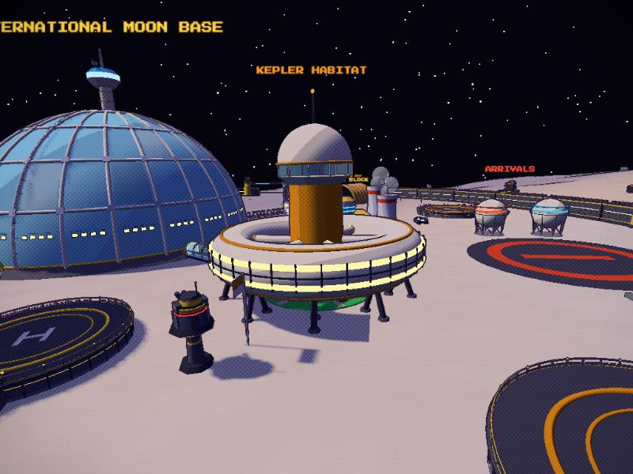
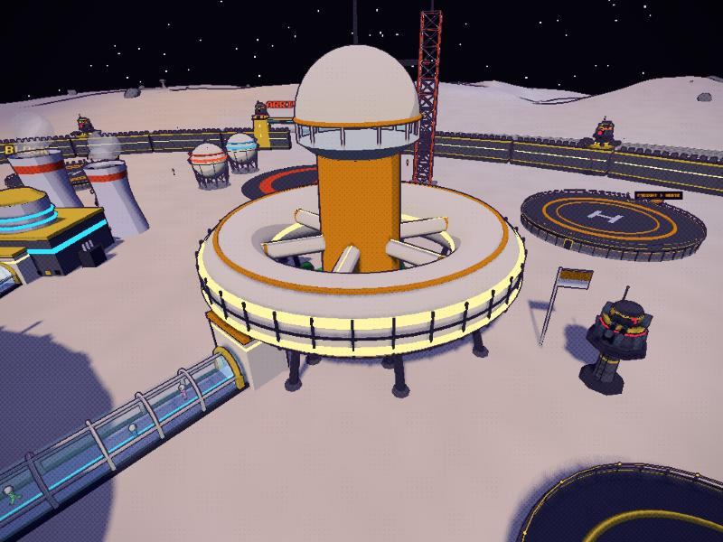
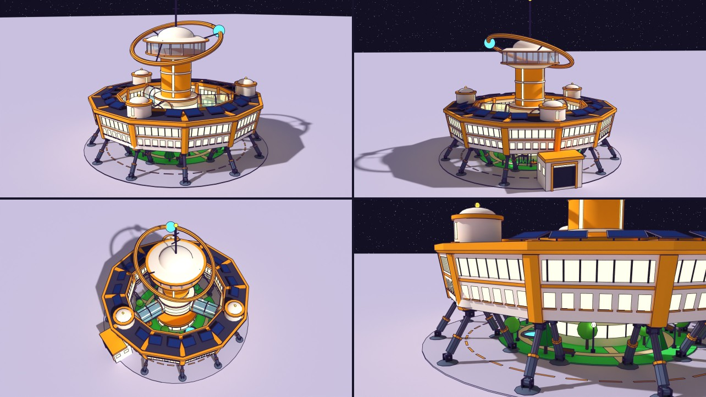
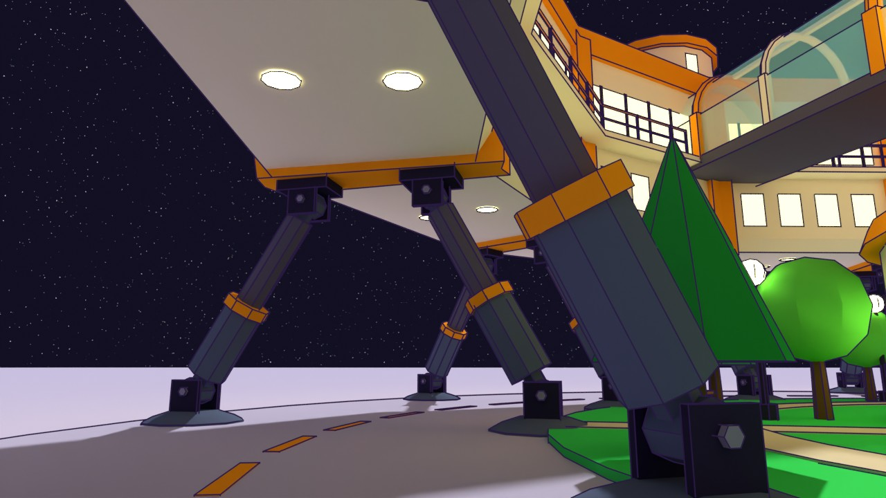
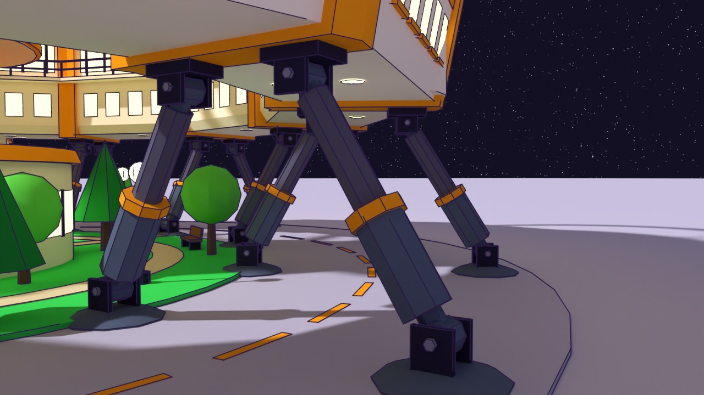
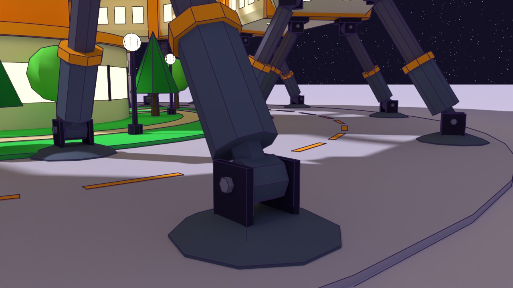
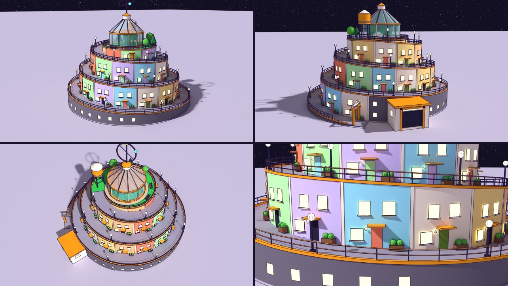
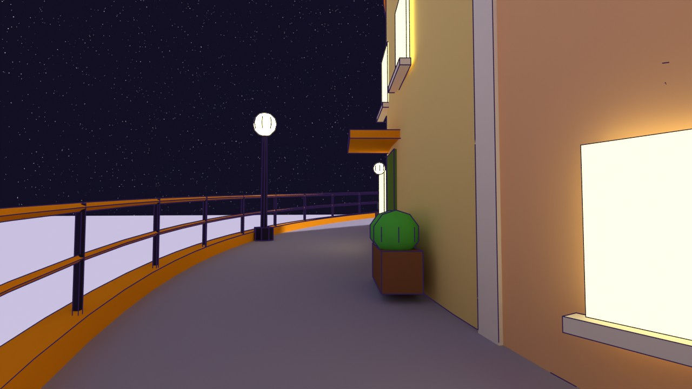

# Kepler Habitat (ILMB wing): two redesign proposals

**A, the Orrery, was chosen and is in the game** (`tools/blender/build_habitat.py` -> `src/assets/habitat.glb`, baked by
`settlements.js keplerHabitat`; Asset Row item ILMB KEPLER HABITAT (ORRERY)). Its legs were refined on the way in: each is
pinned at both ends, so it visibly bolts into its footpad and the ring (below). B stays here as a study
(`tools/blender/proposals/habitat_b.py`).

The Kepler Habitat is the ILMB's family wing, until now drawn by `wingHabitat()` in `src/world.js`: a round tube ring on thin A-frame
legs, six stub spokes, a plain orange hub tower with a dome, and a park under the ring that the tube mostly hides.

| Before, from the side | Before, from above |
|---|---|
|  |  |

What it does well and both proposals keep: a footprint of about 27 m radius, the skywalk docking on the -x face at floor 0.6 m, a
landmark silhouette among the other five wings, Kepler's orange, cream and green, and somewhere for a skater to play. What it does
less well: from any distance the ring reads as a saucer rather than a building with floors, the spokes end in mid-air, nothing says
"homes", and the park can hardly be seen.

Both are built from code in Blender (A by `tools/blender/build_habitat.py`, B by `tools/blender/proposals/habitat_b.py`, sharing
`tools/blender/habitat_kit.py`) and rendered by `tools/blender/proposals/preview_habitat.py`.

## A: Orrery (the ring, refined)

The same idea, built like a Kepler prefab instead of a smooth tube:

- **Twelve straight two-deck modules** (8 m deep, 8 m tall) with an **orange joint collar** at each seam. The lower deck has
  apartment windows with sills, the upper deck a panorama ribbon with mullions, and there is an orange floor belt between them. The
  outer wall leans out 1.4 m, so the ring looks lifted.
- **A lander leg pair under every joint**, each leg pinned at both ends so it could swing in its radial plane: a hinge under the
  collar (mount plate, two cheeks, a pin through the strut's eye) and a dished footpad with a boss and two lugs, the pin through the
  shock sleeve's eye. A shock sleeve with an orange band joins the strut. There is no tie bar: the ring ties the legs at the top,
  and the loop stays clear. The underside sits **7 m up**, with downlights in the soffit and a dashed **skate loop** under the ring.
- **Three glazed spoke bridges** from the hub to a railed **park balcony** on the ring's inner face. Each lands at a **lift core**
  that rises through the roof, and the one on the skywalk side comes down to the lobby.
- **Solar rows** on the roof.
- **The hub keeps its orange shaft**, now with a commons pavilion at its foot, a glazed spoke deck and an observation crown with a
  saucer roof.
- **The orrery:** a tilted orbit ring carrying a blue planet circles the crown. It is the Kepler mark from the cargo decals, built
  at landmark size. In the game it turns slowly (a `fan` pivot, 0.06 rad/s).
- **The park**: lawn, paths, trees, a pond, benches, lamps and a playground with a slide, swings and a roundabout.

| A leg pair from outside | A foot: pad, lugs, pin, eye |
|---|---|
|  |  |

## B: Spiral Street (a hill town in the round)

A new building type for the wing. **One street climbs the building in three turns** on a gentle helical ramp, from a gate at
ground level to a roof garden. It is 4.5 m wide and climbs 7 m a turn: about 5% on the first turn, 6.5% on the second, 9% on
the last. Row houses in Kepler pastels line it.

- **33 house fronts**, two storeys each. Each has a front door in its own colour, an orange awning, a porch lamp, a window and
  sill, a planter with shrubs, and two upstairs windows. A cream pilaster stands between neighbours.
- Each turn's houses stand on the **stone plinth** of the turn below: regolith shielding, with ground-floor windows where it is
  tall enough.
- An **orange kerb and handrail** spiral up the outside, with street lamps along the kerb.
- **The roof garden**: a glass **conservatory** with trees and a pond (the park, under glass this time), benches, an orange
  **water tower** like the ones in Kepler towns, and a lantern mast with a small orbit ring.
- **Skating:** a skater can ride from the gate to the roof without stopping.
- The skywalk docks into a vestibule set into the plinth.

## Side by side

| | A: Orrery | B: Spiral Street |
|---|---|---|
| Change from today | Evolution: same silhouette, built properly | New type: grounded, climbable |
| Silhouette | Ring on legs, tall crown with the orbit ring (mast 46 m) | Stepped spiral cone, glass conservatory (mast 40 m) |
| Reads as homes | Two decks of windows, the park | Strongly: doors, awnings, planters, colours |
| Play | Skate under the ring (7 m clear), loop | Ride the street to the roof |
| Footprint | radius 27.5 m, dock at x -28.6 | radius 26 m, dock at x -27.8 |
| Triangles | 27.5k (with the pinned legs; 318 KB compressed) | 32.0k |
| Game work | Done: a box per module, pitched boxes along the legs, cores, hub, spokes, lobby (68 `col` pivots); the orbit ring turns | Colliders: the street as tilted boxes along the helix (physics boxes take any axes), houses as a stepped solid |

Both pass `audit_coplanar` and sit inside the house budget for a building (15k to 35k, `style.md`).
