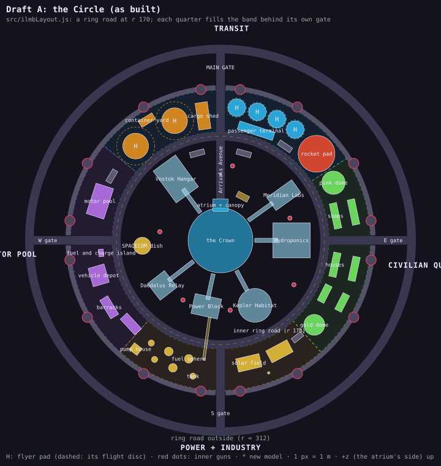

# The ILMB: two layouts

**Draft A, "the Circle", was picked and is built** (November 2026): the positions are `src/ilmbLayout.js`, which the game
builds from (ilmbCore.js buildIlmbQuarters, world.js buildHub, traffic.js) and `tools/ilmb-layouts.mjs` checks and draws as
the A plan; it differs from the draft below in detail: five parking lots added; the passenger side reworked for room (a
44 m terminal along the inner ring, the four bus pads in a row along the wall 8 m apart with an 8 m concourse to the
terminal, the rocket's pad 26 m round at 41°); the cargo shed's doors toward the gate road and the freighters both; the shop
and house rows as 10 m units at 1.25 times their size; the barracks end-on to the road; and **the Vostok Hangar 12 m nearer
the Crown** (at 112, not 124: its apron, 45 m out from the wing's centre, ran under the inner ring road). Traffic drives the inside roads (the open question at the end). Draft B stays
here for the record.

Two drafts for the International Moon Base's grounds. The Crown, its six wings and their skywalks, the job board and the
Rampart stay exactly where they are; everything else is regrouped into four quarters joined by a road inside the wall
that passes through all four gates:

- **Transit**: passengers on one side, freighters on the other, and the rocket to and from Earth;
- **Motor pool**: the repair bay rebuilt as a working garage with an interior, the vehicle depot, the rover lot;
- **Power and industry**: round the Power Block, with the fuel spheres, a tank farm and the solar fields;
- **Civilian quarter**: houses and small shops, the two family domes.

The plans are `docs/ilmb-layout-current.svg`, `-a.svg` and `-b.svg`, drawn and clearance-checked by `tools/ilmb-layouts.mjs`
(the footprints are the data at the top of that script; `node tools/ilmb-layouts.mjs` checks them, `node
tools/ilmb-layouts.mjs docs` redraws the plans). Both drafts pass: at least 4 m between footprints, 3 m off every road
edge and off the wall's inner face, nothing standing in a pad's flight disc, the spawn spot clear.

All positions are in the hub's frame, metres, +x to the right of the plan and +z up it: the side the Crown's main atrium
faces, which the plans call the main gate. Angles are measured from +x counter-clockwise (as `Math.atan2(z, x)`), so the
gates are at 0° (E), 90° (main), 180° (W) and 270° (S).

## What the site has to live with

| Constraint | Where it comes from | What it means for a layout |
|---|---|---|
| The Crown r 53, its atrium and canopy out to r 67.5 at 90° | `build_ilmb.py` | Fixed. A road can end at the canopy. |
| Six wings, their skywalks on the ground from r 56 to each wing | `locations.js` ILMB_WINGS_AT; the wings' `.glb` | Fixed. They reach out to r 147 (Hydroponics, the Habitat) and r 156 to 158 (Meridian Labs, the Vostok Hangar). The footprints in the script are the models' bounds, a few metres generous. |
| The wall: inner face r 245, gate towers (drums r 8.3) at gate ± 7.5°, bastion drums (r 8.4) at 30°, 60°, 120° ... | `build_ilmb.py` WALL_R, GATES, BASTIONS | Everything inside r 242; gate openings about 48 m clear. |
| The ring road outside at r 312 | `traffic.js` RING_GAP | Each gate gets a road out to it (below). |
| The job board at (36, 71), facing out | `locations.js` ILMB_BOARD | Fixed, on the plaza right of the atrium. |
| The spawn point (0, 108), facing the Crown | `main.js` | Both drafts put a road over it: you arrive on the main avenue. |
| Flyers: bus deck r 14.2 (the ramp reaches 13.3 m), freighter deck r 21; flight discs r 15.7 and r 31 | `traffic.js` addFlyer | Four bus lines (Tranquility, Shackleton, Helium-3, Aldrin) and two freighter lines (Farside, Hertzsprung) end at the ILMB: four bus pads, two freighter pads. |
| The rocket's pad, flat, r 30 | `world.js` buildHub | Its gantry stands on the pad. |
| Sixteen wall guns on the towers and bastions; six inner guns on pylons | `locations.js` ILMB_GUNS | The wall's stay. The inner ones move where a quarter needs the ground. |

## Today

The pieces outside the wings are where there was room when each was added: the repair bay behind the Relay, the depot and
patrol rovers east, a barracks in each northern corner, the domes either side of the main gate, the rocket and its
fuel spheres south, two shuttle pads in the gaps between wings (the other flyers' pads are laid by the traffic at load, at
the edge nearest each line's destination). No road goes inside; you cross open ground from the gate.

## Shared by both drafts

**Roads.** Each gate gets a straight road out to the ring road (r 245 to 312, 14 m wide). The traffic already has the piece
for this: a `loc.paved` strip with `ring: true` joins the ring with the flared sweeps the casino's car-park roads use.
Inside, one ring road (14 m, two lanes, kerbs, lamps) passes through all four gates. Where the drafts differ is how far in
it runs and what it does to the quarters.

**Transit.** The four bus lines and two freighter lines get pads laid by the place, not found at load: `traffic.js`
addFlyer already takes a pinned pad (`pinA`, used by your town's shuttle); the ILMB's lines would take theirs from a list
on the location (`loc.transitPads`, bus or ship), and the two pads `buildHub` lays today go. Each pad keeps its stop
shelter (FREIGHT > / SHUTTLE > signs). Passengers walk from the bus pads through a **passenger terminal** (a glazed hall
with the departure boards); freight has a **cargo shed** with container stacks under the existing container gantry
(`gantry.glb`) and the hover-forklift from the Trading Kiosk.

**The rocket, reworked.** Today it is a code-built cylinder, cone and four fins (`models.js` makeRocket). The rework goes to
Blender (blender skill), with its launch gantry refitted to it: a reusable Earth-Moon crew ship standing on landing legs,
a band of cabin windows, a crew access arm from the gantry, propellant lines at the foot. Its flight (`world.js`
updateRocket: down from 900 m, 20 s on the pad, up again, every 76 s) stays. Proposals for its look come once the layout is picked.

**The motor pool's repair bay**, rebuilt in Blender as a working garage you can drive into: three bays behind roller doors,
each with a lift and a vehicle on it (the game's own buggy, Vostok APC and Interceptor models, raised, wheels off on one),
a two-post lift, a four-post lift, a scissor lift; tool walls and pegboards, roll cabinets, workbenches with vices, a tyre
rack, a parts cage, a compressor and hose reels, an office on a mezzanine, the bridge crane kept, painted bay lines. Out
front an apron, a fuel and charge island, and the patrol rover lot. The SPACECOM repair and gear screen (hud SCR-02) is its
counter.

**Blender for the rest.** Every piece of the ILMB that is still code goes to Blender with this work:

| Code-built today | Where | Becomes |
|---|---|---|
| The landing pads (deck, base, railing, stairs) | `landingPad.js` | A Blender kit the builder assembles, so a pad still sizes its base and stairs to the ground under it. This changes every settlement's pads, not just the ILMB's (docs/code-vs-blender.md lists it). |
| The pad-stop shelters | `traffic.js` shelter | Blender, the signs still canvas |
| The solar fields | `world.js` solarField | Blender |
| The rocket and its flat pad | `models.js` makeRocket, `world.js` buildHub | Blender, reworked (above) |

New pieces, all Blender: the passenger terminal, the cargo shed, the repair bay with its interior, a kit of houses (stacked
hab units with porches and window bands) and of shopfronts (a canteen, a suit and outfit shop, a parts counter, a noodle
bar, a clinic), the tank farm (vertical tanks, a pump house, pipe racks), market furniture, the fuel island. Kept as they
are: the domes, barracks, depot, Horton spheres, comms mast, dish and pylons (already Blender). Staying code, as
docs/code-vs-blender.md says: the job board's screens and holo ring, the text signs, the flags' waving cloth, the walkers.
House rules hold: no plants out in the vacuum, no wood.

## Draft A: the Circle

**The idea.** The inner ring road runs at r 170, just clear of the wings, a circle the whole way round. Everything the
quarters hold sits in the 68 m band between it and the wall, and each quarter is centred on its own gate, so the gate road
coming in splits the quarter in two. At the main gate that split is the brief exactly: passengers to the right, freight to
the left. The road from the main gate carries straight on across the ring road as **Arrivals Avenue** to the atrium, so a
traveller off the bus or the rocket walks one straight line to the Crown, and the spawn spot is on it.

| Quarter | Piece | Position (angle, r) | Size | Note |
|---|---|---|---|---|
| **Transit** (33° to 141°) | Passenger terminal | 72°, 188 | 60 × 14, along the ring road | its doors open onto the bus pads behind it |
| | Bus pads ×4 | 83°, 74°, 65°, 56°; r 218 | deck r 14.2 | in a row along the wall, 6 m between decks for the stairs |
| | Rocket pad and gantry | 42°, 211 | r 30 | on the passenger side, the gantry on the pad |
| | Cargo shed | 98°, 205 | 20 × 44 | beside the gate road |
| | Freighter pads ×2 | 111°, 209 and 132°, 207 | deck r 21 | flight discs clear |
| | Container yard and gantry | 121.5°, 230 | 26 × 12 | between the two freighters |
| **Motor pool** (141° to 228°) | Repair bay | 162°, 207 | 52 × 30 | open front onto an apron facing the gate road |
| | Patrol rover lot | 150°, 206 | 22 × 18 | |
| | Vehicle depot | 196°, 207 | 31 × 27 | moved from the east |
| | Fuel and charge island | 186°, 196 | 12 × 8 | |
| | Barracks ×2 | 211°, 212 and 223°, 200 | 35 × 15 | the garrison beside the motor pool |
| **Power and industry** (228° to 312°) | Fuel spheres ×3, tanks ×3, pump house | 232° to 259°, r 200 to 226 | spheres r 7, tanks r 5 | the tank farm west of the gate road, straight out from the Power Block |
| | Pipe bridge | 262°, over the ring road | | from the tank farm to the Power Block |
| | Solar fields ×2 | 283° and 298°, r 205 | 39 × 22 each | east of the gate road |
| | Comms mast | 290°, 230 | | |
| **Civilian quarter** (312° to 33°) | Shops, two rows on a market lane | 12°, r 191 and 223 | 44 × 12 each | north of the gate road |
| | Pink family dome | 27°, 207 | r 19 | |
| | Houses, four rows | 333° and 348°, r 190 and 224 | 30 to 40 × 12 each | south of the gate road |
| | Gold family dome | 318°, 206 | r 17 | |
| Inside the ring road | SPACECOM dish | 184°, 128 | r 14 | by the Daedalus Relay, the comms wing |
| | Inner guns | as today | | none in the way |

**What it does for play.** The circle is a 1.07 km lap with four crossroads, a skating loop round the wings; Arrivals
Avenue is a 100 m straight from the ring road to the atrium. Every quarter faces the same road, so the base reads as four
neighbourhoods round a hub from anywhere on the circle, and its gate makes each one's address. The motor pool is next to
the Vostok Hangar, the tank farm across the road from the Power Block, the houses beside the Kepler Habitat and
Hydroponics: each quarter leans on the wing nearest it.

**Code.** `world.js` buildHub and `ilmbCore.js` PIECES take the new positions; the ring road and the avenue are drawn as
the casino's roads are (a curved strip for the circle is new: `pavedStrip` lays only straight ones); `traffic.js` pins the
ILMB's flyers to their pads. The inner guns don't move.

**Risks.** The ring road passes 5 m outside the Vostok Hangar's far end and 10 m outside Meridian Labs' (by their models'
bounds: check it in the game). The band is 68 m deep, so the freighters' decks leave about 11 m each side and nothing in it can be
bigger than that. The rocket and the big fuel spheres end up on opposite sides of the base: the rocket's gantry carries its
own small propellant tanks, and the spheres are the tank farm's.

## Draft B: the Rampart Road

**The idea.** The inner ring road runs right under the wall, at r 224, along the wall's lit inside band. Nothing is
outside it; the quarters fill the four big wedges between the wings, each a block of its own with no through road. Each gate
road carries on inward into its quarter and stops there. Arrivals move round to the west gate, the **Port Gate**: the Port
Road runs in to the rocket, which stands at its end looking at the Crown, passengers north of the road and freight south
of it. That frees the main gate for **Crown Street**, the civilian quarter's high street, 150 m of shopfronts from the main
gate to the atrium.

| Quarter | Piece | Position | Size | Note |
|---|---|---|---|---|
| **Civilian quarter** (front, 38° to 118°) | Crown Street | x = 0, from the atrium to the ring road | 14 wide | the spawn spot is on it; a small square at its top end |
| | Shops, four rows | x ±20, z 108 to 200 | 40 to 44 × 12 each | both sides of the street |
| | Houses, five rows | x ±46 and 70; two at 22° (r 160, 185) | 20 to 40 × 12 | behind the shops, and in the gap between Hydroponics and the Labs |
| | Family domes | pink (100, 160), gold (-78, 172) | r 19, r 17 | at the quarter's two far corners |
| **Transit** (W, 136° to 212°) | Port Road | from the ring road to x -134 | 14 wide | a forecourt at its end |
| | Rocket pad and gantry | (-100, 0) | r 30 | at the end of the Port Road |
| | Passenger terminal | (-170, 23) | 58 × 16 | along the road's north side |
| | Bus pads ×4 | (-120, 64), (-152, 52), (-186, 52), (-158, 85) | deck r 14.2 | behind the terminal |
| | Freighter pads ×2 | (-180, -40), (-150, -108) | deck r 21 | south of the road |
| | Cargo shed and stacks | (-132, -50) | 36 × 18 | between the rocket and the freighters |
| **Power and industry** (S, 224° to 300°) | Power Road | x = 0, from the ring road to the Power Block's door | 14 wide | |
| | Fuel spheres ×3, tanks ×3, pump house | 228° to 258°, r 162 to 205 | | the tank farm, next to the port |
| | Pipe rack | from the tank farm to the rocket | | short: the rocket is fuelled from the spheres |
| | SPACECOM dish, solar field, comms mast | 278°, 292°, 262° | | east of the Power Road |
| **Motor pool** (E, 304° to 358°) | Works Road | from the ring road to x 176 | 14 wide | |
| | Repair bay | 342°, 186 | 52 × 30 | on the Works Road, apron out front |
| | Vehicle depot, rover lot, fuel island | 322°, 334°, 354° | | about where the depot and rovers are today |
| | Barracks ×2 | 306°, 202 and 316°, 150 | 35 × 15 | |
| Inner guns | three move | gun 2 to (0.95 rad, 100), gun 3 to (2.75 rad, 100), gun 6 to r 125 | | out of Crown Street's shops, the rocket's forecourt, the rover lot (`locations.js` ILMB_GUNS) |

**What it does for play.** The Rampart Road is a 1.41 km lap at the foot of the wall, lit along its whole length by the wall's inside band, with the gates and bastions going past overhead. Crown
Street is a 150 m straight between shopfronts, its kerbs and awnings natural grind lines. The rocket at the end of the Port
Road is in sight from the west gate, and its fuel comes from the tank farm next door.

**Code.** As A, plus the moved inner guns, and four inner roads instead of one.

**Risks.** The rocket stands 47 m from the Crown's skin; at launch its flame and smoke are that close to the concourse's
glass (fine for the game, but look at it). The ring road passes about 9 m inside the gate towers' drums and 12 m inside the
bastions'. The quarters are wedges, so each is narrow near the Crown and the
civilian quarter's west side is squeezed against the Vostok Hangar.

## Side by side

| | A: the Circle | B: the Rampart Road |
|---|---|---|
| Inner ring road | r 170, just outside the wings | r 224, under the wall |
| Quarters | in the band outside it, each centred on its gate | in the wedges inside it, between the wings |
| Arrivals | the main gate: passengers right of the gate road, freight left; Arrivals Avenue to the atrium | the west gate: passengers north of the Port Road, freight south, the rocket at its end |
| From the main gate | the transit quarter, then the avenue to the atrium | Crown Street's shops, then the atrium |
| Rocket and fuel | apart (opposite sides) | next to each other |
| Motor pool | west, by the Vostok Hangar | east, about where the depot is today |
| Lap | 1.07 km | 1.41 km |
| Inner guns | unchanged | three move |
| Clearance check | clear | clear |

**Recommendation: A.** It answers the brief most directly (the gate road is what divides passengers from freight, and the
traveller walks one straight line from the bus to the Crown), it keeps every quarter's buildings off the wings, and it
leaves the inner guns alone. B's best ideas, Crown Street and the long lap under the wall, don't fit A as drawn; if B's
quarters appeal more, it is the one to take whole.

## Traffic on the inside roads (answered: yes)

Cars and buggies drive them. `traffic.js` lays the inner ring as a ring of its own (lanes each way, a junction at each gate
road, the same connectors as the ring road outside: buildRing with `inner`), and each gate road as a road between the two
rings, its outer end an *inward* junction on the ring road outside (reserved before any road to another town picks its
junction, so those keep GATE_SEP, 90 m, from them). The pieces are marked `inner` and land-trains never route through them.
A car or buggy bound for the ILMB pulls in at one of the inner stops half the time (ilmbLayout.js INNER_STOPS, by the
parking lots and quarters) and waits a while; five hover-cars and two buggies belong to the base and never leave it.
Arrivals Avenue, from the inner ring to the atrium, is drawn but not driven.
