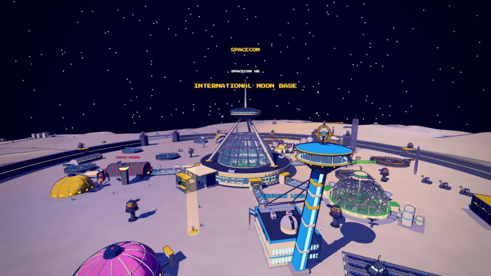
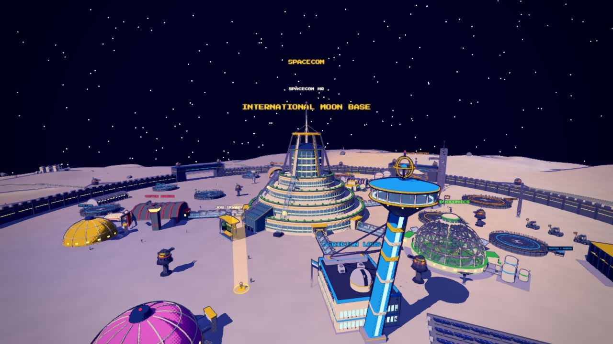
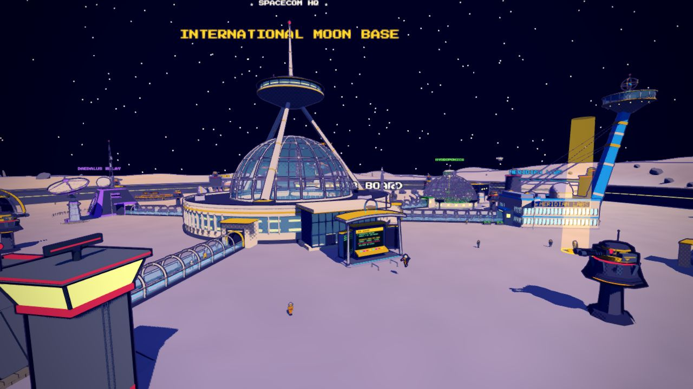
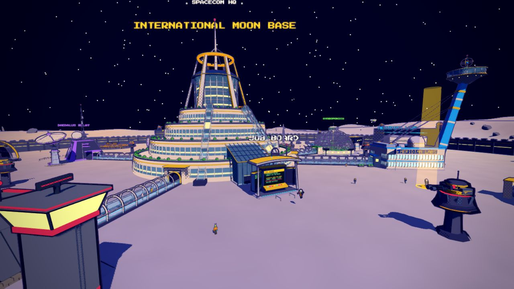
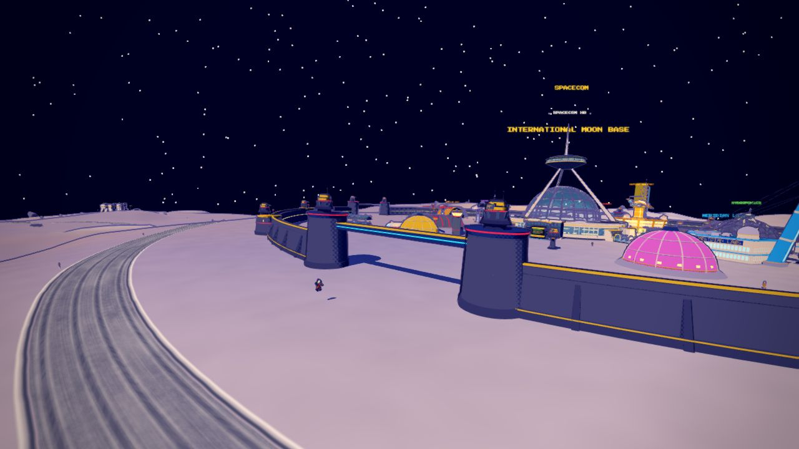
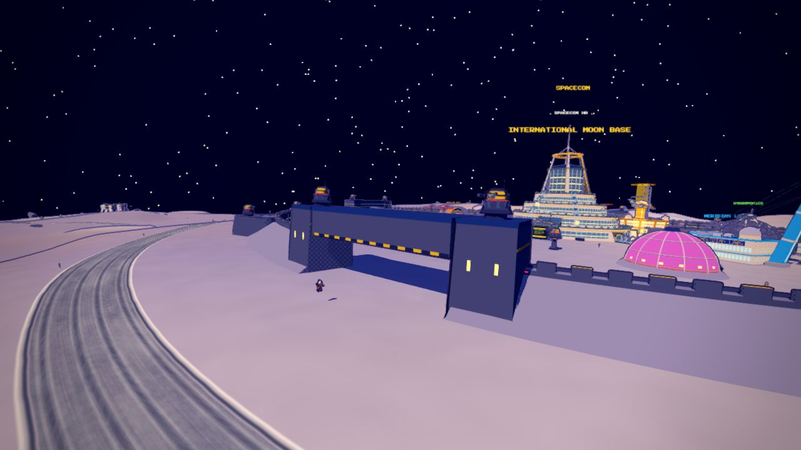
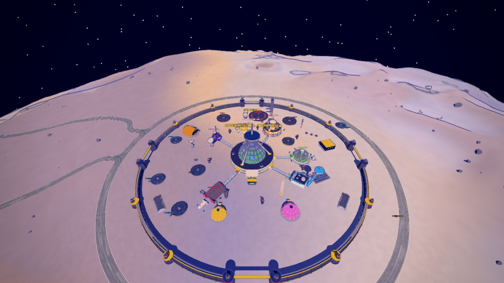
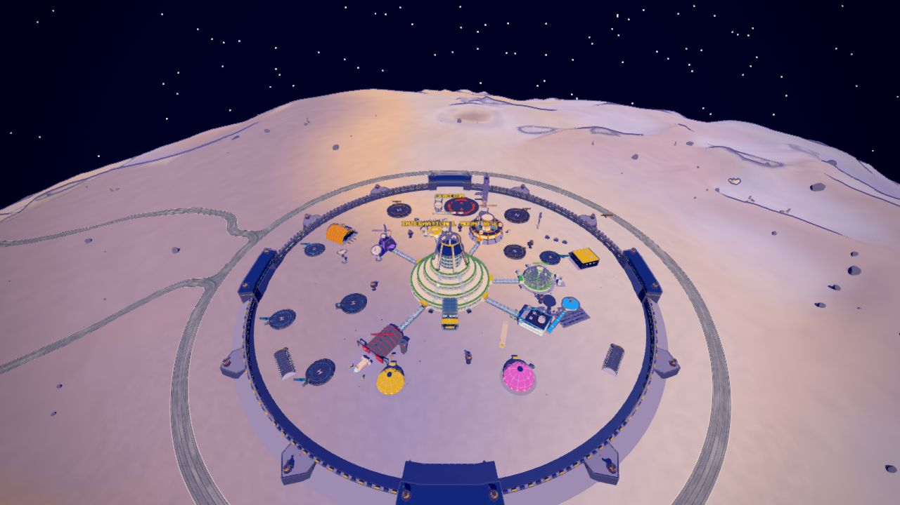
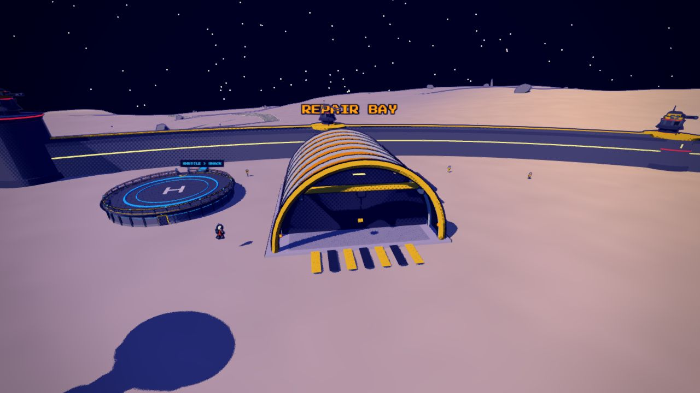
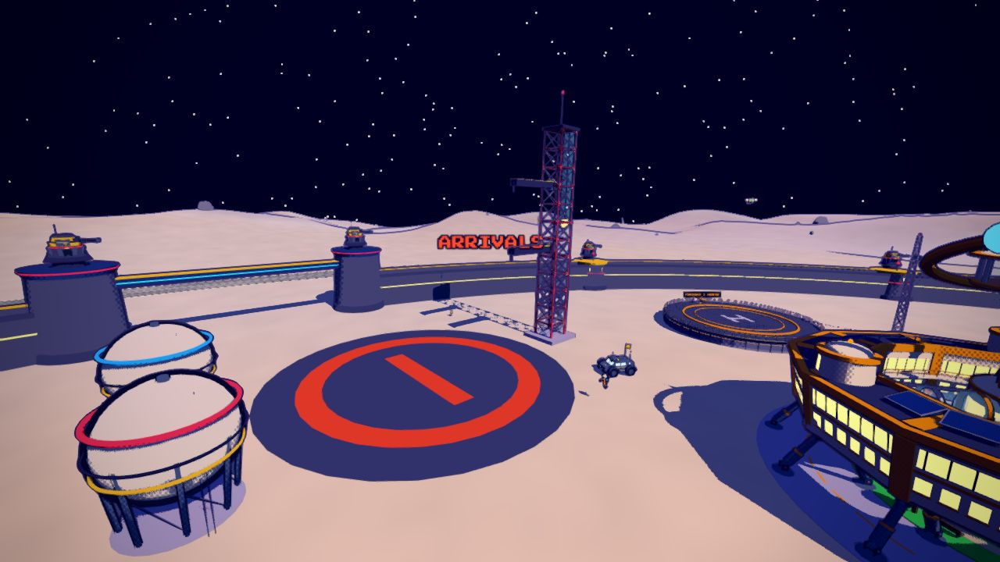

# The ILMB's core: two proposals

The International Moon Base's middle was a 58 m glass hab dome with a spire through it, and its fortress wall forty separate
boxes with gaps between them, separate bastions and gate towers. Both are replaced by Blender models
(`tools/blender/build_ilmb.py` -> `src/assets/ilmb.glb`, placed by `src/ilmbCore.js`), in two proposals. Each is a whole: a
central complex that still docks the six wings' skywalks, and a wall that reads as one continuous ring.

Switch between them in the game with `?ilmbCore=a` or `?ilmbCore=b` (or `localStorage['mr-ilmb-core']`); `?ilmbCore=old`
brings back the code-built dome and wall. Both are in the Asset Row (buildings: ILMB CORE A / B; places: the whole base).

| | Draft A: **the Crown** | Draft B: **the Arcology** |
|---|---|---|
| Central complex | A ring concourse 100 m across, 12 m high, its glazed band running all the way round, around a garden courtyard under a glass dome; over the dome, on three canted legs standing on the ring's roof, a command saucer with the spire. Low and wide. | A stepped mesa of four battered terraces, each with its glazing band and a planted, railed edge, rising to a glass lantern; six canted blades round the lantern meet a halo ring 72 m up, the spire over it. Tall, a landmark from anywhere on the plain. |
| Main entrance (toward the job terminal) | A glazed atrium with a cantilevered canopy | A glazed prow out of the first two tiers, with two inclined glass elevators climbing the terraces' edges either side |
| Wall | **The Rampart**: a battered wall on a plinth with buttress fins, red lamps, a gold-coped parapet and a walk; it swells into round bastions, and at each gate rises into two drum towers with a lit bridge between | **The Earthwork**: an armoured wall with a regolith berm banked against its outside and a crenellated crest; arrowhead bastions like a star fort's, and at each gate one gatehouse: two massive piers and a lintel block over the opening |
| Size | complex 28k triangles, wall 25k | complex 66k triangles, wall 19k |

Both keep the gameplay the base had: the six skywalks dock at r 56 on the wings' angles (they run from the core's lobbies to
each wing's), the main entrance faces the job terminal, the gates are where they were and as wide (about 50 m, under a
bridge or lintel 13 to 14 m up), and the sixteen wall guns stand where the old ones did (two per gate, one per bastion).

| Draft A: the Crown | Draft B: the Arcology |
|---|---|
|  |  |
|  |  |
|  |  |
|  |  |

## The rest of the base, also in Blender now

Every other code-built piece of the ILMB core went to Blender in the same file, refined on the way (each where the old one
stood):

- **The skywalks**: glass tubes on their slabs, white frames every 5 m with a lamp at the crown, gold portal frames at the
  ends, a lit runner down the floor (the walkers through them are still the game's).
- **The job terminal**: a navy console under an arched aluminium canopy on raked posts, the side screens' housings on struts,
  a lit plinth and queue rails (its screens and holo ring are still drawn by the game).
- **The repair bay**: the arched hangar on aluminium ribs, its open end on a lit bay with a bridge crane hung from the roof,
  an office annex, hazard-striped apron.
- **The launch gantry**: the red and white umbilical tower with two swing arms on hinge drums and a lift shaft; **the two
  Horton fuel spheres** with bands at their heights, braced legs and a ladder to a landing.

- **The two family domes** (pink and gold), **the barracks Quonsets**, **the vehicle depot** (a portal-framed shed with three
  roller doors), **the comms mast** (its dish head turning), **the inner defence pylons**.

All of it passes the structure audit (`python3 tools/blender/structure_audit.py tools/blender/build_ilmb.py`): what it still
lists is deliberate (the mast tips under the lamps the game draws, mullions set in the glazing, frames meeting a bridge).
