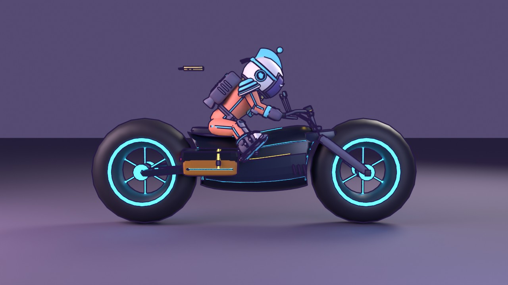
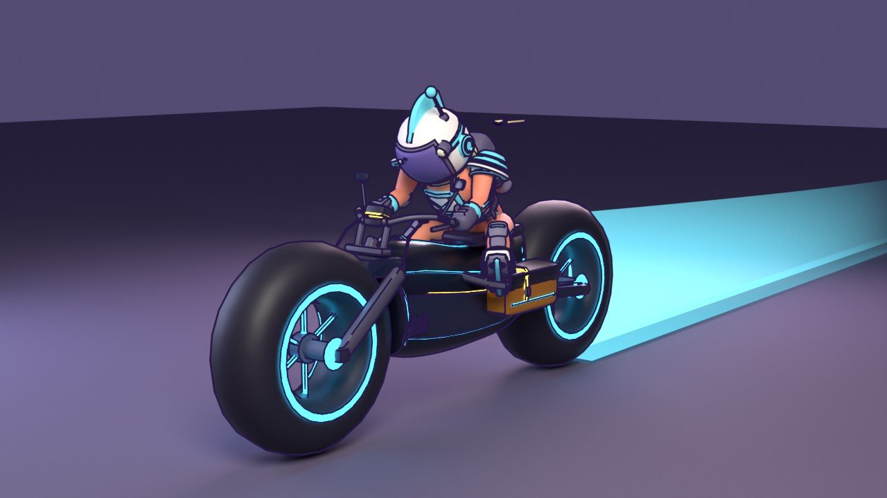
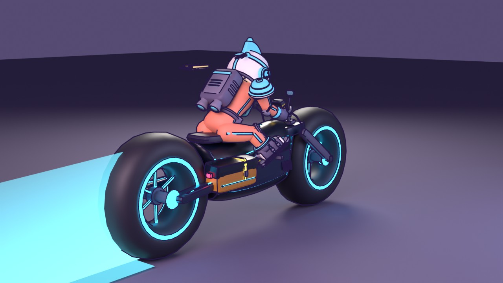
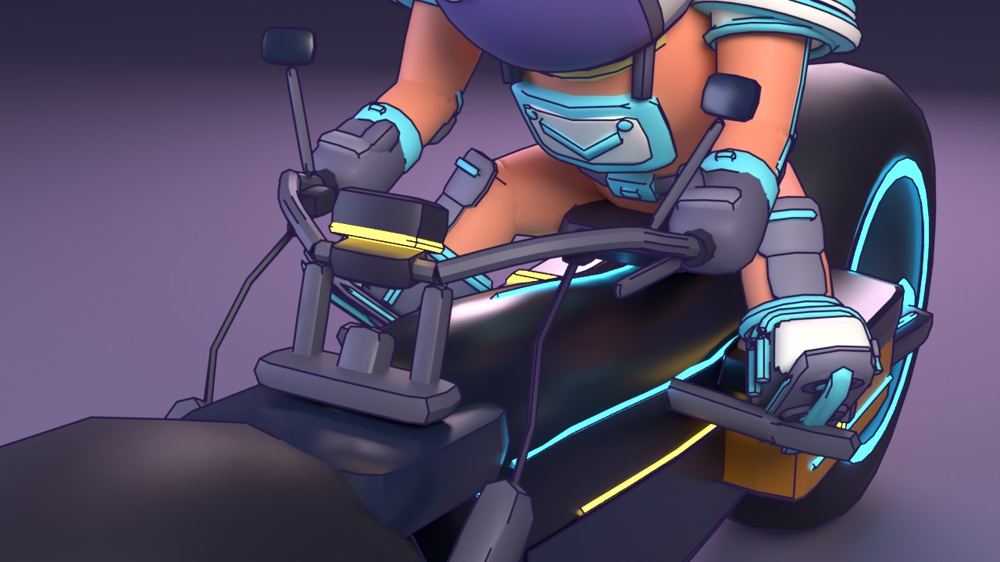

# Meridian Courier Light-Bike

| front three-quarter | rear three-quarter | cockpit |
|---|---|---|
|  |  |  |

The bike in the game (it was proposal B, "Parcel Runner"; the other proposal, the Slipstream, and the primitive-built classic
bike are retired). Built from code in Blender by `tools/blender/build_courier.py` into `src/assets/lightbike.glb`, which
`makeLightBike` in `src/models.js` dresses with the game's materials. After a rebuild, run `npm run optimize:glb`.
`tools/blender/preview_courier.py` builds it, seats the runner, checks the fit and renders the views above (Cycles on the CPU,
`pip install bpy`; the runner is the game's own `runner.glb`). `PREVIEW_RENDER=0` runs only the checks (about 2 s).

## The design

- **No upper wheel wells.** One smooth lofted shell stops short of each tyre and is scooped to it (a 0.08 m gap), so the nose
  and tail cup the wheels without covering them; a glow arc runs round each scoop.
- **Chunky wheels at the front and back:** 0.78 m outside radius, 0.54 m wide, hubless with a glowing ring on each face and six
  glowing spokes rooted in a hub, on slim forks and a swingarm.
- **A sleek body** carrying a cyan shoulder line, a gold pin-stripe and a cyan belly line over a flush dark side panel, and a
  spine light on top.
- **Rounder and friendlier, a delivery bike:** a round headlamp in the nose, and square flapped panniers slung low with a gold
  strap and buckle, half sunk into the flank (`bag_x` 0.36), in their own `bag` slot (the trim colour as a flat toon).
- **An open cockpit, no windscreen:** a triple clamp on the fork tops, two risers with a cross-piece and a gauge pod (lit
  display, gold bezel), a pulled-back swept bar over the slim, scooped tank (half width 0.27, top 1.30 m at the seat) with
  rubber grips and gold end caps, brake levers with reservoirs and lines down to the forks, mirrors on stalks.
- **Footpegs under the rider's soles** (`sole_on_peg`: placed from the rider's pose), on brackets off the shell.
- **About 10k triangles**, plus 7k drawn again for the outline, inside the house budget of about 11k for a vehicle
  (`style.md`). Passes `audit_coplanar`. Ink-0 details stand at most 6 mm off their surface.

## The rider

The pose is solved against the geometry (`SPEC["pose"]`, written to the GLB root as `pose_*` extras, read by `player.js`):
torso lean 0.752, thigh swing -1.5, leg spread 0.6 rad, knees bent 0.8, arm swing -1.179 with 0.128 out, elbow -0.704. The low
belly and the panniers leave the feet room only forward and out, so the thighs ride near level. `preview_courier.py` checks it
every run: both fists within 3 mm of the grips, each skate's rail within 1 cm of its peg, and no leg vertex more than 4 mm
inside the shell or bags (6 vertices, 5 mm at worst). Try other poses with `COURIER_POSE='{"knee": 1.0}'`.

## What the game reads

- **Pivots** (empties with a `role`): `chassis`; two `wheel`, spun about x; `trail`, where the light trail streams from. The
  rider's hip is in the root's `seat` extra, in the bike's own frame.
- **One material a mesh, named for its slot.** Fixed toon: `navy panel dark metal seat tire bag`. Glow: `glass lamp tail`, and
  the two livery glows `stripe` (the bike's colour) and `trim` (the gold).
- **`ink`** on every mesh, by part size as `style.md` lists.

## The light trail

`LightTrail` in `src/models.js`: a 1.5 m glowing wall over a 0.6 m glowing strip of ground (so it has body from any angle),
holding bright for 4 s and easing away, shrinking as it ages. A point is laid every 0.45 m (or every frame when faster), up to
512, so it keeps its shape through slow tight turns and covers 4 s at speed. Holding fire lays **hard light**: that stretch also
draws near-solid and is a wall for everyone but you (`vehicles.js`, the WAKE bar). The renders draw a mock-up of the trail, not
the game's shader.
