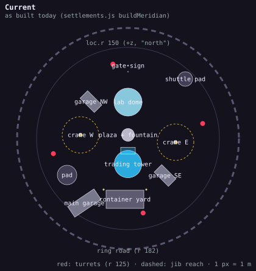
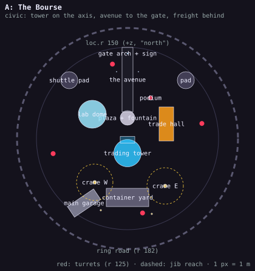
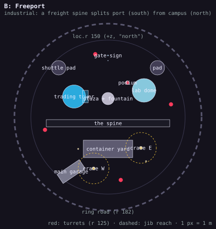

# Meridian Exchange: two layouts

Two alternative building layouts for the Meridian HQ (`src/settlements.js` `buildMeridian`), drawn against the
constraints the rest of the game puts on the site. **Layout A is built** (it is what `buildMeridian` lays out now);
B stays a proposal. The "current" plan below is the layout as it was before A. The plans are
`docs/meridian-layout-current.svg`, `-a.svg` and `-b.svg`, drawn and clearance-checked by
`tools/meridian-layouts.mjs` (the footprints are the data at the top of that script; `node tools/meridian-layouts.mjs`
checks them, `node tools/meridian-layouts.mjs docs` redraws the plans).

All positions are in the settlement's frame, metres, +x to the right of the plan and +z up it ("north": the side
the gate sign and the lab dome are on today).

## What the site has to live with

These come from code outside the builder and are the same for every layout.

| Constraint | Where it comes from | What it means for a layout |
|---|---|---|
| `loc.r` 150 | `locations.js` | Everything solid inside r 150; the ring road's centreline sits at r 182 (`RING_GAP` 32) and is pushed further out wherever a pad or a solid is in the way. |
| Four defence turrets at r 125, angles 0.2 + i·π/2 rad: (122, 25), (-25, 122), (-122, -25), (25, -122) | `world.js` `defensePylons` | Keep 6 m off them. |
| The main garage at angle 236°, r 128, bays facing the ring | `GARAGE_AT`, `traffic.js` `garageRoad` | **Fixed in both layouts.** The forecourt fan and the on-ramp are hand-tuned to this stretch of ring (`TIP0`/`TIP1`, the casino road's junction); moving the garage means retuning `garageRoad`. |
| The faction leader stands where `story.findSpot` puts them | `story.js` | Its first candidate is about (38, 67); it takes it if nothing solid is within 8 m, else moves on round. Both layouts leave that spot open on purpose. |
| The name and "★ MERIDIAN HQ ★" sprites hang over the origin at y 50 and y 62 | `world.js` `buildLocation` | Nothing tall at (0, 0): the tower (72 m to the spire tip) stays at least 20 m off the origin. |
| Pads are spares: kept only if transit uses them | `world.pad(..., spare)`, `traffic.js` `dropSparePads` | Two spare pads on opposite diagonals as today; the freighter's own pad is laid by the traffic, clear of buildings and of the other flight. |
| Gate sign at (0, 120) facing in, flag at (0, 110) | `buildMeridian` | Both layouts keep the gate on the +z side. |

Pieces in play, with their sizes: the trading tower (plinth r 24, ticker collar r 19.6, portico and steps 27 m out
from the centre on the door side), the lab dome (r 22 plus plinth), the main garage (hall 38 × 20 plus the office
and tank yard, 52 m over all), the container yard (62 × 30 today, gantry travel ±24), two tower cranes (34 m
masts, 30 m jibs), the plaza fountain, floodmasts, lamps. Today's two small garages (33 × 17.5 each, on the NW and
SE diagonals) are dropped by both layouts: the main garage is the motor pool, and the sheds only cluttered the
plaza's corners.

## The layout before A

Radial, round a central plaza: tower south of it, dome north, yard far south, cranes east and west, small garages
on the NW and SE diagonals. It reads as a cluster from every side and from no side in particular; the tower, the most
detailed piece on the site, has nothing leading to it.

(Found on the way: the builder's header still promises "four sawtooth warehouses with docks" and the layout comment
puts them "out on the four corners". No warehouse is built, and neither layout below builds one; the comment should go.)

## Layout A: The Bourse (civic, on an axis)

**The idea.** One axis. You come in through a gate arch on the +z side and look straight down a 118 m avenue at the
tower's portico, with the lab dome and a new trade hall facing each other across the avenue. Everything that works
for a living (the yard, the cranes, the garage) is behind the tower, out of that view. The Exchange reads as a
seat of government from the gate and as a port from the ring road behind.

| Piece | Position (x, z) | Size / facing | Note |
|---|---|---|---|
| Trading tower | (0, -24) | door toward +z | `TZ` -42 → -24; portico and steps end at z ≈ 3 |
| Plaza and fountain | (0, 34) | r 12 | between the portico and the avenue, 21 m out from the steps (the casino's fountain needs the room) |
| The avenue (new) | x ±7, z 44 → 150 | the traffic's own road surface (`loc.paved`) | lamp and banner pairs along it at x ±20; a ground decal, no collider, so the ring road is unaffected |
| Gate arch and sign (new) | (0, 140) | across the avenue | the `k.sign` moves from (0, 120) onto the arch; flags at (±18, 110) |
| Lab dome | (-58, 40) | r 22, door toward the avenue | was (0, 60) |
| Trade hall (new) | (64, 24) | 24 × 56, long side on the avenue | a sawtooth-roofed hall (the roof an `ExtrudeGeometry` profile like the portico's pediment), loading doors on its back |
| Leader's podium | (8, 6) | pinned (`loc.leaderSpot`), facing the plaza | at the foot of the portico's steps, off the doors' line (the study had it at `findSpot`'s (38, 67), beside the avenue) |
| Container yard | (0, -97) | 70 × 30, the gantry runs ±24 m | was (-5, -100), 62 × 30; now stacked with the land-train's containers under a Blender-built gantry |
| Tower cranes | (-54, -72), (62, -78) | jibs over the yard | were (-78, 6), (78, -6) |
| Main garage | fixed | | |
| Pads (spare) | shuttle (-96, 96) r 14; the other (96, 96) r 14, its mirror across the avenue | | were (94, 98) r 12, (-100, -60) r 16 |
| Floodmasts | (40, -124), (-44, -118) | | over the yard |

**What it does for play.** The avenue is a long straight you can take at speed from the gate to the plaza, and its
kerbs are a natural grind line if they are registered as rails. The leader stands at the foot of the steps facing the
plaza, so the Charter finale's visit is a ride up the axis to the podium. From the ring road's south stretch the yard and both cranes
front the road, so the port is still the thing the traffic sees.

**Code.** All in `buildMeridian`: move `TZ`, the plaza, the dome, the yard (and its gantry's travel), the cranes,
the masts and the pads; drop the two small `garage(..., 'small')` calls; add the avenue (a slab with kerbs and lamp
pairs), the arch and the hall (one new helper). `traffic.js` is untouched: the garage and its road stay, the pads
are spares and the traffic lays its own.

**Risks.** The tower at (0, -24) stands 24 m off the origin, so the two sprites over (0, 0) clear its third tier
(r 10.5) and its cone; they would not clear it at (0, 0). The podium is pinned, so `findSpot`'s 8 m rule does not
apply to it; it keeps 4 m off the portico's lamps. Nothing new stands near the garage's forecourt.

## Layout B: Freeport (industrial, split by a spine)

**The idea.** A 240 m paved freight spine runs east–west across the site at z -12 and splits it in two. South of
the spine is the port: a container yard half as big again as today's, the gantry running its full length over a
lane between two rows of stacks, both tower cranes over it, the main garage at the end. North of the spine is the campus: the tower stands to the west on its own with its portico facing east
onto the plaza, the lab dome closes the east, the leader's forum lies between them, the pads fill the two north corners. The Exchange reads as a
working port from the ring road's whole south half, with a head office looking over it.

| Piece | Position (x, z) | Size / facing | Note |
|---|---|---|---|
| Trading tower | (-66, 40) | door toward +x (the plaza) | the entrance block needs a yaw of its own (see Code) |
| Plaza and fountain | (0, 36) | r 12 | the tower's portico opens onto it |
| The spine (new) | x ±120, z -19 → -5 | 14 wide, paved, kerbed, lane stripes | lamps every 24 m along the north kerb; a flat slab, no collider |
| Lab dome | (70, 52) | r 22, door toward the plaza | was (0, 60); in from the corner so the pad at (96, 96) fits beside it |
| Leader's podium | (38, 67) | `findSpot`'s first candidate | 12 m from the dome's shell (the 8 m halo holds, but not by much: nudge the dome, not the podium) |
| Container yard | (0, -62) | 96 × 34, gantry travel ±40 | two rows of stacks, a 6 m lane between them; was 62 × 30 |
| Tower cranes | (-28, -100), (64, -60) | | the west one's jib passes over the garage roof (5.4 m) at 34 m |
| Main garage | fixed | | the yard's corner is 9 m from its hall |
| Pads (spare) | shuttle (-96, 96) r 14; the other (96, 96) r 14, its mirror across the site's axis | | the dome stands 14 m off it |
| Gate sign, flag | (0, 120), (0, 110) | as today | |
| Floodmasts | (-58, -62), (74, -86) | | |

**What it does for play.** The spine is the longest straight on the Moon's settlements (240 m), and the yard's
stacks, in 2.6 m steps, are terraces to drop down or grind along if container tops are registered as rails. The
courier's approach from the ring road's south lanes is into the port, through the stacks, up onto the spine and
across to the plaza: a route, not a cluster. The tower, off-centre, is seen in three-quarter view over the
yard from most of the ring, which shows its stepped tiers better than the head-on view does.

**Code.** The tower's entrance (portico, steps, doors, banners, lamps) is drawn on the tower's +z face with
`k.at(0, TZ)`; turning it toward the plaza means wrapping the tower in a helper that takes a yaw and applies it to
the entrance block and the crown as well (the tiers and the ticker collar are round and do not care). Then: the
spine (a slab with kerbs and stripes), the yard's new size and a second row of stacks (the gantry's rails lengthen
with it), the two small garages dropped, and the moves in the table. `traffic.js` untouched, as in A.

**Risks.** The bigger yard and the garage's forecourt both want the south-west: the yard's corner is 9 m from the
garage's hall by the checker, which is enough but leaves no room to grow the yard westward. The dome
is close to the podium's halo (12 m, against a limit of 8 m). More new geometry than A.

## Side by side

| | A: The Bourse | B: Freeport |
|---|---|---|
| Reads as | a seat of trade: gate, avenue, portico | a working port with a head office |
| Seen from the gate | the tower, head-on, at the end of the avenue | the plaza and the dome; the tower to the left |
| Seen from the ring road (south) | yard, cranes | the whole port: yard, cranes, garage |
| Skate line | one 118 m straight with kerbs | a 240 m straight plus container terraces |
| Leader's spot | at the foot of the steps, pinned | between plaza and dome, 12 m clear |
| New pieces | avenue, arch, hall | spine, bigger yard; the tower's entrance turned |
| Code that changes | `buildMeridian` only | `buildMeridian`, plus a tower helper with a yaw |
| `traffic.js` | untouched | untouched |
| Clearance check (`tools/meridian-layouts.mjs`) | clear | clear |

**Recommendation: A.** It costs less (no change to the tower's code), it gives the most detailed piece on the site a
view that leads to it, and it fixes the one real weakness of today's layout, that the HQ has no front. B's best idea,
the bigger yard with the gantry over a lane between two rows of stacks, fits into A's back yard later without
disturbing the axis.
