# Small outposts: two drafts each

**The brief:** rework the smallest settlements (Trading Kiosk, Watchtower, Supply Depot, Farm Dome, Relay Mast, Scrap
Shack, Junk Pile) at a believable scale (the buildings were tiny: the Watchtower's "bunker" was a 3.4 m Quonset), with
more detail and the owner faction's look. Make the Trading Kiosk work like a grand exchange: a central kiosk with
vendors, people about and places to sit. Two near-full drafts of each.

**Picked and in the game** (`OUTPOST_PICK` in `src/outpostModels.js`):

| Kind | Pick |
|---|---|
| Trading Kiosk | B, the Market Cross |
| Watchtower | B, the Lattice Camp |
| Supply Depot | B, the Silo Depot |
| Farm Dome | B, the Greenhouse Row |
| Relay Mast | A, the Guyed Relay |
| Junk Pile | A, Scrap Mountain |
| Scrap Shack | **C, a mix of A and B** (below) |

Every name board and building lettering that said what a place is (the gate signs, MERIDIAN MARKET, SCRAP & SPARES, THE HULK
and so on) is gone from all the drafts; faction marks, flags and warning signs stay.

All the drafts are built in code with the outpost Kit (`src/outpostDrafts.js`). The picks are the default; to look at
another:

- `?outpostDraft=a`, `b` or `c` shows that draft of every kind that has one (the pick for the rest);
- `?outpostDraft=kiosk:a,tower:a` picks per kind;
- `?outpostDraft=off` brings back the old Kit builds;
- `localStorage['mr-outpost-draft']` takes the same values and sticks.

The flattened plateau under each outpost is 44 m (30 with `off`). The viewer shows any draft
(`/tools/viewer.html?m=outpost&kind=kiosk&draft=a`, `&wreck=1`, `&color=rrggbb` for the owner; `&compare=1` puts the old
build and A and B side by side), and the Asset Row's 08 · OUTPOSTS shows the picks and the drafts not picked.

## Scrap Shack C: the Hulk, hollowed out (the pick)

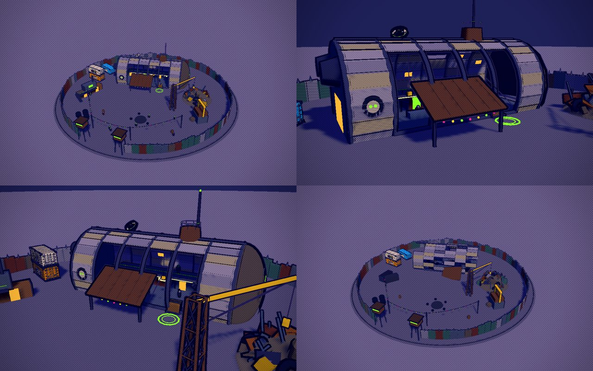

B's crashed freighter, but stripped and lived in rather than whole. The plating is gone along the yard side of its four middle
sections, so the hold stands open on two decks with the ribs standing bare across the gap; a few more plates are missing
elsewhere and window holes are cut in the back, lit from inside. The lower deck (a step up from the yard) has three
containers along the back as rooms with lit doors, a workbench and hanging chains; a railed mezzanine runs over them with a
stair up and a lamp strip under it. A corrugated porch roof leans out over two sections of the opening on posts cut to its
underside, with pirate lights along its edge. The bow is boarded over with a lit window, the stern walled off round a big
lit doorway; a crow's nest, banner and dish ride on the spine. The plating rack (raid) stands in the hold's mouth. Round
it: B's stockade and watch boxes on stilts and its cook fire with tyre seats; A's container bunkhouse with its stair and
balcony, the derrick over the heap and the scrap press; tyre stacks, burning barrels, stolen containers.

## What all the drafts share

| | Before | Drafts |
|---|---|---|
| Yard | 24 to 27 m round apron | 40 m round apron, its floor laid in 32 collider bands (no sinking into the paving) |
| Scale | doors about 2 m, kiosk 3.6 m tall, bunker 3.4 m | doors 2.6 m and up, storeys 3.5 to 4 m, people 1.8 m tall for scale |
| Life | none | vendors, queues, diners, people on benches, guards, a squad drilling, farmers, pirates, junk bots; strollers walk slow rings round the plaza (a turning ring, `userData.spin` as a rate) |
| Look | one palette, the faction colour on trim and flags | each owner's palette (`STYLE`): SpaceCom cream, navy and yellow; Vostok raw concrete and red with a red star; Daedalus violet-black with the eye; Meridian white and cyan with the ring; Kepler cream and orange; Rustmoon scrap with green neon and the skull |
| Storage | ad-hoc boxes | the standard cargo container (`cargoStack`) in the owner's livery (Daedalus has none of its own: it buys Meridian's; Rustmoon's are stolen, mixed) |
| Gameplay | raid spot, blast boxes, smoke, loot drop, wreck | the same, kept for every draft: each has a raid spot with its loot on show, blast boxes on the main building and a wreck |

Images in the sections below: the Kit original (left), draft A, draft B, each framed to fit (so **not** to the same scale: see the sheets above for that); then each draft close up, and each wrecked.
The colours are the kind's real owners (two military kinds are shown in more than one livery).

## Scale: before and after, side by side

Each sheet puts the Kit original, draft A and draft B next to each other **at the same scale** (top), then looks at each
from the same spot 62 m in front of its centre, with the courier (1.8 m) standing at its gate (bottom). The viewer does
this for any kind: `/tools/viewer.html?m=outpost&kind=tower&compare=1`.

| | Before | Draft A | Draft B |
|---|---|---|---|
| Yard across | 48 to 56 m | 80 m | 80 m |
| Trading Kiosk | kiosk 9 x 5 m, 3.6 m tall (billboard to 13 m) | rotunda 21 m across the columns, 17 m to the lantern | trading house 13 m square, two storeys, 18 m to the clock |
| Watchtower | lattice tower to 26 m; Quonset 6.8 m wide, 11 m long, 3.4 m tall | concrete tower to 29 m; bunker 20 x 12 m, 5 m tall | lattice tower to 36 m; barracks 13 m wide, 26 m long, 6.5 m tall |
| Supply Depot | warehouse 20 x 11 m, 8 m to the eaves | warehouse 34 x 16 m, 9 m to the eaves | three silos 8.4 m across, 19 m tall |
| Farm Dome | domes 20 and 14 m across | dome 30 m across | three greenhouses 28 m long; barn 34 x 9 m |
| Relay Mast | mast 41 m | mast 52 m | dish mount 26 m, monopole 36 m |
| Scrap Shack | huts about 11 x 8 m, 4.6 m tall | two-high container block 19 m long, 5.2 m to the roof | hull 34 m long, 15 m to the crow's nest |
| Junk Pile | heap 24 m across, 6 m tall | heap 30 m across, 11 m tall | heap 24 m across, 8 m tall, lookout to 18 m |

For the bigger places: a Kepler town's flattened plateau is 110 to 150 m in radius (220 to 300 m across) with a hub dome
44 m across (60 m for a civic hub), and the HQs run to 280 m. So a draft outpost is about a third of a town across, where the
originals were about a fifth.

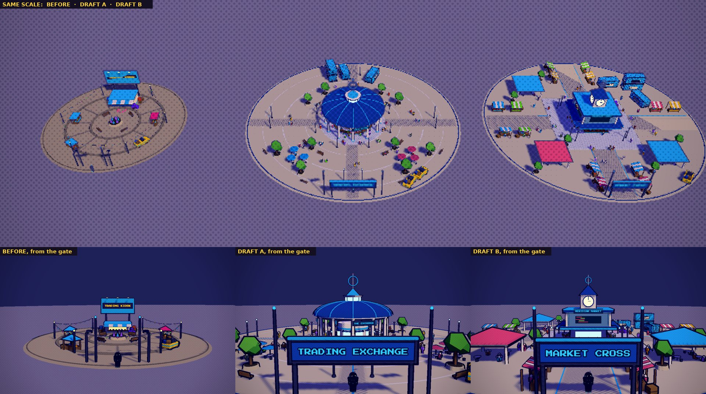
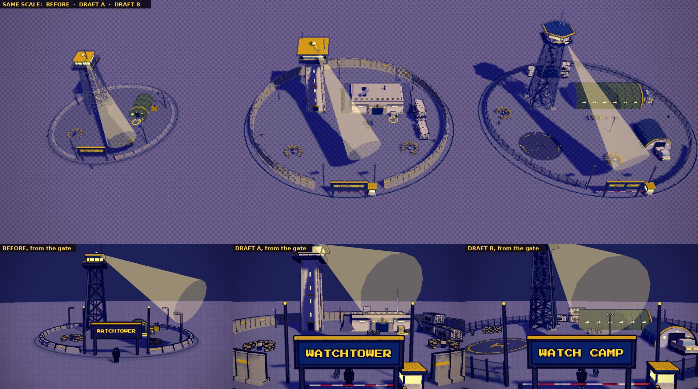
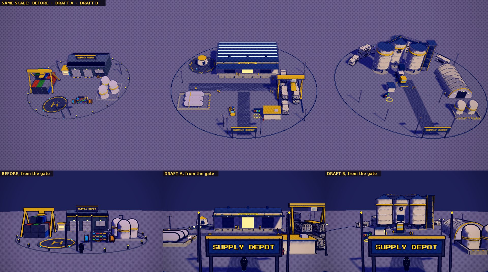
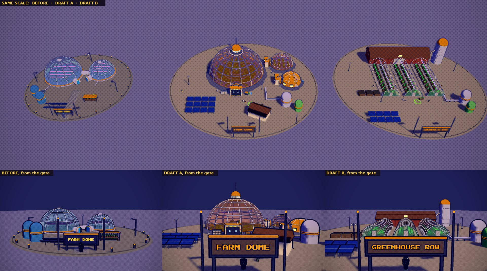
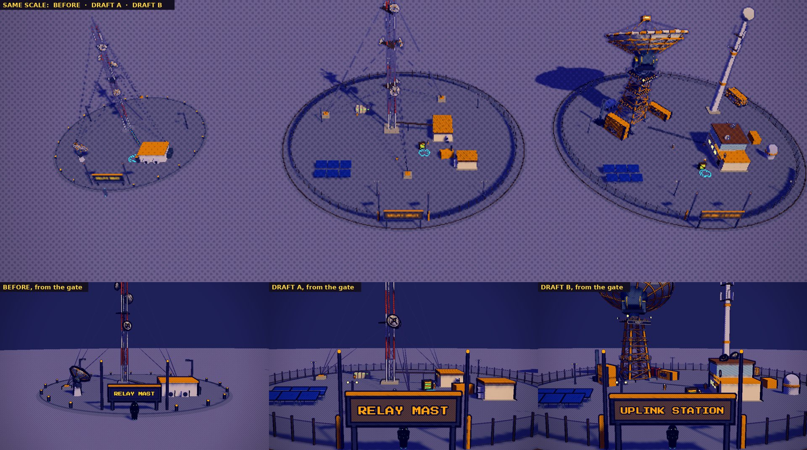
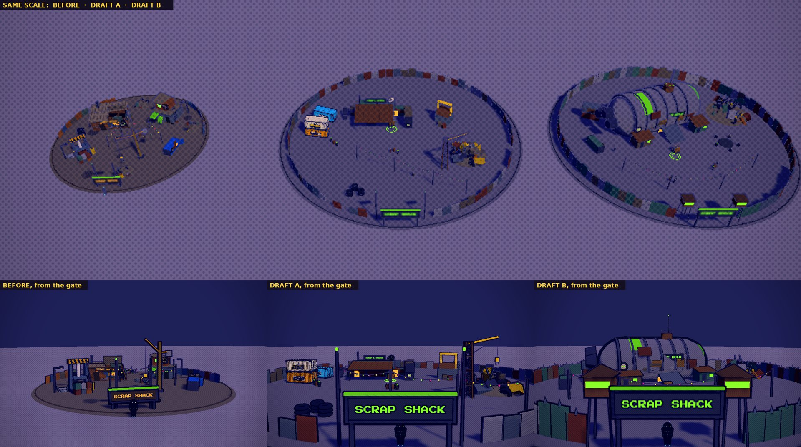
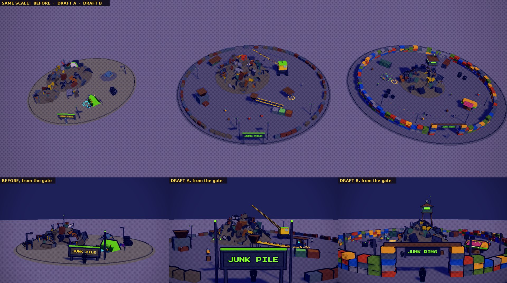

## Trading Kiosk (Meridian)

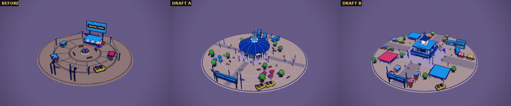

**A: the Exchange Rotunda.** The grand exchange: one round vendor pavilion in the middle of a circular plaza that
everyone trades at. A back-of-house drum with eight lit serving windows, a ring counter of ten bays with a vendor behind
each and queues in front, twelve columns under a ribbed blue dome (17 m to the lantern, the Meridian ring and a beacon on
top), THE EXCHANGE / BUY · SELL · SWAP boards under the ring beam. Four avenues cross the plaza; the quadrants between
them are seating gardens (trees in planters, benches, parasol tables with people at them). Two rings of strollers walk
round it in opposite directions; groups stand chatting. Stock in Meridian containers behind, the mystery crates at the
back door (the raid spot), hover-carts at the gate.

**B: the Market Cross.** A two-storey trading house where two arcaded lanes cross: counters on all four faces under
deep canopies (three vendors and a queue each), the glazed trading floor above with price boards, a clock lantern with
four faces. Open-sided cafés in three corners (pyramid roofs, tables), the stock yard in the fourth, sixteen awning
stalls along the lanes, strollers on the square.

## Watchtower (SpaceCom, Vostok, Daedalus)

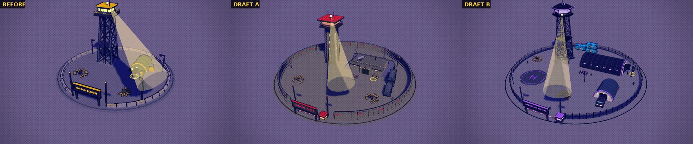

**A: the Fortified Post.** A tapered concrete tower (24 m) with slit windows and a door, a glazed observation cab with a
gallery and a searchlight. The **command bunker** is 20 x 12 m and 5 m to the roof: chamfered roof edges, a recessed
portal with a 4.2 m blast door, hazard stripes and lamps, lit slits, a hatch, periscope, radio mast, radar and sandbags on
the roof, regolith berms on three sides, the faction mark over the door. A ring of 3.6 m T-walls with a checkpoint
(guard booth, boom barrier), two gun pits, containers, a squad drilling, sentries walking the wall.

**B: the Lattice Camp.** A 30 m steel lattice tower with stair flights and landings inside and a hexagonal glazed cab;
its searchlight rides round the gallery. A 26 m Quonset barracks (6.5 m radius, porch, lit windows, the mark on the end
wall), a motor-pool Quonset with a patrol rover, a helipad, a chain-link fence with the checkpoint, gun pits, a squad on
parade.

## Supply Depot (SpaceCom, Vostok, Daedalus)

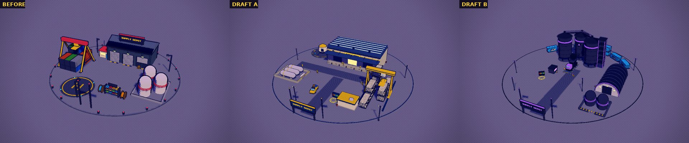

**A: the Distribution Shed.** A 34 x 16 m warehouse, 9 m to the eaves, with a six-tooth north-light roof, three roller
doors (the middle one open on a lit bay with containers inside), a raised loading dock with bumpers and stairs under a
canopy. A container yard under a 12 m portal crane, a bunded fuel farm of three horizontal tanks, a lander on its pad, the
yard office and the wiring rack (raid), a hover-cart.

**B: the Silo Depot.** Three 16 m bulk silos on legs with a catwalk across their tops to a glazed stair tower, a chute
over a hauler on the weighbridge, a 22 m Quonset store, a wall of containers round the back, a weigh house and the
wiring rack, a bunded pair of tanks.

## Farm Dome (Kepler)

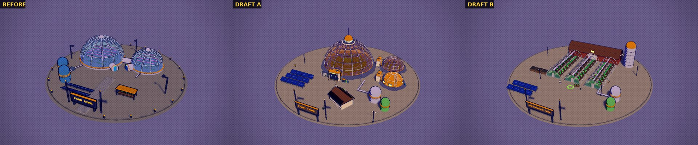

**A: the Great Dome.** One 30 m glazed dome (Kepler's habDome shell, with its airlock and cupola) over three ringed
terraces of crops and an orchard, grow lamps hung inside, farmers at work. Two seed domes, rows of solar tables (each
post cut to its panel's underside, facing the sunward +z), water and nutrient tanks with their pipe, the packing shed
with the sapling crates (raid).

**B: the Greenhouse Row.** Three 28 m glass barrel vaults over crop beds, closed at the back by a 34 m red packing barn
with a gambrel roof, a grain silo with its chute, compost bins, tanks, a solar row, the sapling cart at the middle
greenhouse's door (raid).

## Relay Mast (Kepler, Meridian)

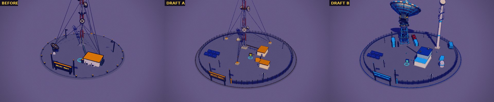

**A: the Guyed Relay.** A 52 m guyed lattice mast in red and white bands: three service platforms, five dish heads on
arms in the owner's livery and a dish turning on a boom at the top, sector panels, guys to three anchor blocks. An
equipment shelter with a cable bridge from the mast, a second shelter, generator, battery bank, the transponder rack
(raid), solar tables, a security fence.

**B: the Uplink Station.** A 26 m dish on its lattice mount (the dish stations' model, turning slowly, in the owner's
livery), a 36 m monopole with two tiers of sector panels and a radome, a two-storey operations building with a glazed
control room and small dishes on the roof, generator, tank, the transponder rack, solar tables, a container.

## Scrap Shack (Rustmoon)

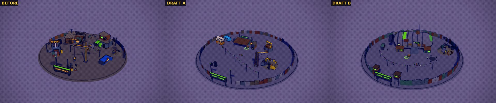

**A: the Container Workshop.** Shipping boxes stacked two high into an L, with lit doorways, a stair and a railed
balcony, a corrugated lean-to over the work floor (its posts cut to the roof), SCRAP & SPARES neon and the clan's skull.
A scrap press, a derrick with its hook over the heap, the plating rack (raid), burning barrels, tyre stacks, a plate fence,
pirate lights.

**B: the Hulk.** A crashed freighter's hull on its belly, made the clan's workshop: a lit hold with a ramp, lean-to rooms
down its flank, patches and a green stripe, a crow's nest and banner on its back, THE HULK on its side. A stockade of tall
plates with two watch boxes on stilts at the gate, a cook-fire ring of tyre seats, a heap, scrap boxes.

## Junk Pile (Rustmoon)

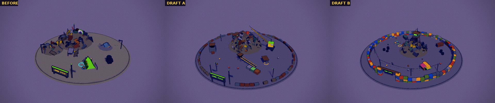

**A: Scrap Mountain.** An 11 m mound of wreckage (a car, a fin and a dish on top) worked by a tracked electromagnet
crane whose boom turns slowly over it, a sorting line from a hopper into three bins, a crusher, the junk-bot bench under
an awning (raid), the foreman's hut, junk bots pottering.

**B: the Junk Ring.** A ring wall of crushed cars stacked two and three high, a gate of car stacks under a JUNK RING beam,
the central heap with a lookout shack on stilts and its searchlight, tyre stacks, a tinker's caravan with an awning and
counter, the junk-bot pen with a charging post (raid).

## Close up

| A | B |
|---|---|
| 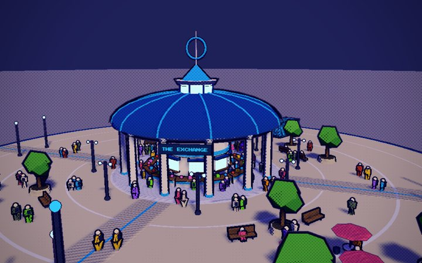 | 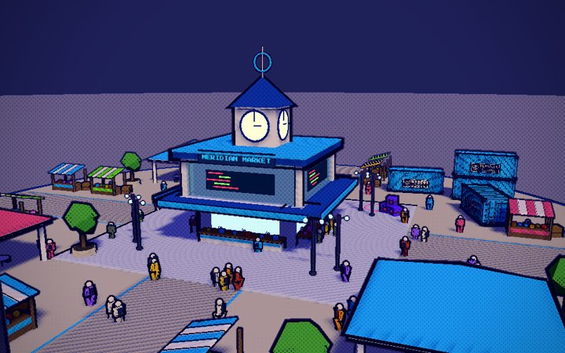 |
| 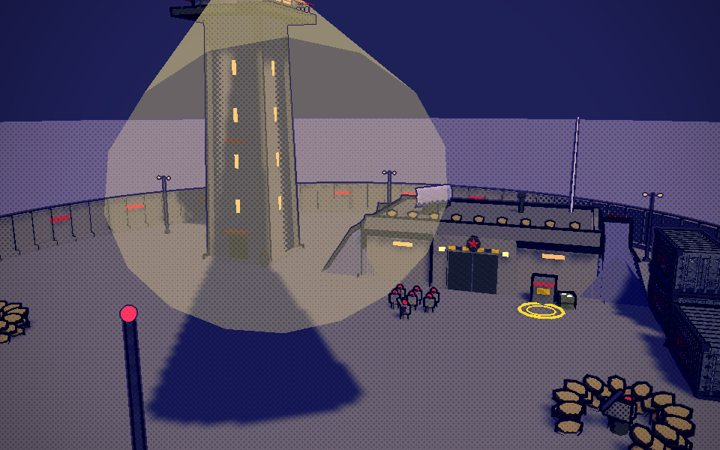 | 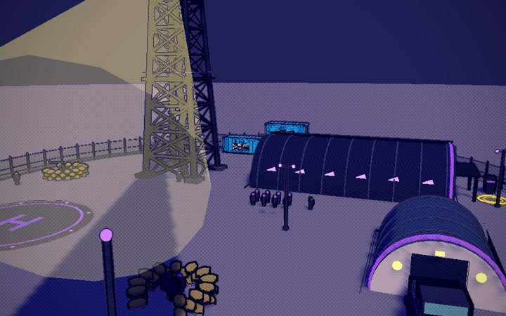 |
| 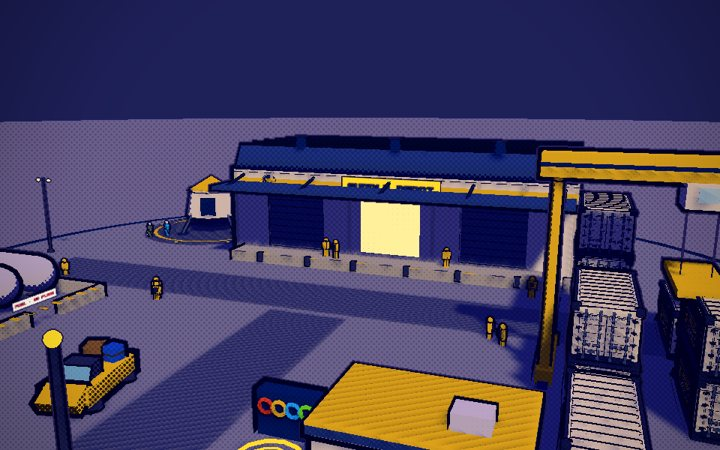 | 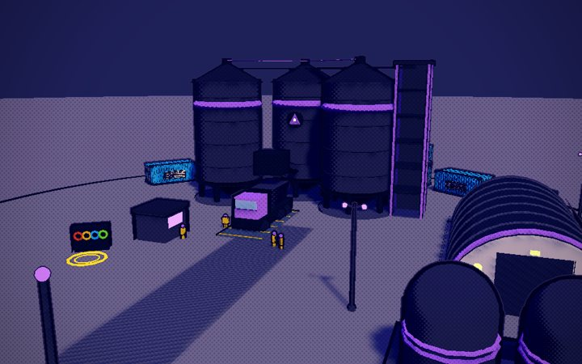 |
| 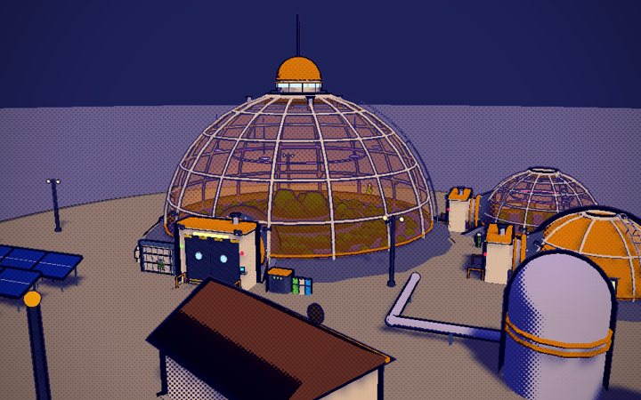 | 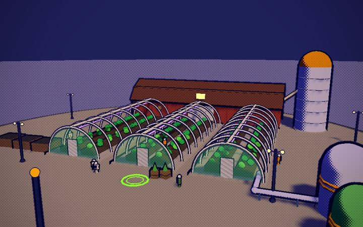 |
| 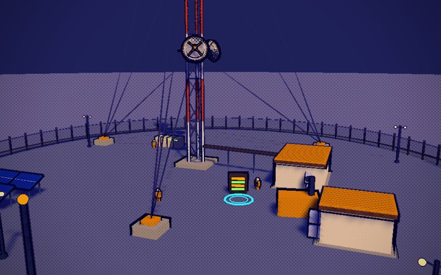 | 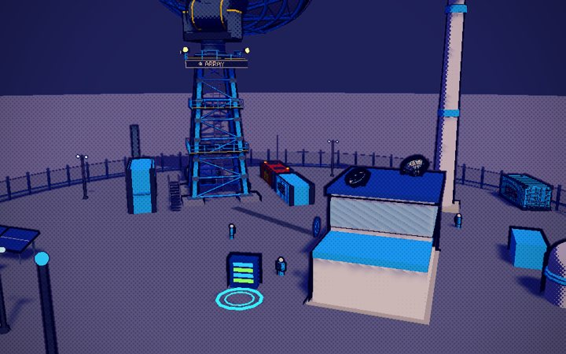 |
| 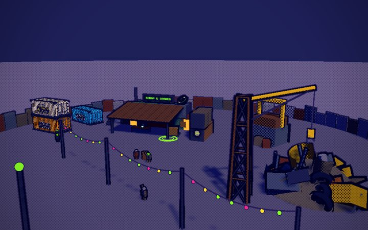 | 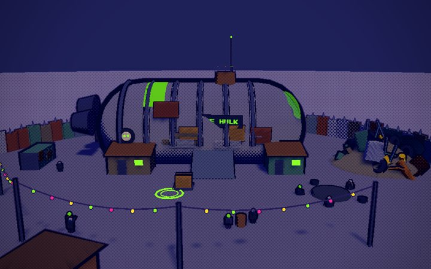 |
| 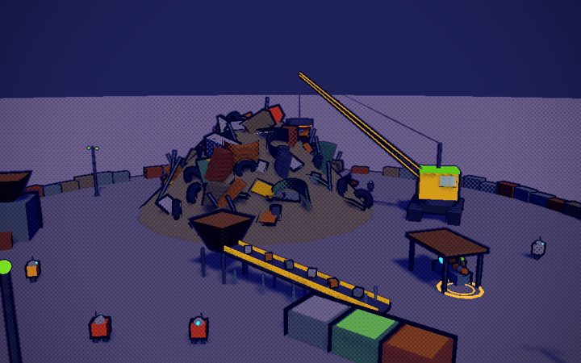 | 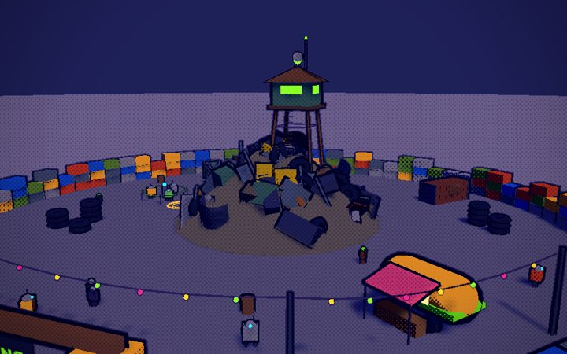 |

## Wrecked

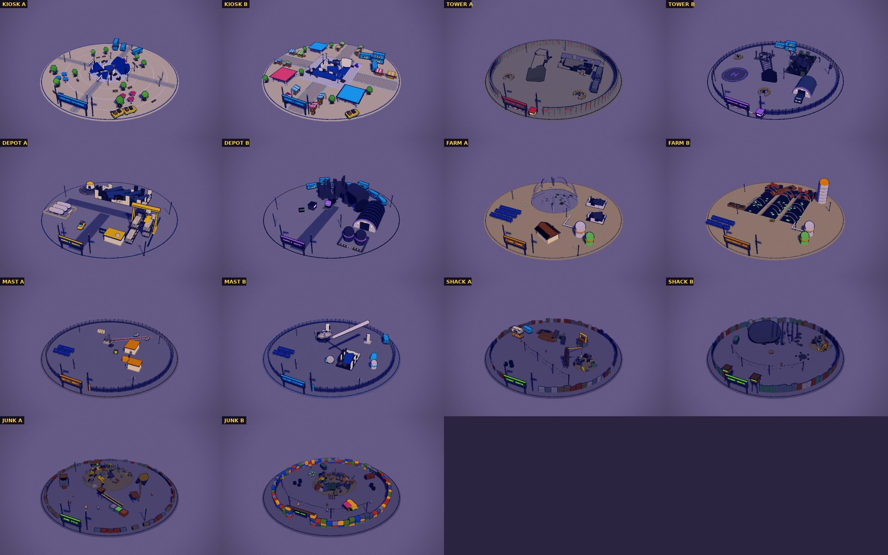

## Cost and what is still rough

- **Draw calls** stay low (8 to 21 per outpost, the Kit merges by material). **Triangles** are up: 20k to 150k against
  10k to 12k, mostly the people (about 400 triangles each with their ink) and, on the depots, the Blender containers.
  Only outposts within 900 m are built, but a draft that is picked should get a diet (fewer, simpler people; fewer
  containers).
- **Colliders:** 66 to 240 per outpost (floors included), against about 20 before.
- People stand still except the strollers, who glide round their rings rather than step.
- Not yet looked at from the runner's side in play (grinds, every roof reachable): the colliders follow
  `docs/collision.md`, but each picked draft wants a pass with `tools/downs-audit.mjs`-style checks and the free cam.
- Once one of each is picked, it replaces the Kit builder in `src/outpostModels.js` (and the Blender pilot for the mast
  and tower, `tools/blender/build_outposts.py`, would need redoing to match, or retiring).
