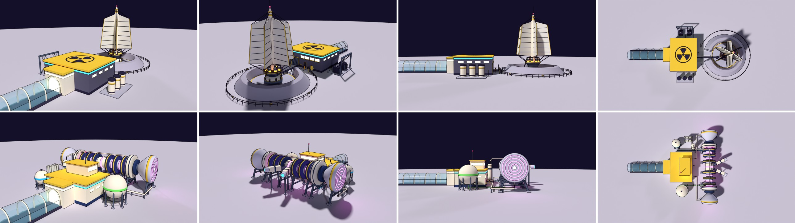

# ILMB Power Block: two redesign proposals

**The brief:** redesign and refine the ILMB's Power Block in Blender, around a form of power that would really be used in
space: one proposal for **nuclear fission** and one for **fusion**.

**What's wrong with the current block** (`current_ingame.jpg`, built in three.js by `wingPower()` in `src/world.js`): the
slate reactor hall with a glowing drum on its roof is fine, but its landmark is a pair of hyperboloid **cooling towers venting
steam**. Those only work on Earth: they reject heat by evaporating water into air. On the Moon there is no air, so all waste
heat has to leave as radiation, through **radiator panels**. Both proposals drop the towers and use radiators, which follows
the house rule *lunar logic over car logic* (`.claude/skills/blender/style.md` §4).

Both are concept models built from code by `tools/blender/build_power.py` (`VARIANT = "a"` or `"b"`), exported here as
`power_a.glb` / `power_b.glb`, and rendered by `tools/blender/preview_power.py`. **B was picked and is in the game** (below); A stays a concept. Both fit
the existing wing plot: the same wing frame, a vestibule whose front face sits at x = -12.6 so the skywalk docks unchanged,
the SPACECOM cream, yellow and navy, and the ILMB's cyan band. The glass skywalk stub, the ground and the orange figure (1.8 m) in
the renders are for context and scale only.

| | A: "Pile" (fission) | B: "Bottle" (fusion) |
|---|---|---|
| Real-world basis | NASA Fission Surface Power / Kilopower (KRUSTY, 2018): a uranium core, heat pipes, Stirling converters, deployable radiators | D-He3 tandem magnetic mirror (GAMMA-10, WHAM / Realta): a linear magnetic bottle, beam heating, direct energy conversion |
| Silhouette | a **31 m spire** of six radiator fins over a bermed pit (vertical landmark) | a **44 m bottle** on trestles, glowing between its coils (horizontal landmark) |
| Signature glow | orange: the Stirling converters' hot ends | pink: plasma windows and the converter end faces (H-alpha, the colour real hydrogen plasmas glow) |
| Footprint (wing frame) | x -12.6 to 43.8, z -18.3 to 18.3 | x -12.6 to 27.1, z -22.1 to 22.1 |
| Concept triangles | 15.1k | 16.8k |

## A: "Pile" (fission)

A reactor the size of a base's needs, laid out like NASA's lunar Fission Surface Power reference concepts.

- **Reactor in a regolith pit.** The core sits below grade inside a ring berm of regolith. The berm *is* the shield, so
  nothing else needs to be. The berm is open toward the hall, with concrete wing walls at the cut, an apron with a yellow
  ring, and the reactor head at grade: a steel liner collar, a domed cream head and eight control-drum drives.
- **Shadow shield and converters.** A steel cone with tungsten bands sits between the core and the converter deck above it.
  On the deck are eight Stirling converters, with **hot ends glowing orange** (they run at about 800 °C), finned cold ends,
  alternator caps, and heat pipes to the mast.
- **Radiator spire (the new landmark).** A tapered mast with six vertical radiator fins, 17 m tall. Lunar radiators stand
  vertical so both faces see cold sky and not the sunlit ground. Each fin has a header pipe up its inner edge, heat-pipe ribs
  on both faces, a yellow rim, stays from a collar near the top, and struts from the deck. A red blinker and a whip sit on top.
- **Switch and control hall.** It keeps the old block's slate and yellow-cap look, with the cyan band. Control-room
  windows look out at the reactor, and there are a personnel door and a roller door. A big **trefoil is painted on the roof**
  for the map and for anyone flying over. A cable tray runs from a junction box at the reactor to the hall; the access lane
  runs beside it.
- **Around it:** a **spent-fuel cask pad** (three dry casks), a **switchyard** (two transformers with fins and bushings
  under a busbar gantry) and an **exclusion fence** round the berm with trefoil signs and a large one at the gate.

## B: "Bottle" (fusion)

A D-He3 fusion plant, fuelled from the Moon's own regolith. That is the reason anyone would build fusion here, and it ties the
plant to the **Helium-3 Exchange** and to the courier cargo that already exists (Helium-3 Canister, Spare Reactor Coil).

- **The magnetic bottle.** A 25 m central cell runs along the plot, at right angles to the skywalk (the T is visible on the
  way in). It has six **navy superconducting coils** with yellow bands, **pink plasma windows** between them, and a cream
  midplane chamber where the beams enter.
- **Mirror plugs and direct converters.** At each end is a thick cream mirror coil (the bottle's neck), an anchor coil, and a
  **flared direct-energy converter**: a tank 10 m across whose end face glows with concentric collector rings. D-He3 gives off
  mostly charged particles, which can be turned into DC directly, so there are no turbines and much less waste heat.
- **On trestles, about 4 m clear.** The coils ride in cradles on splayed legs, so the runner, and rovers, can **drive or
  skate under the bottle**.
- **Heating and cooling.** Two **neutral-beam injectors** form a V on the outer side: duct, beamline, ion source (cyan
  end), and stands. A **cryoplant** keeps the magnets cold: a cold box, a cryogen header along the coil tops, and two
  radiator panels of its own.
- **Fuel.** A **He-3 sphere** (green band, the colour of the Helium-3 Canister cargo) and a **deuterium sphere** (blue
  band), with fuel lines on sleepers up to the vessel.
- **Power-conditioning hall.** Cream, with a navy foot and the cyan band. Gas-insulated DC lines run from both converters,
  on posts, into its machine-side wall, and a **glazed control bridge on the roof** looks out over the bottle.

## How they compare

- **Readability:** A says "nuclear" at any distance (spire, trefoils, berm). B says "fusion / sci-fi" (rings, pink glow), and is
  the more spectacular at night.
- **Landmark:** A is tall and thin. Its spire (31 m with the whip) replaces the towers as the thing you see from across the
  base; the POWER BLOCK sign (now 26 m up) would move to about 33 m. B is broad and low (16 m with its mast). The sign stays,
  and the bottle is seen broadside from the hub.
- **Lore and gameplay hooks:** A is the near-future, by-the-book plant (SCRAM drills, cask-haul jobs, a fenced radiation
  zone). B gives a reason for **He-3 runs from the Exchange to the ILMB**, a raid target with clear weak points (the
  injectors, the cryoplant), and a drive-under path.
- **Plot:** both fit the current wing clearances (about 50 m to the Relay and the Habitat ring). A reaches further out from the
  hub; B reaches further sideways.

## B in the game

B went in after a refinement pass. `power_b_sheet.jpg` shows the refined B, and `b_ingame.jpg` shows it in the game.

- **Added for a climber:** a railed roof on the hall (top rail at 1.1 m, a knee rail, a toe board, posts at most 1.4 m apart)
  with a ladder up the +z wall that runs on above the roof as grab handles.
- **Added detail:** stiffener ribs on the converters, feed boxes where the cryogen drops enter the coils, flanges and an HV
  bushing on each injector, a cooling unit and vents on the roof, and a **He-3 fill point** (cabinet, coupling, bollards)
  where a tanker from the Exchange would couple up.
- **Lamps and glow:** aircraft lamps on the bridge mast and both converter tops (`blinker` pivots). The pink plasma windows
  and converter faces breathe in the game.
- **Colliders:** 55 `col` pivots (hall, vestibule, bridge, the bottle in lying cylinders, trestle legs and beams, injectors,
  spheres, cryoplant, DC lines). The gaps between trestles stay open, so you can drive under the bottle.
- **Ground contacts and z-fighting:** legs start inside their footings, and `audit_coplanar` passes with nothing left over.

The builder also exports B to `src/assets/power.glb` (189 KB once `npm run optimize:glb` has run). `settlements.js
powerBlock()` bakes it, `world.js wingPower()` places it, and the Asset Row has it under Building Parts.
