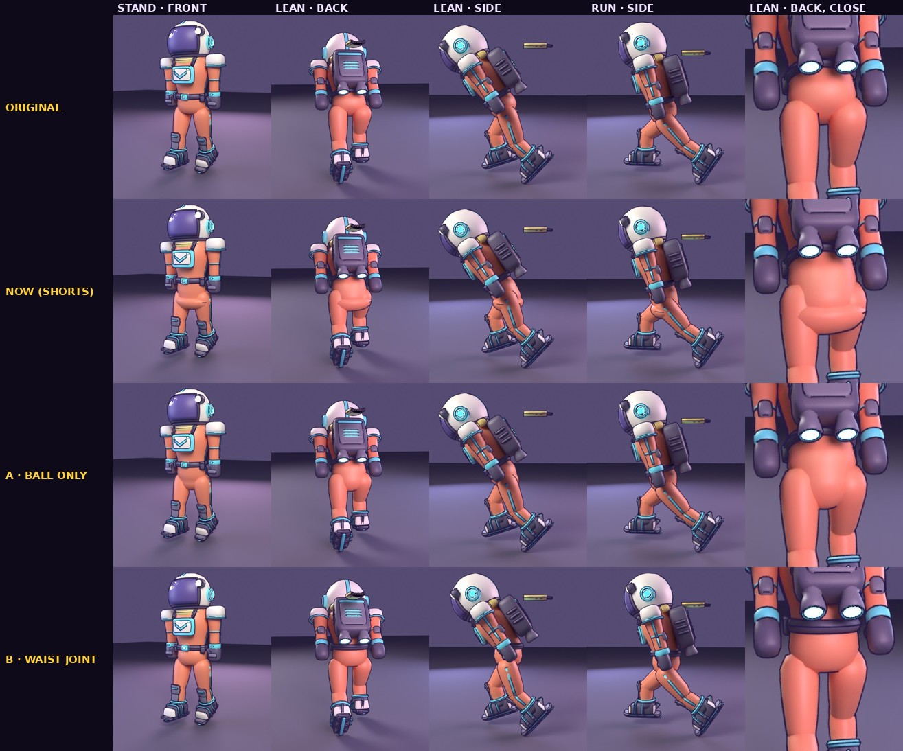

# The courier's hips: two drafts

The courier is rigid parts on pivots. His torso turns on a pivot at the hip joints, at the bottom of its egg-shaped trunk,
so leaning into a skate (up to 0.6 rad) swung the trunk's lower back up 10 cm and bared the thighs' tops. The first fix
(a ball on the pivot in a hip piece, "shorts") sealed it but flared out at the hips and hid the thighs' tops: an eggplant
with short legs. Two drafts, both keeping his original silhouette (`tools/blender/build_runner.py`, `RUNNER_HIPS`):

- **A · Ball only** (`ball`): no hip piece. The trunk's lower half is a ball centred on the pivot, no wider than the thighs
  (0.22 across each way of the middle, as deep as it is tall), so a lean turns it about its own middle and leaves it where
  it was. The legs keep their full length; nothing in the game changes but the model.
- **B · Waist joint at the belt** (`waist`): the egg as it was, cut at the belt. Below it a pelvis stays with the legs
  (the belt, buckle and pouches on it); the chest turns on a ball at the belt, so he bends at the waist with the pelvis
  upright, the joint under the belt. The torso pivot moves up 0.3 m, so the game's runner layout moves with it (head,
  arms, cargo slot, scarf: `models.js makeRunner`).
