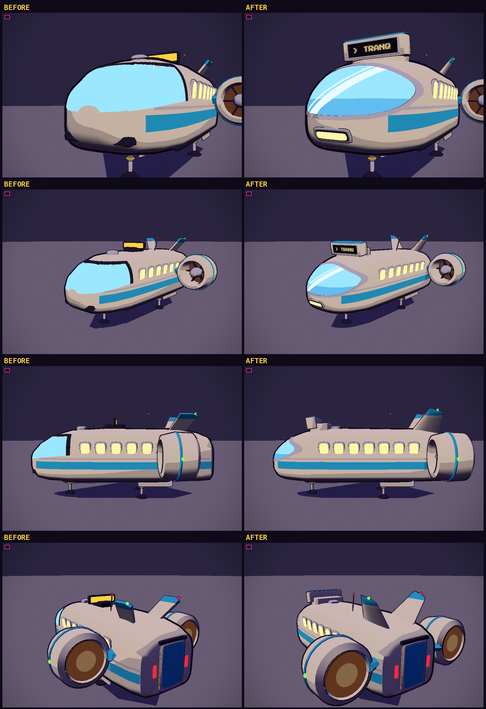
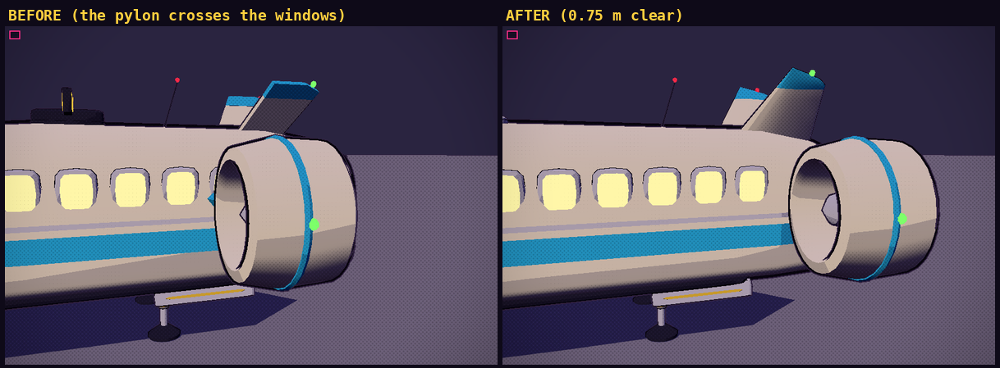

# Shuttle-bus: nose, route board, tail and engines

The shuttle-bus (`tools/blender/build_ships.py` -> `src/assets/ships.glb`) kept its size and shape; this pass reworked the parts that
looked rough. It was settled over two rounds of proposals (four variants, A to D), and the shipped shuttle is "proposal C with D's bar-light".



## What changed

- **A bubble windscreen.** The glass was a flat, unlit cyan slab with a stair-stepped edge (the old script kept or dropped whole hull faces, so
  a cut across the quads came out as a sawtooth), a heavy black frame and nothing on it. It is now one sheer visor in a silver bezel with a
  slim dark gasket, in three tints (new material slots `glass`, `glassDeep`, `glassHi`: a sky tint, a deeper tint under a horizon line, and
  two white reflection streaks). The pieces are cut from the same patch of the hull's skin, so none overlaps another.
- **Clean cuts.** `clipf()` cuts a dense patch of the skin exactly where a smooth field crosses zero, so every edge of the glass, bezel and
  gasket is a clean curve with rounded corners. Each band edge of the streaks is its own cut (one field for both bands skipped a band narrower
  than a mesh cell, and left a stair-stepped edge near the nose).
- **One wide bar-light** centred under the visor (a silver rim round a dark well round the lit strip), set on the hull's skin (`stick()` finds
  the surface and its normal). The old headlights sat inside the hull, so they drew as dark blobs. The glass's lower edge is lifted a little at
  the chin to leave the lamp room.
- **A rounder nose.** The hull's sections from z 2.0 forward are re-cut every 0.4 m along monotone cubic curves (`smooth_sections()`): the same
  shape without the facets. The livery belt follows it.
- **A route board that names its destination.** A blocky header board built into the roofline just over the screen (3.4 x 0.85 m, one face),
  its face leaning forward and down a little like the nose, in a silver frame round a dark panel to match the bezel. See below.
- **A refined V-tail.** The old fins were flat extruded plates. The new ones are lofted through airfoil sections (`airfoil_fin()`): tapered
  (a 3.2 m chord to 1.45 m), raked, with a round leading edge, a fine trailing edge and a rounded tip, shaded smooth, banded in the livery across
  the outer fifth, with a nav light on each tip.
- **Engines clear of the passenger windows.** The pylon carrying each side engine passed through the two rearmost windows, and the duct came
  within 0.13 m of another. The engines now sit right aft (z -7.7 instead of -5.0), the pylon is shorter and ends inside the hull's length,
  and the window row starts further forward and is spaced a little tighter (all seven windows kept). The pylon and duct stop 0.75 m and 0.55 m
  behind the rearmost window's rim, and **`build_ships.py` fails if a change brings the engines within 0.3 m of the windows**.



Cost: about 25.5k triangles for the shuttle (it was 23.5k), before outlines. `ships.glb` is the same size as before, and the freighter in it is unchanged.

## The route board

- **In the model:** a pivot with role `board`, at the middle of the display face (`+z` out of it), with `w`, `h`, `faces` (1 = front only, 2 = a
  back face too) and `depth` (the back face's distance behind the pivot) as custom properties. Its meshes are the housing. The lit face is not
  a mesh: the game draws it.
- **In the game:** `makeShip` (`src/models.js`) puts a plane on the pivot with a canvas texture: amber pixel-font lettering on a dark dot-matrix
  panel, shrunk to fit (`> TRANQ`, `> VOSTOK-9`). `ship.setSign(text)` changes the text, and does nothing for a model without a board.
- **What it says:** `Traffic.updateFlyer` sets each visible bus's board to the short name of the stop it is bound for: the far end while it flies,
  the other end while it waits at a pad. The medevac, recall and Spindle-pod shuttles read `MEDEVAC`, `RECALL` and `EXTRACT`; any other shuttle
  reads `SHUTTLE`.

## Rebuilding

```
MOONRUNNER_REPO=. python3 tools/blender/build_ships.py   # -> src/assets/ships.glb (builds the freighter too)
npm run optimize:glb                                     # compress it like the others
```

The dev viewer shows the shuttle with `/tools/viewer.html?m=shuttle&sign=TRANQ&yaw=30&pitch=6&dist=20&at=0,5.5,4` (it lifts the shuttle by its
gear height, 4.6 m, so add that to the `y` of `at=`). `&ships=<url>` loads another ships file in place of `ships.glb`, to try a rebuild before
replacing it.

## How it was settled

Round 1 offered a three-pane cockpit visor with a header board built into the roof (A) and a one-piece bubble visor in a silver bezel with a
lightbox on a roof fin (B). The bubble visor, the silver trim and A's blockier "part of the frame" board were kept; round 2 added one central
headlight, new tail fins and engines clear of the windows in two forms: C (a round lamp, a header board over the screen, a V-tail) and D (a bar
lamp, a double-faced board block on a livery rail along the roof, a dorsal fin with stabilisers). C's design was chosen, with D's bar-light.
The four builds, their renders and the measurements are in this branch's history (the commits "Shuttle-bus: two nose and route-board
proposals" and "Shuttle-bus round 2").
