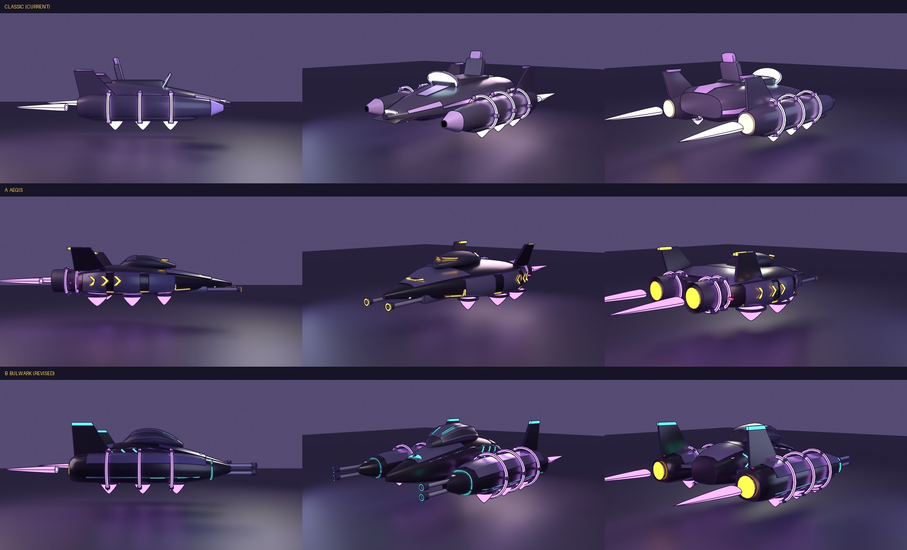

# Daedalus Phase Skimmer: two redesign proposals

The brief: keep the buoyant, floating feel and the sleek body; go **sleek and armoured** in the same purple and black, with at least
one more colour; the runner rides **inside** (hidden, like the APC's crew); a mobile, floating, forward-facing gunship.

Both are built from code in Blender by `tools/blender/build_skimmer_redesign.py` (`VARIANT = "a"` or `"b"`) and exported here as
`skimmer_a.glb` / `skimmer_b.glb` (plain, for any viewer). **Both are in the game:** the builder also writes the compressed
`src/assets/skimmer_a.glb` / `skimmer_b.glb`, `makeSkimmer` in `src/models.js` builds whichever is selected (**B by default**), and
the original is still there as `classic`. Switch with the dev menu (F8) item **10 · SKIMMER MODEL** (B, A, CLASSIC; remembered across
launches; it applies to the next skimmer you call with V). The Asset Row shows all three side by side.
`tools/blender/preview_skimmer.py` rebuilds both (and the classic one) and re-renders this sheet (Cycles on the CPU,
`pip install bpy pillow`).

## What both share

- **The same frame and animation contract as the classic Skimmer** (about 6.5 m long, origin on the ground under the middle, floated
  0.8 m up and bobbed by the Garage), so the game's animation drives them unchanged: **phase coils** that spin about z and speed up,
  **thruster flames** along -z that stretch with speed, **hover glows** along -y that breathe. Hover pads under the hull are the
  buoyant glow that holds it up.
- **Sleek and armoured:** a smooth lofted hull, with armour plates laid on its skin in sequence (seams between them), a bridge with
  slit windows (the runner is inside and unseen), and **forward-facing cannons**: twin barrels with shrouds and glowing muzzle rings,
  dead ahead. The guns are for show: the game's weapons still fire from the runner as before (the APC's turret is the only vehicle gun
  with its own aim and fire code).
- **The mark:** the Daedalus "eye", an almond with a pupil, on the nose (the style notes call the faction look "a delta with an eye").
- **Colours:** the livery's near-black (`body`) and violet (`stripe`, `glow`), plus **armour plates** (`plate`, a lighter plum-slate)
  and a **third colour** (`accent`, a glow) used for chevrons, bridge slits, muzzle rings, fin tips and edge lines.
- **The runner is hidden:** `hide_rider` on the GLB root makes the model say so (`model.hideRider`), and the game does not draw the
  runner while it is driven, as for the APC. (The classic Skimmer still shows its seated runner.)

## A: Aegis (amber)

One broad armoured **delta wing**: a low hump bridge with amber slit windows, plated shoulders with three amber chevrons each, a
thick amber chine line, twin chin cannons under the nose with amber muzzle rings, a short rocket pod on each wing's leading edge,
and, at the tail, twin **phase-drive tubes** with two spinning coils each and canted fins. Six hover pads under the wings. The
sleeker of the two, and closest to the classic's lifting-body delta.

## B: Bulwark (mint-teal)

An armoured **catamaran**: the classic's layout, hardened. A central fuselage with a plated spine and a **bridge dome** with mint
slits, between two big hover nacelles that carry twin nose cannons (mint muzzle rings and intake rims), three heavy phase coils each,
armoured wing roots, mint chine lines and canted fins. Three hover pads under each nacelle. The heavier, more obviously armed one.

## B, revised: everything flush

B's first pass had parts hovering on curved surfaces: the tail fins stood 15 cm above the nacelle roof with their tip lights offset, the
head and tail lamps floated, and the eye, chevrons and bridge slits were flat slabs laid on curved skin. Now (`skimmer_b_details.jpg`
shows before above, revised below):

- **Fins** grow out of the nacelle's own roofline (the foot follows the roof and sinks 0.12 m into it); the mint tip is a band cut from the
  fin's own outline, 6 mm thicker, so it is flush whatever the fin does.
- **Marks and lights are draped:** the eye (an almond with a round pupil), the chevrons, the bridge slits and the head and tail lenses are
  solved vertex by vertex onto the section's own superellipse (`top_point`, `flank_point`, `patch`, `decal` in the builder), so they
  follow the surface's curve across and along it.
- **Intake rims** follow the nacelle's actual cross-section; the two mint skin lines are sunk to stand 6 mm off the hull.
- **Coil tabs are round:** circular drums with a softly domed face, axis along the radius (`coil(..., tab="round")`).

A keeps its original flat eye, chevrons and fin lights (its builder path is unchanged, so its files still match it).

## Numbers

- **9.1k triangles (A) / 11.0k (B)**, plus 4.9k / 6.3k drawn again for the outline: inside the house budget of about 11k for a vehicle
  (`style.md`). 105 / 102 KB compressed (the files here are plain: about 260 / 310 KB). Both pass `audit_coplanar`; ink-0 details lie
  within about 6 mm of the surface they are on.
- Slots: livery `body`, `stripe`; glows `glow`, `accent` (**new**), `white`, `red`, and the flames `plume plumeCore lift engine`;
  fixed toons `plate` (**new**), `dark`, `metal`, `steel`. The two new slots have entries in `makeSkimmer` (`SKIMMER_ACCENT`, `SKIMMER_PLATE`).
- Extras on the root: `radius`, `proposal`, `hide_rider`, and `dust` (x, z pairs where the hover vehicle scatters dust, replacing the
  numbers that were hard-coded for the classic's nacelles).

## How the game uses them

`makeSkimmer({ style })` picks `'a'`, `'b'` or `'classic'` (default: the dev-menu setting, else B). The accent colour is per style in
`SKIMMER_ACCENT` (A amber `0xffb62e`, B mint `0x2ee6c0`). After a rebuild run `npm run optimize:glb` (the builder writes plain files).
To retire a proposal, remove its entries from the `GLB` map and `loadShipParts` in `src/models.js`, and from `SKIMMER_STYLES`.
