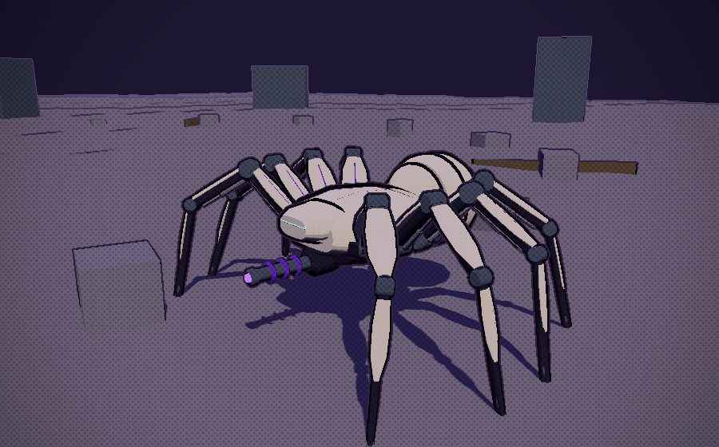
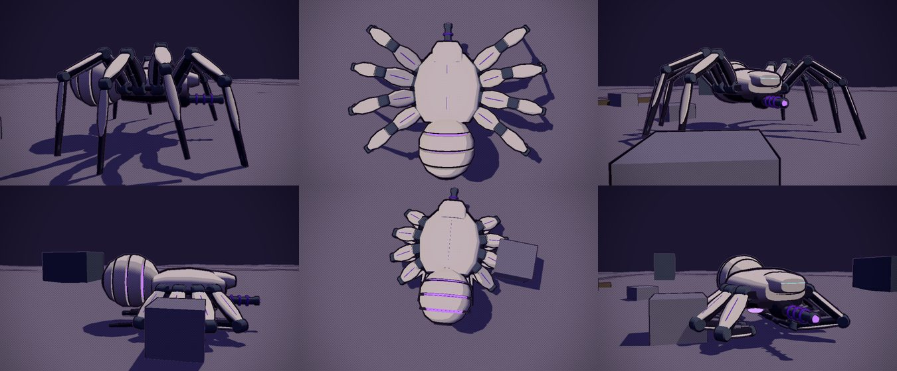
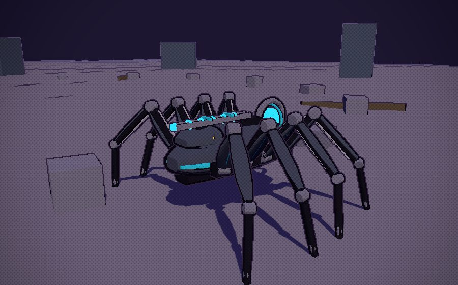
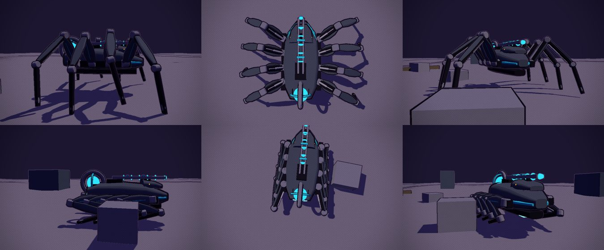
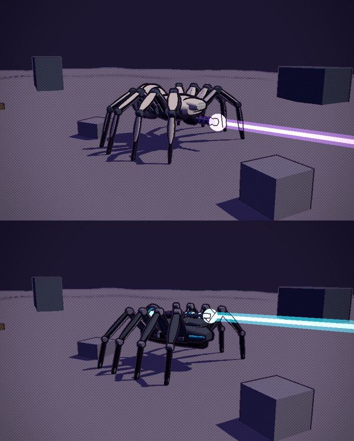

# Zbornak's spider tank: two proposals

The end-game reward. Win the Triple Crown, bring the champion to Dr. Zbornak, and he keeps it "for research"; in return he hands over
the walking tank he has been building round a mini antimatter reactor. It walks on eight armoured legs by the same IK the mites and
chimeras use (`src/gait.js`), folds them into the armour of a compact skimming frame when it runs out of stride (overdrive), and fires
a reactor beam from a central cannon. The runner rides inside, out of sight.

Both proposals are built: `tools/blender/build_spidertank.py` -> `src/assets/spidertank.glb`, driven by `src/spidertank.js`. To look:

- **The lab**, `npm run dev`, then `/tools/spidertank-lab.html?v=a` (or `?v=b`). It drives itself round a circle of crates and low walls:
  walking, running, folding into overdrive and skimming, unfolding, stopping to fire the beam. Press a key to drive: W/S speed, A/D turn,
  SHIFT overdrive, hold SPACE for the beam. `&demo=walk|run|skim|fold|beam` loops one part; `&cam=chase|side|front|rear|top|orbit`.
- **The Asset Row**, Ground Vehicles: both proposals, walking and folded.

| | A: ARACHNE | B: STRIDER |
|---|---|---|
| Body | a low, round armoured cephalothorax on a hip ring, the reactor in a ribbed abdomen behind | a long armoured wedge on flank rails, the reactor in a gyroscope of rings at the tail |
| Legs | radiate round the ring, front ones reaching ahead: a spider | in a row down each flank, near sideways: a harvestman |
| Overdrive fold | each leg folds on its own hinges: the thighs swing down and out (their plates become the saucer's rim), the shins curl in under the belly, the feet trail back | each leg swings back along its flank: the thigh plates lie over one another as side armour, the shins fold forward under them, the feet trail as skids |
| Overdrive shape | a round armoured pod, 8.4 m across and 4.2 m tall | a dart, 5.8 m wide and 9.4 m long |
| Cannon | slung under the brow like a fang | a rail down the spine, over the cockpit |
| Cockpit | two visor slits in an armoured brow | a wraparound visor band in a cowl |
| Palette | Zbornak's lab: cream armour, violet trim, violet antimatter glow | graphite armour, cyan trim and glow, amber visor |
| Size, walking | 13 m across the feet, 10.6 m long, 5.1 m tall, hips 3.1 m up | 12.2 m across, 8.8 m long, 5.5 m tall, hips 2.75 m up |
| Triangles | 15.0k | 13.8k |

## What both share

- **Eight legs, walking in fours.** A tetrapod (left front, right second, left third and right back together, then the other four), so
  four feet are always down and the hull rides level. Each leg is three bones on `leg` and `knee` pivots with a `foot` at the ground
  contact, as the chimera kit's jointed legs are, and `gait.js` walks it unchanged: planted feet, steps that land ahead, FABRIK. Each
  bone carries an armour plate on its outer side, a joint drum and a hydraulic ram.
- **Long legs make long strides, so it can walk fast.** About 4.4 m from hip to foot, its strides reach 6.4 m and it steps five times a
  second at 32 m/s, which is how fast a mite steps at a stroll. Feet stay planted to the centimetre at every speed (measured in the lab).
- **Steps over things.** A step whose path crosses something taller (a crate, a wall top, a hump) arcs over it (`gait.js`, new for this
  and used by the mites too); the lab's feet stand on crate tops, and the hull rises over anything taller than its belly clears.
- **Overdrive.** Past 33 m/s (55% of the gait's limit) it folds: each joint eases to the pose stored with it in the model (extra `fold`,
  worked out in Blender from each bone's folded direction), the hull drops by a little over a quarter of its hip height (the tucked feet just clear the ground) and its jets light. Under that
  speed it unfolds and walks again. It skims to 90 m/s in the lab.
- **The reactor beam.** Hold fire: the reactor and the muzzle brighten for a second (let go and it fizzles), then a condensed beam
  channels for four seconds, 420 m long. Spider form only: holding fire in overdrive unfolds it first. While charging and firing it
  keeps 30% of its speed.
- **The runner rides inside**, hidden: the cockpit is sealed (a `seat` pivot marks where).

## What the rest takes

1. **Pick one** (or mix: B's fold with A's legs, say). Then: its colliders (`col` empties for the hull), a far copy for distance, run it
   through `npm run optimize:glb`, and load it from `models.js`'s GLB map instead of a URL.
2. **Footholds on structures.** The lab's ground knows its crates; the game's would cast down onto the place's colliders (their tops are
   the drawn tops: `docs/collision.md`; `rayCollider`, `colliders.query`) and fall back to `planet.ground`, keep feet off edges (try a
   few spots near the wanted one), and set the ride height from what is under the hull, as the lab does. The hull collides only with
   what stands above its legs' reach; the legs never block it.
3. **The mount.** A `VEHICLES` entry for it (`hideRider`), summoned and entered from the Garage like the others, with its own drive: walking
   (its acceleration, turning that slows as it speeds up), the fold past 33 m/s, and overdrive on the Skimmer's hover drive. Outdoors
   only: it is too big for the casino or the Downs' halls.
4. **The beam in play.** A long ray from the muzzle against enemies, meteors, colliders and the ground (stopping where it hits, with a
   splash there), its damage, a charge meter on the HUD, sound, and the slowdown; the fire button as the turrets' (left mouse).
5. **The quest.** The Triple Crown is already recorded (`race.js`: `genes.crown`). On winning it, Zbornak calls; bring the champion (as a
   follower, or from the pen) to the lab; he keeps it (it leaves your stable, and could be seen in a tank in his lab), and the spider tank
   joins the Garage. A save flag for it.
6. **Then** the Asset Row item for the chosen one alone, the CHANGELOG, the source map, and these proposals marked as decided.

## To decide

- A or B (or a mix).
- Where it folds (33 m/s now) and how fast it skims (90 m/s now; the Skimmer's top is 100).
- The beam's damage, and whether it stops at the first thing it hits or burns through.
- What Zbornak does with the champion: out of sight, or on show in the lab.
