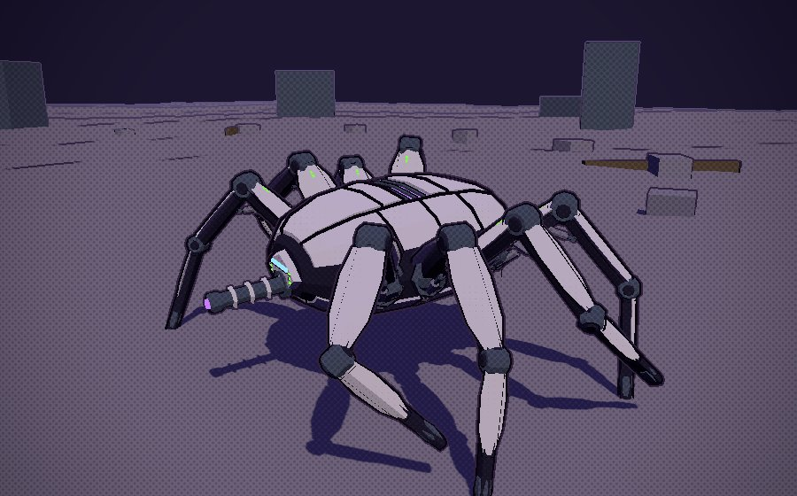
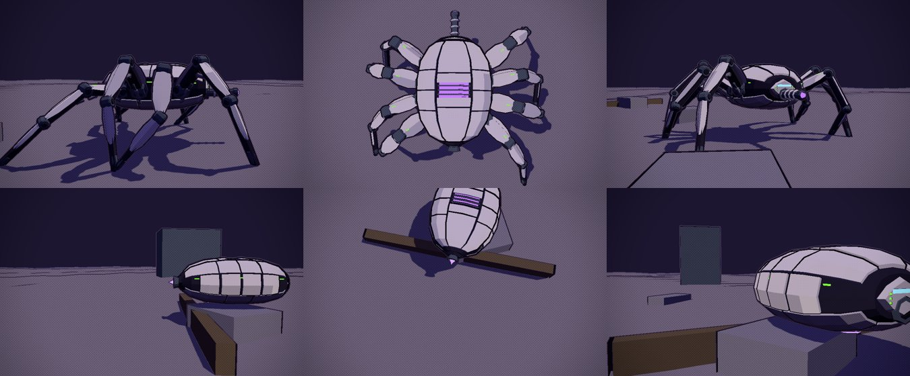
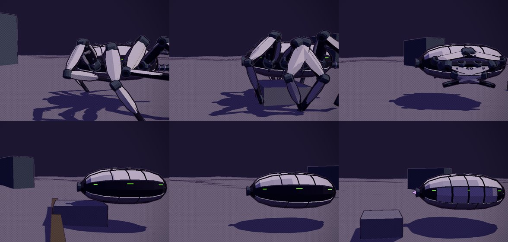
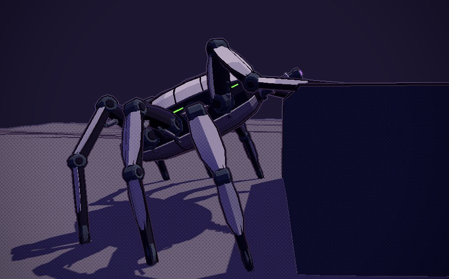
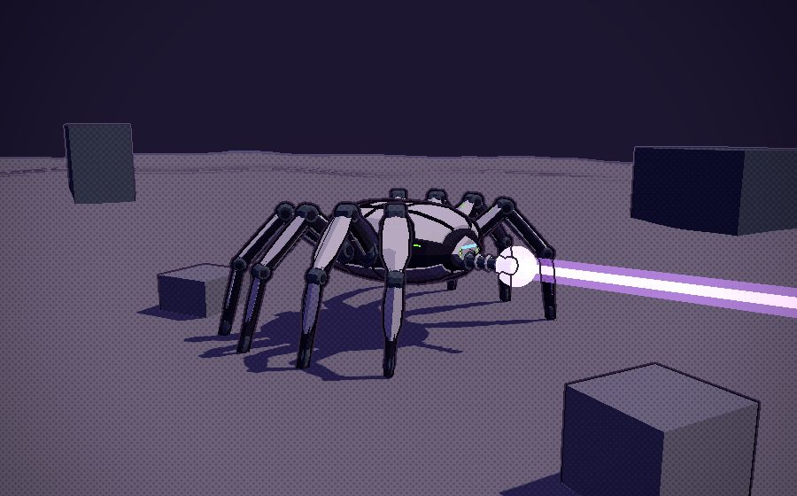

# Zbornak's spider tank: ARACHNE

The end-game reward. Win the Triple Crown, bring the champion to Dr. Zbornak, and he keeps it "for research"; in return he hands over
the walking tank he has been building round a mini antimatter reactor. It walks on eight armoured legs by the same IK the mites and
chimeras use (`src/gait.js`), its strides lengthening up to 40 m/s; past that it closes up by itself into a hovering bead (overdrive),
and when it slows under 34 m/s the legs come back out and stand it up. It fires a reactor beam from a central cannon. The runner rides inside, out of sight.

Built in Blender (`tools/blender/build_spidertank.py` -> `src/assets/spidertank.glb`, 12.0k triangles, 312 KB) and driven by
`src/spidertank.js`. Revision 3: of the two first proposals the white one (A) was kept, bulkier and more mechanical, without its
abdomen; B was dropped. Round three made it close up by itself, stride longer, grip and climb, and drive its rams, and took the fins
off. Not in the game yet.

- **The lab:** `npm run dev`, then `/tools/spidertank-lab.html`. It drives itself round a circle of crates and low walls: walking,
  running, closing up past 40 m/s and skimming, opening out, stopping to fire the beam. Press a key to drive it: W/S speed, A/D turn,
  hold SPACE for the beam. `&demo=walk|climb|wall|run|skim|fold|beam` loops one part (`wall` walks down the test lane: a 2.3 m crate
  it climbs over, then a 4.8 m block it can't, which it reaches up onto and stops at); `&speed=` sets it;
  `&cam=chase|side|front|rear|top|orbit`.
- **The Asset Row**, Ground Vehicles: walking, and closed up.

## The look

- **A faceted, armoured bead**, 4.6 m wide and 2.8 m tall (7.5 m long closed up, cannon to tail jet): sixteen facets round, off-white plates over a dark frame (the lab's colours),
  the lower plates a pale grey, the frame showing in the seams between them and as a belt round the waist where the legs bolt on.
- **The nose:** an octagonal armoured face with a visor slit across it; the beam cannon below it, in a steel collar.
- **The reactor** glows violet through a grilled window in the spine, and flares as the beam charges.
- **Zbornak's green** only as LEDs: short strips along the belt, three dots either side of the visor, two on each thigh. Small enough
  not to read as Rustmoon's livery.
- **Eight angular legs:** octagonal struts, flat-faceted shields with a ridge down each (thigh and shin), drums at the joints, an
  angular hoof-claw, and two working hydraulic rams on each: one from the hull to the thigh, one from the thigh to the shin. Each is a
  barrel and a rod that aim at each other every frame (`ram`/`rod` pivots), so they slide in and out as the leg moves and go in with
  it when it folds. Standing, 11.9 m across the feet, 10.3 m long and 4.8 m tall, the hips 3.1 m up.

## Closing up (overdrive)

It closes up by itself at 40 m/s, over 1.3 s, in stages, and opens out again under 34 m/s (the gap keeps it from flickering between
the two); slowing down, it runs backwards:

1. **The legs zigzag** against the hull, toward its middle (thigh along the hull, shin folded back, foot forward again).
2. **They slide in** through their hip ports, collars and all, into the hull.
3. **The hatches shut:** each port's door, stowed inside, swings out flush with the hull.
4. Meanwhile **the cannon draws back** into the nose, and three jets under the belly and the tail jet come out. The hull settles to
   ride its jets 0.6 m off the ground, and lifts over what it skims across (up to 2.5 m).

Every moving piece carries its own share of the fold in the model (`fold`, `foldPos`, `foldScale` and their spans), so the timing is
tuned in Blender.

## Walking and the beam

- **Eight legs in fours** (a tetrapod: left front, right second, left third and right back together, then the other four), so four
  feet are always down and the hull rides level and tilts with the ground under them.
- **Strides lengthen with speed, long and unhurried:** each leg reaches as far fore and aft as its hip allows, and at the top the
  next foot lifts just before the last one lands. 4.0 m at 3 m/s, 10.5 m at 20 m/s, 12.7 m at 38 m/s, three steps a second per leg
  at most (a mite takes five at a stroll); the steps of a leg this size take longer, as a pendulum's would. Feet stay planted to the
  centimetre at every speed and through turns, in place or tight round a crate (measured in the lab), and the walk never drops out
  into a glide.
- **It grips what it stands on:** a foot only lands where its leg reaches; on a ledge too high it lands on the nearest spot below it,
  toward the hip or beside. A step up lifts the foot first and then reaches over and sets it down (no flopping onto the edge); a step
  down reaches out and then drops. A step whose path crosses something taller (a crate, a wall top) arcs over it.
- **The hull keeps clear of the ground:** at least 0.5 m over whatever is under it, looking a little ahead, as high as the planted
  legs can hold it and no higher. What it can't clear stops it (`tank.clearTop`), with the front legs up on it: it never jumps up onto
  a block its legs can't reach, and it never rears at a wall. A 2.3 m crate it walks over; a 4.8 m block stops it.
- **The reactor beam:** hold fire. The reactor and the muzzle brighten for a second (let go and it fizzles), then a condensed beam
  channels for four seconds, 420 m long. Walking only: holding fire while skimming opens it out first. While charging and firing it
  keeps 30% of its speed.

## What the rest takes

1. **Finish the model:** colliders (`col` empties for the hull), a far copy for distance, and loading it from `models.js`'s GLB map
   instead of a URL.
2. **Footholds on structures.** The lab's ground knows its crates; the game's would cast down onto the place's colliders (their tops are
   the drawn tops: `docs/collision.md`; `rayCollider`, `colliders.query`) and fall back to `planet.ground`, keep feet off edges (try a
   few spots near the wanted one: `spidertank.js` does, given a `ground(p, out, ceil)` that skips what is taller than `ceil`), and set
   the ride height from what is under the hull, as the lab does. The hull collides only with what stands above `tank.clearTop`; the
   legs never block it.
3. **The mount.** A `VEHICLES` entry for it (`hideRider`), summoned and entered from the Garage like the others, with its own drive:
   walking (its acceleration, turning that slows as it speeds up), closing up past 40 m/s, and overdrive on the Skimmer's hover drive.
   Outdoors only: it is too big for the casino or the Downs' halls.
4. **The beam in play.** A long ray from the muzzle against enemies, meteors, colliders and the ground (stopping where it hits, with a
   splash there), its damage, a charge meter on the HUD, sound, and the slowdown; the fire button as the turrets' (left mouse).
5. **The quest.** The Triple Crown is already recorded (`race.js`: `genes.crown`). On winning it, Zbornak calls; bring the champion (as a
   follower, or from the pen) to the lab; he keeps it (it leaves your stable), and the spider tank joins the Garage. A save flag for it.
6. **Then** the CHANGELOG, the source map, and this page brought up to date.

## To decide

- Where it closes up (40 m/s, opening under 34) and how fast it skims (90 m/s in the lab; the Skimmer's top is 100).
- The beam's damage, and whether it stops at the first thing it hits or burns through.
- Whether the champion is seen again (in a specimen tank in Zbornak's lab, say).
