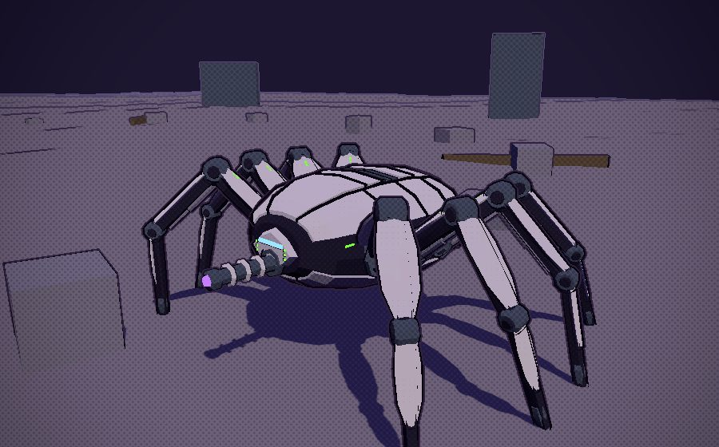
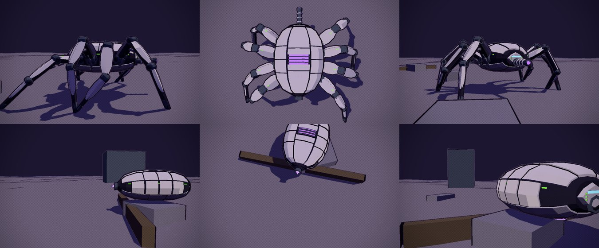
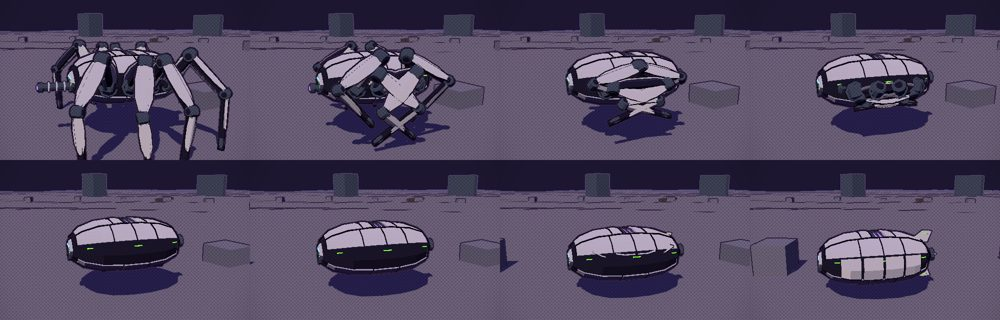
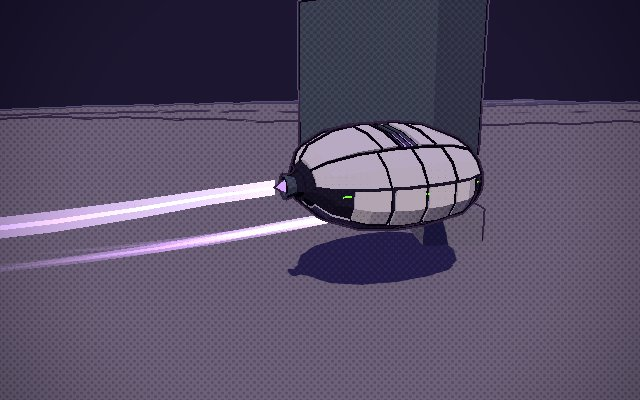
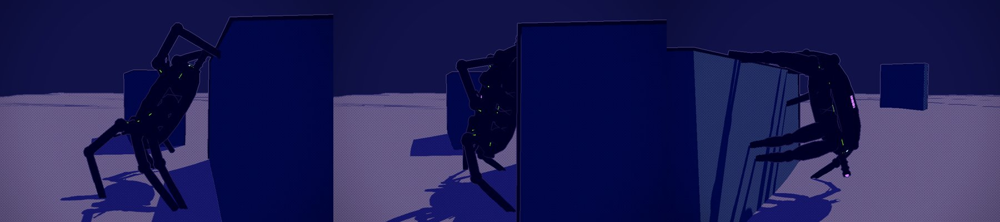
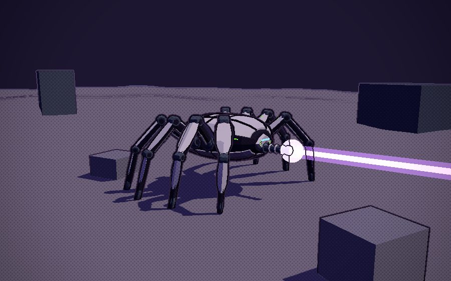

# Zbornak's spider tank: ARACHNE

The end-game reward. Win the Triple Crown, bring the champion to Dr. Zbornak, and he keeps it "for research"; in return he hands over
the walking tank he has been building round a mini antimatter reactor. It walks on eight armoured legs (`src/spiderwalk.js`; the
leg solve is the chimeras', `src/gait.js`) any way it is driven, ahead, back or sideways, turning to where it is aimed: a ripple
walking, two sets of four running, the legs never crossing. Its hull stands on its feet and goes only as far as its planted legs
reach, so it climbs what its legs can: about 10 m nose first, its rear legs straightening under it and its front pair hooking the
top. Past 25 m/s it closes up by itself into a hovering bead (overdrive; never while it climbs), and when it slows under 21 m/s the
legs come back out and stand it up. It fires a reactor beam from a central cannon. The runner rides inside, out of sight.

Built in Blender (`tools/blender/build_spidertank.py` -> `src/assets/spidertank.glb`, 12.0k triangles, 312 KB) and driven by
`src/spidertank.js`. Revision 4: of the two first proposals the white one (A) was kept, bulkier and more mechanical, without its
abdomen; B was dropped. Round three made it close up by itself, stride longer, grip and climb, and drive its rams, and took the fins
off. Round four smoothed its run, solved its legs exactly, kept its feet below its hips and its hull and legs out of what it walks
among, and made the bead float higher on glowing jet trails. Round five rebuilt how it walks and climbs (below): the hull on its
feet, strafing, aimed by the reticle. Not in the game yet.

- **The lab:** `npm run dev`, then `/tools/spidertank-lab.html`. It drives itself round a circle of crates and low walls: walking,
  running, closing up past 25 m/s and skimming, opening out, stopping to fire the beam. Press a key to drive it: W ahead, S back (to 18 m/s),
  A/D sideways (to 12 m/s), hold SPACE for the beam; **it turns to where the camera looks** (the reticle), so drag to aim it (H gives
  the camera back to the tank, and then Q/E turn it). **Look round** with the mouse: drag to turn the camera round the tank, right-drag (or shift-drag) to slide
  what it looks at, wheel to zoom, H to stop it turning with the tank, R or double-click to put it back. **P** pauses, **.** steps a
  frame, **[ ]** slow the clock down to a tenth and back. `&demo=walk|climb|wall|run|skim|fold|beam` loops one part (`wall` walks
  down the test lane: a 2.3 m crate, a 3.2 m step, a 4.6 m block, a 9.5 m block and a 12 m wall it climbs onto and down off (all in about 70 s at 3 m/s), then a 16 m
  wall it gets as high up as it can and stops at); `&speed=` sets it; the blocks round the circle are platforms to climb (3 to 13 m) and walls;
  `&cam=chase|side|front|rear|top|orbit` is where the camera starts. **F9** saves the flight (every tick's time and input since
  the page loaded, and the last 15 s of the tank's state); drop the file on the lab page to replay it frame for frame (pause, slow and
  look round as it plays; `&at=s` jumps in). `?sweep` (or `?sweep=quick`, about a minute) drives fresh tanks, unseen, straight at every
  box from 8 sides at a walk and a run, at the blocks crabbed (its nose turned 45, 90, 135 or 180 degrees from the way it goes) and
  stopped half on them, parks them beside the tall ones, sends them across three gaps between pairs of platforms (3, 5 and 7 m) and
  turns them on the spot on tops, then tables each: over it, round it or stopped against what it should do (over anything up to
  `tank.climbMax` nose or tail first; sideways on, what it can step up without rearing), its hull and leg bones in things, frames
  with a leg through the hull, a foot across the body's middle, a planted foot over nothing, a planted foot off its hold, or a leg
  in limbo (neither planted nor stepping), the pose's jerk, how long it took, and the steps and pose change of its last 6 s
  (shuffling); each row's link (`?case=...`) replays it in the lab.
- **The Asset Row**, Ground Vehicles: walking, and closed up.

## The look

- **A faceted, armoured bead**, 4.6 m wide and 2.8 m tall (7.5 m long closed up, cannon to tail jet): sixteen facets round, off-white plates over a dark frame (the lab's colours),
  the lower plates a pale grey, the frame showing in the seams between them and as a belt round the waist where the legs bolt on.
- **The nose:** an octagonal armoured face with a visor slit across it; the beam cannon below it, in a steel collar.
- **The reactor** glows violet through a grilled window in the spine, and flares as the beam charges.
- **Zbornak's green** only as LEDs: short strips along the belt, three dots either side of the visor, two on each thigh. Small enough
  not to read as Rustmoon's livery.
- **Eight angular legs:** octagonal struts, flat-faceted shields with a ridge down each (thigh and shin), drums at the joints, an
  angular hoof-claw, and two working hydraulic rams on each: one from the hull to the thigh, one from the thigh to the shin. Each is a
  barrel and a rod that aim at each other every frame (`ram`/`rod` pivots), so they slide in and out as the leg moves and go in with
  it when it folds. Standing, 11.9 m across the feet, 10.3 m long and 4.8 m tall, the hips 3.1 m up.

## Closing up (overdrive)

It closes up by itself at 25 m/s, over 1.3 s, in stages, and opens out again under 21 m/s (the gap keeps it from flickering between
the two). It won't start to while it is climbing or gripping something (a foot on a face or up on something, the hull tilted or
hoisted: `tank.climbing`), so a climb never turns into a bead on the wall; slowing down, it runs backwards:

1. **The legs zigzag** against the hull, toward its middle (thigh along the hull, shin folded back, foot forward again).
2. **They slide in** through their hip ports, collars and all, into the hull.
3. **The hatches shut:** each port's door, stowed inside, swings out flush with the hull.
4. Meanwhile **the cannon draws back** into the nose, and three jets under the belly and the tail jet come out. The hull floats
   1.5 m off the ground on them, bobbing, banking into its turns, and lifting over what it skims across (up to 2.5 m more). Each jet
   leaves a glowing trail in the world, white-hot at the nozzle and violet as it thins (`tank.fx`, put beside the tank's root).

Every moving piece carries its own share of the fold in the model (`fold`, `foldPos`, `foldScale` and their spans), so the timing is
tuned in Blender.

## Walking and the beam

- **Its legs are solved exactly** (`gait.js` `solveBent`): each three-bone leg bends its knee up, as built, in the upright plane
  through its hip and foot, the ankle folding as the foot comes in, so a leg never flips from one shape to another; a knee that would
  be in something turns aside from it.
- **The hull stands on its feet** (`spiderwalk.js`). Each leg has a home: its rest stance, carried with the hull and dropped onto
  whatever is under it. The pose the hull wants is the one that puts every home nearest its foot's hold (`fitPose`: height, pitch
  and roll together), raised to clear what is under it and just ahead; and it goes toward that only as far as its planted legs
  reach (`constrain`: none past its length, none folded closer than it folds). So feet up on a block and feet down on the ground
  tilt and raise it between them, some legs half folded and some stretched, from any side; and **a planted foot never leaves its
  hold**. The root is slowed, or stopped, where going on would take the hull out of a planted leg's reach whatever its pose
  (`tank.speedMax`), till that leg has stepped.
- **Every leg is planted, stepping or reaching.** A step is a timed arc to a hold chosen at lift-off (for where its hip will be when
  it lands), up first onto something higher, over first and then down; it lands only on a hold in its reach. A leg with nothing in
  reach to stand on reaches for where it would, probing, and steps the moment a hold comes in reach.
- **Any way it goes.** It is driven by a velocity across the ground and turned separately (to the reticle): ahead, back to 18 m/s,
  sideways to 12 m/s, or any mix. **A spider's rhythm** on easy ground: one beat for all eight legs, a ripple up each side at a
  walk (six or seven feet down), two sets of four at a run from 3.8 to 9 m/s; each foot keeps to its own lane of the hull, so
  **the legs never cross**. Turning on the spot (1.8 rad/s) drives the same beat. On rough ground (tilted, feet at different
  heights, held up against something) they step by need instead: the leg that holds the hull back the most goes first, never two
  neighbours or a pair across the hull at once, four always down.
- **Climbing, nose or tail first.** Pushed at something and held up, its feet look further on and the hull leans into it.
  - A leg whose home comes over the thing steps up onto its top if it reaches it (3 m over its hip at most, 0.7 m in from the edge).
  - **A reaching leg may take a hold on the face instead; a leg that carries it never does:** a face hold needs four other feet on
    tops (the ground, or the thing's top). So the front legs go up the face while the rear four stand on the ground.
  - The hull follows its feet up: **its rear legs straighten together under it**, as far as they go.
  - **Once the reaching pair has hooked the top, one foot each side, the haul begins:** they pull, and the legs below may let go of
    the ground and come up the face after the hull, in order, the leg ahead always higher.
  - **About 10 m** is what that reaches (`tank.climbMax`, measured: the lab's 9.7 m block, from meeting its face to walking on
    top, in about 8 s). Corner first it often hooks only one side, so above about 7 m it mostly gives up that way.
- **Against a wall too tall** the same thing happens short of the top: it rears up on its straightened rear legs, its front legs
  pawing up the face (a new hold every second or so). After 4 s of getting nowhere it gives up: its feet let go of the face, it
  backs off (`tank.shove`, a velocity it asks its driver for) and stands down level, and it won't try again till it is pushed
  another way or let go.
- **Sideways on it only leans:** its flank is too close to a face for a leg to fold to, so pushed sideways it rolls toward the thing
  (to 34 degrees), steps its near legs up onto what they reach (about 5 m) and goes over that; anything taller it gives up at. Its
  hull's collision keeps its legs' room beside it, so it never stands flank-on against a wall with its legs crushed between.
- **Coming down** is the climb reversed. At an edge over a drop its front feet go down the face, the hull following them; its
  middle goes no more than 3 m out past the edge till the hull is down near the ground below; any leg may walk down the face
  after it (the four-on-tops rule is the climb's), and a leg left stretched behind with nowhere better lets go and reaches down.
- **Measured** (the lab's sweep; see the lab's table for every case): 952 cases.
  - **Right in 939** (it went over what it should, stopped at what it can't, stood still where it should).
  - Blocks of 2 to 7 m: all 80 face-on approaches over, 74 of 80 corner-first. Blocks of 7 to 10.5 m: 35 of 40 face-on, 12 of 40
    corner-first. All 112 approaches to walls over 11.5 m stopped. Crabbed (nose turned from the way it goes) at blocks under
    5.5 m: 27 of 28 over. Standing beside tall blocks: still in all 69. All 12 gap crossings and 5 turns on tops right.
  - **The hull is in nothing, no planted foot is over nothing and none is off its hold, in any frame** (a planted foot was past
    its leg's length in 1.7% before). A leg is in limbo, reaching, in 3.7% of frames; a leg passes into the hull in 1.4% (2.7%
    before) and a foot is across the body's middle in 1.1% (0.1% before: nearly all of it crabbed diagonally at a corner).
  - The cost of the hull waiting on its legs: a climb and the walk off the far side take 18 s on average for a 2 to 7 m
    block and 25 s for a 7 to 10.5 m one, at 4 m/s at most on rough ground.
  - **What it still does wrong** (the 13): corner-first at the 6 m blocks and platforms it gives up, or stalls coming down off
    them (5); having given up at one thing it will not go round it to the next while pushed the same way (3); parked half on
    a block, turned from the way it came, it sometimes keeps shuffling (4); one 4.8 m block sideways and corner-first (1).
- **Its height is its own:** kept in the world, so the caller can put the root on the ground under it or anything else; the caller's
  collision asks the tank (`tank.hits(x, y, z, yaw)`: how far into things the hull, and its legs' room beside it, would be with the
  root there) and never moves or turns it deeper in. It turns at 1.8 rad/s at a standstill (`tank.turnMax`), slower as it speeds
  up, and at 0.6 picking its footing on rough ground.
- **It backs up**, to 18 m/s (`tank.reverseMax`), and goes sideways, to 12 m/s (`tank.strafeMax`): the same legs, the same rules.
- **The reactor beam:** hold fire. The reactor and the muzzle brighten for a second (let go and it fizzles), then a condensed beam
  channels for four seconds, 420 m long. In spider form only: held in the bead, fire does nothing; held walking, it keeps it a spider
  (under 25 m/s, so it never closes up). While charging and firing it keeps 30% of its speed.

## What the rest takes

1. **Finish the model:** colliders (`col` empties for the hull), a far copy for distance, and loading it from `models.js`'s GLB map
   instead of a URL.
2. **Footholds on structures.** The lab's ground knows its crates; the game's would cast down onto the place's colliders (their tops are
   the drawn tops: `docs/collision.md`; `rayCollider`, `colliders.query`) and fall back to `planet.ground`, keep feet off edges (try a
   few spots near the wanted one: `spiderwalk.js` does, given a `ground(p, out, ceil)` that skips what is taller than `ceil`, and a
   `ray(from, dir, far, out)` for faces); the tank poses its own hull. The drive moves the root only where `tank.hits` says the hull
   goes no deeper into things, no faster than `tank.speedMax`, adds `tank.shove`, and passes `push` (what the driver asks for:
   `{ x, z }` across and ahead).
3. **The mount.** A `VEHICLES` entry for it (`hideRider`), summoned and entered from the Garage like the others, with its own drive:
   walking (its acceleration, strafing, turning to the reticle at `tank.turnMax`), closing up past 25 m/s, and overdrive on the Skimmer's hover drive.
   Outdoors only: it is too big for the casino or the Downs' halls.
4. **The beam in play.** A long ray from the muzzle against enemies, meteors, colliders and the ground (stopping where it hits, with a
   splash there), its damage, a charge meter on the HUD, sound, and the slowdown; the fire button as the turrets' (left mouse).
5. **The quest.** The Triple Crown is already recorded (`race.js`: `genes.crown`). On winning it, Zbornak calls; bring the champion (as a
   follower, or from the pen) to the lab; he keeps it (it leaves your stable), and the spider tank joins the Garage. A save flag for it.
6. **Then** the CHANGELOG, the source map, and this page brought up to date.

## To decide

- Where it closes up (25 m/s, opening under 21) and how fast it skims (90 m/s in the lab; the Skimmer's top is 100).
- The beam's damage, and whether it stops at the first thing it hits or burns through.
- Whether the champion is seen again (in a specimen tank in Zbornak's lab, say).
