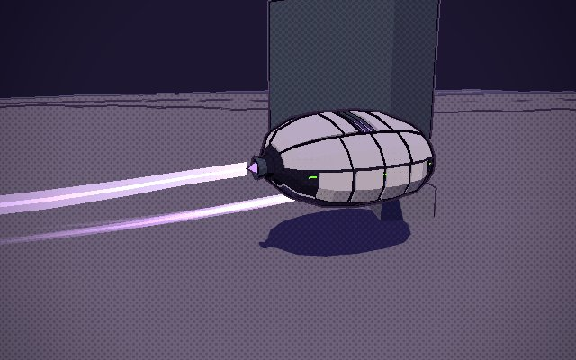

# Zbornak's spider tank: ARACHNE

The end-game reward. Win the Triple Crown, bring the champion to Dr. Zbornak, and he keeps it "for research"; in return he hands over
the walking tank he has been building round a mini antimatter reactor. It walks on eight armoured legs by the same IK the mites and
chimeras use (`src/gait.js`), to a spider's rhythm: a ripple walking, two sets of four running, the legs never crossing. It climbs what
its legs can reach the top of. Past 25 m/s it closes up by itself into a hovering bead (overdrive; never while it climbs), and when it
slows under 21 m/s the legs come back out and stand it up. It fires a reactor beam from a central cannon. The runner rides inside, out of sight.

Built in Blender (`tools/blender/build_spidertank.py` -> `src/assets/spidertank.glb`, 12.0k triangles, 312 KB) and driven by
`src/spidertank.js`. Revision 4: of the two first proposals the white one (A) was kept, bulkier and more mechanical, without its
abdomen; B was dropped. Round three made it close up by itself, stride longer, grip and climb, and drive its rams, and took the fins
off. Round four smoothed its run, solved its legs exactly, kept its feet below its hips and its hull and legs out of what it walks
among, and made the bead float higher on glowing jet trails. Not in the game yet.

- **The lab:** `npm run dev`, then `/tools/spidertank-lab.html`. It drives itself round a circle of crates and low walls: walking,
  running, closing up past 25 m/s and skimming, opening out, stopping to fire the beam. Press a key to drive it: W ahead, S back (to 18 m/s),
  A/D turn, hold SPACE for the beam. **Look round** with the mouse: drag to turn the camera round the tank, right-drag (or shift-drag) to slide
  what it looks at, wheel to zoom, H to stop it turning with the tank, R or double-click to put it back. **P** pauses, **.** steps a
  frame, **[ ]** slow the clock down to a tenth and back. `&demo=walk|climb|wall|run|skim|fold|beam` loops one part (`wall` walks
  down the test lane: a 2.3 m crate, a 3.2 m step, a 4.6 m block, a 9.5 m block and a 12 m wall it climbs onto and down off (all in about 70 s at 3 m/s), then a 16 m
  wall it gets as high up as it can and stops at); `&speed=` sets it; the blocks round the circle are platforms to climb (3 to 13 m) and walls;
  `&cam=chase|side|front|rear|top|orbit` is where the camera starts. **F9** saves the flight (every tick's time and input since
  the page loaded, and the last 15 s of the tank's state); drop the file on the lab page to replay it frame for frame (pause, slow and
  look round as it plays; `&at=s` jumps in). `?sweep` (or `?sweep=quick`, about a minute) drives fresh tanks, unseen, straight at every
  box from 8 sides at a walk and a run, parks them beside the tall ones, sends them across three gaps between pairs of platforms (3,
  5 and 7 m) and turns them on the spot on tops, then tables each: over it, round it or stopped against what it should do (over
  anything up to `tank.climbMax`), its hull and leg bones in things, frames with a leg through the hull, a foot across the body's
  middle or a planted foot over nothing, the pose's jerk, how long it took, and the steps and pose change of its last 6 s
  (shuffling); each row's link (`?case=...`) replays it in the lab.
- **The Asset Row**, Ground Vehicles: walking, and closed up.

## The look

- **A faceted, armoured bead**, 4.6 m wide and 2.8 m tall (7.5 m long closed up, cannon to tail jet): sixteen facets round, off-white plates over a dark frame (the lab's colours),
  the lower plates a pale grey, the frame showing in the seams between them and as a belt round the waist where the legs bolt on.
- **The nose:** an octagonal armoured face with a visor slit across it; the beam cannon below it, in a steel collar.
- **The reactor** glows violet through a grilled window in the spine, and flares as the beam charges.
- **Zbornak's green** only as LEDs: short strips along the belt, three dots either side of the visor, two on each thigh. Small enough
  not to read as Rustmoon's livery.
- **Eight angular legs:** octagonal struts, flat-faceted shields with a ridge down each (thigh and shin), drums at the joints, an
  angular hoof-claw, and two working hydraulic rams on each: one from the hull to the thigh, one from the thigh to the shin. Each is a
  barrel and a rod that aim at each other every frame (`ram`/`rod` pivots), so they slide in and out as the leg moves and go in with
  it when it folds. Standing, 11.9 m across the feet, 10.3 m long and 4.8 m tall, the hips 3.1 m up.

## Closing up (overdrive)

It closes up by itself at 25 m/s, over 1.3 s, in stages, and opens out again under 21 m/s (the gap keeps it from flickering between
the two). It won't start to while it is climbing or gripping something (a foot on a face or up on something, the hull tilted or
hoisted: `tank.climbing`), so a climb never turns into a bead on the wall; slowing down, it runs backwards:

1. **The legs zigzag** against the hull, toward its middle (thigh along the hull, shin folded back, foot forward again).
2. **They slide in** through their hip ports, collars and all, into the hull.
3. **The hatches shut:** each port's door, stowed inside, swings out flush with the hull.
4. Meanwhile **the cannon draws back** into the nose, and three jets under the belly and the tail jet come out. The hull floats
   1.5 m off the ground on them, bobbing, banking into its turns, and lifting over what it skims across (up to 2.5 m more). Each jet
   leaves a glowing trail in the world, white-hot at the nozzle and violet as it thins (`tank.fx`, put beside the tank's root).

Every moving piece carries its own share of the fold in the model (`fold`, `foldPos`, `foldScale` and their spans), so the timing is
tuned in Blender.

## Walking and the beam

- **Its legs are solved exactly** (`makeGait`'s `pole`): each three-bone leg bends its knee up, as built, in the upright plane
  through its hip and foot, the ankle folding as the foot comes in, so a leg never flips from one shape to another.
- **A spider's rhythm** (`wave`): one beat for all eight legs, each at its own place in it. Walking, a **ripple** runs up each side
  from the back leg to the front, a quarter of a stride apart, the two sides half a stride out (three quarters of each stride a foot
  is down, so six or seven feet hold it at once). From 3.8 m/s to 9 m/s it blends into the **run**: two sets of four (left front,
  right second, left third, right back; then the others) that take turns, half the stride down, a little less flat out. Turning on
  the spot drives the same beat.
- **The legs never cross:** each side's reach, from its front leg's furthest ahead to its back leg's furthest behind, is cut into four
  even lanes along the body with a gap between them, and each foot lands in, stands in and swings within its own (a stepping foot is
  carried with the body, so it only ever goes forward in its lane; one carried out of it by a turn steps at once). The front legs
  reach ahead and the back ones behind, as a spider's do. Measured from above: no two neighbours cross at any pace, turning on the
  spot, circling or backing up. The cost is the stride: 2.96 m at most, so 1 step a second per leg walking at 3 m/s, 2 at 12 m/s, 3 at
  18 and nearly 4 at 24, just under where it closes up. Feet stay planted to the centimetre.
- **It climbs as high as its legs reach (13 m), body first, then feet, then steps:**
  - **The hull's pose comes from the ground, not its feet** (`target`): each half of its outline (front and back, left and right)
    wants its hips its standing height over most of what is under it, and at least 1.65 m over the highest thing there; going, the
    leading half looks 2.5 to 6 m ahead and the trailing half as far as it is long. So over a crate it rises just enough to clear it,
    over a gap it keeps level with the tops either side, and at a wall it rears up toward the wall's top before its nose is there.
    Each frame it goes as far toward that pose as it may (`bodyPose`): never deeper into anything (`HULL3`), and no planted foot
    further out of reach, or folded in closer, than it is. The legs set how high it gets; the pose eases, so nothing jolts it.
  - **Each foot takes the hold nearest the height that pose puts it at** (`foothold`), with some stretch and some fold left in hand,
    among the spots round its lane, ahead of it (in line, to either side, and in line with its hip, for a narrow block), the faces
    round its hip and the face below an edge going down. It may only take one in its leg's reach, in its lane, **on its own side of the
    body**, with its foot and shin clear of the hull, no more than 3 m over its hip, and on a top with leverage (0.7 m in from any edge
    on its hip's side; past it the top may end, so it straddles a narrow block). Over an edge above its hip it reaches knee-up, as a
    leg does. A grip on a face is never higher than the face's top.
  - **The legs keep clear of the hull:** a thigh never rises more than 69 degrees over the level (closer in, the ankle folds instead),
    so the knee stays up and out over its foot; the leg solve turns a knee aside from the hull as from anything else; and with the
    hull steep, a stepping foot lifts off the hull and out to its side rather than straight up along it.
  - **Climbing, the legs step by need** (`gait.js` `free`, under 1.5 m/s and not turning): the neediest first (out of reach, near full
    stretch, far off the height its hold should be, carried out of its lane or in toward the body's middle), at most two at once and
    never two neighbours, and only while every corner of the body keeps a foot down (or five other feet hold). A step takes as long as its foot needs at 6 m/s
    (a long reach up a face takes up to 1.1 s, rather than flinging the foot there), and once a fifth of the way it no longer jumps to
    another hold. A leg with nothing it can reach to hold **hangs** off the hull, clear of what it is against, and keeps looking.
    Turning or moving faster, the walking rhythm takes over; walking, feet land where the rhythm asks (the climbing preferences for
    stretch in hand and wider looks are for climbing only, so the front legs keep the rhythm).
  - **It slows into a climb:** climbing, it goes no faster than 5 m/s, and rearing up at something ahead slower still, down to a
    1.5 m/s creep while its pose is well behind the one it wants (it looks ahead 0.6 s of its speed, so from a run it brakes before
    its nose gets there). So it meets a face gently rather than hitting it and stopping dead.
  - Nothing over 13 m above its **anchor**, the second lowest foot standing on a top; a wall taller, it gets as high up the face as it
    can and stops there. Walking off something tall, it climbs down nose first; with too few feet holding it, it drops. Standing beside a
    wall it stands still (no shuffling between two holds as good).
  - **Measured** (the lab's sweep, 742 cases, every box from 8 sides at 4 and 12 m/s, gaps, turning on tops, standing): blocks it
    should climb, 115 of 117 approaches at both 4 and 12 m/s (corner-first too); every gap of 3 to 7 m crossed both ways; too-tall
    walls stopped at in all 48; standing beside tall blocks, still in all 69; 5 cases wrong in all. The hull is in nothing in any of
    them and no planted foot over nothing; a leg passes into the hull in 2.6% of frames (most of them a thigh grazing its side, steep
    against a wall), and a foot is across the body's middle in 0.35%. Climbing, its stepping feet move about as smoothly as walking (at
    worst a quarter of what they did). What it still does wrong: block 27 and the lane's 9.5 m block from one corner each stop at the
    face, and turning on the spot pressed against a tall block, a leg can still pass into it.
- **Its height is its own:** kept in the world, so the caller can put the root on the ground under it or anything else; the caller's
  collision asks the tank (`tank.hits(x, y, z, yaw)`: how far into things the hull would be with the root there) and never moves or
  turns it deeper in, so it turns on the spot even face-down against a wall. In the lab it spins quick on its feet (2.6 rad/s at a
  standstill, slower as it speeds up).
- **It backs up**, to 18 m/s (`tank.reverseMax`): the gait's strides mirror, the rear legs leading.
- **The reactor beam:** hold fire. The reactor and the muzzle brighten for a second (let go and it fizzles), then a condensed beam
  channels for four seconds, 420 m long. In spider form only: held in the bead, fire does nothing; held walking, it keeps it a spider
  (under 25 m/s, so it never closes up). While charging and firing it keeps 30% of its speed.

## What the rest takes

1. **Finish the model:** colliders (`col` empties for the hull), a far copy for distance, and loading it from `models.js`'s GLB map
   instead of a URL.
2. **Footholds on structures.** The lab's ground knows its crates; the game's would cast down onto the place's colliders (their tops are
   the drawn tops: `docs/collision.md`; `rayCollider`, `colliders.query`) and fall back to `planet.ground`, keep feet off edges (try a
   few spots near the wanted one: `spidertank.js` does, given a `ground(p, out, ceil)` that skips what is taller than `ceil`, and a
   `ray(from, dir, far, out)` for faces); the tank poses its own hull. The drive moves the root only where `tank.hits` says the hull
   goes no deeper into things (the legs never block it), and passes `push` (what the driver asks for).
3. **The mount.** A `VEHICLES` entry for it (`hideRider`), summoned and entered from the Garage like the others, with its own drive:
   walking (its acceleration, turning that slows as it speeds up), closing up past 25 m/s, and overdrive on the Skimmer's hover drive.
   Outdoors only: it is too big for the casino or the Downs' halls.
4. **The beam in play.** A long ray from the muzzle against enemies, meteors, colliders and the ground (stopping where it hits, with a
   splash there), its damage, a charge meter on the HUD, sound, and the slowdown; the fire button as the turrets' (left mouse).
5. **The quest.** The Triple Crown is already recorded (`race.js`: `genes.crown`). On winning it, Zbornak calls; bring the champion (as a
   follower, or from the pen) to the lab; he keeps it (it leaves your stable), and the spider tank joins the Garage. A save flag for it.
6. **Then** the CHANGELOG, the source map, and this page brought up to date.

## To decide

- Where it closes up (25 m/s, opening under 21) and how fast it skims (90 m/s in the lab; the Skimmer's top is 100).
- The beam's damage, and whether it stops at the first thing it hits or burns through.
- Whether the champion is seen again (in a specimen tank in Zbornak's lab, say).
