# The stable yard: two layouts

The stables sit behind Chimera Downs' far stand, whose two tunnels (x = ±47.5) open out the back. They were four blocks of six boxes
round a lane in the middle, short of the tunnels and open on every side. Both layouts below hang the yard off the stand's back wall
(z = −96) so the tunnels come out into it, close it in with L-shaped wings of boxes and fences, and give it gates. Both are in the
game: `STABLE_LAYOUTS` in `src/downsPlan.js`, `STABLE` picks the one built: **B was chosen**. In a dev build `?stables=a`
shows A.

`node tools/stable-layouts.mjs` checks both (pieces clear of the stand, the arcades and each other) and `node tools/stable-layouts.mjs docs`
redraws the plans here.

| | Now | A: The Stable Court | B: The Twin Lanes |
|---|---|---|---|
| Boxes | 24 | 40 | 44 |
| Depth behind the stand | 44 m | 78 m | 68 m |
| From a tunnel | out into the open | into one walled court | down a lane of boxes |

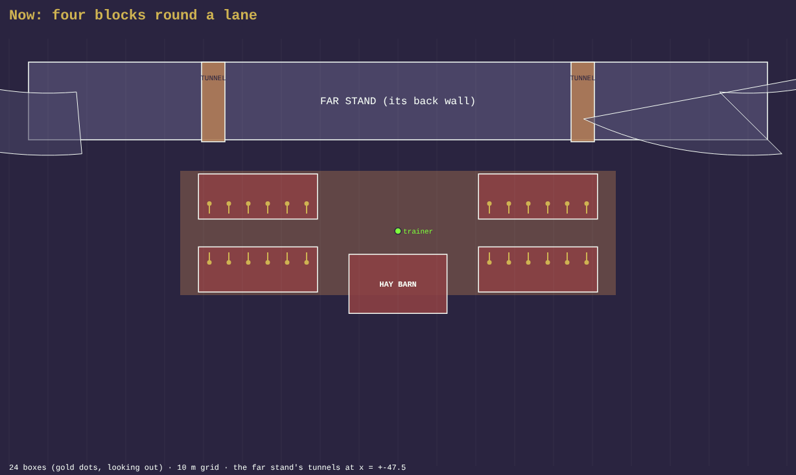

## A: The Stable Court (not built)

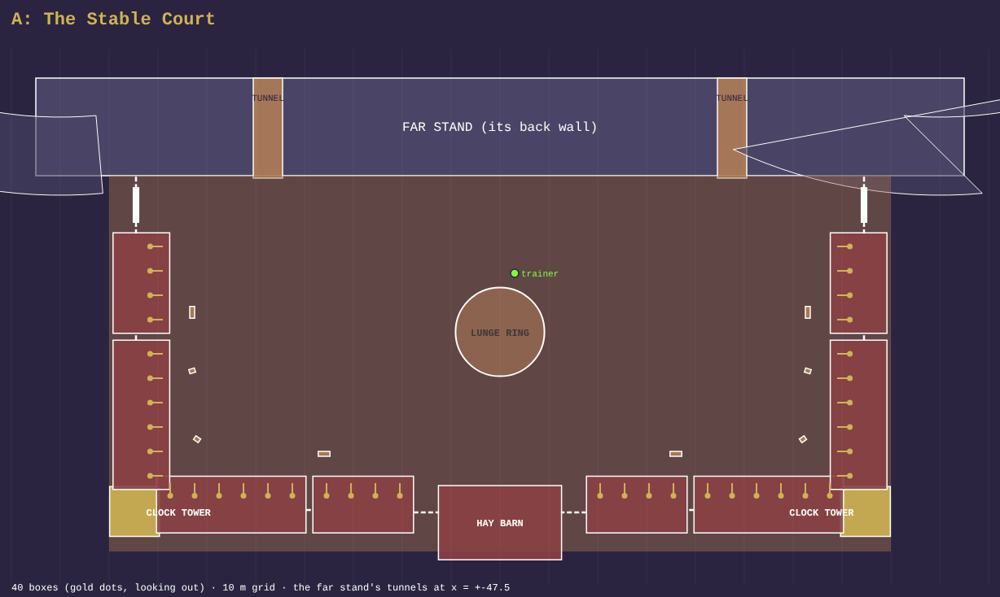

One court the width of the stand's middle. On each side an L of boxes: a wing (a six-box and a four-box block) running back from the
stand, turning at a clock-towered tack room into the back row, which runs in to the hay barn in the middle. The lunge ring stands in
the middle of the court, the trainer between it and the tunnels. A gate at the front of each wing
leads out to the west and the east; fences close the gaps.

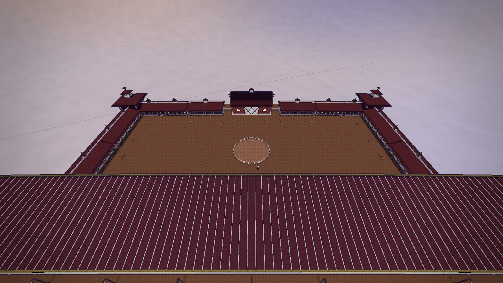

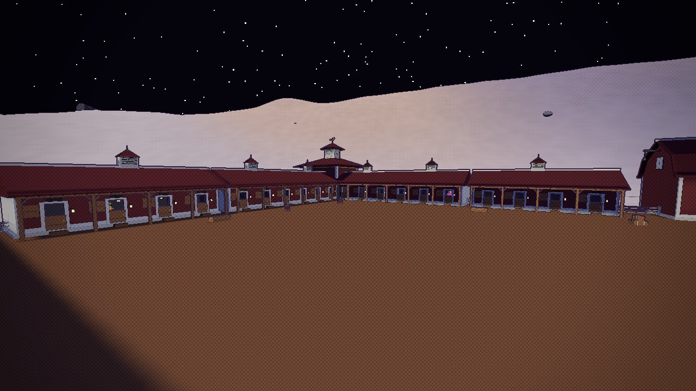

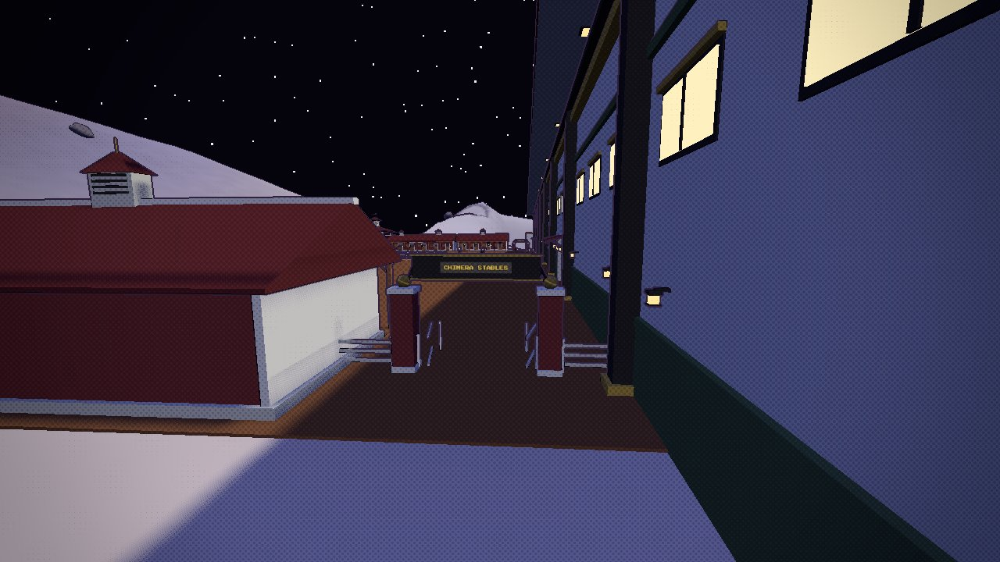

## B: The Twin Lanes (built)

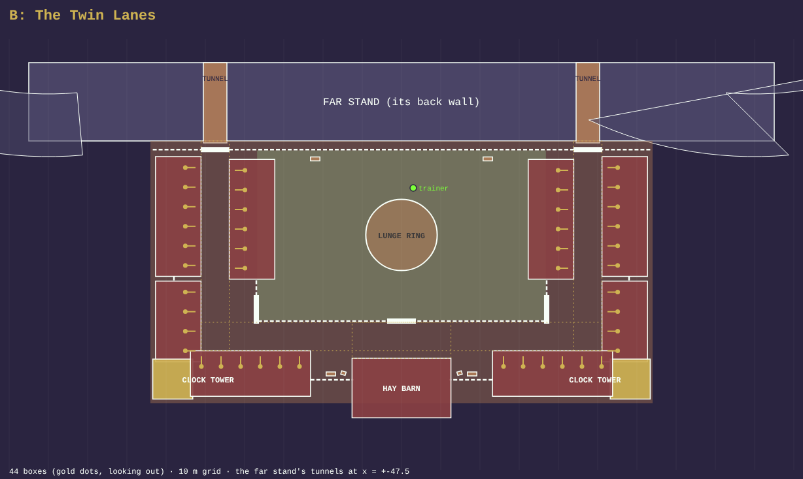

Each tunnel comes out at a gate into a lane of boxes running straight back: an outer row and an inner row facing each other across
it. At the far end the outer row turns at a clock tower into the back row, which runs in to the hay barn. Between the two lanes is a
fenced turnout paddock on grass with the lunge ring, a gate to it from each lane and one at the back. The paddock stops at the line
between its two side gates, leaving an earth yard 10 m deep in front of the barn that joins the lanes. The lanes and that yard
(dotted on the plan) are kept clear: the troughs, the saddle racks and the hay stand in the paddock or in the nooks between the back
rows and the barn, and the checker fails a layout that puts one in a walk.

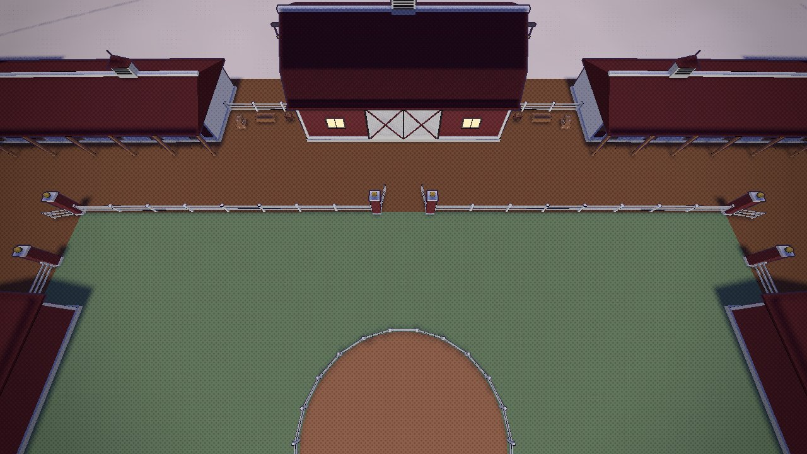

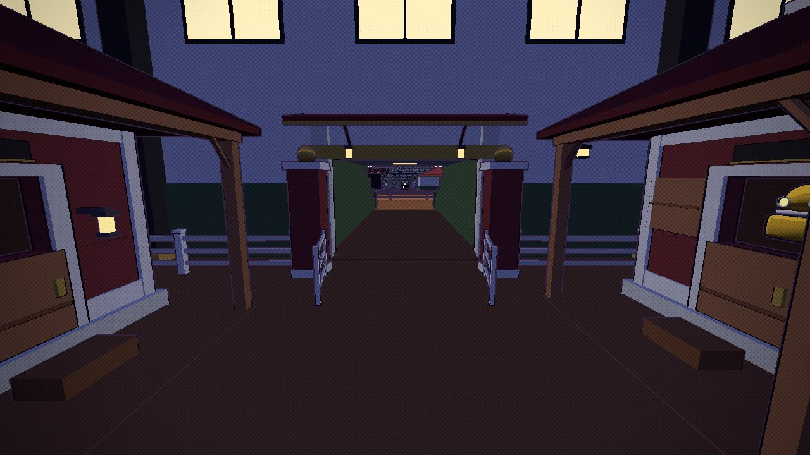

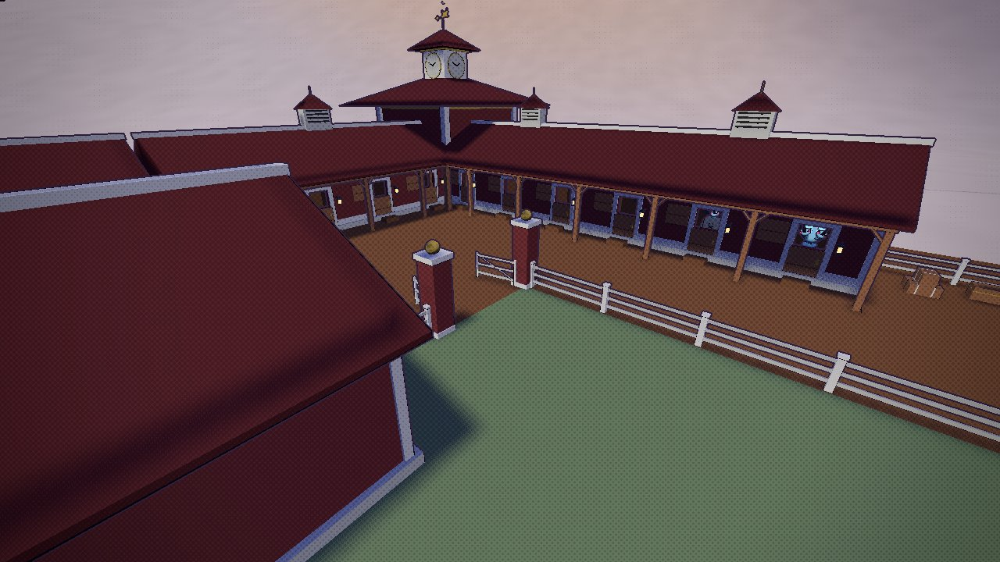

## The kit (`tools/blender/build_downs_stable.py`)

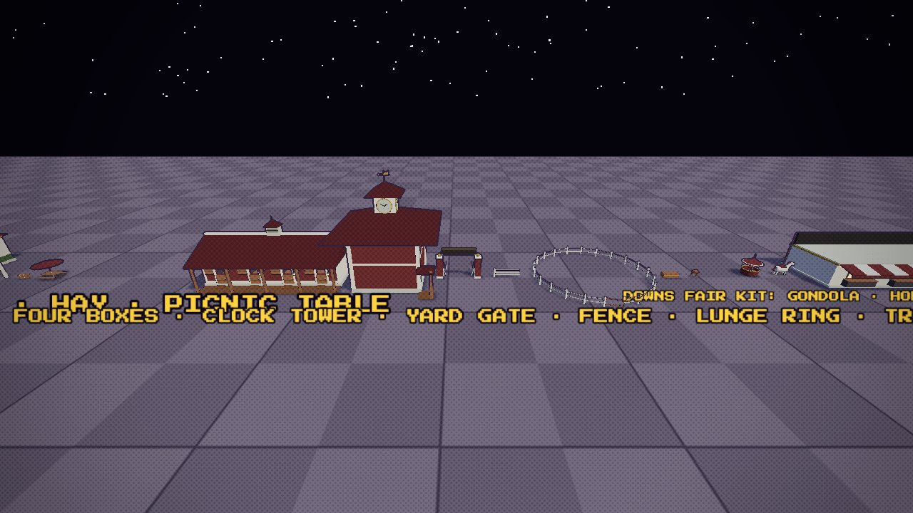

- **`dn_stable_6`, `dn_stable_4`**: blocks of six and four boxes (the one block of six they replace had shut doors on a blank wall).
  Each box's Dutch door has its lower leaf shut and its upper leaf swung back, opening on a lit stall: warm plank walls, a ceiling,
  straw, a hay rack, a lantern. Over each door a name board, beside it a lantern on a bracket; a feed trough on the porch, whose
  posts carry knee braces; Mint cladding on the end walls; louvred cupolas on the ridge.
- **`dn_stable_corner`**: the knuckle of an L, a two-storey tack room with lit windows on its outer faces, a hip roof, a clock turret
  with a clock on each face and a chimera weathervane. It lays the porch's square in the inner corner, a post where the two porch
  beams cross and a soffit under the two roofs' eaves.
- **`dn_yard_gate`**: Barn Red piers with Mint caps and gold balls, two braced leaves swung in. **`dn_stable_fence`**, **`dn_stable_post`**:
  Mint post and rail, cut into equal bays of about 4 m.
- **`dn_lunge_ring`** (a round pen 18 m across), **`dn_trough`**, **`dn_tack`** (a saddle on its rack).

**Chimeras in the boxes**: a third of the boxes have one, two kinds or three spliced (a rival's sort), sized so its head is over the
shut lower door, looking out, idling while you are in the yard (`stable()` in `src/race.js`).

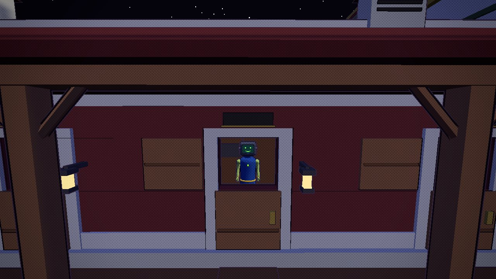
