# The defence turret: two proposals

The game's one defence turret was code-built (`models.js` turretParts): an octagonal base, a head with twin barrels. It
stands on every base's defence ring and walls (the ILMB's, scaled 1.35), in restricted zones, on founded outposts as the
militia guns, and at the hometown barracks. It is replaced by a Blender model (`tools/blender/build_turret.py` ->
`src/assets/turret.glb`, 113 KB compressed; `models.js` makeTurret), in two proposals. Both keep the old one's footprint (about 2.5 m
round) and head height (the head turns at 3.1 m), so the colliders and every placement stand.

**Picked: A, Bastion.** B was taken out of the build after the pick; its builder is in the history (commit c993625,
`build_b` in `tools/blender/build_turret.py`). `?turret=old` (or `localStorage['mr-turret']`) brings back the code-built
one. The Asset Row has Bastion and the old one side by side (vehicles: DEFENCE TURRET), beside the faction line-up (BASE
TURRETS).

**The ILMB's towers, fitted to it** (`build_ilmb.py` tower): with the pick, the guns on the Rampart's bastions and gate
towers moved to the middle of their drums (they stood 2.6 m and 1.6 m outboard of it), and each tower's top now tapers:
the drum curves in from the wall's height in a shoulder (a quarter ellipse, leaving the drum upright) to a seat just wider
than the turret's foot (3.75 m; the ILMB's guns are scaled 1.35, a 3.4 m foot), a navy collar with a red lit band round
it. The flat gun decks, the separate gun plinths and the gate towers' overhanging crowns are gone; the parapet and its
coping run into a bastion's shoulder, and its beacon mast stands on the shoulder's inboard slope, clear of the gun.

| Before | After |
|---|---|
| 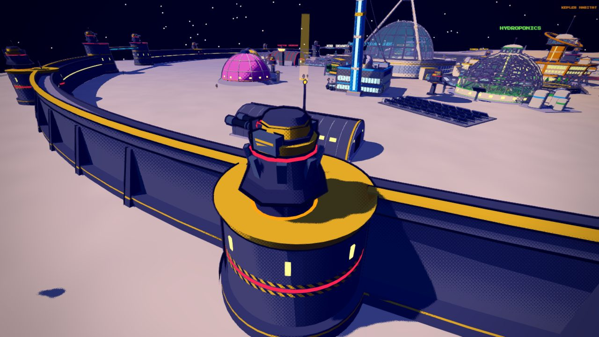 | 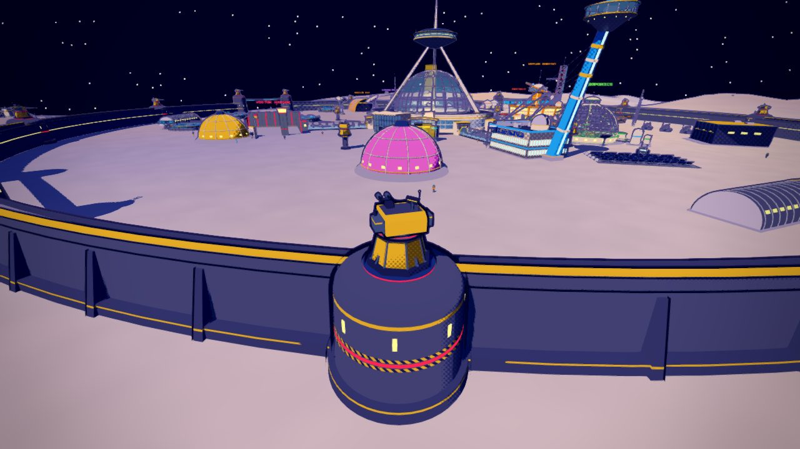 |
| 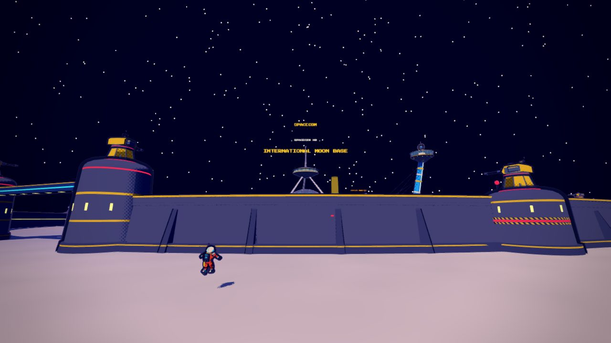 | 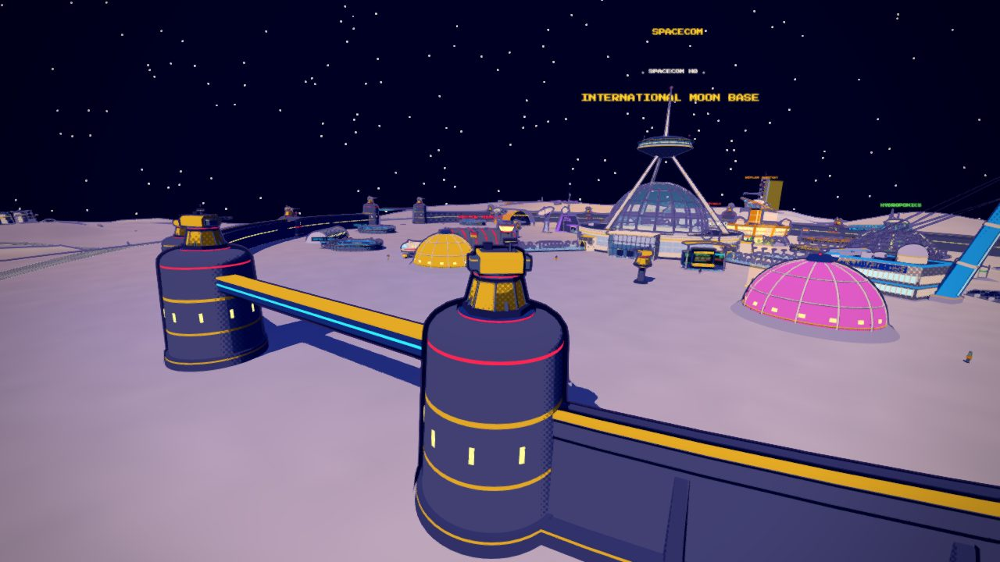 |

| | A: **Bastion** | B: **Aegis** |
|---|---|---|
| Idea | a twin autocannon in an armoured head: the heavy, angular gun emplacement | a radome gun on a yoke: the sensor dome rides with the gun, a rotary cannon under it |
| Pedestal | octagonal, battered, on a bolted foot; corner ribs, four gussets, an access hatch with a hazard sill and status lamp, a dark collar, a red band on the slew ring | round, tapering to the slew ring; six ribs, a door with a lamp, a red band |
| Head (turns) | a sloped shell (lower and upper glacis, flat roof, bustle) with side armour; ammo boxes on the flanks with belt chutes into the shell; a roof sight with a red lens, a turning search radar, a whip with a faction lamp | a turntable and a yoke of two tapering arms with trunnion bearings, a brace, equipment pods with lit strips outside the arms |
| Gun (pitches) | on a trunnion in two cheek brackets: a drum mantlet, two barrels with recoil sleeves, a clamp, slotted muzzle brakes | the radome (white, a faction band) over the gun housing, a six-barrel rotor that spins up while firing, an ammo drum under it, an IR camera |
| Muzzles | two, fired in turn | one |
| Size | 1.5k triangles | 2.0k triangles |

The faction's colour goes on the `body` slot (and the `lens` lamps glow in it); everything else is fixed.

## The pictures

| A: Bastion | B: Aegis |
|---|---|
| 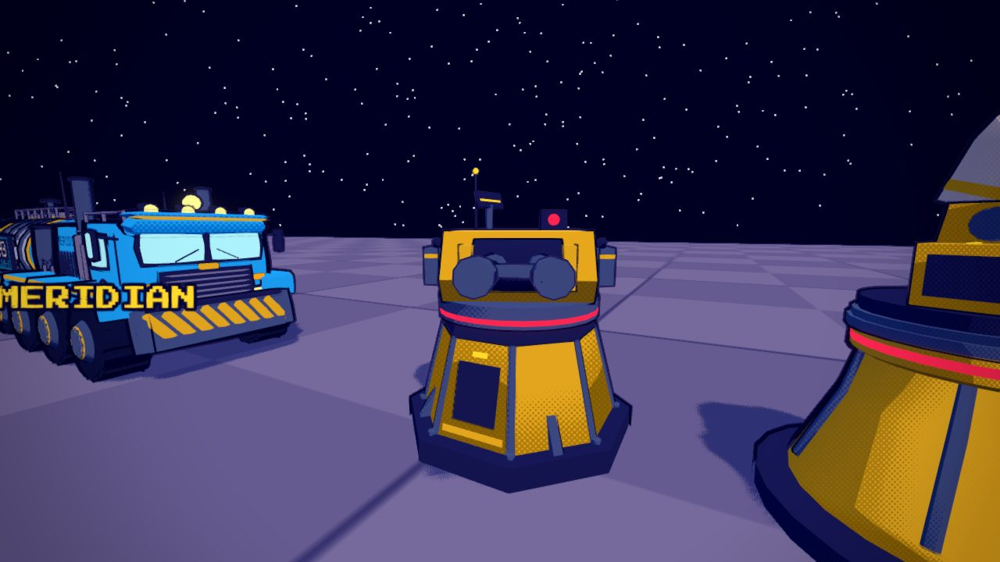 | 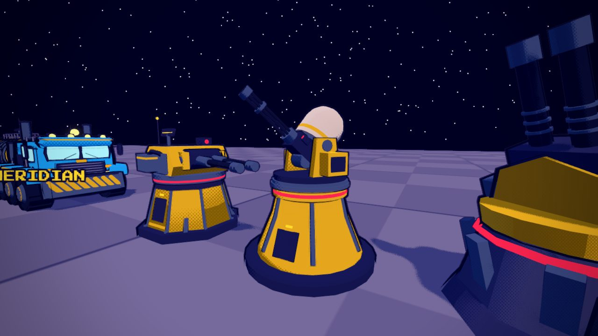 |
| 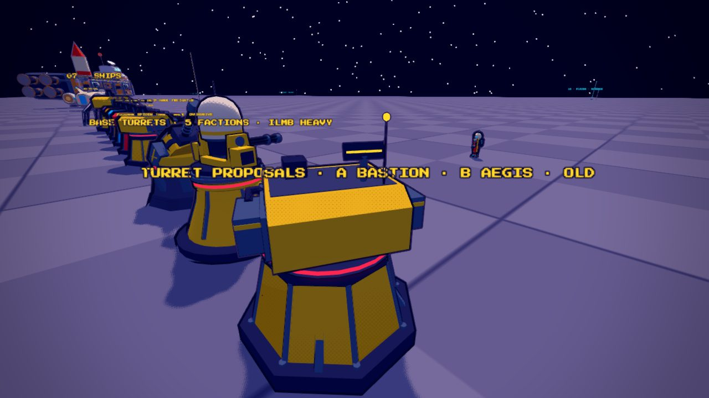 | 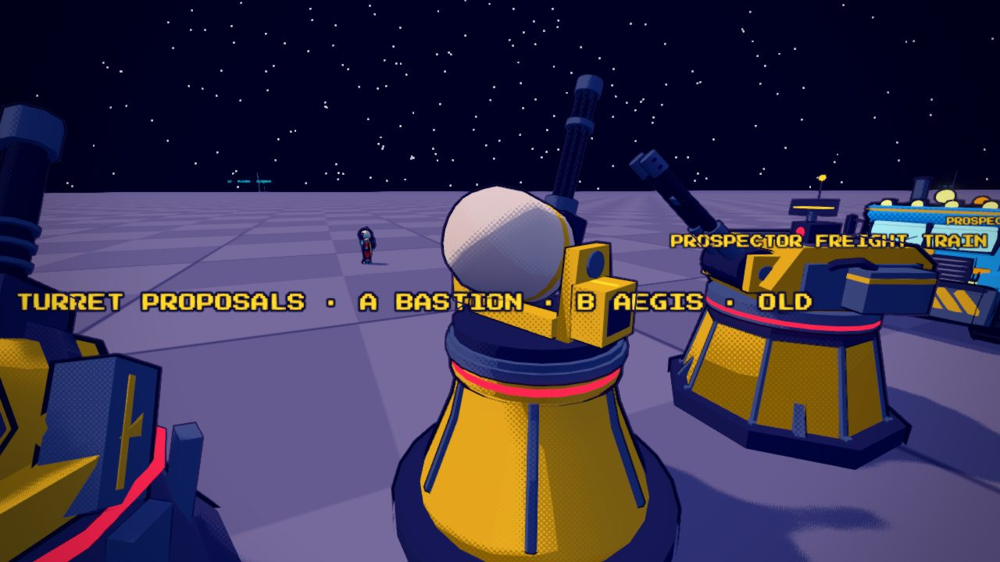 |
| 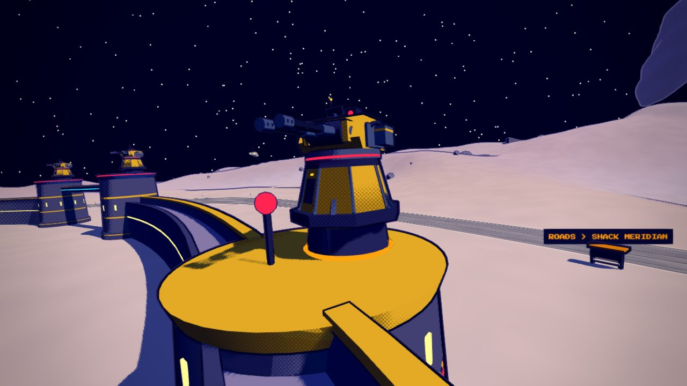 | 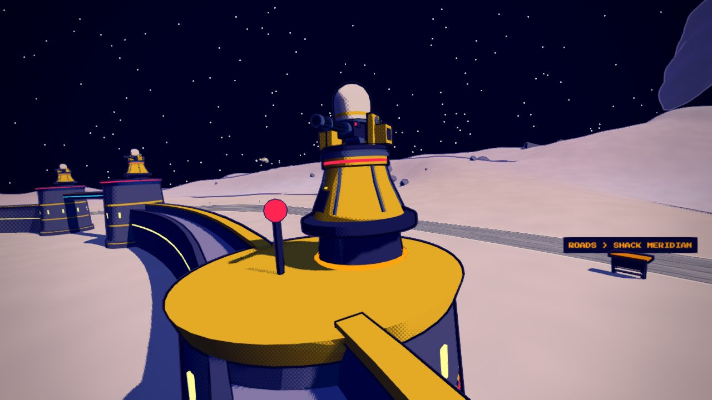 |

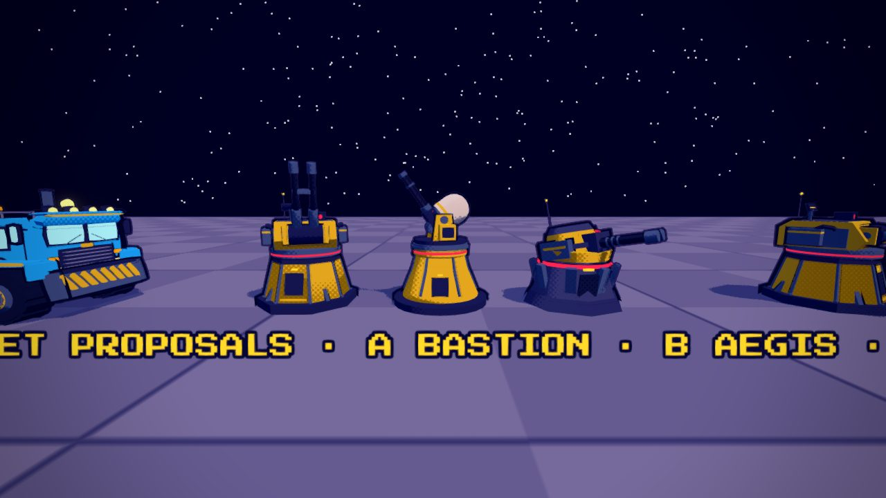

## How they fight now (both proposals)

- **The gun pitches.** The head turns onto the target and the gun pitches onto it (from 20 degrees down to 70 up); a base
  turret fires only once it is roughly on target (within 0.35 rad of yaw, 0.4 of pitch), from its muzzles in turn. The
  founded outposts' militia guns pitch their gun the same way (`territory.js` updateGuns).
- **Tracer rounds.** The old glowing bolts are tracers now (the War-Rig's `round`: a thin glowing streak that grows out
  behind the round, sparks on a hit), 20% faster: 180 m/s, the ILMB's 205 (`enemies.js` TURRET_SHOT). Damage as before.
- **Flak.** Against a runner more than 30 m over the ground (`FLAK_ALT`), a base turret switches to flak, Captain Kade's
  (now `src/flak.js`, shared): a shell fused to burst at your lead point (solved over a few passes, so a fast runner is led),
  or as soon as it passes within 6 m of you; the burst stings (4 + 11 close in, the ILMB's 5 + 13), shoves you away and pulls
  you down within 11 m. One shell every 1.3 s per turret (the ILMB's 1.0 s), a heavier muzzle flash and a deep thump.
