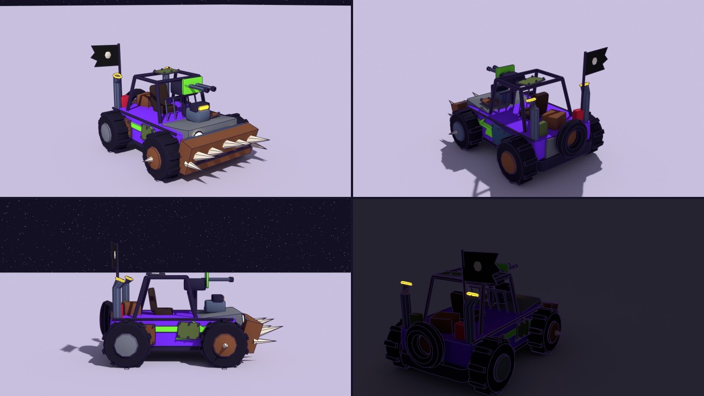
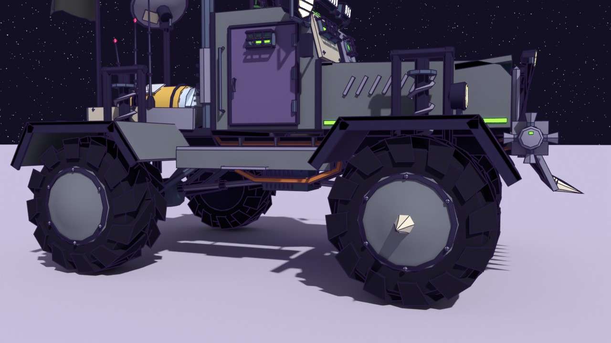

# Rustmoon War-Rig: two redesign proposals

The Rustmoon War-Rig (renamed from "Rustmoon Scrapjaw War-Rig") is the pirates' truck: the one they hunt you in, and the
one Rustmoon gives you as a reward (`VEHICLES.warrig`). It was a low scrap buggy with a spiked plow, an open seat and a
twin gun that only the AI swung:

**A, FURNACE, went in after four revision rounds** (`tools/blender/build_warrig.py` -> `src/assets/warrig.glb`, shared
parts in `tools/blender/warrig_kit.py`; see "In the game" below). B stays here as the runner-up study
(`tools/blender/proposals/warrig_b.py`).

## The brief

A Mad-Max monster truck, sci-fi and lunar, that looks like nothing else in the game:

- a **10-round-burst spray machine gun over the cab**, worked by a **pirate gunner** who aims where you aim
- an **asymmetric, claustrophobic cockpit**: heavy armour, tiny thick viewports behind crossbar cages, no clean centred glass
- **overkill lights**: mismatched LED bars, searchlights, infrared laser sights, for hunting in the shadow zones
- **exaggerated suspension**, tall and wide, for big low-gravity jumps over craters without flipping
- **aggressive, chunky tread** to claw through the regolith
- **kitbashed** industrial greebles, tubes and bolts; stolen, rigged-together parts
- from the reference sheet: an **exposed fusion core or MHD drive** (plasma conduits, cooling coils, fuel injectors spitting
  ion-blue sparks), **comms arrays and sensor spikes** (dishes, antenna needles, a stolen military target-lock pod),
  **RCS thrusters** to turn it in the air, and **sun-bleached paint and frayed MLI blankets instead of rust** (no oxygen,
  so no iron oxide)

Both are built from code in Blender (A by `tools/blender/build_warrig.py`, B by `tools/blender/proposals/warrig_b.py`,
sharing `tools/blender/warrig_kit.py`) and rendered by `tools/blender/proposals/preview_warrig.py` at the game's 1.35
scale. B's plain GLB is here (`warrig_b.glb`) for any viewer, e.g. `tools/viewer.html`; A's is the game's. The gunner in
the renders is the game's courier in the Rustmoon pirate colours, hung on the rig's `crew` point and posed as the game
poses him.

## A: FURNACE (a big-rig head on monster-truck legs, the reactor in the hood)

Laid out like a conventional truck tractor: a long hood with a grille, the cab behind it, heat stacks behind the cab and a
short rear deck, over two axles 4.9 m apart (6.6 m in the game).

- **Running gear:** two solid axles on trailing links, each corner hung from one long coilover inside its own hoop (two
  posts and a top bar on outriggers from the frame), so the shocks stand clear beside the body; bump stops under the rails.
  **Angular wheel wells** the full width of the body over all four wheels (flat plates round each wheel from the body out
  past the tyre, a dropped lip along the outer edge, a hole in the top where the shock and its hoop come through; the
  front pair painted), which carry the body down to the wheels. Balloon tyres 2.8 m across in the game, **modelled whole**:
  the carcass and its tread are one mesh with one outline, each lug swept as one piece from just past the centre line over
  the shoulder and down the sidewall, raked into a chevron, with deep grooves between. Dished beadlock hubs; spiked front
  hubs, for ramming.
- **The hood:** truck-shaped (louvred sides with a green LED strip low down, a rounded nose, a grille of nine bars), open
  in the middle over a stolen tokamak under two guard bars: a ring of ion-blue plasma inside eight copper field coils on a
  cradle, the solenoid poking up through the bars, three injector valves (red hand wheels, each braced to a coil) spitting
  blue sparks into the ring, copper cooling coils along the bay into the louvres, two plasma conduits under the ring into
  the cab.
- **Front:** a plow of raked blades with ramming teeth on a bumper beam, a bull bar with two mismatched pod lamps,
  mismatched headlamps on stalks off the front wheel wells.
- **Cab:** armoured. The windscreen is plated: the driver's two slits in the left half, caged, the right half plated over
  round one caged porthole; the slits look out over the reactor's guard bars. A visor bar of LEDs over the windscreen, a
  big searchlight on the left pillar, mirrors on both sides, a green LED strip along the brow, corner irons, ribs on the
  back.
- **The door** is on the left: a painted armour leaf in a heavy frame, hinges, a lever latch, a caged slit, a grab
  handle. Under it, joining the wheel wells, a step plate the same width with the same lip, riveted round its edges and
  across (the step up to the door).
- **The right side:** the same riveted step plate between the wells, with a bundle of three tanks of different sizes
  strapped together lying across it, tucked behind the front wheel well (bands round the bundle, a valve on the outer end,
  a line from the inner end into the bay), a closed equipment locker on the cab wall (two doors with hinges, T-handles and
  a louvred vent, a small searchlight on top), and a full-height ladder from the step plate to grab rails over the roof.
- **Underneath:** a finned drive motor hung under the cab with driveshafts (U-joints and a slip joint) to both diffs, and
  lines down each frame rail (a cable and a copper coolant line), clamped, and a fat coolant hose on each side sagging
  below the body line on hangers from the bay back to the deck.

  
- **Heat stacks:** two behind the cab, at different heights, with perforated heat shields; they dump the reactor's coolant
  heat. Their tops are bent outward under the gun's sweep.
- **Gun:** a ring mount on the cab roof, a **standing gunner** behind a drum-fed **five-barrel rotary** (four turns of
  the cluster is the burst), a notched salvage-plate shield bolted to two arms with a slot to look through, an IR laser
  sight.
- **Rear deck:** two He-3 canisters stolen from Meridian (cream with cyan bands and gold collars, a navy plate with the
  Meridian globe in gold, steel domes, a valve block with a gauge and a red hand wheel at the back), a relay dish on a mast, three antenna
  needles on the left sideboard, the flag on the back-left corner (nothing behind it, so the game's waving cloth streams
  back; the renders use that cloth, ported from `makeWaveFlag`, at 24 m/s), a rear bumper with two ramming spikes.
- **Colour:** primer, sun-bleached plate and bare metal; only the door and the front wheel wells are painted, in sun-faded
  faction violet. The faction's violet and green only glow: viewport slits, LED strips, the turret's LED ring, a violet
  underglow under the frame.

### Checked by the builder

`build_warrig.py` ends with three checks from the kit, and A passes all of them:

- `audit_flips()`: no inside-out pieces.
- `clash_check()`: no part cuts through another, with the turret also swung every 30 degrees with the barrel at both
  stops. The parts meant to meet (a link into its rail, a pipe into what it feeds, armour on the cab) are listed in the
  builder.
- `float_check()`: every piece is joined to the frame through a chain of pieces touching each other, so nothing hangs
  in the air. Only the sparks fly free, and the plasma ring (its magnetic field holds it).

### Revision history

1. **First pass:** a squat welded bunker over a monster-truck chassis, scrap-paddle tyres, weld beads on every plate.
2. **Second round:** no weld beads or stray spikes; the flag on its own corner pole; shocks in hoops clear of the body
   (the clash check found eleven clashes); a taller cab so the driver can see over the reactor; a whole relay dish; RCS
   pods on the frame ends; a door and a utility shelf with a ladder; little paint, the faction colours only as glows;
   chunky chewed rubber lugs.
3. **Third round:** reshaped as a big-rig head (a long truck hood with a grille and the reactor open in it, a conventional
   cab, heat stacks, a rear deck, fenders), 0.85 m longer; a cleaner build under 20k triangles; tyres modelled whole with
   the grooves cut in, instead of blocks sitting on the carcass; the float check.
4. **Fourth round:** angular full-width wheel wells instead of the round fenders, for depth low on the body; a sill and
   running board on the door side; the open shelf replaced by a closed locker and a strapped tank bundle; a drive motor,
   driveshafts and pipe runs underneath; the RCS quads moved to the bumper ends.
5. **Into the game:** the RCS quads removed; the wells joined on each side by a riveted step plate (the step up to the
   door), the tank bundle on the right one; the gun's mechanics (above).

## B: CRATERCRAB (six-wheeled cab-forward, the drive on its back)

A new silhouette for the game: a six-legged crawler. (It shares A's kit, so it has the new tyres and no welds too, but it
has not had A's revision rounds.)

- **Running gear:** six wheels, each on its own swing arm (a lower wishbone and an upper link to an upright) with a tall
  coilover slanting in to a shoulder tower on the hull. It stands on six "crab legs" with a track wider than it is tall
  (about 7.8 m in the game), so it is very hard to flip.
- **Cockpit:** cab-forward. A pillbox right of centre with a row of three tiny round viewports behind crossbar cages, a
  slit on its flank, a periscope, three sensor spikes, a hatch and a frayed MLI blanket on the roof. Left of it, a low
  armoured bow.
- **The light crown:** a pipe frame on the bow carrying one huge searchlight, two smaller ones at different angles, three
  LED bars (one standing on end) and a stolen military target-lock pod with an IR laser. A cow-catcher of scrap blades and
  teeth leads.
- **Gun:** a pedestal tower mid-ship. The **gunner sits in a pipe-cage basket** behind a **ten-barrel volley gun** (two
  rows of five: the 10-round burst is one shot from each barrel), with a box magazine, a laser sight and a scope.
- **The MHD drive, open to the sky:** an ion-blue plasma channel under copper electrode bars, between two magnet blocks
  wound with copper racetrack coils, cooling coils on the feed lines, frayed MLI over the blocks' fronts, two big radiator
  fins in a V, and a magnetic nozzle at the tail spitting sparks.
- **Back:** a torn radar dish on a mast, three antenna needles, the flag, RCS quads at the corners.

## At night

| A, lights on | B, lights on |
|---|---|
|  |  |

The searchlights are `spot` empties in the GLB (position, `aim`, size), so the game can hang real spotlights on them if
we want the rigs to light the ground in the shadow zones. The renders do exactly that.

## What both share

- **Slots.** Livery: `body` (painted panels; shown here sun-faded, 0x655682), `stripe`, `lens` (glows in the trim
  colour) and `underglow` (glows in the body colour). Fixed: `dark`, `steel`, `metal`, `tire`, `bleach` (sun-bleached
  plate), `primer`, `copper`, `mli` (gold foil), `foil` (silver), `bone`, `red`, `tank`. Glows: `lamp`, `led`, `plasma`,
  `ion`, `laser`, `beacon`. No rust slot, by the brief. The new slots need entries in `makeWarRig`'s palette when one goes
  in.
- **No sculpted welds.** The brief's dynamic-topology sculpting does not fit this pipeline: the models are rebuilt from
  code each time (a sculpt would be lost on the next build, or would have to become a hand-kept `.blend`), and dyntopo
  makes dense meshes, tens of thousands of triangles per seam. A first pass built bead geometry along the plate edges
  instead; it was dropped in the revision round.
- **The gun works like the APC's turret** (`vehicles.js aimTurret` / `turretFire`): `turret` yaws, `barrel` pitches, `muzzle`
  marks where rounds leave. Both rigs add a **`crew` empty** on the turret where the pirate stands (A) or sits (B, `pose`
  extra), so the gunner turns and aims with the gun: when you aim, the turret follows your camera and the gunner with it.
- **The driver rides inside** the armoured cab (not drawn, like the APC); only the gunner shows.

## Numbers

| | A FURNACE | B CRATERCRAB |
|---|---|---|
| Triangles | 19.3k (15.0k of them inked) | 17.2k (14.6k inked) |
| Wheels | 4, radius 1.05 (1.42 m in the game) | 6, radius 0.95 (1.28 m in the game) |
| Length × width (game scale) | about 10.9 m (11.7 m with the plow's teeth) × 7.3 m | about 10 m × 7.8 m |
| Height (game scale) | about 7.9 m to the gunner's head (cab roof 5.5 m) | about 6.5 m to the cage roof |
| Compressed (in the game) | 267 KB | |

Both are over the house budget for a vehicle (11k, `.claude/skills/blender/style.md`); for the War-Rig the cap is 20k.
The tyres are the biggest single cost (about 0.9k triangles each). A passes `audit_flips`, `clash_check` and
`float_check`; B passes `audit_flips`.

## In the game

- **Model:** `makeWarRig` (`src/models.js`) builds it from `warrig.glb` at frame size; the game scales it 1.35, for you and
  for the pirates. Its painted panels are the faction colour faded toward primer; `lens` glows in the trim colour and the
  underglow in the body colour. The flag cloth (`makeWaveFlag`, the same as the other vehicles') hangs on the `flag`
  empty and streams back with speed. On the `crew` empty stands the pirate gunner: a runner in the Rustmoon pirate look
  (`RUSTMOON_LOOK`, which the pirate skaters wear too), posed at the grips, leaning back and raising them as the barrel
  climbs (`aimPose`).
- **You drive it from inside** (`hideRider`), like the APC. The gun works like the APC's turret (`vehicles.js
  aimTurret`): the turret, and the gunner on it, swing where the camera looks, and the barrel pitches to the point under
  your crosshair.
- **Burst fire** (`vehicles.js burstFire`, numbers in `weapons.js RIG_GUN`): left mouse (RT on a pad) fires 20 rounds at
  12 a second, then the gun cools for 2 s; a burst, once started, runs out even if you let go, and holding fires burst
  after burst. Each round leaves the barrels up to 1 degree off their line (about 0.7 on average): it groups, it does not
  hose. Rounds fly at 320 m/s, drop a little, do 7 damage each (your damage upgrades count) and hit with a spark and a puff
  of dust, not an explosion.
- **Tracers** (`projectiles.js`, type `round`): each round is a white-hot streak in an orange glow that grows out behind
  it to 6 m and sheds embers as it flies.
- **The pirates' rigs** use the same model and gunner; their AI already swung the `gun` pivot, which is now the turret,
  so their gunner tracks his target. They still fire their old single shots.
- **Size:** the rig is much bigger than the old one, so its collision radius is 4.6 (was 4.3 for yours and 4.0 for theirs)
  and the AI aims at the middle of its taller hull. The Asset Row item (RUSTMOON WAR-RIG) is 13 x 12 m.
