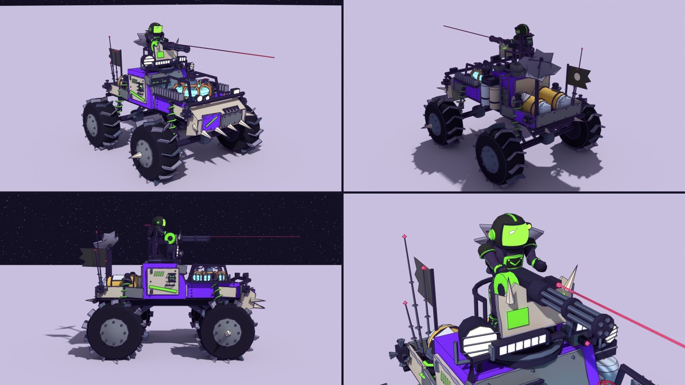
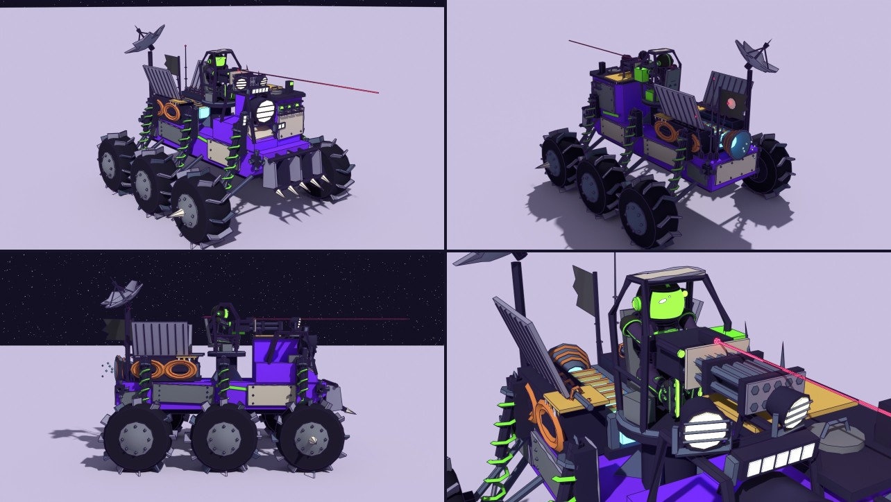
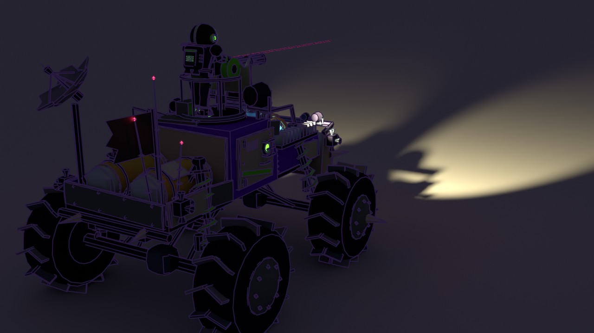
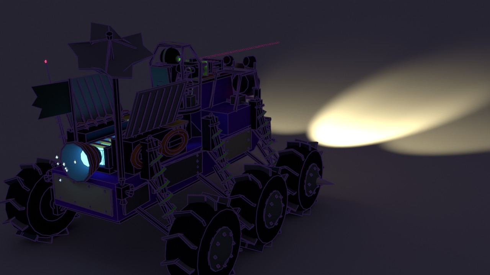

# Rustmoon War-Rig: two redesign proposals

The Rustmoon War-Rig (renamed from "Rustmoon Scrapjaw War-Rig") is the pirates' truck: the one they hunt you in, and the
one Rustmoon gives you as a reward (`VEHICLES.warrig`). Today it is a low scrap buggy with a spiked plow, an open seat and
a twin gun that only the AI swings (`tools/blender/build_warrig.py`).

## The brief

A Mad-Max monster truck, sci-fi and lunar, that looks like nothing else in the game:

- a **10-round-burst spray machine gun over the cab**, worked by a **pirate gunner** who aims where you aim
- an **asymmetric, claustrophobic cockpit**: heavy armour, tiny thick viewports behind crossbar cages, no clean centred glass
- **overkill lights**: mismatched LED bars, searchlights, infrared laser sights, for hunting in the shadow zones
- **exaggerated suspension**, tall and wide, for big low-gravity jumps over craters without flipping
- **aggressive tread** cut from scrap metal, to claw through the regolith
- **kitbashed** industrial greebles, tubes and bolts, with **welded** seams where the plates meet
- from the reference sheet: an **exposed fusion core or MHD drive** (plasma conduits, cooling coils, fuel injectors spitting
  ion-blue sparks), **comms arrays and sensor spikes** (jagged dishes, antenna needles, a stolen military target-lock pod),
  **RCS thrusters** to turn it in the air, and **sun-bleached paint and frayed MLI blankets instead of rust** (no oxygen,
  so no iron oxide)

Both proposals are built from code in Blender (`tools/blender/proposals/warrig_a.py`, `warrig_b.py`, sharing
`warrig_kit.py`) and rendered by `tools/blender/proposals/preview_warrig.py` at the game's 1.35 scale. The plain GLBs are
here (`warrig_a.glb`, `warrig_b.glb`) for any viewer, e.g. `tools/viewer.html`. The gunner in the renders is the game's
courier in the Rustmoon pirate colours, hung on the rig's `crew` point and posed by hand.

## A: FURNACE (long-nose 4x4, the reactor in the hood)

A classic monster-truck shape, pushed far:

- **Running gear:** two solid axles, each corner hung from one long coilover (acid-green spring) up to a tall welded shock
  tower, with trailing links and bump stops. Balloon tyres 2.8 m across in the game, with bent chevron paddles cut from
  scrap plate, every one a little different; spiked hubs up front. The track is about 7 m wide in the game.
- **The fusion bay:** the hood is open. A stolen tokamak sits in it: a ring of ion-blue plasma inside eight copper field
  coils round a central solenoid, under a roll cage. Three open injector valves (red hand wheels) spit blue sparks into
  the ring. Copper cooling coils run to radiator fin stacks on both cheeks, and two glowing plasma conduits feed the cab.
- **Cockpit:** a squat welded bunker set off to the left. Two mismatched slits in the glacis and a porthole in the door,
  each sunk in a heavy frame behind a crossbar cage. The right side is coolant tanks, a louvred vent box and the gunner's
  ladder.
- **Gun:** a ring mount on the bunker roof, a **standing gunner** behind a drum-fed **five-barrel rotary** (two turns of
  the cluster is the burst) with a jagged, notched shield and an IR laser sight.
- **Lights:** a long LED bar and a short one at odd heights on a brow rack, a big caged searchlight on the left, a small
  one on the tanks, three mismatched pod lamps on the ram.
- **Back:** two He-3 tanks under frayed gold MLI blankets with silver patches, a bent radar dish on a mast, three antenna
  needles with red tips, the flag. RCS quads on all four corners. A ram of bleached plate with punched vents, teeth and
  side spikes.

## B: CRATERCRAB (six-wheeled cab-forward, the drive on its back)

A new silhouette for the game: a six-legged crawler.

- **Running gear:** six wheels, each on its own swing arm (a lower wishbone and an upper link to an upright) with a tall
  coilover slanting in to a shoulder tower on the hull. It stands on six "crab legs" with a track wider than it is tall
  (about 7.8 m in the game), so it is very hard to flip. The same scrap-paddle tyres.
- **Cockpit:** cab-forward. A welded pillbox right of centre with a row of three tiny round viewports behind crossbar
  cages, a slit on its flank, a periscope, three sensor spikes, a hatch and a frayed MLI blanket on the roof. Left of it, a
  low armoured bow.
- **The light crown:** a pipe frame on the bow carrying one huge searchlight, two smaller ones at different angles, three
  LED bars (one standing on end) and a stolen military target-lock pod with an IR laser. A cow-catcher of scrap blades and
  teeth leads.
- **Gun:** a pedestal tower mid-ship. The **gunner sits in a pipe-cage basket** behind a **ten-barrel volley gun** (two
  rows of five: the 10-round burst is one shot from each barrel), with a box magazine, a laser sight and a scope.
- **The MHD drive, open to the sky:** an ion-blue plasma channel under copper electrode bars, between two magnet blocks
  wound with copper racetrack coils, cooling coils on the feed lines, frayed MLI over the blocks' fronts, two big radiator
  fins in a V, and a magnetic nozzle at the tail spitting sparks.
- **Back:** a bent radar dish on a mast, three antenna needles, the flag, RCS quads at the corners.

## Side by side at night

| A, lights on | B, lights on |
|---|---|
|  |  |

The searchlights are `spot` empties in the GLB (position, `aim`, size), so the game can hang real spotlights on them if
we want the rigs to light the ground in the shadow zones. The renders do exactly that.

## What both share

- **Slots.** Livery `body` (Rustmoon violet), `stripe` (acid green: springs, paint daubs, the magazine) and `lens` (viewport
  slits that glow in the trim colour). Fixed: `dark`, `steel`, `metal`, `tire`, `bleach` (sun-bleached plate), `primer`,
  `copper`, `mli` (gold foil), `foil` (silver), `bone`, `red`, `tank`. Glows: `lamp`, `led`, `plasma`, `ion`, `laser`,
  `beacon`. No rust slot, by the brief. The new slots need entries in `makeWarRig`'s palette when one goes in.
- **The welded look** is built into the geometry, not sculpted: every big plate has a lumpy hand-laid bead along its
  visible edges (`weld_geo` in `warrig_kit.py`, fat and thin by turns), and bolts and patches sit on top. The brief's
  dynamic-topology sculpting does not fit this pipeline: the models are rebuilt from code each time (a sculpt would be
  lost on the next build, or would have to become a hand-kept `.blend`), and dyntopo makes dense meshes, tens of
  thousands of triangles per seam, against a vehicle budget of about 11k. The beads cost about 1.5k triangles per rig.
- **The gun works like the APC's turret** (`vehicles.js aimTurret` / `turretFire`): `turret` yaws, `barrel` pitches, `muzzle`
  marks where rounds leave. Both rigs add a **`crew` empty** on the turret where the pirate stands (A) or sits (B, `pose`
  extra), so the gunner turns and aims with the gun: when you aim, the turret follows your camera and the gunner with it.
- **The driver rides inside** the armoured cab (not drawn, like the APC); only the gunner shows.

## Numbers

| | A FURNACE | B CRATERCRAB |
|---|---|---|
| Triangles | 17.6k (14.5k of them inked) | 16.8k (14.1k inked) |
| Wheels | 4, radius 1.05 (1.42 m in the game) | 6, radius 0.95 (1.28 m in the game) |
| Length × width (game scale) | about 9 m × 7 m | about 10 m × 7.8 m |
| Height (game scale) | about 7.2 m to the gunner's head | about 6.5 m to the cage roof |

Both are about 50% over the house budget for a vehicle (11k, `.claude/skills/blender/style.md`). They are drawn at full
detail to judge the design; the chosen one gets trimmed on the way in (cleats and hubs per wheel are the biggest
single cost, then the welds and springs). Both pass `audit_flips`.

## What going in would take

1. Move the chosen builder to `tools/blender/build_warrig.py` (it already writes the same root name `warrig`) and trim it
   to budget; add its new slots to `makeWarRig` in `src/models.js`, and its turret, barrel, muzzle and crew to the model.
2. `VEHICLES.warrig`: `turret: true`, `hideRider: true`, and a burst fire mode (10 rounds, then a cooldown) instead of the
   APC's single shell; a pirate (`makeRunner` with `FOES.rustmoon.look`) placed on the `crew` empty, posed as in the
   renders.
3. Pirate rigs driven by the AI: they currently swing a `gun` pivot; they would swing the turret instead, and get a
   gunner too.
4. The frame is bigger than the old one (wheels 1.05 / 0.95 against 0.85, a wider track), so `radius`, the ride lift
   and the dust spots need checking in the game; the Asset Row item's footprint grows too.
