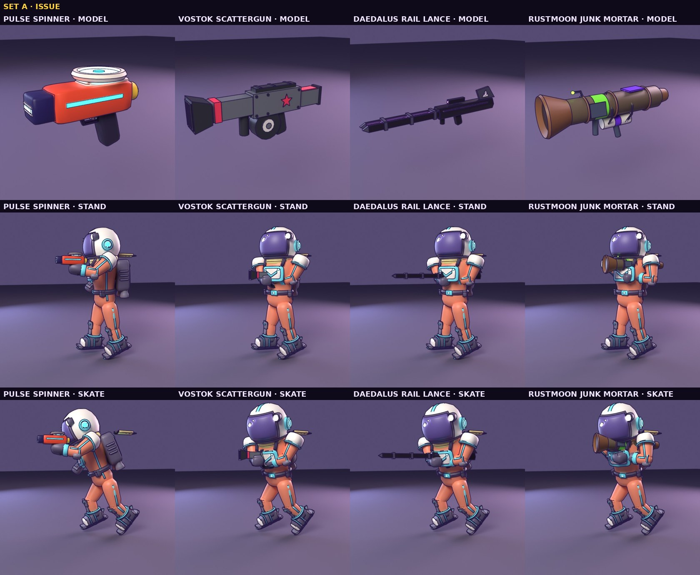
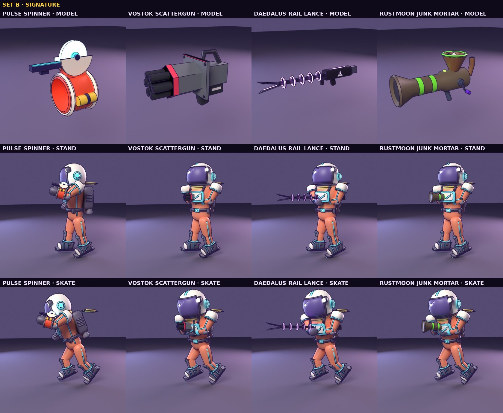

# Weapon models: two sets of proposals

The game draws no weapon today, only the shot. These are drafts for a model of each of the four
(`src/weapons.js` WEAPONS), built from code in Blender (`tools/blender/build_weapons.py`) and rendered with the courier
holding them, standing and skating (`tools/blender/preview_weapons.py`, Cycles with Freestyle ink). Nothing is in the game
yet.

| | |
|---|---|
|  |  |

## Who makes what, and how it looks

Each weapon wears its maker's colours and style (`.claude/skills/blender/style.md`, "Faction palettes"):

| Weapon | Maker | Colours | Style |
|---|---|---|---|
| Pulse Spinner | standard courier issue (no faction) | Courier Orange `ff4f2e`, cyan, cream, yellow, navy (`cosmeticsData.js` courier); the disc lit in **the player's laser colour** (slot `laser`) | rounded, sporty, like the courier's own kit |
| Scattergun | Vostok | slate `6b6f78`, red `ff3b5c`, dark slate, cream | slab-sided, riveted, a red star |
| Rail Lance | Daedalus | near-black `1a1426`, violet `c77dff` (lit), dark panels, cream | faceted and sharp, the delta with an eye |
| Junk Mortar | Rustmoon | rust, acid green `7dff3a` (paint), War-Rig violet `7b2ff7`, cream | stolen, welded scrap; paint only, no mark |

The black-market Scattergun and Rail Lance (sold by Rustmoon) are the same guns, "serial filed off".

## Set A · Issue: clean, practical shapes

- **Pulse Spinner, Disc Blaster.** A chunky one-hand blaster: an orange body with a cyan stripe down each flank, the disc
  magazine spinning flat on top in a cream ring, a navy muzzle with a lit launch slot, a yellow cell at the back.
- **Vostok Scattergun, Breaker.** A slab-sided box shotgun: a slate receiver with rivets and a red star each side, a short
  shroud with a red band, a flared slot muzzle for the spread, a drum underneath, a short slab stock with a red stripe.
- **Daedalus Rail Lance.** A faceted near-black body with violet seams, two long rails out front lit violet on their
  inner faces, three collars binding them, pointed tips, an angular scope (the Lance has the scope on right mouse), the
  delta-eye on its tail fin.
- **Rustmoon Junk Mortar, Pipe Mortar.** A fat scrap pipe on the shoulder: a funnel bell, uneven weld seams, an
  acid-green band slapped on, a violet plate and a steel patch welded over holes, a gas bottle strapped underneath, a
  bent-rod sight with a green bead, bent-pipe grips.

## Set B · Signature: bolder, more mechanical character

- **Pulse Spinner, Wrist Spinner.** A gauntlet on the right forearm: the lit disc stands upright in a cream cradle on top,
  a lit rail runs out over the fist, a yellow power cell is strapped to the outer side. The hand is left free (a fist),
  so it suits a courier who also grabs, scoops and winches.
- **Vostok Scattergun, Hedgehog.** Seven short barrels in a hexagon (it fires seven pellets) behind a riveted slab shield
  with a big red star, the way the APC is built; a carry handle, an ammo box, a side handle for the left hand.
- **Daedalus Rail Lance, Coil Lance.** A slender spine through five violet coil rings on spoked cradles, ending in a
  forked blade tip; a faceted power core at the hands with a lit window and the delta-eye on its flanks.
- **Rustmoon Junk Mortar, Junk Hopper.** A stubby flared cannon at the hip with a hopper on top full of scrap (a gear,
  bolts, a can), a crank on the right, a stovepipe exhaust, acid-green stripes and a violet patch.

## Holding them

The courier's arms are short (about 0.64 m from shoulder to the middle of the glove, shoulders 0.9 m apart), so a gun
held like a rifle is out of reach: two-handed weapons are held close, with the torso turned into a right-handed stance
(left shoulder forward). Each model says how it is held (its root's properties) and the preview solves both arms to it
(two-bone IK, the elbow an exact hinge, as the game's pivots bend), reporting any hand that falls short; in these renders
every hand reaches its grip, standing and skating.

| Hold | Weapons | Body |
|---|---|---|
| pistol | Disc Blaster | right arm out toward the aim, the left out for balance |
| wrist | Wrist Spinner | the same, the gauntlet riding the forearm |
| chest | Breaker, Hedgehog, Junk Hopper | both hands, held across the body; torso turned 0.65 rad |
| under | Rail Lance, Coil Lance | tucked under the right arm, the left hand on the fore grip |
| shoulder | Pipe Mortar | the tube on the right shoulder, both hands on the grips under it |

Each weapon's frame: the right hand's grip at the origin, +z the way it fires, +y up; `fore` is the left hand's point,
`muzzle` where the shot leaves (the game fires from 0.5 m right of the courier today: the muzzle would replace that).

## To put one set in the game

- Export the chosen set to a GLB (slots and ink as the house rules; the Pulse Spinner's `laser` slot takes
  `cosmetics.laserColor`).
- The weapon hangs from the right forearm (`foreR`) in the hand's frame; the arms take the hold's pose (an aim layer over
  the walk, run and skate poses in `player.js animate`), both arms solved to the grips as here.
- Shown only in combat, as the crosshair is: drawn while firing and for a while after the last shot, then put away
  (`gamepad.js crosshair`, the same timer).
