# Dr. Zbornak's Antimatter Lab: the rework


This is the draft picked from the first two proposals: **the Rotunda, with Zbornak "the Elder" and the LABNET terminal**, revised
from the review. Proposal B (the Institute, Zbornak "the Singed", the SPECIMEN INDEX) is dropped.

Everything is modelled in Blender from code (`tools/blender/build_zbornak_lab.py`, `zbornak_kit.py`, `zbornak_figure.py`) and
rendered with Cycles and Freestyle (`tools/blender/preview_zbornak_lab.py`). It is now in the game: "In the game" below
says how. The chimeras in the pods, on the bench and in the corral are the game's own (`makeChimera`, exported for the
renders). The courier is `runner.glb`. The drone feeds are filmed in the game too (`tools/zbornak-drones.mjs`).

| | Today | The Rotunda |
|---|---|---|
| Main lab | 44 × 32 m box, 16 m tall | round, 64 m across; ribbed dome 27 m; the reactor's crown of rings 44 m up through an oculus |
| Airlock | a doorway | ribbed tunnel (14 m) to a lock housing, round pressure door, ZBORNAK LABORATORIES over it |
| Security | none | camera on a round wall mount and a two-link arm, a scan cone onto the stand plate, the photo on a screen beside the door |
| Lab terminal | none | LABNET, the console before the drone wall, right of the door as you come in |
| Ranch | gravel yard, one trough, kiosk at the gate | gambrel barn, pen office on its end (the pen terminal indoors), corral, silo feeding a roofed feed bunk |
| Plateau | barrels, gas rack, generator | plaza, paved walks to the supply pad and the ranch, Zbornak containers, radiator field, solar array |

| Today, from the air | Today, inside |
|---|---|
|  |  |


## The second in-game review

| Asked | Done |
|---|---|
| The walk should meet the ranch's ground flush at the gate, not clip | It ran on over the cattle grid. Now it ends square on the grid's new steel frame. The grid's bars sit flush with the walk's top over a dark pit, and the corral's dirt carries on past it. |
| The fence gates have no end posts | Each swung-open gate leaf has a stile at each end (it was two rails and a brace), strapped to its log post. |
| The reactor: lose the lightning, no plate under the core, let it bob | The plasma arcs are gone. The "plate" was the collar round the column, a closed cylinder that read as a disc through the glass. It is an open band now. The core bobs up and down in the column (about half a metre, with a little sway) as it spins. |
| The stair to the catwalk is hard to climb without sliding off | It is replaced by a **lift**: a glass shaft beside the catwalk on the west, a short railed bridge from its top onto the ring. Stand on the car a moment and it takes you to the other level, standing. Come to the shaft at the level it isn't at and it comes for you. Each level's opening has a waist-high gate that rises only while the car is there and drops before it moves. The catwalk's railings now collide too, and their rails stop at the openings instead of running across them. |
| The barn and the office: things not flush, clipping | The barn's walls stopped at 6 m under a roof whose line meets them at 6.55 m. That left a dark wedge, and the gables' edges didn't follow the roof. Now walls and gables meet the roof's underside, with caps on the ridge and on the gambrel's break. The office's walls stopped at 4.8 m under a roof sloping to 5.6, which left the black gap. Now they rise to the roof's line. The roof stops short of the barn's gable instead of running into it, and the HOLDING PEN sign is on the wall over the door, under the eave. |
| The fume hood's duct leads nowhere, and the hood is oblong | The hood was a square cone scaled before it was turned, a lozenge. It is now a rectangular hood (`frustum`) on a rim with a light under it. Its round duct rises, with a damper band, and bends back into a bolted flange in the wall under the cable tray. |

| | |
|---|---|
| 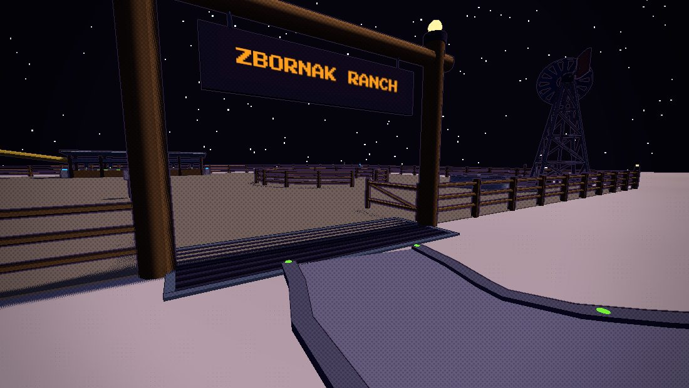 | 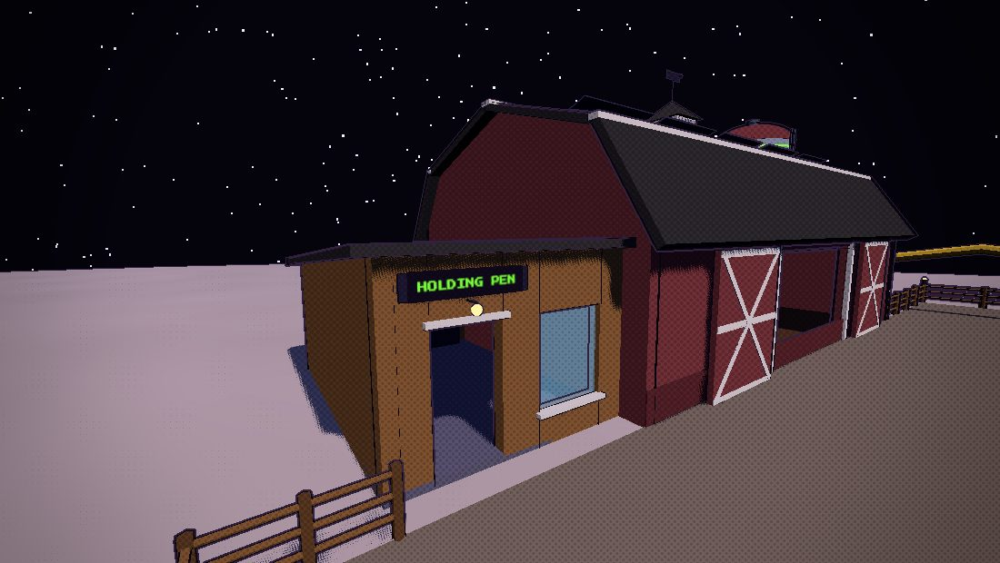 |
| 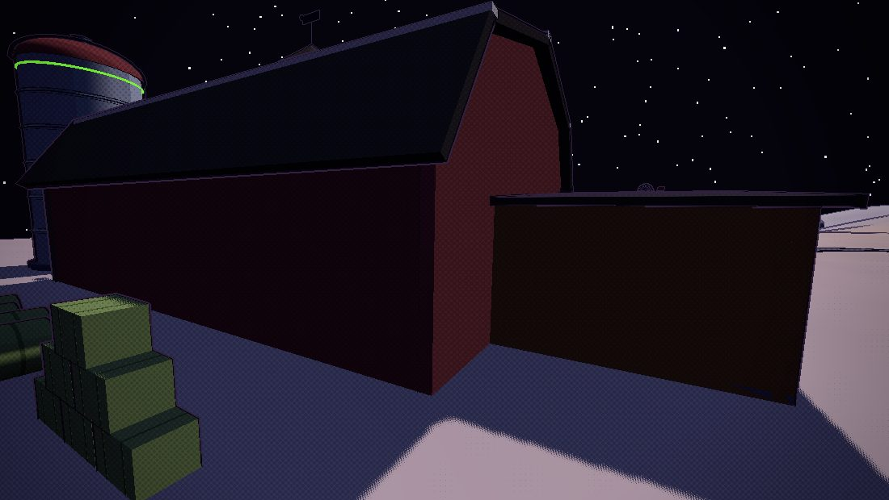 | 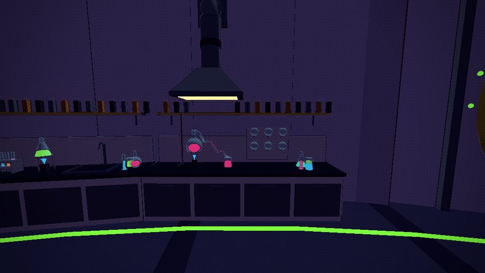 |
| 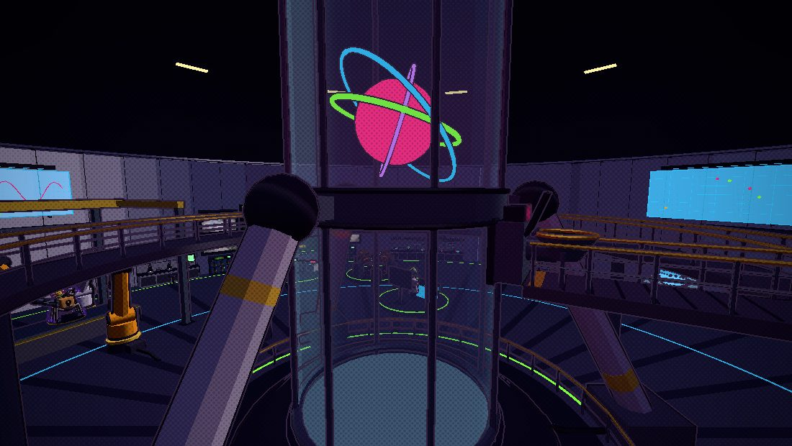 | 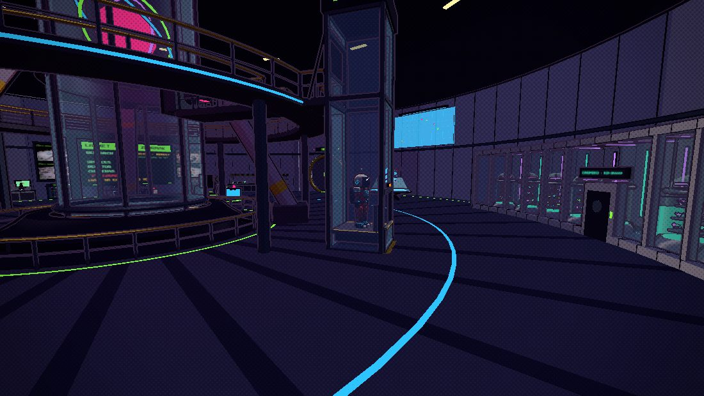 |
| 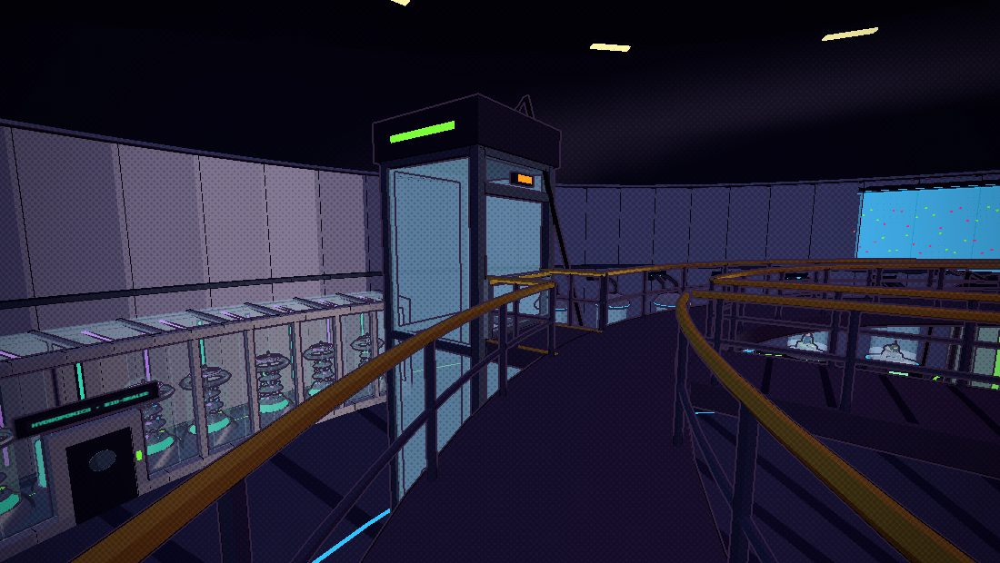 | |

## The in-game review

The first review of the lab in the game. The shots are the game's own (`game/`).

| Asked | Done |
|---|---|
| The EXOTIC MATTER sign is cut off | It was one long line of lettering flat against the curved wall, so its ends went into the wall. It is now two lines (EXOTIC MATTER, then DO NOT LOOK DIRECTLY) on a flat board, stood off the wall on brackets above the cable tray. |
| The hydroponics habitat needs a back of its own and vertical glow bars | A white back-plate runs along the wall behind the pods, with a cap rail. Fourteen vertical grow-light bars stand before it in dark channels, violet and teal in turn. |
| Put the holotable between the green and blue floor rings, away from the hydroponics | It is now midway between the cyan ring (18 m) and the lime ring (28.5 m), and midway between the airlock and the habitat (31° left of the door). The wall projection above moved with it. |
| The airlock's inner end: the trim either side clips the lights, and the trim and cables cut off there | The guide rails stood on the ring of chase lights. They are now 0.45 m further out. The cable tray stopped short of the portal. Now it runs straight across in front of the pilasters, joining the round run's ends, on brackets to the wall. |
| The inner door doesn't open or close | It is a real door now. It shuts in the opening and rises out of sight into the wall. The two doors cycle like the Downs' airlocks. Walk 6 m into the tube and the outer door drops behind you. The tube cycles with a hiss, then the inner door rises. Going out runs the other way. A door opens only once the other has been shut a moment, and never shuts on you in its doorway. |
| Rework LABNET and the equipment corner: LABNET a big wall display, the drone feeds at its sides | LABNET is now a **9.6 × 5.5 m wall display**, stood 1.3 m off the wall so it rises past the cable tray. The attract screen shows your research totals and the newest reactor results. The four **drone feeds** are 3.2 m panels, two above each other at each side, each turned to the wall's curve on a column frame. **LABNET's desk** curves round its chair, with a keyboard, a touch panel and the drone joystick. It also holds a drone on a repair mat with a screwdriver and a parts tray, a soldering station, a desk lamp and a red toolbox. |
| Battery chargers: refine them (the CHARGING sign floated), more depth and detail | The chargers are new cabinets under each feed column, on a plinth with vented sides. Behind a glass door is a bay 0.25 m deep, holding two rows of three cells in cradles. Each cell has terminals with cables into the bay's back, a charge bar and a lamp. CHARGING and a meter are set into the header's face, and the feed runs to a floor junction box. |
| Scale everything up: it looks miniature | The chemistry benches, the microscope bench and the magnet array are 1.25× (bench tops at 1.26 m), moved apart so they still fit along the wall. The kit's `G.at(..., s=)` scales parts, colliders and markers together. |

| | |
|---|---|
| 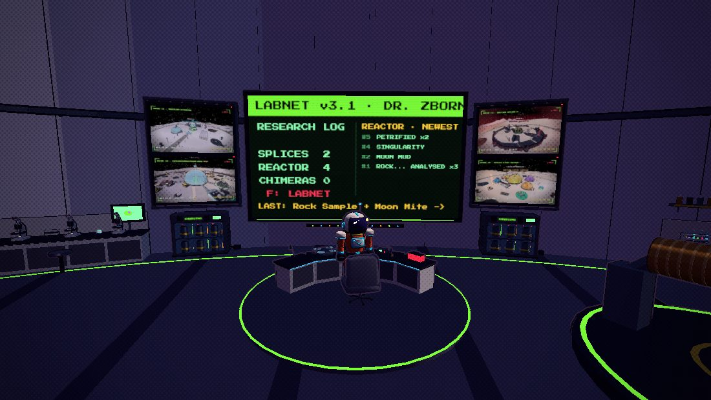 | 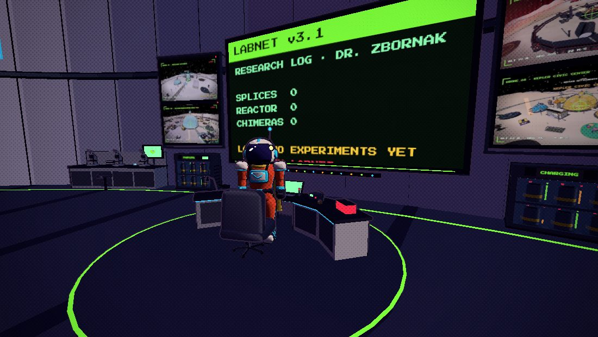 |
| 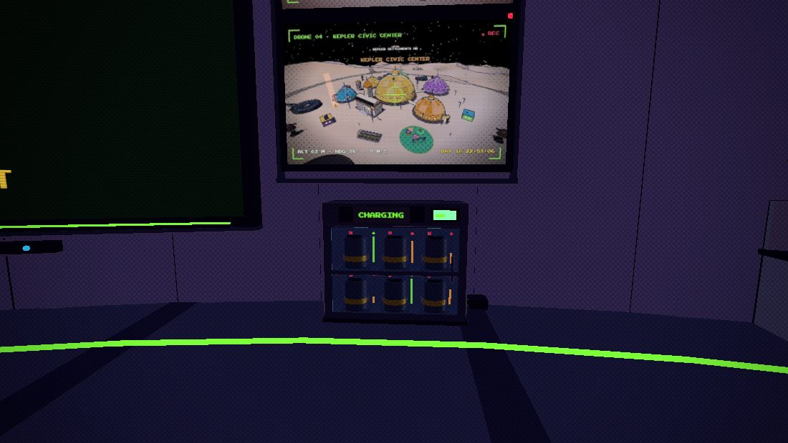 | 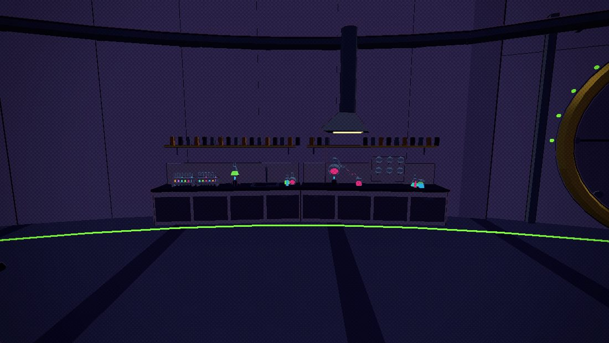 |
| 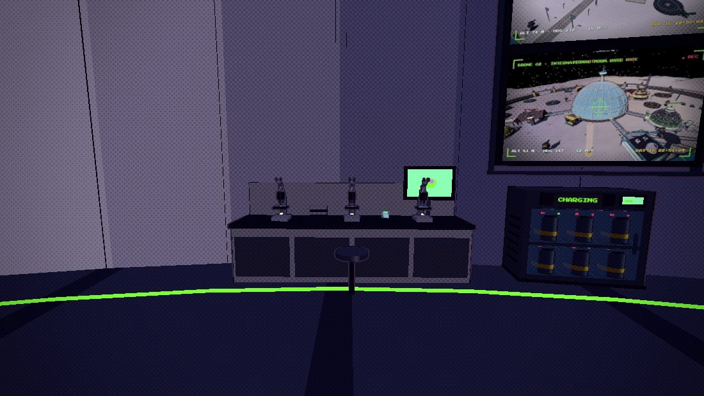 | 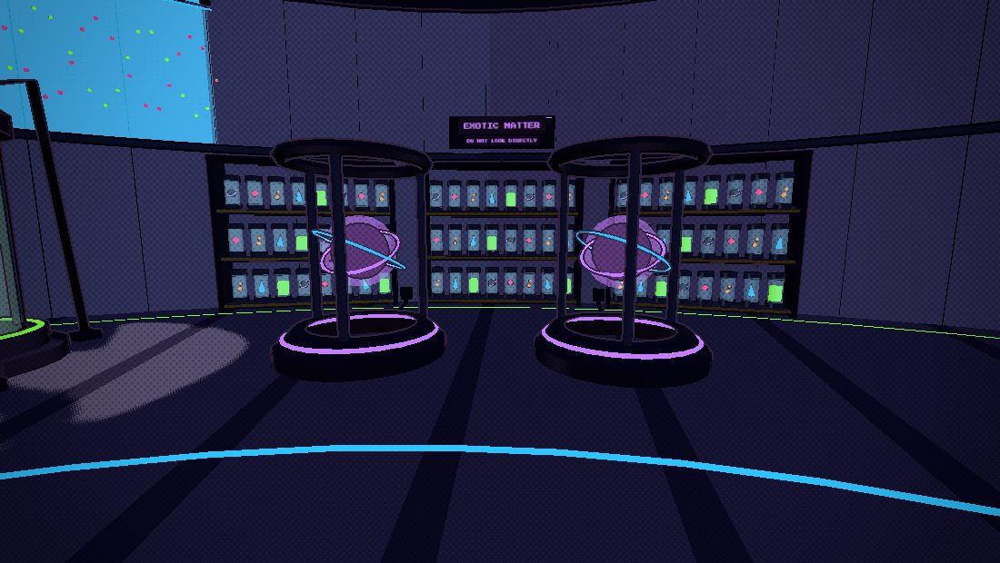 |
| 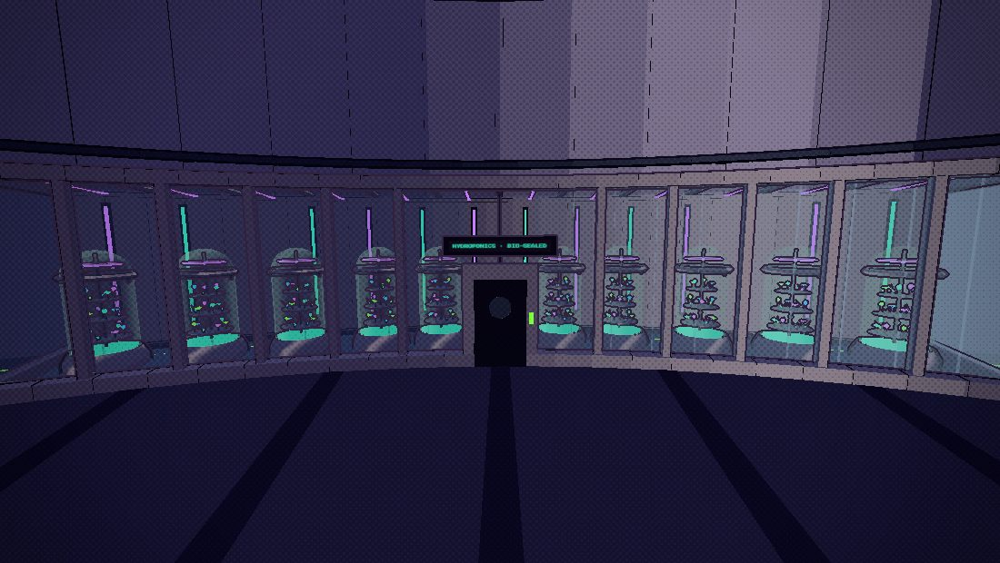 | 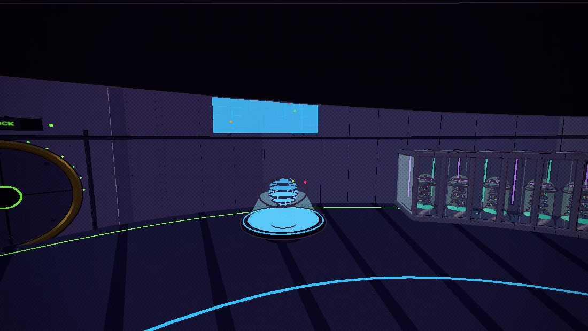 |
| 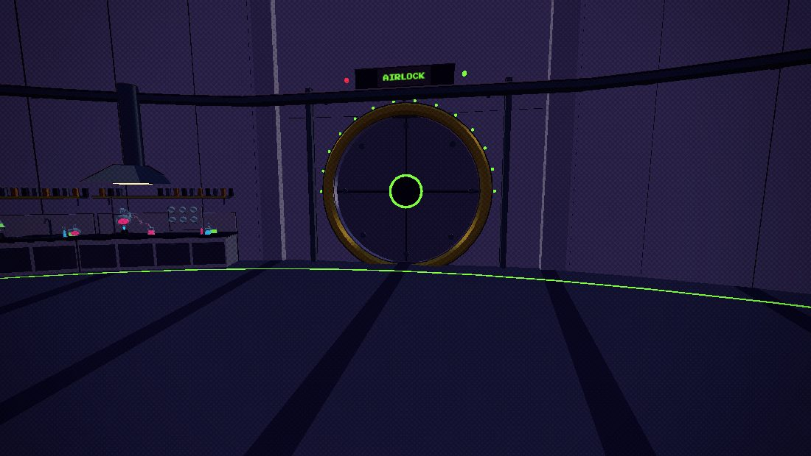 | 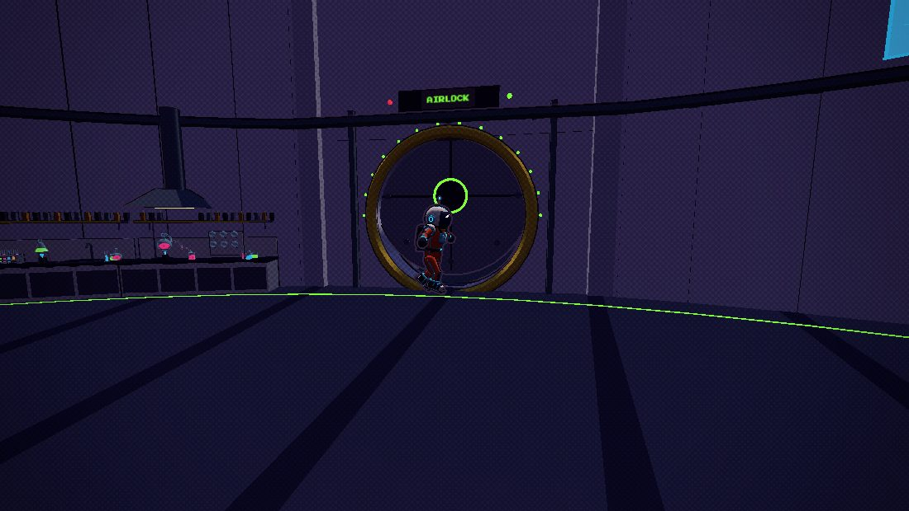 |

## The latest revision

| Asked | Done |
|---|---|
| The yellow paint bands on the reactor's struts look off | They were short cylinders on axes of their own, set beside the masts, so they read as skewed blocks. Now each band is a sleeve on its mast's own axis, a little proud of it: one low on each mast and one near the head. |
| The airlock's inner door clips through the wall's sides, with no wall above it; make it look part of things | The ring wall's gap was narrower than the tunnel, so the tunnel ran through the wall panels either side, and the gap was open up to the roof. Now the gap is wide enough and filled by a **portal wall** up to the wall's top. The tunnel's mouth is a round opening in it with a hazard frame and a ring of lime chase lights. The **inner door** is raised into a pocket in the wall above, its lower edge showing in the opening, with guide rails each side. AIRLOCK is lit over it, with a status lamp each side and pilasters where it meets the ring wall. |
| Replace the gallery with lab equipment; a curved "drone view" screen of other settlements; the lab terminal built in | The gallery is gone, and so is LABNET's wall unit. Right of the door is now the **equipment corner**: |
| | **Two chemistry benches:** a distillation rig (a flask over a burner's blue flame, a condenser coil to a collecting beaker) under an extraction hood; a flask rack; test-tube racks; a burner on a tripod; a sink with a swan-neck tap; reagent shelves of bottles. |
| | **The magnet array:** four electromagnet coils on yokes holding a steel sphere in the air in cyan field loops, with a control pedestal. |
| | **The drone wall:** four video panels fitted round the wall, each a **live drone feed** of a settlement, filmed in the game: Meridian Exchange, the ILMB, Bastion Vostok-9 and Kepler Civic Center. Each feed is under a drone's HUD (DRONE 0n, REC, altitude, heading and speed, a timestamp, a crosshair) and the wall's caption reads ZBORNAK DRONE NETWORK · 4 FEEDS LIVE. |
| | **Battery chargers:** a cabinet under each end of the drone wall, with eight big cells in cradles, charge bars filling, status lamps and a bus bar into the cable tray. |
| | **The LABNET console:** a curved desk on a low dais before the drone wall. LABNET is its main screen, with two feed monitors, a keyboard, a drone joystick and a stool. |
| | **The microscope bench:** three microscopes, slide boxes, petri dishes, and a monitor showing a magnified cell. |

| | |
|---|---|
| 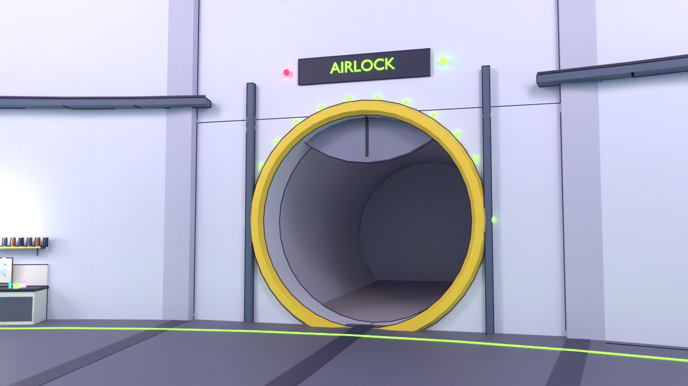 | 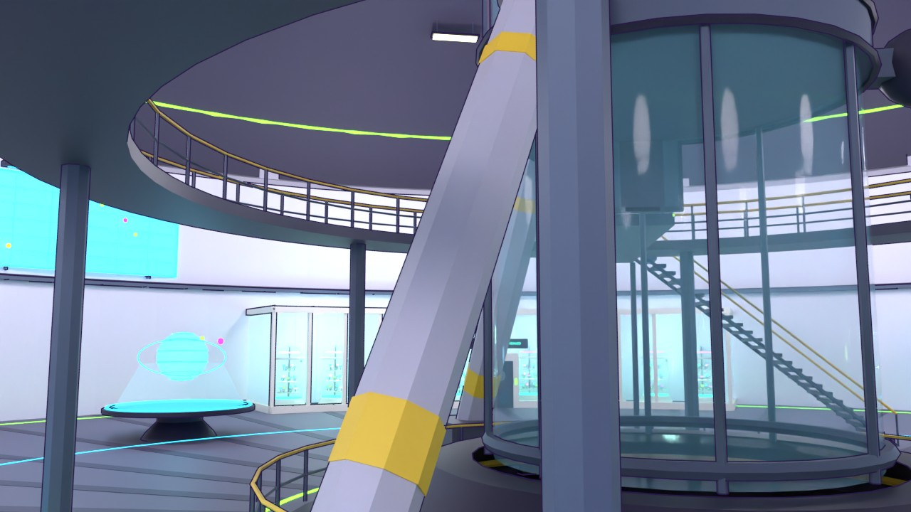 |
| 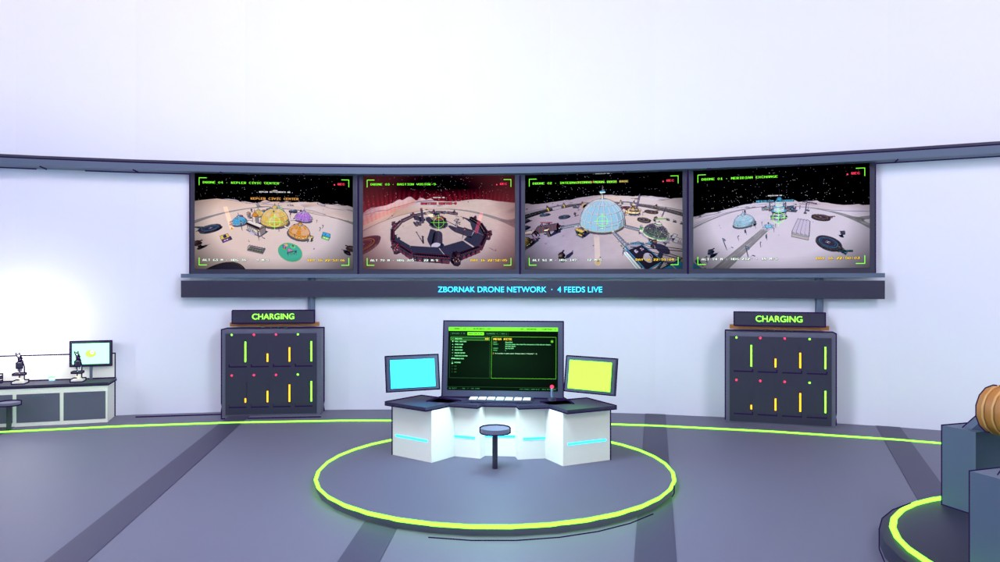 |  |
| 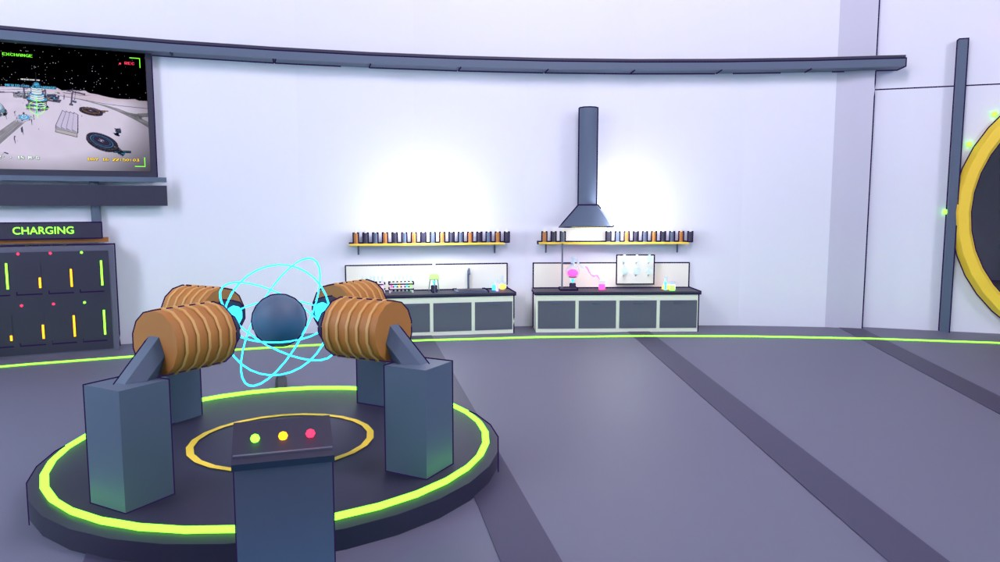 | 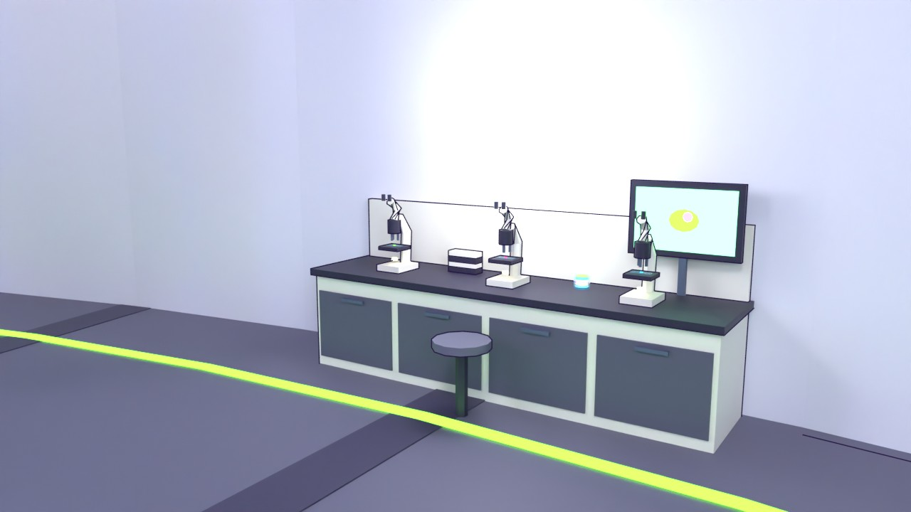 |

| Drone feeds | |
|---|---|
| 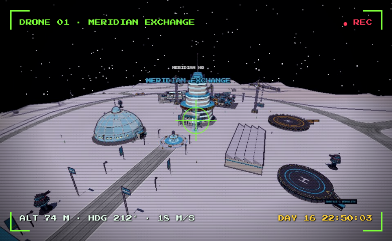 | 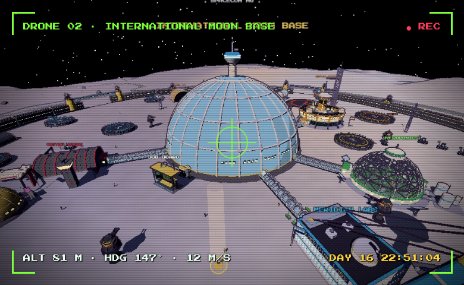 |
| 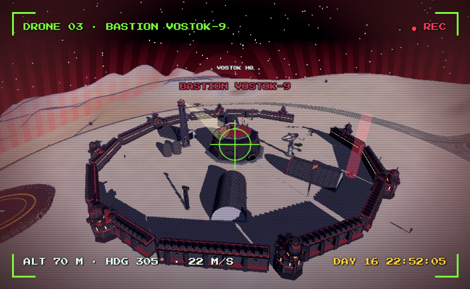 | 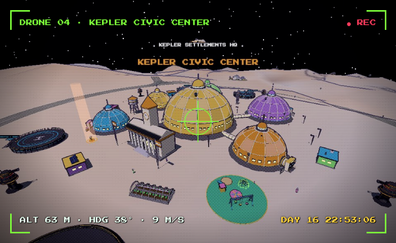 |

## The third revision

| Asked | Done |
|---|---|
| The hydroponics sign is far too big for its board | The lettering is about half its old height and fits inside the board over the habitat's door. |
| The hydroponics habitat: half as far out from the wall | Its glass front now stands 4.5 m from the wall (it was 9 m). Inside is one row of ten growth pods with a lane behind the door, the nutrient header along the wall and the nutrient tank behind the door. |
| The stair to the catwalk stands right in front of the habitat's door | The stair now runs along the outside of the catwalk ring, rising toward the front to a railed landing on the west side, straight across from the intake bridge. Its foot is toward the back, so the floor before the habitat's door is clear. |
| The robot arms: realistic, working together | The arms now work one cell (shown below). Each tool point moves in straight, eased lines between keyed spots, and the joints are solved for it (inverse kinematics), as a real robot's are. The plate arm's wrist turns about the tool's axis (a new `roll` joint) to keep the plate square to the chimera. The four loose blocks on the bench are now a **plate carrier**: a tray with slotted end frames holding the armour plates on edge. |

**The robot cell's work cycle,** one loop (`CELL_KEYS` in `build_zbornak_lab.py`):

1. The left arm swings in and clamps the chimera on its jig.
2. The right arm lifts an armour plate out of the carrier, swings it over and holds it flat on the chimera's flank.
3. The welder comes in and runs a bead up the plate's seam, lit blue and throwing sparks while it welds and dark the rest of the
   time.
4. The right arm lets go and goes back for the next plate. The plate stays on, its bead still glowing.
5. The left arm lets go.


| | |
|---|---|
|  |  |
|  |  |

## The first review (some of it since changed: the gallery and LABNET's wall unit are now the equipment corner)

| Asked | Done |
|---|---|
| The robot arms move; the welder glows an intense blue | Each arm is a chain of pivots the game turns: `turret` (yaw), `shoulder`, `elbow`, `wrist` (pitch, each on its own joint) and `roll` (the tool flange). They work a cell together (the last revision, above). The welder's tip burns blue-white inside two deep-blue halos, lights the bench blue (a 3 kW blue light at the tip) and throws a fan of sparks; halo, light and sparks flicker. |
| An intake hatch on the raised scaffolding, for throwing things in | A railed bridge runs from the catwalk's inner edge to the reactor, straight on from the top of the stair. It ends at a hopper with its lid swung up, over a chute into a port housing clamped on the glass (INTAKE, the reactor's pink glow in the throat). |
| Wires that make sense: the cryo pods' lines, the struts to the reactor; a pass over all the small things | The rule now: every pipe and cable ends in a socket, a junction box, a flange or the **cable tray** that runs round the wall at 6.2 m. Details in the table below. |
| LABNET wall-mounted, right of the door as you come in | On the wall 14° right of the door: main screen in a frame, two side screens angled in, a keyboard shelf on brackets, status lamps, a conduit into the tray, a stand-here mark on the floor. |
| The vault door leads nowhere: rework or axe it | Axed. The exotic-matter corner is now one wall of canister racks (three 6.4 m racks) with the two magnetic cages before it, each cabled to the wall. The space the old console left by the door is now the **gallery of the petrified**: five plinths with brass plaques and a spotlight each, a stone courier on each (`alchemy.js` already puts petrified people "in the lab's gallery"). |
| Outside: the camera clear of the door, the post beside the door gone, the camera's strut on its mount, a round mount | The mount is a round plate (bolted ring, hub) up and to the right of the door's frame. The arm leaves the hub and reaches out over the plate, above and in front of the door, clear of the frame. The intercom post is gone. |
| No sign on top; just "Zbornak Laboratories"; the green fluid pod gone | The roof sign and the specimen jar are gone. One board over the door reads ZBORNAK LABORATORIES. |
| Clean paths: no lights through the walk, not jagged, no black plates at the bends, joined to the platforms | Each walk is one smooth ribbon (a spline through its points) with a raised kerb on each side, and flush lit studs set into the kerb tops. It starts inside the plaza's edge and ends on the ranch gate's cattle grid, or on a ramp up onto the pad's deck. The old walks were boxes overlapping at each bend: the black plates. |
| Hydroponics more sci-fi: growth pods in a sealed habitat | A sealed glass habitat against the wall: a curved glazed front on a white kerb with mullions, a glass canopy on ribs, glass end walls and an airlock hatch (HYDROPONICS · BIO-SEALED). Inside are ten **growth pods** on a nutrient header. Each pod is a pedestal with a nutrient bath, a glass capsule with a domed top, three tiers of glowing plants round a stem, a grow-light ring and a mister. Violet grow strips run under the canopy. The last revision made it shallower (one row of pods). |
| Storage crates like Meridian's, with Zbornak branding (and a CLAUDE.md rule) | `zb_container` builds the standard cargo box (`cargo.py`, as stacked in Meridian's yard) in a Zbornak livery: violet body; a plate on each flank with a lime Z roundel, ZBORNAK over LABORATORIES; numbers ZBL 000417 on. Stacks stand by the pad and by the east gas rack. CLAUDE.md now says every place's storage crates are this container in the owner's livery. |

**The connections pass:**

| Part | Now |
|---|---|
| Reactor pylons | Each mast ends in an emitter head bolted by a bracket to a steel collar clamped round the glass column, below the core, with the emitter's lens on the collar. Before, the heads hung 1.5 m off the glass. |
| Reactor cables | From each pylon's footing along the floor into a socket on the plinth. |
| Cryo pods | Two coolant lines from each crown, up and back into a junction box on the wall, and from there up into the cable tray. Before, the lines stopped in the air. |
| Ceiling lamps | Each hangs on two rods from the dome. Before, they floated a metre under it. |
| Hanging vines | Gone with the old racks. They started in mid-air under the dome. |
| Wall projections | On brackets from the wall, with an emitter bar along each top. |
| Splice pod | Its four hoses end in floor sockets. |
| Zbornak's dais | The monitor stands on a post on the dais. Before, it floated. |
| Magnetic cages | A feed cable from each plinth to a wall socket. |
| LABNET and the canister racks | Conduits into the tray. |
| Robot arms | Cables along every link, from joint to joint. Each pedestal has a junction box and a floor cable. The gantry's legs stand on base plates. |
| Silo | The auger chute meets the feed bunk's auger at an elbow. Before, it missed by about a metre. |
| Barn lanterns | Hang on chains from the loft floor. |
| Office lamp | On a bracket. |
| Gas racks | Pipes on stands into wall flanges. |
| Generator and solar array | Ground conduits on blocks to junction boxes at the wall. |
| Radiator field | Its header ends in a flange on the rotunda's back wall. |

## The Rotunda


**Airlock and security.** A ribbed tunnel runs out from the dome, like the hab domes' airlocks, to a lock housing with a round
pressure door in a hazard ring under the ZBORNAK LABORATORIES board. You stand on the painted plate with the two lit footprints.
The camera, on its arm off the round mount, casts its scan cone down and takes your picture, and the screen beside the door shows
it: *VISITOR · COURIER #0417 · MATCH 99% · ZBORNAK: "OH. YOU." · ACCESS GRANTED*. Then the door opens.


**Inside** (the dome lifted off), round the reactor clockwise from the door:

| Spot | What is there |
|---|---|
| Right of the door | the **equipment corner**: chemistry benches, the magnet array, the drone wall with the **LABNET** console before it, battery chargers, the microscope bench; **Zbornak's dais** facing the door |
| Right | the **robotics bay**: a junk-bot chimera on a jig, being armoured: a clamping arm, a plate arm and the **welder**, a plate carrier on the bench, an overhead gantry |
| Back right | **exotic matter**: a wall of canister racks (void beads, crystals, plasma) and two magnetic cages with a floating black sphere in each |
| Back | the **splice pod** under a 13 m projection of a double helix |
| Back left | six **cryo-stasis pods** in an arc, a chimera asleep in each |
| Left | the **hydroponics habitat**, 4.5 m deep against the wall |
| Front left | the **holotable**: the Moon as a hologram, a map projected on the wall |
| Middle | the **reactor**: plinth, glass column, a caged core in three rings, three pylons clamped to its collar, a pit railing. The ring catwalk 6.5 m up, the stair along it to a landing on the west and the bridge across from it to the **intake hatch** |


| | |
|---|---|
|  |  |
|  |  |
|  |  |
|  | |

**Outside:**
- **The walks:** from the plaza to the supply pad and to the ranch gate.

  
- **Zbornak containers:** stacks of them by the pad, and by the east gas rack.

  
- **The radiator field:** behind the dome, piped to the reactor (its heat dump).
- **The solar array:** to the west, cabled in.
- **Gas racks and the generator,** each piped or cabled to the wall.

**The ranch** stands east of the lab, its office 26 m from the dome:
- **The barn:** a red gambrel barn with its sliding doors open on the corral, and stalls with lanterns.
- **The pen office:** on the barn's end, with the pen terminal inside under a HOLDING PEN board.
- **The feed line:** a silo feeds an auger into a roofed 15 m feed bunk of glowing feed, with lick blocks at the ends.
- **Water and the rest:** a stock tank filled by a sun-mill pump, a training ring and bales.
- **The gate:** the ZBORNAK RANCH arch with a cattle grid.


## Dr. Zbornak, "the Elder"


He is 2.35 m tall, thin and pale green, an alien with no helmet:
- **Head:** an egg of a cranium tipped back, with brain ridges over the crown; three eyes (two almond with lit amber slits, one on
  the brow); brass goggles pushed up on the cranium; soot on a cheek.
- **Coat:** knee length, burnt ragged at the hem with flame-licks of char up the skirt and a singed brown edge, embers still
  glowing in it, a singed right cuff, a burnt patch on the back and a hole by the pocket.
- **Underneath and on him:** shirt and tie, three pens in the breast pocket, a name badge.
- **In his hands:** a clipboard in the left arm, a pen in the right hand.

The head turns on a `head` pivot at the neck, like the casino's bouncer. He is 7.9k triangles before outlines, exported alone in
the game's GLB contract as [zbornak.glb](zbornak.glb).

## LABNET

Step up to the console and press F: the camera moves in to the screen. It is a green CRT log in the game's pixel faces, with
these tabs:
- **SPLICES:** each of the splice pod's ten mutations, with its source, effect, when it was spliced, whether it is active, your
  three mutation slots, and Zbornak's note.
- **REACTOR:** everything that can go in (single items, pairs, three of a kind, three different), with the input, the result,
  when it was first logged and how many times.
- **CHIMERAS** and **PEN.**

Locked entries show `???`. After every splice, feed or hatch the new entry is marked NEW and named on the bottom line. The entries
are the game's own (`MUTATIONS`, `ITEMS` and the reactor's results in `src/alchemy.js`); the save shown is made up.

| SPLICES | REACTOR |
|---|---|
|  |  |

## In the game

The draft is now the game's Antimatter Lab.

- **The model:** `ZB_GAME=1 MOONRUNNER_REPO=. python3 tools/blender/build_zbornak_lab.py`, then
  `node tools/optimize-glb.mjs src/assets/zlab.glb`.
  - It exports `src/assets/zlab.glb` (2.2 MB, 197k triangles) in four roots: `zl_lab`, `zl_roof`, `zl_out`, `zl_ranch`.
  - The parts make their own colliders (929 `col` pivots: boxes and cylinders; the dome, the fins, the stair and the tunnel's arc as slabs
    under their faces; pipes and tanks lying down as boxes). `k.floorCols` covers the floors.
  - The containers are `zb_container`: the cargo box in Zbornak livery, one collider per stack.
- **`src/labWorld.js`** bakes the static parts and keeps these live:
  - the spots: intake, doctor, LABNET, splice pod, pen terminal, the plate, the two doors;
  - the screens and lettering;
  - the chimeras;
  - the moving parts.
- **Moving parts:**
  - The robot cell plays `CELL_KEYS` with the joints solved each frame (`armIk`, the same solve as `arm_ik`).
  - The welder's glow shows only while it welds.
  - The plate is shown in the carrier, the gripper or welded on.
  - The reactor's rings spin and flare with the reactor light.
  - Zbornak's head turns to you within 30 m.
- **The airlock:** stop on the plate and the scan cone lights.
  - At 1.2 s the camera's view (a render target from the camera's spot) is held as a still on the security screen with ACCESS
    GRANTED.
  - At 2 s the outer door rises 5.4 m and its collider goes.
  - 6 m into the tube it drops behind you, and the tube cycles. 1.2 s after the outer door shuts, the inner door rises 6 m into
    the portal's wall as you come within 6 m of it.
  - Going out, the inner door opens as you come within 5 m of it, and the outer door once the inner one has shut.
  - A door opens only once the other has been shut a moment. It stays up while you are within 4 m of its doorway.
- **The intake hatch:** X feeds the reactor there, within 3.5 m.
- **The lift** to the catwalk (`updateLift`): stand on its car for 0.7 s and it carries you (`player.seat` with `stand`) to
  the other level in 4.5 s. It lets you off once that level's gate is up, and you must step off and on to go back. From the
  level it isn't at, come within 4 m and it comes for you. The car's deck collides at the top only while the car is there.
  Each gate's collider goes while it is up.
- **LABNET:** `F` at the desk before the wall display opens it as a CRT terminal (`src/labnet.js`). The wall display itself shows your
  totals and the newest reactor results (`drawLabScreens`).
  - It has four tabs: SPLICES, REACTOR, CHIMERAS, PEN.
  - `alchemy.js` keeps its log (splices, and each reactor result with its first experiment number and count) in the save.
- **The pen terminal** is in the barn office. `PEN` in `alchemy.js` is the corral, and the residents graze at the feed bunk.
- **The drone feeds** (two at each side of LABNET's display) are stills filmed in the game (`src/assets/zlab-drone0..3.jpg`, by
  `tools/zbornak-drones.mjs`), not live cameras.
- **Statues:** dropped. A person thrown in with a rock still comes back PETRIFIED, as a joke line, and leaves no figure.

## Making the renders again

```bash
npx vite --port 5199 --host 127.0.0.1
```

```bash
node tools/zbornak-chimeras.mjs
```

```bash
node tools/zbornak-drones.mjs
```

```bash
MOONRUNNER_REPO=. python3 tools/blender/preview_zbornak_lab.py photo
```

```bash
node tools/zbornak-screens.mjs
```

```bash
MOONRUNNER_REPO=. python3 tools/blender/preview_zbornak_lab.py views
```

```bash
MOONRUNNER_REPO=. python3 tools/blender/preview_zbornak_lab.py anim
```

```bash
MOONRUNNER_REPO=. python3 tools/blender/preview_zbornak_lab.py plan
```

```bash
MOONRUNNER_REPO=. python3 tools/blender/preview_zbornak_lab.py zbornak
```

```bash
MOONRUNNER_REPO=. python3 tools/blender/preview_zbornak_lab.py sheet
```

In order: the dev server (in its own shell) serves the game for the chimera export and the fonts for the screens; the chimeras go
to `/tmp/zb-chimeras` (`ZB_CHIMERAS`); the security camera's snapshot comes before the screens, which paint it on the security
screen. A view takes about a minute on four cores at 1280 × 720 and 32 samples (`PREVIEW_W`, `PREVIEW_H`, `PREVIEW_SAMPLES`;
`PREVIEW_VIEWS=over,gate` renders some). `MOONRUNNER_REPO=. python3 tools/blender/build_zbornak_lab.py` builds the area and
exports Zbornak.
