# Dr. Zbornak's Antimatter Lab: the rework

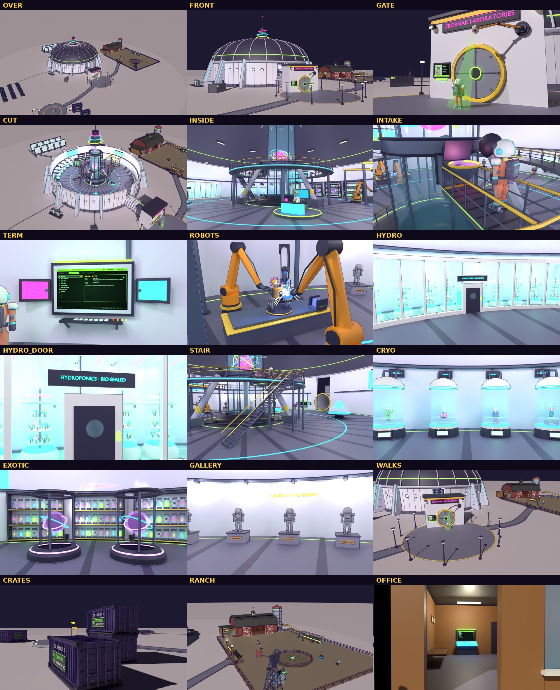

This is the draft picked from the first two proposals: **the Rotunda, with Zbornak "the Elder" and the LABNET terminal**, revised
from the review. Proposal B (the Institute, Zbornak "the Singed", the SPECIMEN INDEX) is dropped.

Everything is modelled in Blender from code (`tools/blender/build_zbornak_lab.py`, `zbornak_kit.py`, `zbornak_figure.py`) and
rendered with Cycles and Freestyle (`tools/blender/preview_zbornak_lab.py`). **Nothing is in the game yet;** "Building it" below is
what that takes. The chimeras in the pods, on the bench and in the corral are the game's own (`makeChimera`, exported for the
renders). The courier and the gallery's stone couriers are `runner.glb`.

| | Today | The Rotunda |
|---|---|---|
| Main lab | 44 × 32 m box, 16 m tall | round, 64 m across; ribbed dome 27 m; the reactor's crown of rings 44 m up through an oculus |
| Airlock | a doorway | ribbed tunnel (14 m) to a lock housing, round pressure door, ZBORNAK LABORATORIES over it |
| Security | none | camera on a round wall mount and a two-link arm, a scan cone onto the stand plate, the photo on a screen beside the door |
| Lab terminal | none | LABNET, on the wall right of the door as you come in |
| Ranch | gravel yard, one trough, kiosk at the gate | gambrel barn, pen office on its end (the pen terminal indoors), corral, silo feeding a roofed feed bunk |
| Plateau | barrels, gas rack, generator | plaza, paved walks to the supply pad and the ranch, Zbornak containers, radiator field, solar array |

| Today, from the air | Today, inside |
|---|---|
| 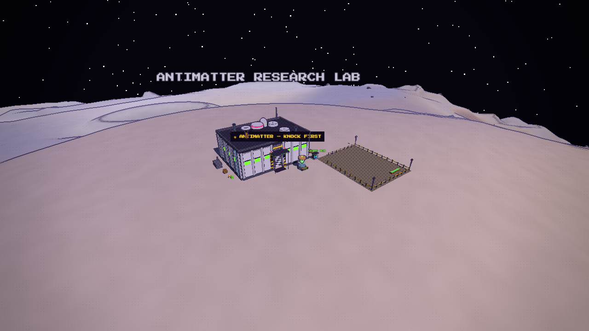 | 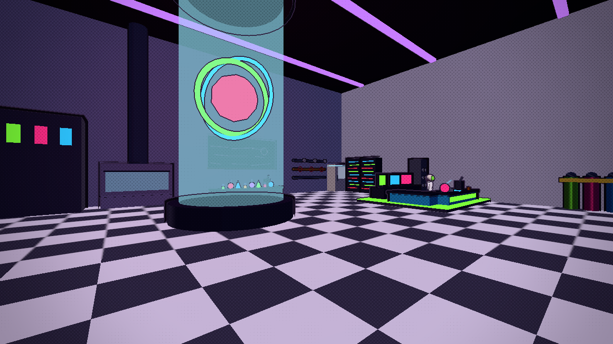 |

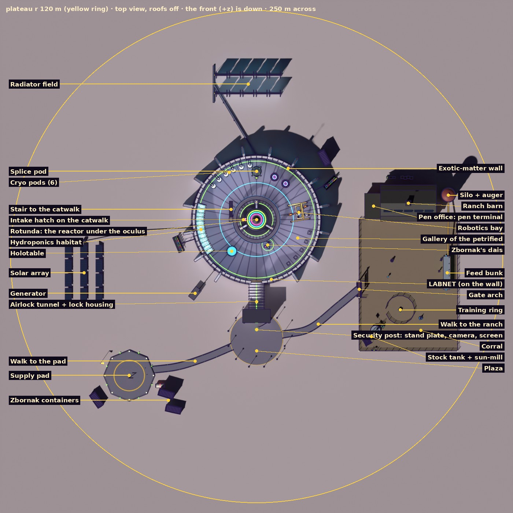

## The last revision

| Asked | Done |
|---|---|
| The hydroponics sign is far too big for its board | The lettering is about half its old height and fits inside the board over the habitat's door. |
| The hydroponics habitat: half as far out from the wall | Its glass front now stands 4.5 m from the wall (it was 9 m). Inside is one row of ten growth pods with a lane behind the door, the nutrient header along the wall and the nutrient tank behind the door. |
| The stair to the catwalk stands right in front of the habitat's door | The stair now runs along the outside of the catwalk ring, rising toward the front to a railed landing on the west side, straight across from the intake bridge. Its foot is toward the back, so the floor before the habitat's door is clear. |
| The robot arms: realistic, working together | The arms now work one cell (shown below). Each tool point moves in straight, eased lines between keyed spots, and the joints are solved for it (inverse kinematics), as a real robot's are. The plate arm's wrist turns about the tool's axis (a new `roll` joint) to keep the plate square to the chimera. The four loose blocks on the bench are now a **plate carrier**: a tray with slotted end frames holding the armour plates on edge. |

**The robot cell's work cycle,** one loop (`CELL_KEYS` in `build_zbornak_lab.py`):

1. The left arm swings in and clamps the chimera on its jig.
2. The right arm lifts an armour plate out of the carrier, swings it over and holds it flat on the chimera's flank.
3. The welder comes in and runs a bead up the plate's seam, lit blue and throwing sparks while it welds and dark the rest of the
   time.
4. The right arm lets go and goes back for the next plate. The plate stays on, its bead still glowing.
5. The left arm lets go.

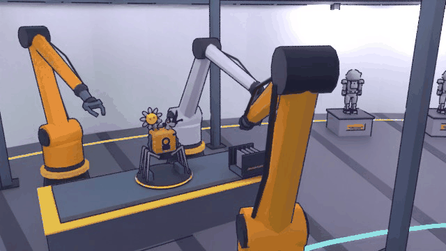

| | |
|---|---|
| 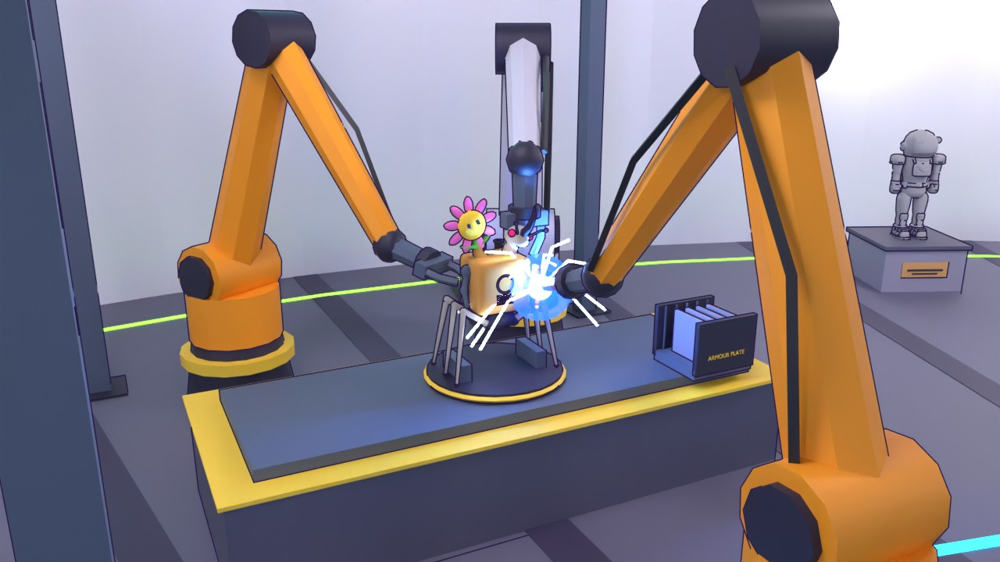 | 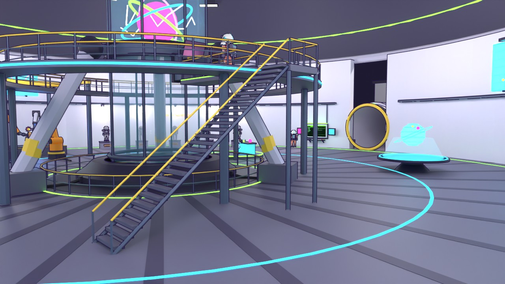 |
| 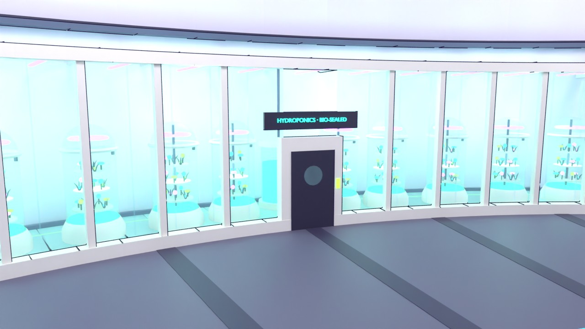 | 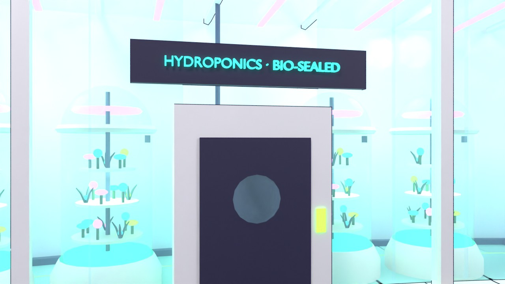 |

## The first review

| Asked | Done |
|---|---|
| The robot arms move; the welder glows an intense blue | Each arm is a chain of pivots the game turns: `turret` (yaw), `shoulder`, `elbow`, `wrist` (pitch, each on its own joint) and `roll` (the tool flange). They work a cell together (the last revision, above). The welder's tip burns blue-white inside two deep-blue halos, lights the bench blue (a 3 kW blue light at the tip) and throws a fan of sparks; halo, light and sparks flicker. |
| An intake hatch on the raised scaffolding, for throwing things in | A railed bridge runs from the catwalk's inner edge to the reactor, straight on from the top of the stair. It ends at a hopper with its lid swung up, over a chute into a port housing clamped on the glass (INTAKE, the reactor's pink glow in the throat). |
| Wires that make sense: the cryo pods' lines, the struts to the reactor; a pass over all the small things | The rule now: every pipe and cable ends in a socket, a junction box, a flange or the **cable tray** that runs round the wall at 6.2 m. Details in the table below. |
| LABNET wall-mounted, right of the door as you come in | On the wall 14° right of the door: main screen in a frame, two side screens angled in, a keyboard shelf on brackets, status lamps, a conduit into the tray, a stand-here mark on the floor. |
| The vault door leads nowhere: rework or axe it | Axed. The exotic-matter corner is now one wall of canister racks (three 6.4 m racks) with the two magnetic cages before it, each cabled to the wall. The space the old console left by the door is now the **gallery of the petrified**: five plinths with brass plaques and a spotlight each, a stone courier on each (`alchemy.js` already puts petrified people "in the lab's gallery"). |
| Outside: the camera clear of the door, the post beside the door gone, the camera's strut on its mount, a round mount | The mount is a round plate (bolted ring, hub) up and to the right of the door's frame. The arm leaves the hub and reaches out over the plate, above and in front of the door, clear of the frame. The intercom post is gone. |
| No sign on top; just "Zbornak Laboratories"; the green fluid pod gone | The roof sign and the specimen jar are gone. One board over the door reads ZBORNAK LABORATORIES. |
| Clean paths: no lights through the walk, not jagged, no black plates at the bends, joined to the platforms | Each walk is one smooth ribbon (a spline through its points) with a raised kerb on each side, and flush lit studs set into the kerb tops. It starts inside the plaza's edge and ends on the ranch gate's cattle grid, or on a ramp up onto the pad's deck. The old walks were boxes overlapping at each bend: the black plates. |
| Hydroponics more sci-fi: growth pods in a sealed habitat | A sealed glass habitat against the wall: a curved glazed front on a white kerb with mullions, a glass canopy on ribs, glass end walls and an airlock hatch (HYDROPONICS · BIO-SEALED). Inside are ten **growth pods** on a nutrient header. Each pod is a pedestal with a nutrient bath, a glass capsule with a domed top, three tiers of glowing plants round a stem, a grow-light ring and a mister. Violet grow strips run under the canopy. The last revision made it shallower (one row of pods). |
| Storage crates like Meridian's, with Zbornak branding (and a CLAUDE.md rule) | `zb_container` builds the standard cargo box (`cargo.py`, as stacked in Meridian's yard) in a Zbornak livery: violet body; a plate on each flank with a lime Z roundel, ZBORNAK over LABORATORIES; numbers ZBL 000417 on. Stacks stand by the pad and by the east gas rack. CLAUDE.md now says every place's storage crates are this container in the owner's livery. |

**The connections pass:**

| Part | Now |
|---|---|
| Reactor pylons | Each mast ends in an emitter head bolted by a bracket to a steel collar clamped round the glass column, below the core, with the emitter's lens on the collar. Before, the heads hung 1.5 m off the glass. |
| Reactor cables | From each pylon's footing along the floor into a socket on the plinth. |
| Cryo pods | Two coolant lines from each crown, up and back into a junction box on the wall, and from there up into the cable tray. Before, the lines stopped in the air. |
| Ceiling lamps | Each hangs on two rods from the dome. Before, they floated a metre under it. |
| Hanging vines | Gone with the old racks. They started in mid-air under the dome. |
| Wall projections | On brackets from the wall, with an emitter bar along each top. |
| Splice pod | Its four hoses end in floor sockets. |
| Zbornak's dais | The monitor stands on a post on the dais. Before, it floated. |
| Magnetic cages | A feed cable from each plinth to a wall socket. |
| LABNET and the canister racks | Conduits into the tray. |
| Robot arms | Cables along every link, from joint to joint. Each pedestal has a junction box and a floor cable. The gantry's legs stand on base plates. |
| Silo | The auger chute meets the feed bunk's auger at an elbow. Before, it missed by about a metre. |
| Barn lanterns | Hang on chains from the loft floor. |
| Office lamp | On a bracket. |
| Gas racks | Pipes on stands into wall flanges. |
| Generator and solar array | Ground conduits on blocks to junction boxes at the wall. |
| Radiator field | Its header ends in a flange on the rotunda's back wall. |

## The Rotunda

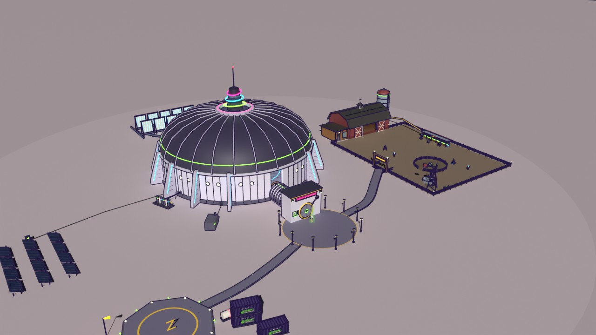
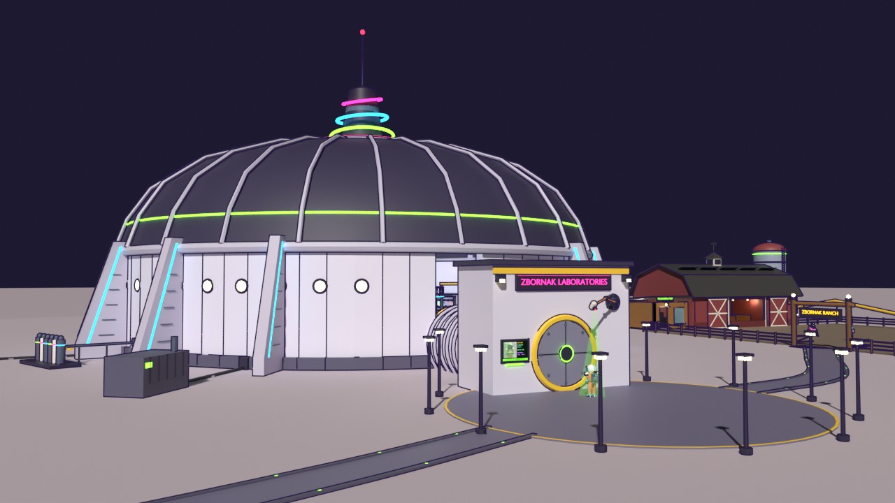

**Airlock and security.** A ribbed tunnel runs out from the dome, like the hab domes' airlocks, to a lock housing with a round
pressure door in a hazard ring under the ZBORNAK LABORATORIES board. You stand on the painted plate with the two lit footprints.
The camera, on its arm off the round mount, casts its scan cone down and takes your picture, and the screen beside the door shows
it: *VISITOR · COURIER #0417 · MATCH 99% · ZBORNAK: "OH. YOU." · ACCESS GRANTED*. Then the door opens.

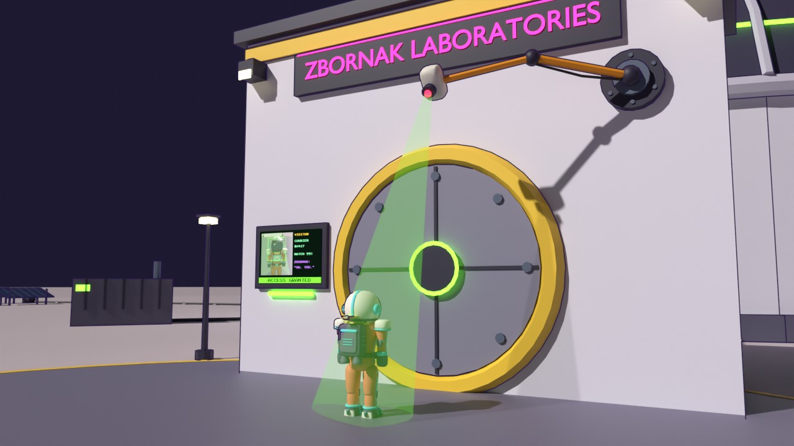

**Inside** (the dome lifted off), round the reactor clockwise from the door:

| Spot | What is there |
|---|---|
| Right of the door | **LABNET** on the wall, then **Zbornak's dais** facing the door |
| Front right | the **gallery of the petrified**: five stone couriers on plinths |
| Right | the **robotics bay**: a junk-bot chimera on a jig, being armoured: a clamping arm, a plate arm and the **welder**, a plate carrier on the bench, an overhead gantry |
| Back right | **exotic matter**: a wall of canister racks (void beads, crystals, plasma) and two magnetic cages with a floating black sphere in each |
| Back | the **splice pod** under a 13 m projection of a double helix |
| Back left | six **cryo-stasis pods** in an arc, a chimera asleep in each |
| Left | the **hydroponics habitat**, 4.5 m deep against the wall |
| Front left | the **holotable**: the Moon as a hologram, a map projected on the wall |
| Middle | the **reactor**: plinth, glass column, a caged core in three rings, three pylons clamped to its collar, a pit railing. The ring catwalk 6.5 m up, the stair along it to a landing on the west and the bridge across from it to the **intake hatch** |

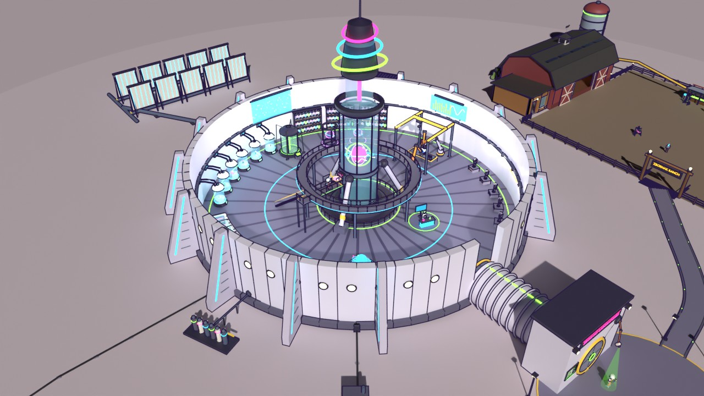
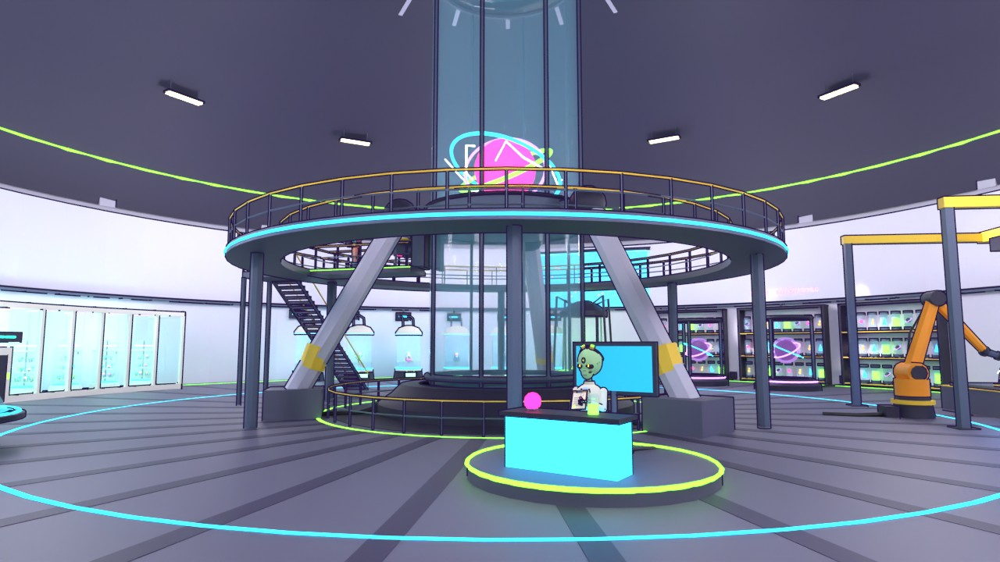

| | |
|---|---|
| 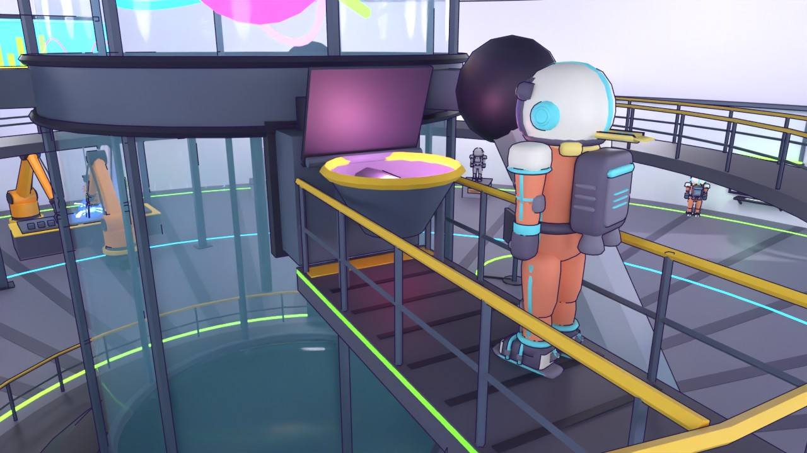 | 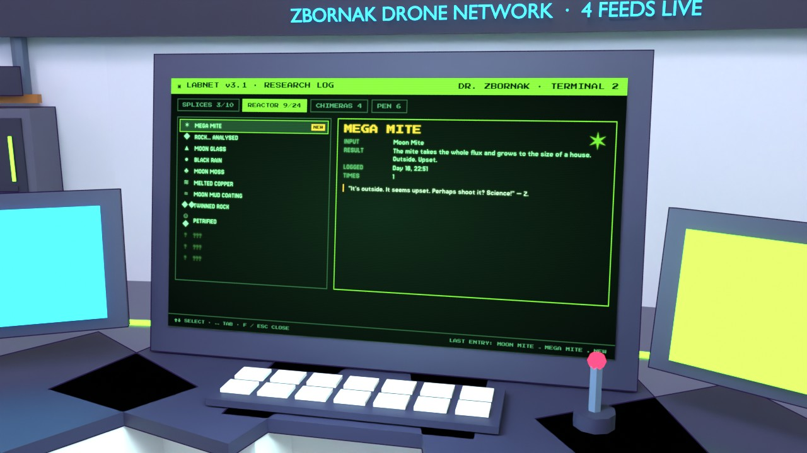 |
|  | 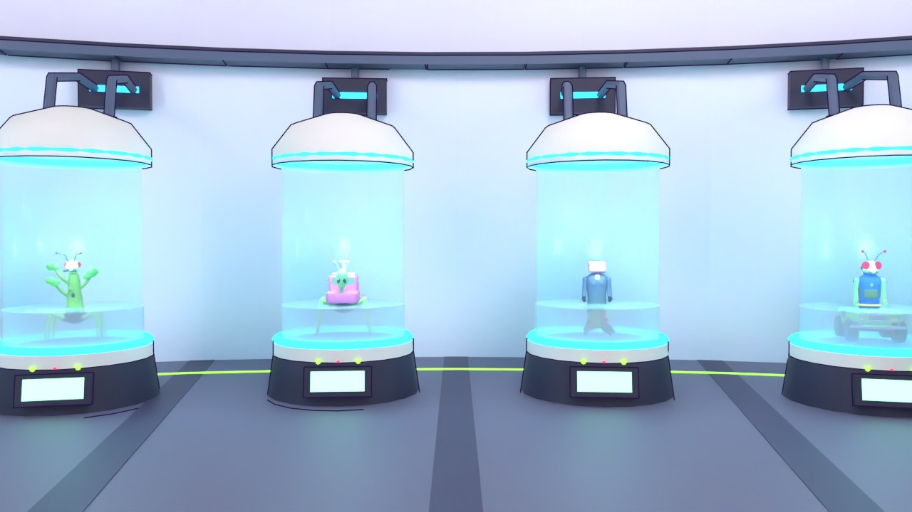 |
| 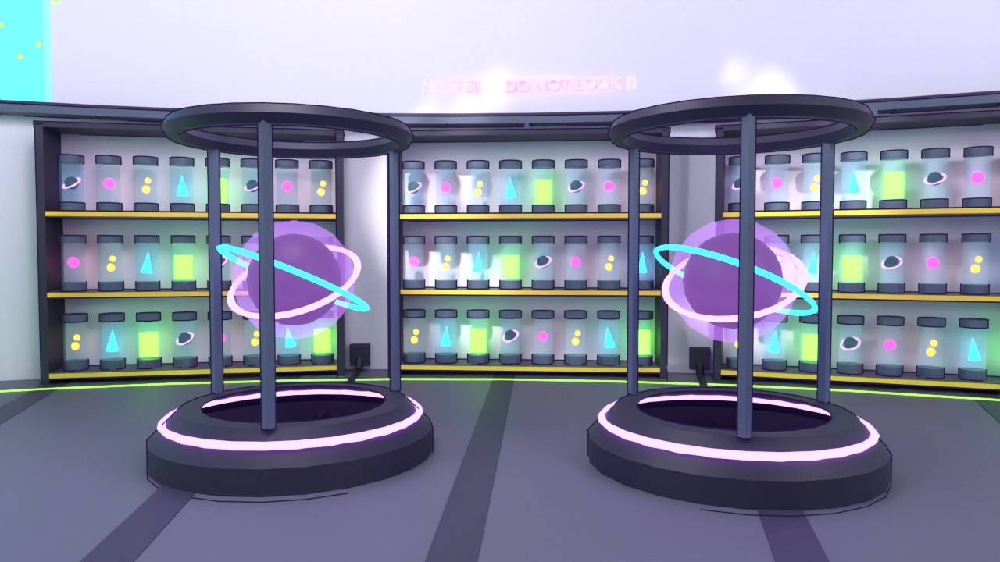 | 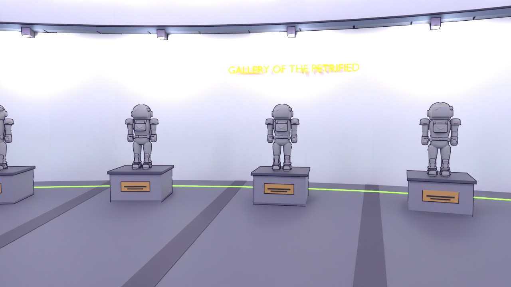 |
| 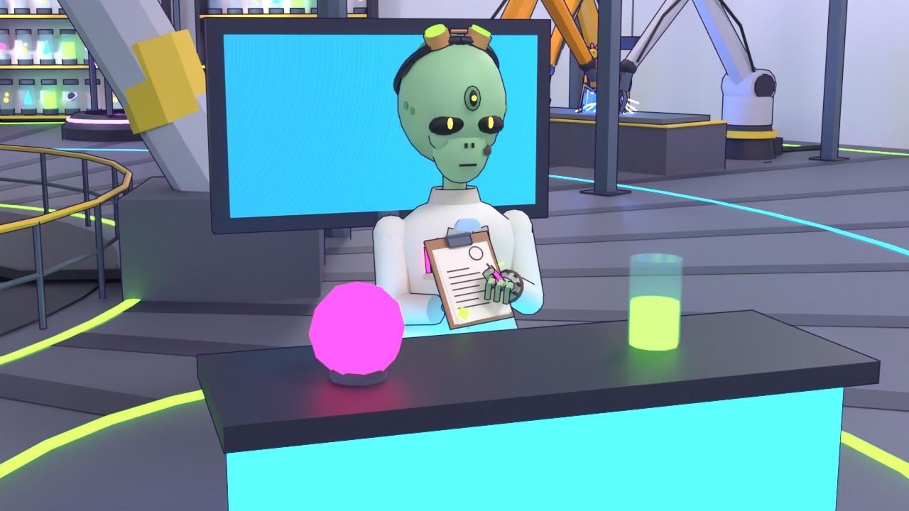 | |

**Outside:**
- **The walks:** from the plaza to the supply pad and to the ranch gate.

  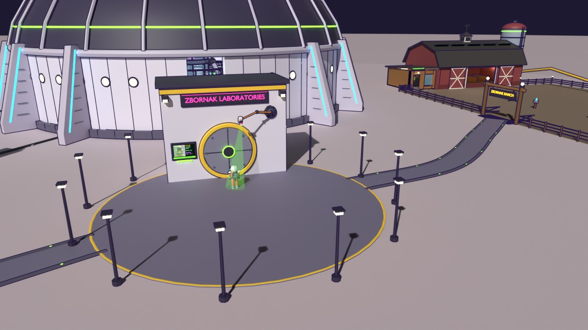
- **Zbornak containers:** stacks of them by the pad, and by the east gas rack.

  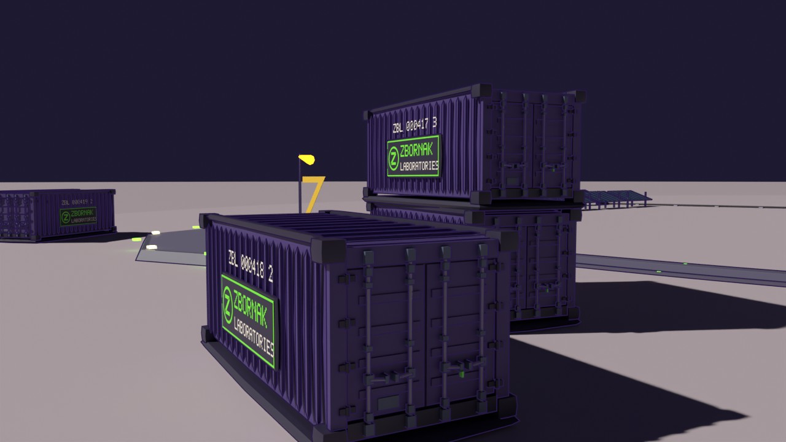
- **The radiator field:** behind the dome, piped to the reactor (its heat dump).
- **The solar array:** to the west, cabled in.
- **Gas racks and the generator,** each piped or cabled to the wall.

**The ranch** stands east of the lab, its office 26 m from the dome:
- **The barn:** a red gambrel barn with its sliding doors open on the corral, and stalls with lanterns.
- **The pen office:** on the barn's end, with the pen terminal inside under a HOLDING PEN board.
- **The feed line:** a silo feeds an auger into a roofed 15 m feed bunk of glowing feed, with lick blocks at the ends.
- **Water and the rest:** a stock tank filled by a sun-mill pump, a training ring and bales.
- **The gate:** the ZBORNAK RANCH arch with a cattle grid.

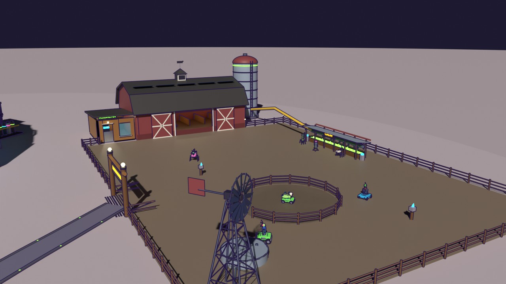
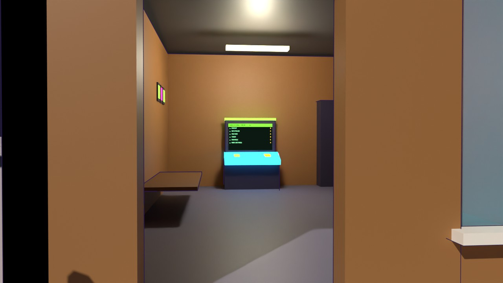

## Dr. Zbornak, "the Elder"

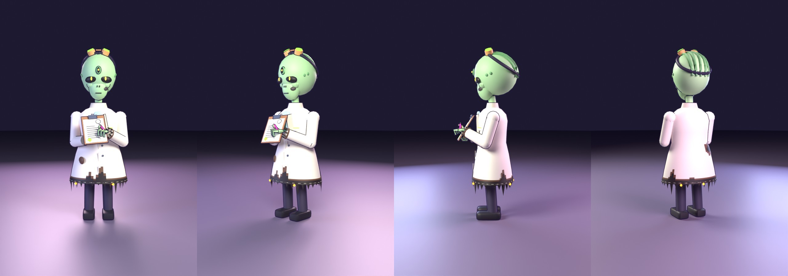
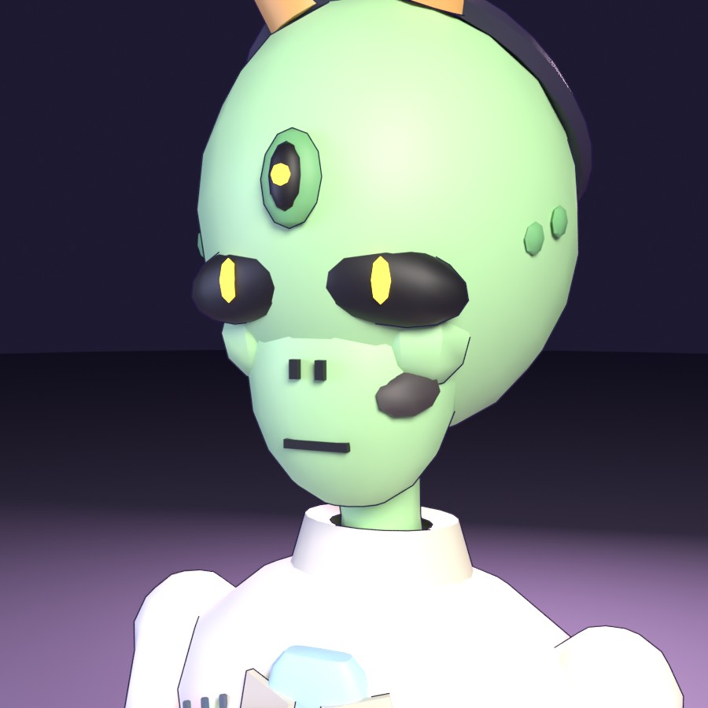

He is 2.35 m tall, thin and pale green, an alien with no helmet:
- **Head:** an egg of a cranium tipped back, with brain ridges over the crown; three eyes (two almond with lit amber slits, one on
  the brow); brass goggles pushed up on the cranium; soot on a cheek.
- **Coat:** knee length, burnt ragged at the hem with flame-licks of char up the skirt and a singed brown edge, embers still
  glowing in it, a singed right cuff, a burnt patch on the back and a hole by the pocket.
- **Underneath and on him:** shirt and tie, three pens in the breast pocket, a name badge.
- **In his hands:** a clipboard in the left arm, a pen in the right hand.

The head turns on a `head` pivot at the neck, like the casino's bouncer. He is 7.9k triangles before outlines, exported alone in
the game's GLB contract as [zbornak.glb](zbornak.glb).

## LABNET

Walk up to the wall unit and press F: the camera moves in to the screen. It is a green CRT log in the game's pixel faces, with
these tabs:
- **SPLICES:** each of the splice pod's ten mutations, with its source, effect, when it was spliced, whether it is active, your
  three mutation slots, and Zbornak's note.
- **REACTOR:** everything that can go in (single items, pairs, three of a kind, three different), with the input, the result,
  when it was first logged and how many times.
- **CHIMERAS** and **PEN.**

Locked entries show `???`. After every splice, feed or hatch the new entry is marked NEW and named on the bottom line. The entries
are the game's own (`MUTATIONS`, `ITEMS` and the reactor's results in `src/alchemy.js`); the save shown is made up.

| SPLICES | REACTOR |
|---|---|
| 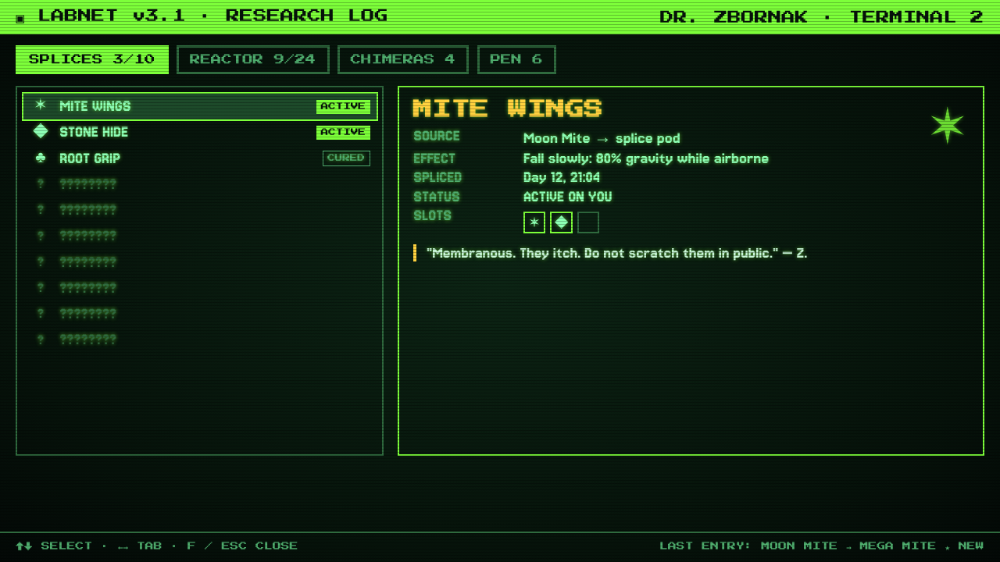 |  |

## Building it

- **Models:** the builder makes one scene. For the game it splits into the place's parts as the Downs' do: shell, airlock,
  interior stations, ranch buildings, kit pieces. Each part would be a `parts(..., solid=True)` build with its own colliders
  (`docs/collision.md`): roofs collide at their drawn top, floors use `k.floorCols`, and the catwalk, the stair and the bridge are
  walkable. The containers are the game's own `cargoStack`, with a Zbornak livery added to the cargo box's liveries.
- **Moving parts:** the game plays the robot cell's cycle: `CELL_KEYS` per arm, the joints solved by `arm_ik` each frame and the
  plate shown in the carrier, the gripper or welded on. It also turns the reactor's rings, the welder's flicker and the sun-mill.
- **The intake hatch:** this is where X feeds the reactor (today it is anywhere within 11 m of it). The hopper's throat flashes on
  a feed.
- **The airlock:** standing on the plate starts the sequence. The arm swings out, the scan cone sweeps, and the screen shows the
  courier as they are (a render-to-texture from the camera's spot, held as a still). A beat later comes Zbornak's line and ACCESS
  GRANTED, then the door opens and closes behind you.
- **LABNET:** a prompt and a close-up camera like the casino's seated games. It needs a small log of firsts (what was fed and when,
  and the times) kept in the save.
- **The pen terminal** moves into the barn office, and `PEN` in `alchemy.js` moves to the corral, the residents gathering at the
  feed bunk.
- **Statues:** `statue()` in `alchemy.js` puts each new statue on the next free plinth.
- **Zbornak:** the figure replaces `makeFigure` in `buildLab`, his name tag and talk prompt move with the dais, and the head turns
  toward the player.
- **Cost:** the area is 178k triangles as built here, before outlines; the six containers are 35k of that, as `cargo.py`
  details them. In the game the containers come from `cargoStack`, and the rest is baked and merged like the Downs, with the far
  pieces (radiator field, solar array) culled with distance.

## Making the renders again

```bash
npx vite --port 5199 --host 127.0.0.1
```

```bash
node tools/zbornak-chimeras.mjs
```

```bash
MOONRUNNER_REPO=. python3 tools/blender/preview_zbornak_lab.py photo
```

```bash
node tools/zbornak-screens.mjs
```

```bash
MOONRUNNER_REPO=. python3 tools/blender/preview_zbornak_lab.py views
```

```bash
MOONRUNNER_REPO=. python3 tools/blender/preview_zbornak_lab.py anim
```

```bash
MOONRUNNER_REPO=. python3 tools/blender/preview_zbornak_lab.py plan
```

```bash
MOONRUNNER_REPO=. python3 tools/blender/preview_zbornak_lab.py zbornak
```

```bash
MOONRUNNER_REPO=. python3 tools/blender/preview_zbornak_lab.py sheet
```

In order: the dev server (in its own shell) serves the game for the chimera export and the fonts for the screens; the chimeras go
to `/tmp/zb-chimeras` (`ZB_CHIMERAS`); the security camera's snapshot comes before the screens, which paint it on the security
screen. A view takes about a minute on four cores at 1280 × 720 and 32 samples (`PREVIEW_W`, `PREVIEW_H`, `PREVIEW_SAMPLES`;
`PREVIEW_VIEWS=over,gate` renders some). `MOONRUNNER_REPO=. python3 tools/blender/build_zbornak_lab.py` builds the area and
exports Zbornak.
